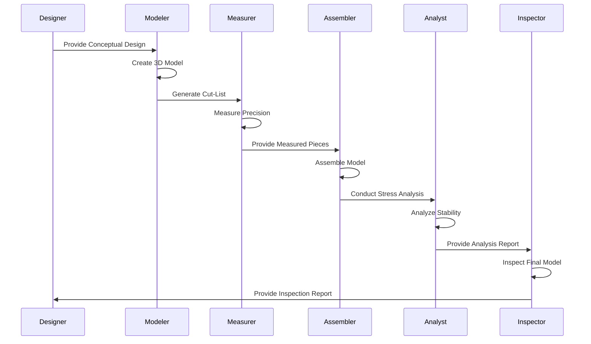

# Foundation: Microscale
## 1. Conceptual Mental Model (First principles, historical context, and fundamental paradigm shifts)

### First Principles
Microscale in the context of LEGO building refers to the detailed, precise construction of models at a very small scale, often requiring a deep understanding of the physical properties of LEGO bricks and the principles of structural engineering. The fundamental principle here is the ability to construct intricate, stable structures using the limited set of LEGO pieces, which necessitates a deep understanding of balance, stress distribution, and the mechanical properties of the bricks themselves.

### Historical Context
LEGO was founded in 1932 by Ole Kirk Christiansen in Denmark. The name LEGO is derived from the Danish words "leg godt," meaning "play well." The company began with wooden toys but shifted to plastic in the 1940s. The introduction of the iconic LEGO brick in 1958 marked a significant paradigm shift, as it allowed for the construction of complex, interlocking structures. Over the years, LEGO has evolved, with the introduction of specialized pieces that cater to microscale building, such as minifigures, microscale vehicles, and specialized connectors.

### Fundamental Paradigm Shifts
The shift from wooden toys to plastic bricks was a significant paradigm shift, as it introduced a standardized system that could be used to build a wide variety of structures. The introduction of microscale building pieces in the 1980s and 1990s further refined this system, allowing for the creation of highly detailed and intricate models. The digital age has also brought new tools and techniques for designing and building microscale LEGO models, such as 3D modeling software and online communities.

## 2. Essential Terminology & Taxonomy (Comprehensive architectural definitions)

### 1. **Microscale**
   - **Definition:** The construction of LEGO models at a very small scale, often requiring a high degree of precision and attention to detail. Microscale models are typically built to represent real-world objects in a highly detailed and accurate manner.
   - **System-Level Definition:** Microscale in LEGO building is a subset of the broader LEGO construction paradigm, characterized by the use of specialized pieces and techniques to create highly detailed and precise models.

### 2. **Stress Distribution**
   - **Definition:** The manner in which forces are distributed throughout a LEGO structure. Proper stress distribution is crucial for ensuring the stability and longevity of a microscale model.
   - **Mathematical Definition:** Stress distribution can be modeled using principles of statics and structural engineering, where the forces acting on a structure are analyzed to determine the internal stresses in each component.

### 3. **Balance**
   - **Definition:** The state of equilibrium in a LEGO structure, where the forces acting on the structure are evenly distributed, ensuring stability.
   - **System-Level Definition:** Balance in microscale LEGO building is achieved through careful placement of pieces and consideration of the center of gravity of the model.

### 4. **Tolerances**
   - **Definition:** The acceptable range of variation in the dimensions of LEGO pieces. Tolerances are critical in microscale building, as even small variations can affect the fit and stability of a model.
   - **Mathematical Definition:** Tolerances are typically specified in micrometers or thousandths of an inch and are used to ensure that LEGO pieces fit together precisely.

### 5. **Gear Ratios**
   - **Definition:** The relationship between the number of teeth on two or more gears in a LEGO mechanism. Gear ratios determine the speed and torque of the mechanism.
   - **System-Level Definition:** Gear ratios are critical in microscale LEGO building, as they allow for the creation of complex mechanical systems with precise control over speed and torque.

### 6. **Material Properties**
   - **Definition:** The physical characteristics of LEGO bricks, such as their strength, flexibility, and resistance to wear and tear. Material properties are critical in microscale building, as they affect the stability and longevity of a model.
   - **System-Level Definition:** Material properties are determined through testing and analysis of LEGO bricks, and are used to inform the design and construction of microscale models.

### 7. **Precision Measuring**
   - **Definition:** The process of measuring the dimensions of LEGO pieces with a high degree of accuracy. Precision measuring is critical in microscale building, as even small variations can affect the fit and stability of a model.
   - **System-Level Definition:** Precision measuring is achieved through the use of specialized tools, such as calipers and micrometers, and is used to ensure that LEGO pieces fit together precisely.

### 8. **Cut-List**
   - **Definition:** A detailed list of the LEGO pieces required to build a microscale model. A cut-list is typically generated using 3D modeling software and is used to ensure that all necessary pieces are available before construction begins.
   - **System-Level Definition:** A cut-list is a critical component of the microscale LEGO building process, as it ensures that the model can be built with the available pieces and that no pieces are wasted.

## 3. Architecture & Core Workflow (Detailed ASCII and Mermaid diagrams with step-by-step dataflow)

### ASCII Diagram
```
+-------------------+
|  Conceptual Design|
+-------------------+
          |
          v
+-------------------+
|  3D Modeling      |
+-------------------+
          |
          v
+-------------------+
|  Cut-List         |
+-------------------+
          |
          v
+-------------------+
|  Precision Measuring|
+-------------------+
          |
          v
+-------------------+
|  Assembly         |
+-------------------+
          |
          v
+-------------------+
|  Stress Analysis    |
+-------------------+
          |
          v
+-------------------+
|  Final Inspection |
+-------------------+
```

### Mermaid Sequence Diagram


## 4. Common Misconceptions & Mental Traps (Subtle edge cases and flawed mental models)

### Misconception 1: All LEGO Pieces Fit Perfectly
- **Flawed Mental Model:** Many builders assume that all LEGO pieces fit together perfectly, without considering the tolerances and variations in the dimensions of the pieces.
- **Correct Understanding:** LEGO pieces are designed to fit together with a small amount of tolerance, which allows for some variation in the fit. This tolerance is critical for ensuring that pieces fit together precisely and that the model is stable.

### Misconception 2: Stress Distribution is Not Important in Microscale Models
- **Flawed Mental Model:** Some builders believe that stress distribution is not important in microscale models, as they are typically small and lightweight.
- **Correct Understanding:** Stress distribution is critical in microscale models, as even small forces can cause significant stress in the pieces. Proper stress distribution ensures that the model is stable and can withstand the forces acting on it.

### Misconception 3: Precision Measuring is Not Necessary
- **Flawed Mental Model:** Some builders believe that precision measuring is not necessary in microscale models, as the pieces are small and the variations are not significant.
- **Correct Understanding:** Precision measuring is critical in microscale models, as even small variations in the dimensions of the pieces can affect the fit and stability of the model. Precision measuring ensures that the pieces fit together precisely and that the model is stable.

### Misconception 4: Gear Ratios Do Not Affect Microscale Models
- **Flawed Mental Model:** Some builders believe that gear ratios do not affect microscale models, as they are typically small and do not require complex mechanical systems.
- **Correct Understanding:** Gear ratios are critical in microscale models, as they allow for the creation of complex mechanical systems with precise control over speed and torque. Proper gear ratios ensure that the model functions as intended.

## 5. Socratic Discussion Starters (Advanced questions for deep Socratic exploration)

### Discussion Question 1
How does the concept of stress distribution in microscale LEGO building relate to the principles of structural engineering, and what are the implications for the stability and longevity of microscale models?

### Discussion Question 2
What are the advantages and disadvantages of using specialized microscale pieces in LEGO building, and how do they affect the precision and stability of the model?

### Discussion Question 3
How does the process of precision measuring in microscale LEGO building differ from traditional LEGO building, and what are the benefits and challenges of using precision measuring tools and techniques?
