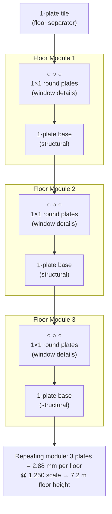

# Lesson 1: Scale Ratios, Primitive Vocabulary, Geometric Constraints

## 1. First-Principles Intuition & Invariants

Microscale construction represents one of the most intellectually demanding disciplines within advanced Lego building, requiring practitioners to compress architectural mass, structural detail, and recognizable form into assemblies measuring typically between 8 and 30 studs in any primary dimension. Unlike minifigure-scale construction, where a single stud approximates 10 centimeters of real-world space, microscale operates at ratios ranging from 1:200 down to 1:500 or beyond, demanding that builders abandon intuitive one-to-one mapping between physical elements and their represented forms. At these compression ratios, a single 1×1 plate no longer represents a brick or tile but must encode an entire window bay, a vehicle silhouette, or a structural column. The cognitive shift required is profound: the builder must learn to see through the part to the volumetric impression it creates when viewed at arm's length, training the eye to perceive aggregate shape rather than individual component geometry.

The fundamental invariant governing all microscale work is the preservation of recognizable proportion despite radical reduction in geometric fidelity. A microscale building must communicate its architectural lineage—whether Brutalist concrete, Art Deco setback towers, or Gothic Revival spires—through massing, silhouette, and carefully chosen textural elements rather than through direct replication of facade details. This constraint forces builders to develop a hierarchical understanding of architectural significance: which features define a structure's identity at distance, and which can be elided without loss of recognition. A cathedral, for instance, becomes defined by its cruciform plan, rose window placement, and flying buttress rhythm rather than by individual stone courses or tracery patterns. The builder's task is not miniaturization but abstraction, selecting the minimal set of geometric cues that trigger accurate mental reconstruction in the viewer.

Scale ratio selection directly determines both the parts palette available and the structural strategies viable. At 1:200, a standard doorway spanning 2 meters corresponds to a single stud width, while at 1:500 the same aperture compresses to two-fifths of a stud, effectively forcing the builder to represent it through color contrast or negative space rather than literal void geometry. This mathematical relationship between real-world dimension and stud grid imposes hard limits on representable detail. The Lego stud measures 8 millimeters on center with 7.8-millimeter pitch, meaning that at 1:200 each stud represents 1.6 meters of real space, while at 1:500 each stud encodes 4 meters. These ratios are not arbitrary but emerge from practical buildability: tighter ratios render most architectural features sub-stud scale and unrepresentable, while looser ratios inflate models beyond the "read as microscale" threshold where the eye begins parsing individual parts rather than holistic form.

Vertical compression introduces additional complexity because Lego's geometry is fundamentally anisotropic. A standard brick exhibits a 6:5 aspect ratio between horizontal stud spacing and vertical plate height—three plates stack to 9.6 millimeters while two studs span 16 millimeters—creating systematic vertical compression in naively constructed models. Builders must compensate through deliberate vertical exaggeration or selective use of tile-and-plate stacking to achieve perceptually correct proportions. A ten-story office tower at 1:250 scale, assuming 4-meter floor-to-floor heights, should rise 16 studs vertically (40 meters ÷ 2.5 meters per stud ≈ 16), but if built with standard brick courses this height will appear compressed due to the 6:5 ratio distortion. Skilled practitioners counteract this through hybrid techniques: using 1×1 round plates as floor separators, introducing tile layers to increase vertical count without adding visual mass, or strategically placing modified bricks with studs on the side to break up perceived horizontal banding.

The parts vocabulary for microscale diverges radically from standard building techniques. Elements prized in minifigure-scale work for their connectivity and structural robustness—2×4 bricks, Technic pins, large plates—become oversized and texturally inappropriate. Instead, the microscale palette privileges small-footprint parts with subtle surface variation: 1×1 plates and tiles for window patterns, 1×1 cheese slopes for angled rooflines, 1×2 grilles for textured facades, modified 1×1 plates with clips for irregular geometries, and jumper plates for half-stud offset detailing. This vocabulary prioritizes visual texture over structural integrity, accepting that microscale models are inherently fragile display pieces rather than play-tested toys. A single-stud-wide tower may rely entirely on friction between stacked 1×1 elements, with no traditional interlocking brick structure whatsoever—a design approach that would be unacceptable in larger scales but becomes necessary when geometric fidelity demands maximal surface articulation within minimal volume.

Color theory operates under different constraints at microscale. While minifigure-scale builders can afford polychromatic facades with fine color gradations, microscale compression means that individual colored parts become significant visual features rather than texture. A 1×1 red tile on a tan building facade doesn't read as a single window but as a prominent colored accent, potentially representing an entire row of terracotta ornamentation or a colored glass feature. Consequently, microscale builders develop restrained color palettes, often limiting schemes to two or three primary colors plus one accent, relying on monochromatic texture variation—light gray, dark gray, black—to suggest depth and material change rather than literal color shifts. This discipline mirrors architectural rendering techniques where value contrast conveys form more effectively than chromatic variety.

## 2. Core Architecture & Mechanics

The geometric foundation of microscale construction rests on the stud grid as an absolute coordinate system, with all design decisions constrained by this 8-millimeter lattice. Unlike larger scales where builders can afford to place elements intuitively and refine through iteration, microscale demands that practitioners plan dimensions with millimeter precision before physical assembly, often sketching stud-grid overlays on reference photographs or architectural elevations to determine which features land on stud boundaries and which require SNOT (Studs Not On Top) techniques or half-stud offsets to represent accurately. The stud grid imposes a fundamental quantization on design: curves become stairstepped approximations, diagonal lines emerge from strategic corner placement, and radial symmetry requires careful calculation to ensure equidistant feature placement around a central axis.

```text
Stud Grid Coordinate System (Top View):
┌─────┬─────┬─────┬─────┬─────┐
│ 0,4 │ 1,4 │ 2,4 │ 3,4 │ 4,4 │
├─────┼─────┼─────┼─────┼─────┤
│ 0,3 │ 1,3 │ 2,3 │ 3,3 │ 4,3 │
├─────┼─────┼─────┼─────┼─────┤
│ 0,2 │ 1,2 │ 2,2 │ 3,2 │ 4,2 │
├─────┼─────┼─────┼─────┼─────┤
│ 0,1 │ 1,1 │ 2,1 │ 3,1 │ 4,1 │
├─────┼─────┼─────┼─────┼─────┤
│ 0,0 │ 1,0 │ 2,0 │ 3,0 │ 4,0 │
└─────┴─────┴─────┴─────┴─────┘
Each cell = 8mm × 8mm
```

Horizontal compression strategies prioritize silhouette accuracy over internal structure. A microscale skyscraper measuring 12 studs wide must allocate those 96 millimeters (12 × 8mm) to communicate the building's massing hierarchy: perhaps 2 studs for setback corner towers, 8 studs for the central mass, and 2 studs for the opposite setback. Within each segment, texture must suggest fenestration patterns without literal window placement. This is achieved through strategic use of textured parts: a 1×2 grille tile placed vertically suggests a column of windows, a 1×1 tile in contrasting color implies a structural pier or material change, and a 1×1 cheese slope indicates a chamfered corner or angled surface. The builder constructs a visual grammar where repeated patterns—alternating tiles and plates, rhythmic color changes, stepped profiles—create the impression of detail density without requiring actual geometric representation of every architectural feature.

Vertical construction employs hybrid stacking techniques to achieve correct aspect ratios while maintaining structural coherence. The standard approach alternates plate layers with tile layers, using the tile's smooth surface to visually separate floors while plates provide connection points for outward-facing details. A typical floor assembly might consist of a 1-plate-height base layer carrying 1×1 round plates or cylinders at window positions, topped by a tile layer that caps these details and provides a clean separation plane, followed by another plate layer beginning the next floor's pattern. This three-layer system (plate-detail-tile) repeats vertically, with variations introduced through color changes, modified parts, or strategic omissions to suggest setbacks, parapets, or roof structures.



SNOT techniques become essential for representing non-orthogonal features. Brackets, headlight bricks, and modified plates with studs on the side allow builders to attach elements perpendicular to the primary build direction, enabling vertical stripes, sideways-mounted tiles for smooth facades, and angled details impossible within pure stud-top construction. However, each SNOT connection introduces structural fragility and dimensional offset that must be carefully managed. A headlight brick (1×1 brick with stud on side) offsets the attached element by 8 millimeters but raises it by 4.8 millimeters relative to the base plate, creating a half-plate vertical shift that must be compensated through subsequent layer adjustments. Builders develop mental libraries of these offset patterns, automatically calculating how bracket assemblies, clip connections, and inverted slopes interact to achieve desired geometries while maintaining grid alignment.

Curves and diagonals rely on strategic part selection and optical illusion. True curves are impossible on the stud grid, but effective curved impressions emerge from several techniques: staggered stud offsets using jumper plates to create half-stud lateral shifts; cheese slopes and angled plates arranged in radial patterns; and careful color gradation that guides the eye to perceive smooth transitions between stepped elements. A microscale dome, for instance, might use concentric rings of progressively smaller diameter, with each ring stepped inward by one stud and elevated by one plate, the resulting stairstepped profile reading as curved when viewed from a few feet away. Diagonal walls achieve believability through similar means: alternating plate and tile courses at staggered offsets, with corner elements—1×1 slopes, cheese slopes, angled tiles—softening the visual stairstepping effect.

Structural stability at microscale contradicts intuitive building principles. Traditional Lego construction emphasizes overlap—each brick should span at least two bricks below to distribute load and prevent shear failure. Microscale assemblies often violate this principle systematically, stacking single-stud-width elements vertically with no overlap whatsoever, relying purely on clutch power between studs and anti-studs. This fragility is accepted as inherent to the scale, but builders mitigate catastrophic failure through several strategies: incorporating occasional wider elements (1×2 or 2×2 plates) as internal bracing; using tile caps to lock upper layers and prevent lateral shifting; applying transparent 1×1 round plates as "glue" elements that add connection points without visible bulk; and designing models with broad base footprints that lower centers of gravity. A microscale cathedral might feature a 20×30 stud footprint but a central spire rising 40 studs, achievable only through a hollow interior construction where the spire's core is a tightly interlocked stack of 1×1 and 2×2 elements, with the visible exterior details cantilevered off this hidden armature.

The assembly sequence for microscale models inverts standard practice. Where typical Lego building proceeds from foundation upward in continuous layers, microscale construction often requires preassembly of fragile submodules—a textured facade panel, a detailed roofline section—that are later integrated into the main structure with minimal handling. This modular approach reduces the risk of damaging delicate single-stud connections during upper-level construction. A microscale skyscraper might be built as four separate corner towers, each preassembled to full height, which are then connected by fragile 1-plate-wide curtain wall sections in a final integration step. This sequence also facilitates iteration: facade panels can be rebuilt and refined without disturbing the core structure, allowing practitioners to experiment with texture patterns and color schemes non-destructively.

## 3. High-Performance Optimization & Failure Modes

Achieving visual density without geometric chaos requires disciplined parts selection and pattern repetition. Novice microscale builders often fall into the trap of introducing too much variation—every window a different part, every floor a different height, every corner a unique detail—resulting in visual noise that defeats the purpose of abstraction. Expert practice emphasizes rhythmic repetition: a single window pattern repeated across an entire facade, a consistent floor height maintained throughout the structure, and variation introduced only at structurally significant boundaries such as setbacks, cornices, or base/capital transitions. This discipline mirrors real architectural practice where modular curtain wall systems and repeated floor plans create legible urban forms. A microscale Manhattan streetscape might employ identical 1×1-round-plate-and-tile window patterns across ten different buildings, differentiating structures solely through overall massing, height, and color palette.

Color contrast management becomes critical for readability at distance. Microscale models are typically viewed from 1 to 3 meters away, a distance at which subtle color variations merge into uniform tone. Builders must therefore exaggerate contrasts: where a real building might feature cream limestone walls with tan terracotta accents, the microscale version requires white walls with medium dark flesh (reddish-brown) accents to achieve equivalent visual separation. Similarly, fenestration patterns demand high contrast—trans-black or trans-clear tiles against light gray walls, dark gray grilles on white backgrounds—to remain readable. The human visual system's sensitivity to luminance contrast far exceeds its sensitivity to hue differences, so value contrast (light vs. dark) should be prioritized over chromatic contrast (red vs. blue) when establishing hierarchical visual relationships.

Texture density must be calibrated to viewing distance and model scale. Excessive texture—attempting to represent every architectural detail at the part level—creates surfaces that appear busy or noisy rather than detailed. The optimal strategy employs textural hierarchy: prominent features receive explicit geometric representation (corner towers as protruding masses, central arches as actual curved assemblies), secondary features are suggested through color or part variation (window bays as alternating tile colors, setbacks as single-plate height changes), and tertiary details are omitted entirely or implied through aggregate surface treatment (brick coursing as overall surface color choice rather than individual brick representation). This hierarchy ensures that viewer attention focuses on massing and primary form rather than being distracted by overly literal micro-details.

Structural failure modes in microscale construction typically manifest as three distinct phenomena: catastrophic shear collapse where vertical stacks separate laterally due to insufficient overlap; cantilevered element droop where unsupported overhangs sag under their own weight; and connection failure where clip or bracket assemblies detach under minimal handling stress. Shear collapse is mitigated by introducing hidden structural cores—a central shaft of interlocked 2×2 or 2×4 bricks within a hollow tower—that provide longitudinal stability independent of the fragile exterior detailing. Cantilevered droop requires careful mass distribution: long overhangs must use lightweight elements (tiles, thin plates) rather than heavy bricks, and should be supported by hidden bracket assemblies or inverted slopes that transfer load back to the core structure. Connection failures demand redundancy: any clip-based assembly should have at least two connection points, and critical structural joints should combine multiple connection types (stud-on-plate plus clip-and-bar, for instance) to prevent single-point failures.

Transport and display considerations impose additional design constraints often overlooked during initial construction. A microscale model that appears stable on the workbench may prove impossibly fragile when moved, requiring builders to design with modularity in mind: large models should separate into 12×12 or 16×16 stud sections that can be individually transported and reassembled on-site. This modular approach also facilitates storage and reduces the risk of catastrophic damage from accidental impacts. Display orientation matters critically—a model designed for tabletop viewing may appear distorted when placed on a high shelf, as the viewing angle changes the perceived proportions and hides carefully crafted ground-level details. Advanced practitioners build models with primary viewing angles in mind, sometimes deliberately exaggerating vertical features or angling walls to compensate for expected perspective effects.

Photography and documentation of microscale work requires specialized techniques because standard photography flattens depth and obscures the subtle texture variations that make microscale models effective. Optimal documentation employs moderate telephoto focal lengths (85-135mm equivalent) from 2-3 meters distance to compress perspective and emphasize silhouette, uses diffuse lighting to avoid harsh shadows that exaggerate surface irregularities, and applies narrow depth of field selectively to guide viewer attention toward primary features while softening background elements. These techniques replicate the viewing conditions under which microscale models are meant to be appreciated—from across a room, taking in the overall composition rather than scrutinizing individual parts.

The iterative refinement process for microscale builds follows a specific cadence: establish overall massing first with simple placeholder elements; verify proportions by photographing the work-in-progress from intended viewing distances; refine texture patterns on a single facade or section before replicating across the model; introduce color accents sparingly and verify their readability at distance; and perform final structural reinforcement once the visual design is locked. This sequence prevents premature optimization on details that may be discarded during proportion correction, and ensures that structural decisions don't constrain aesthetic possibilities. A facade texture that looks perfect when scrutinized at arm's length may vanish into visual noise when viewed from across the room, requiring replacement with a simpler, higher-contrast pattern—a change that's far easier to implement before the entire model is built out.

Parts inventory management for microscale work differs fundamentally from other building styles. Rather than maintaining large quantities of common bricks and plates, microscale practitioners accumulate deep stocks of specific small elements: hundreds of 1×1 plates in various colors, bulk quantities of cheese slopes and tiles, extensive collections of modified plates with clips and bars, and comprehensive inventories of textured parts like grilles, louvers, and printed tiles. This inventory reflects the statistical reality that a single microscale skyscraper might consume 200+ identical 1×1 round plates for window details but require only a few dozen standard bricks for structural support. Successful microscale builders develop sourcing strategies focused on bulk purchases of these high-consumption specialty parts, often through BrickLink orders or Pick-a-Brick wall harvesting, rather than acquiring generic part assortments designed for general building.
