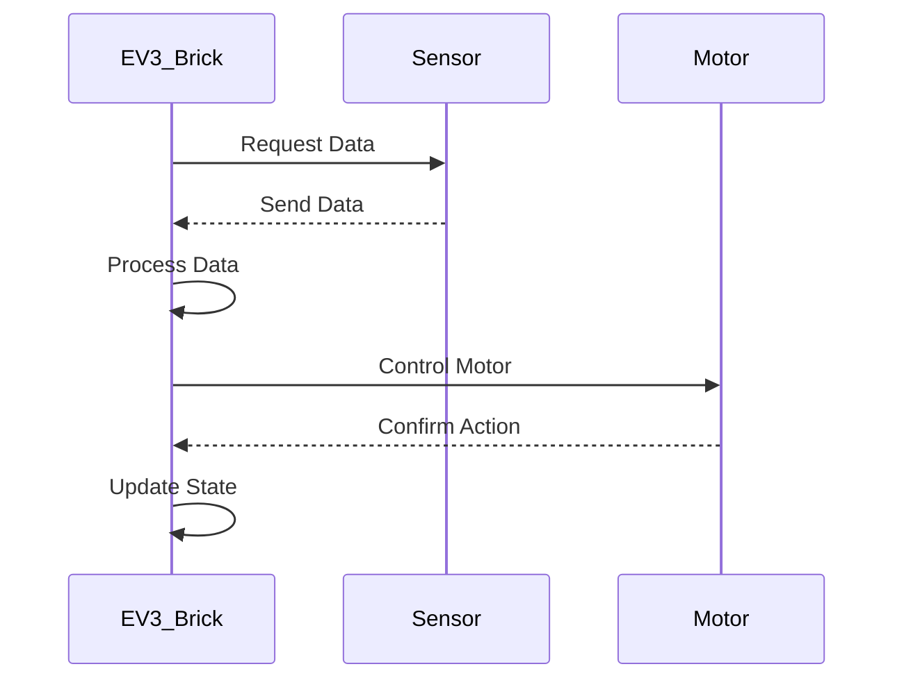

# Foundation: Mindstorms
## 1. Conceptual Mental Model (First principles, historical context, and fundamental paradigm shifts)

### First Principles
Mindstorms, introduced by LEGO in 1984, is a series of educational toys and software designed to engage children in the principles of robotics and computational thinking. At its core, Mindstorms embodies the integration of mechanical engineering, electrical engineering, and computer science. The fundamental principle is that through hands-on construction and programming, learners can develop a deep understanding of these disciplines.

### Historical Context
The concept of Mindstorms was inspired by Seymour Papert's book "Mindstorms: Children, Computers, and Powerful Ideas," which argued that computers could be used as a tool for learning and creativity. LEGO's implementation of this idea began with the LEGO TC Logo system in 1984, which used a simple programming language to control a basic robot. Over the years, the system evolved into the LEGO Mindstorms series, incorporating more advanced sensors, motors, and programmable bricks.

### Fundamental Paradigm Shifts
The introduction of Mindstorms shifted the paradigm from passive consumption of technology to active creation and experimentation. It encouraged learners to think critically about problem-solving, design, and innovation. The modular nature of LEGO components allowed for a wide range of creative possibilities, fostering a sense of ownership and accomplishment.

## 2. Essential Terminology & Taxonomy (Comprehensive architectural definitions)

### 1. **LEGO Technic**
   - **Definition:** LEGO Technic is a line of LEGO components designed for building complex mechanical systems. It includes gears, axles, beams, and other parts that enable the construction of intricate mechanisms.
   - **System-Level Definition:** Technic components are engineered to maintain precise tolerances, ensuring that mechanical systems operate smoothly and efficiently. The use of standardized parts allows for easy assembly and disassembly, facilitating iterative design and troubleshooting.

### 2. **LEGO Mindstorms EV3**
   - **Definition:** LEGO Mindstorms EV3 is a robotics platform that combines LEGO Technic components with a programmable brick (EV3 brick) and a suite of sensors.
   - **System-Level Definition:** The EV3 brick serves as the central processing unit, capable of executing programs written in various programming languages. It communicates with sensors and motors through digital ports, enabling real-time data collection and control.

### 3. **LEGO Mindstorms NXT**
   - **Definition:** LEGO Mindstorms NXT is the predecessor to EV3, featuring a programmable brick (NXT brick) and a set of sensors.
   - **System-Level Definition:** The NXT brick is a microcontroller that executes programs written in the NXT-G graphical programming language. It interfaces with sensors and motors through analog and digital ports, facilitating the development of autonomous robots.

### 4. **LEGO Mindstorms RCX**
   - **Definition:** LEGO Mindstorms RCX is the original version of the Mindstorms series, introduced in 1998.
   - **System-Level Definition:** The RCX brick is a microcontroller that executes programs written in the RCX programming language. It interfaces with sensors and motors through a single serial port, limiting the complexity of the robots that can be built.

### 5. **LEGO Mindstorms Education**
   - **Definition:** LEGO Mindstorms Education is a suite of educational resources designed to integrate Mindstorms into classroom settings.
   - **System-Level Definition:** The Education version includes curriculum materials, lesson plans, and assessment tools. It is designed to align with educational standards and promote collaborative learning.

### 6. **LEGO Mindstorms Software**
   - **Definition:** LEGO Mindstorms Software refers to the programming environments used to create and execute programs for the programmable bricks.
   - **System-Level Definition:** The software includes graphical programming languages (e.g., NXT-G, EV3-G) and text-based languages (e.g., LeJOS, RobotC). These languages provide a range of functions for controlling motors, reading sensor data, and implementing logic.

### 7. **LEGO Mindstorms Sensors**
   - **Definition:** LEGO Mindstorms Sensors are electronic devices that collect data from the environment and send it to the programmable brick.
   - **System-Level Definition:** Sensors include touch sensors, ultrasonic sensors, color sensors, and gyro sensors. They are designed to operate within specific voltage ranges and provide digital or analog outputs that can be processed by the programmable brick.

### 8. **LEGO Mindstorms Motors**
   - **Definition:** LEGO Mindstorms Motors are electric motors that convert electrical energy into mechanical energy, enabling the movement of LEGO robots.
   - **System-Level Definition:** Motors are designed to operate within specific voltage ranges and provide torque and speed control. They are interfaced with the programmable brick through digital ports, allowing for precise control of robot motion.

## 3. Architecture & Core Workflow (Detailed ASCII and Mermaid diagrams with step-by-step dataflow)

### ASCII Diagram of LEGO Mindstorms EV3 Architecture

```
+-------------------+       +-------------------+       +-------------------+
|    EV3 Brick      |       |      Sensors      |       |      Motors       |
|  (Programmable)   |       |  (Touch, Color,  |       |  (Large, Medium)  |
|  (Microcontroller)|       |   Ultrasonic,    |       |  (Controlled by    |
|  (Digital Ports)  |       |    Gyro)         |       |   EV3 Brick)      |
+-------------------+       +-------------------+       +-------------------+
          |                           |                           |
          |                           |                           |
          |                           |                           |
          v                           v                           v
+-------------------+       +-------------------+       +-------------------+
|  Data Collection  |       |  Data Processing  |       |  Motor Control    |
|  (Sensors)        |       |  (Program Logic)  |       |  (Program Logic)  |
+-------------------+       +-------------------+       +-------------------+
          |                           |                           |
          |                           |                           |
          |                           |                           |
          v                           v                           v
+-------------------+       +-------------------+       +-------------------+
|  Program Execution|       |  Program Execution|       |  Program Execution|
|  (EV3 Brick)      |       |  (EV3 Brick)      |       |  (EV3 Brick)      |
+-------------------+       +-------------------+       +-------------------+
```

### Mermaid Sequence Diagram of LEGO Mindstorms EV3 Workflow



## 4. Common Misconceptions & Mental Traps (Subtle edge cases and flawed mental models)

### Misconception 1: Mindstorms is Only for Children
- **Flawed Mental Model:** Many adults assume that Mindstorms is a toy solely for children, overlooking its potential for advanced learning and professional development.
- **Correct Understanding:** Mindstorms can be used by learners of all ages to explore complex concepts in robotics and computer science. Its modular design and programmable components make it suitable for both beginners and experts.

### Misconception 2: Programming is the Only Skill Developed
- **Flawed Mental Model:** Some practitioners believe that the primary skill developed through Mindstorms is programming, neglecting the importance of mechanical engineering and problem-solving.
- **Correct Understanding:** Mindstorms fosters a multidisciplinary approach to learning, integrating mechanical design, electrical engineering, and computational thinking. It encourages learners to think critically about the design and functionality of their robots.

### Misconception 3: All Robots Must Be Complex
- **Flawed Mental Model:** Beginners often feel pressure to create highly complex robots, leading to frustration and discouragement.
- **Correct Understanding:** Simple robots can be just as educational and rewarding as complex ones. Starting with basic projects allows learners to build foundational skills and gradually increase the complexity of their designs.

### Misconception 4: Sensors Are Only for Data Collection
- **Flawed Mental Model:** Some practitioners view sensors solely as data collection devices, failing to recognize their role in real-time decision-making.
- **Correct Understanding:** Sensors provide real-time feedback that can be used to implement autonomous behavior in robots. By integrating sensor data into program logic, learners can create robots that respond to their environment dynamically.

### Misconception 5: Programming Languages Are Interchangeable
- **Flawed Mental Model:** Practitioners may assume that all programming languages used with Mindstorms are interchangeable, leading to confusion and frustration.
- **Correct Understanding:** Different programming languages have unique features and capabilities. Choosing the right language depends on the complexity of the project and the learner's programming experience.

## 5. Socratic Discussion Starters (Advanced questions for deep Socratic exploration)

### Discussion Question 1
- **Question:** How does the modular nature of LEGO Technic components contribute to the development of problem-solving skills in learners? Can you provide examples of how learners can use this modularity to explore different design possibilities?

### Discussion Question 2
- **Question:** In what ways does the integration of sensors and motors in LEGO Mindstorms promote a multidisciplinary approach to learning? How can educators leverage this integration to create more engaging and comprehensive learning experiences?

### Discussion Question 3
- **Question:** How does the choice of programming language impact the complexity and functionality of LEGO Mindstorms projects? Can you discuss the advantages and disadvantages of using different programming languages in the context of Mindstorms?
