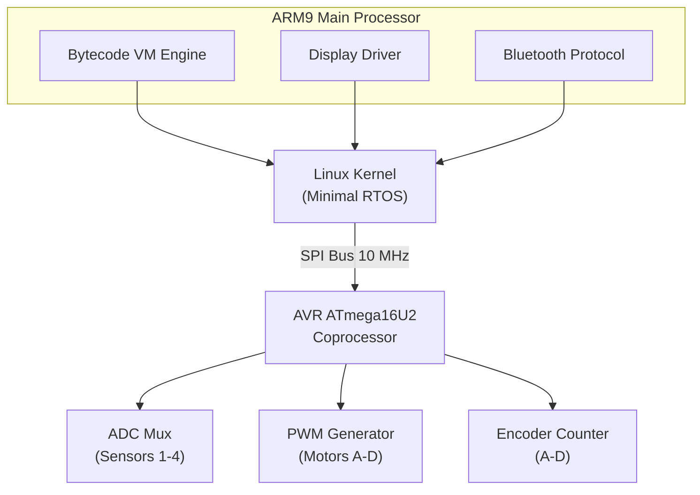

# Lesson 1: Foundational Architecture of Programmable Robotics

## 1. First-Principles Intuition & Invariants

The LEGO Mindstorms platform represents a carefully constrained computing ecosystem engineered for educational robotics, where hardware predictability and real-time sensor feedback take precedence over computational throughput. Unlike general-purpose computing platforms that optimize for parallelism and abstract resource management, the NXT and EV3 intelligent bricks operate under a deterministic execution model where sensor polling, motor control loops, and user program logic must coexist within strict timing guarantees measured in milliseconds. Understanding this architecture requires abandoning assumptions carried from desktop or server environments and embracing the embedded systems mindset: every clock cycle matters, memory is a precious commodity measured in kilobytes rather than gigabytes, and peripheral communication protocols must guarantee bounded latency.

At its foundation, the EV3 brick houses an ARM9 processor running at 300 MHz—a clock speed that seems glacial by modern standards but provides sufficient computational power when paired with a purpose-built firmware layer that eliminates unnecessary abstraction overhead. The processor interfaces directly with a dedicated AVR coprocessor responsible for all analog-to-digital conversion from sensors and pulse-width modulation generation for motor control, creating a hardware separation between critical real-time tasks and higher-level program execution. This dual-processor architecture ensures that even when user bytecode enters an infinite loop or encounters computational bottlenecks, motor control signals maintain their timing integrity and sensor readings continue to stream without corruption or dropped samples.

The memory hierarchy within the EV3 establishes the primary constraint governing program complexity and sophistication. With 64 MB of RAM and 16 MB of flash storage, developers must architect solutions that minimize dynamic allocation, reuse memory buffers across sensor reads, and avoid recursive algorithms that could exhaust the stack. The firmware reserves approximately 30 MB of RAM for the operating system kernel and device drivers, leaving user programs with roughly 34 MB of working memory—a budget that initially seems generous until one accounts for the bitmap framebuffer consuming display memory, audio sample buffers for sound playback, and Bluetooth protocol stacks maintaining wireless communication channels. Programs that attempt to store extensive logged sensor data or maintain large lookup tables quickly discover these limits, forcing a disciplined approach to data structure selection where circular buffers replace unbounded arrays and fixed-point arithmetic substitutes for floating-point operations to conserve both memory and CPU cycles.

The execution model for Mindstorms programs diverges fundamentally from the preemptive multitasking familiar in desktop operating systems. EV3 firmware implements a cooperative threading model where multiple program threads share processor time through explicit yield points rather than involuntary context switches triggered by timer interrupts. When a user program spawns parallel tasks to simultaneously read ultrasonic distance while controlling motor position, these tasks execute in a round-robin fashion, each advancing its instruction sequence until reaching a blocking operation like waiting for a sensor threshold or motor rotation target. This cooperative model eliminates the need for complex mutex locking or atomic operations but introduces the requirement that every program thread must periodically yield control—either implicitly through sensor read operations that poll hardware or explicitly through wait statements—to prevent starving other threads of execution time.

The port addressing schema and hardware abstraction layer provide the interface between user program logic and physical peripherals. The EV3 brick exposes four input ports labeled 1 through 4 for sensors and four output ports labeled A through D for motors, with each port capable of auto-detecting connected device types through a resistor-based identification protocol. When a touch sensor connects to Input Port 2, the AVR coprocessor measures voltage divider ratios on the port's analog lines to identify the sensor model, then configures the appropriate driver and begins streaming binary state data through a memory-mapped register accessible to user programs. Motor ports implement a more sophisticated protocol where the main processor transmits target position, velocity, and torque parameters to the AVR, which then executes closed-loop PID control at 1 kHz using encoder feedback to achieve precise motion profiles independent of load variations or battery voltage fluctuations.

The real-time operating principles governing sensor sampling and motor control establish the temporal invariants that define responsive robot behavior. Sensor drivers on the AVR coprocessor maintain dedicated sampling rates optimized for each device type: touch sensors poll at 1 kHz to capture momentary contact events, ultrasonic range finders transmit acoustic pulses at 10 Hz to measure distance while avoiding self-interference, and color sensors integrate reflected light intensity over 3 millisecond windows to distinguish between hues with acceptable noise rejection. User programs access these sensor streams through non-blocking read operations that return the most recently sampled value from a hardware buffer, guaranteeing that sensor queries complete in less than 100 microseconds regardless of the sensor's physical measurement cycle. This architecture ensures that control loops comparing sensor values against thresholds can iterate at frequencies exceeding 100 Hz, providing the rapid feedback necessary for line-following algorithms, obstacle avoidance reflexes, and precision manipulation tasks.

Motor control operates under complementary timing constraints where position and velocity commands specified by user programs translate into PWM waveforms updated at the motor driver's 1 kHz control frequency. When a program commands Motor A to rotate 720 degrees at 50% power, the firmware calculates the required angular velocity from the current position error, applies PID gains tuned for the motor's inertial characteristics, and generates a duty cycle that the AVR translates into high-frequency switching of the H-bridge transistors driving current through the motor windings. The closed-loop nature of this control means that external loads—such as a gripper arm encountering resistance while closing—automatically trigger compensatory increases in motor current to maintain the commanded velocity, up to the stall torque limit where the controller saturates and position error begins accumulating.

The data flow between hardware abstraction layers and user bytecode execution occurs through a message-passing architecture where sensor reads, motor commands, and display updates translate into discrete packets transferred between the ARM9 main processor and AVR coprocessor over a dedicated SPI bus running at 10 MHz. Each packet contains a command identifier, port address, and payload data, with the protocol enforcing strict size limits to bound transmission latency. A sensor read request consists of a 4-byte packet specifying the port number and read type, eliciting a 16-byte response containing the sensor's current value and metadata like measurement timestamp and validity flags. Motor control packets carry more complex payloads including target position, maximum velocity, acceleration ramp rate, and hold torque, allowing the AVR to execute smooth motion profiles without requiring continuous command streams from the main processor that would saturate bus bandwidth.

This architectural foundation establishes the essential invariants that govern all higher-level programming strategies on the Mindstorms platform. Programs must operate within the memory budget, respect the cooperative threading model by avoiding blocking operations in tight loops, and structure sensor-control loops to align with the hardware sampling rates and motor update frequencies. Violating these constraints produces characteristic failure modes: memory exhaustion crashes manifest as abrupt program termination mid-execution, thread starvation from missing yield points causes unresponsive interfaces where button presses go unacknowledged, and control loops executing slower than sensor sampling rates introduce aliasing artifacts where rapid sensor state changes appear invisible to the program logic.

## 2. Core Architecture & Mechanics

The internal organization of the EV3 intelligent brick separates concerns across three distinct processing domains that communicate through well-defined interfaces, each optimized for specific aspects of robotic control. At the apex sits the ARM9 processor executing the Linux-based EV3 firmware and user program bytecode, responsible for high-level decision logic, sensor data interpretation, and coordination of concurrent program threads. One layer below, the AVR ATmega16U2 coprocessor handles all time-critical analog interfacing, converting sensor voltages into digital readings and generating precise motor control PWM signals with microsecond-level jitter specifications. At the lowest level, discrete analog front-end circuitry implements voltage regulation, signal conditioning, and protection diodes that ensure sensor ports tolerate accidental short circuits and motor outputs survive stall conditions without releasing magic smoke.

The ARM9 processor connects to external SDRAM through a 16-bit data bus running at 133 MHz, providing the memory bandwidth necessary to support simultaneous display framebuffer updates, Bluetooth packet processing, and program execution. The firmware boots from internal flash into a minimal Linux kernel stripped of unnecessary subsystems like networking stacks and filesystem journaling, preserving boot time under 30 seconds while maintaining enough POSIX compatibility that user programs can leverage standard file I/O for datalogging and configuration management. The kernel reserves contiguous memory regions for DMA-capable buffers used in SPI communication with the AVR and allocates fixed-size heaps for the bytecode virtual machine, ensuring deterministic memory access patterns that avoid cache thrashing and maintain predictable instruction timing.

The sensor port architecture implements a unified analog interface capable of supporting the diverse signal types required by different sensor modalities. Each input port provides both 5V regulated power delivery and analog voltage measurement on six independent sensing lines, allowing complex sensors like the ultrasonic rangefinder to transmit trigger pulses while simultaneously measuring echo return timing. The port auto-detection mechanism exploits the fact that different sensor types present characteristic impedance signatures: a touch sensor appears as a simple switch to ground through a 1kΩ resistor, while a color sensor presents a complex impedance profile as its internal LED drivers switch through red, green, and blue illumination sequences. The AVR samples these impedance signatures during port initialization, consults an internal lookup table mapping resistance ratios to device types, and configures the appropriate driver firmware before any user program begins executing.

Touch sensors represent the simplest sensor interface, translating to a single digital bit representing contact state. The AVR polls the sensor input at 1 kHz by measuring voltage on the port's PIN1 line—when the touch button depresses, it shorts PIN1 to ground, pulling the voltage below a 1.5V threshold that the comparator recognizes as a logical zero. This binary value streams into a circular buffer where the ARM9 can access it through memory-mapped I/O without invoking kernel system calls, achieving sensor read latencies under 50 microseconds. The 1 kHz sampling rate ensures that even momentary taps lasting only 2-3 milliseconds get captured in at least two consecutive samples, allowing debounce algorithms in user programs to distinguish intentional presses from vibration-induced noise.

Ultrasonic distance sensors operate through a fundamentally different protocol involving precise timing of acoustic pulse propagation. When the AVR transmits a sensor read command, it asserts a trigger signal for 10 microseconds to initiate an ultrasonic burst, then measures the elapsed time until an echo pulse returns on a separate input line. The speed of sound in air (approximately 343 meters per second at 20°C) converts this time-of-flight measurement into distance through the relation $d = \frac{v \cdot t}{2}$, where the factor of two accounts for the round-trip path. The AVR performs this calculation using fixed-point arithmetic and stores the resulting distance in centimeters, achieving 1 cm resolution over the sensor's 3-255 cm measurement range. The 10 Hz update rate reflects the acoustic constraint that each ultrasonic pulse must fully dissipate before transmitting the next burst, preventing self-interference that would corrupt distance readings.

Color sensors introduce additional complexity by requiring active illumination and spectral filtering to distinguish reflected light intensity across red, green, and blue wavelengths. The sensor contains an RGB LED for illumination and a photodiode with an integrated analog-to-digital converter that measures reflected light intensity on a 0-1023 scale. The AVR cycles the sensor through illumination modes—red LED active, green LED active, blue LED active, all LEDs off—capturing photodiode readings in each state to build a four-element vector (R, G, B, ambient). User programs access this raw intensity data or invoke classification algorithms in firmware that map intensity vectors to discrete color labels like "red," "blue," "green," "yellow," "white," and "black" using Euclidean distance metrics in RGB space. The 3 millisecond integration time per color channel establishes the minimum 12 millisecond cycle time for a complete RGBW measurement sequence, translating to an effective sampling rate of approximately 80 Hz.

Motor output ports implement a sophisticated closed-loop control architecture where user programs specify desired motion profiles while the AVR handles real-time PID regulation to track those commands despite external disturbances. Each motor port connects to a pair of quadrature encoders embedded in the motor housing that generate pulse trains proportional to shaft rotation, providing 360 counts per revolution corresponding to 1-degree angular resolution. The AVR accumulates these encoder pulses using hardware counter peripherals that continue incrementing even during main processor interrupt servicing, ensuring zero loss of position information. When a user program commands rotation to a target angle, the firmware calculates position error as the difference between current encoder count and target count, multiplies this error by a proportional gain to determine base motor power, applies derivative damping to prevent overshoot as the target approaches, and saturates the output within the -100% to +100% power range before converting to PWM duty cycle.

The PWM generation hardware operates at 20 kHz carrier frequency, well above the mechanical response bandwidth of the motor and gearbox system, producing smooth torque delivery without audible switching artifacts. The H-bridge motor driver receives complementary PWM signals that alternatively connect the motor windings to positive and negative battery voltage, with dead-time insertion preventing shoot-through conditions where both high-side and low-side transistors conduct simultaneously. The motor driver implements current sensing through shunt resistors that allow the AVR to measure instantaneous motor current and detect stall conditions where current exceeds safe limits for more than 200 milliseconds. Upon detecting a stall, the firmware reduces PWM duty cycle to a safe holding level and sets a status flag accessible to user programs, allowing high-level control logic to recognize blocked motion and attempt alternative strategies.

The display subsystem provides a 178×128 pixel monochrome LCD with direct framebuffer access, where each pixel maps to a single bit in a 2.8 KB memory region. The ARM9 processor writes drawing commands—text strings, geometric shapes, bitmaps—by manipulating this framebuffer through a simple graphics library that rasterizes primitives into pixel arrays. The display controller refreshes the LCD at 60 Hz by scanning the framebuffer serially, transmitting each row of pixels to the display panel over a parallel data bus. This architecture allows user programs to update portions of the display independently, redrawing only changed regions rather than flushing the entire framebuffer, minimizing processor overhead for simple status displays that update a single numeric value while leaving surrounding graphics unchanged.

Button inputs on the brick's front panel connect directly to GPIO pins on the ARM9 processor, with hardware debouncing implemented through RC filters that smooth voltage transitions during mechanical contact bounce. The firmware polls these GPIO pins at 100 Hz, capturing press and release events into an input queue that user programs drain through non-blocking read operations. This polling rate ensures responsive tactile feedback where users perceive button presses as instantaneous while providing sufficient oversampling to reject contact bounce artifacts lasting less than 10 milliseconds.

Bluetooth communication operates through a dedicated radio module presenting a serial UART interface to the ARM9 processor, abstracting the complex RF protocol stack into simple byte-oriented transmit and receive operations. The firmware implements a message framing protocol where each transmitted packet begins with a length byte followed by command identifier and payload, allowing reliable reconstruction of message boundaries despite the connectionless nature of serial streams. User programs access Bluetooth through mailbox primitives that queue outgoing messages and poll for incoming messages without blocking program execution, enabling wireless sensor telemetry and remote control interfaces that run concurrently with local sensor processing and motor control loops.

The power supply architecture regulates the 6×AA battery pack's 9V nominal voltage down to multiple rails—5V for logic circuitry and sensors, 9V direct connection to motor drivers—through switching regulators that maintain efficiency above 85% across the full load range. Battery voltage monitoring occurs through an analog-to-digital converter channel that samples the unregulated battery voltage after a resistor divider, allowing firmware to estimate remaining capacity and display low-battery warnings before voltage sags affect motor performance. The power system includes overcurrent protection that trips if aggregate current draw exceeds 2A sustained, protecting the battery pack and motor drivers from damage during accidental short circuits or catastrophic gear failures.

## 3. High-Performance Optimization & Failure Modes

Achieving responsive robot behavior within the Mindstorms platform's resource constraints demands careful attention to program structure, sensor sampling strategies, and motor control loop tuning. The cooperative threading model imposes the primary optimization constraint: every program thread must execute its work quantum and yield control within a bounded time interval, typically targeting 10-20 millisecond slice durations to maintain overall system responsiveness. Threads that perform complex computations—such as image processing on color sensor data or pathfinding algorithms over obstacle maps—must partition their work into incremental stages that complete within the slice budget, storing intermediate results in persistent state variables and resuming from checkpoints across multiple invocations.

Sensor polling frequency optimization requires matching read rates to the physical phenomena being measured and the control loop's decision latency requirements. A line-following robot using dual color sensors to detect track boundaries benefits from sampling at 50-100 Hz to capture edge transitions while the robot travels at typical speeds of 20-30 cm/s, ensuring multiple sensor readings occur within the spatial extent of the line's width. Polling more frequently provides no additional information since the color sensor's own integration time limits updates to 80 Hz, while polling less frequently risks aliasing where the robot overshoots the line boundary between samples. The optimal strategy reads sensors at the beginning of each control loop iteration, uses those values to calculate motor commands, issues the motor updates, then yields control to allow other threads their execution slice before the next sensor read occurs naturally at the start of the subsequent iteration.

Motor control tuning for precise positioning and trajectory tracking centers on PID gain selection that balances response speed against overshoot and oscillation. The proportional gain determines how aggressively the motor reacts to position errors—high gains produce rapid convergence to the target angle but risk overshooting and triggering damped oscillations, while low gains yield sluggish approach profiles that fail to reject disturbances like uneven terrain or payload shifts. The derivative gain provides anticipatory damping by measuring the rate of error change, applying corrective torque that increases as the motor approaches the target to arrest momentum before overshoot occurs. The integral gain addresses steady-state errors from friction and gravitational loads by accumulating position error over time and applying additional torque proportional to this accumulated deficit, though excessive integral gain introduces windup artifacts where past errors continue influencing control action long after disturbances disappear.

A practical PID tuning workflow begins by disabling integral and derivative terms (setting their gains to zero), then incrementally increasing proportional gain until the motor exhibits slight overshoot—approximately 5-10% of the commanded rotation angle. This establishes the baseline proportional gain. Next, derivative gain increases until the overshoot disappears while maintaining rapid initial response. Finally, integral gain slowly increases until steady-state position error converges to zero under worst-case loading without introducing oscillatory instability. For typical Mindstorms motors and mechanical loads, effective gains cluster around P=1.5, I=0.1, D=0.8 in the firmware's normalized gain scale, though optimal values depend heavily on mechanical advantage ratios in gear trains and moment of inertia of attached linkages.

Memory management optimization techniques exploit the fixed-size allocation model to avoid fragmentation and guarantee predictable performance. User programs should pre-allocate all arrays and data structures during initialization rather than dynamically creating them during main loop execution, since dynamic allocation fragments the heap and introduces latency spikes when the memory manager must search for sufficiently large free blocks. Sensor data logging illustrates this principle: rather than appending sensor readings to a dynamically resizing array, pre-allocate a circular buffer with fixed capacity—say 1000 samples—and overwrite the oldest entries when the buffer fills. This approach bounds memory consumption and maintains constant-time insertion performance regardless of how long the program runs.

The bytecode virtual machine's execution model introduces instruction-level optimization opportunities through careful sequencing of operations to minimize temporary variable allocation. Compound sensor expressions like `(sensor1 + sensor2) / 2` execute more efficiently when restructured to reuse accumulator registers: reading sensor1 into the accumulator, adding sensor2 directly to that register, then dividing by two in place, produces fewer bytecode operations than allocating temporary variables for intermediate results. Modern block-based programming environments automatically apply these optimizations during compilation, but text-based programming interfaces benefit from explicit attention to operation ordering.

Bluetooth communication performance depends critically on message framing strategy and queue management. Transmitting individual sensor readings as separate messages introduces 8-10 bytes of framing overhead per message, overwhelming the radio link's 57600 baud rate (approximately 5.7 KB/s) when sensor updates exceed 100 Hz. Aggregating multiple sensor values into packed messages—for example, bundling four sensor readings with timestamps into a single 16-byte packet transmitted at 25 Hz—reduces framing overhead from 80% to 50% of transmitted bytes, effectively doubling useful data throughput. The mailbox system queues up to 16 messages before blocking on transmission, requiring user programs to monitor queue depth and throttle message generation when backlogs develop to prevent deadlocks where the sender stalls indefinitely waiting for queue space.

Battery voltage compensation maintains consistent robot behavior as battery charge depletes from fresh 1.5V alkaline cells to depleted 1.0V endpoints. Motor speed exhibits strong correlation with supply voltage since PWM duty cycle translates to average voltage applied to motor windings—50% duty cycle delivers 4.5V with fresh batteries but only 3.0V near end-of-life. Programs targeting velocity control rather than position control must scale commanded PWM duty cycle inversely with measured battery voltage to maintain constant speed: if the desired wheel velocity requires 50% power at 9V supply, increasing duty cycle to 67% compensates for voltage droop to 6V. The firmware exposes battery voltage through a dedicated system call returning millivolts, enabling this compensation through simple arithmetic: `adjusted_power = nominal_power * 9000 / battery_voltage_mv`.

Characteristic failure modes manifest when programs violate architectural constraints or encounter resource exhaustion. Memory overflow crashes terminate program execution abruptly without stack traces or error messages, requiring disciplined use of fixed-size buffers and avoiding unbounded data structure growth. Thread starvation produces intermittent lockups where portions of the program continue executing while others freeze—typically the display stops updating while motors continue running—indicating that a thread entered a tight loop without yielding. Inserting explicit `wait(1)` statements in computationally intensive loops restores responsiveness by forcing periodic yields even when no sensor reads or blocking operations naturally occur.

Sensor calibration drift introduces systematic errors when programs assume fixed thresholds for color detection or touch sensitivity without accounting for environmental variations. Color sensors measuring reflected light intensity shift readings by 20-30% between bright sunlight and indoor fluorescent lighting, requiring either auto-calibration routines that sample ambient conditions at program start or adaptive thresholds that track running statistics of sensor readings. Touch sensors accumulate contact resistance over thousands of actuations as carbon deposits build up on switch contacts, gradually shifting the voltage threshold between pressed and released states. Periodic recalibration where programs prompt users to press and release sensors, then learn the actual voltage boundaries, maintains detection accuracy over extended operation.

Motor synchronization for differential drive robots demands careful attention to encoder-based feedback rather than relying on open-loop power matching. Commanding equal power to left and right motors produces curved paths due to manufacturing variations in motor efficiency, gear mesh friction, and wheel diameter tolerances—typical variations produce 5-10% speed differences that accumulate into 15-degree heading errors over 1 meter of travel. Implementing a heading hold controller that compares left and right encoder deltas every control loop iteration, then applies corrective power adjustments to the faster motor, maintains straight-line trajectories within 2-degree accuracy. The controller structure computes heading error as `error = left_encoder - right_encoder`, then adjusts left motor power by `P_left - K * error` and right motor power by `P_right + K * error`, where K represents a gain typically tuned to 0.05-0.1 to provide gentle corrections without oscillatory hunting.

Thermal limitations constrain sustained motor operation, particularly in stall conditions where electrical power dissipates entirely as resistive heating rather than mechanical work. Motors operating at full power under stall conditions reach unsafe temperatures exceeding 60°C within 30 seconds, risking permanent magnet demagnetization and winding insulation failure. The firmware's current sensing and thermal model provide partial protection by reducing power after detecting sustained high current, but programs performing extended high-torque operations—such as lifting heavy payloads or driving through soft terrain that constantly loads motors—should implement duty cycling where motors operate at full power for 2-3 seconds, then reduce to 50% power for 1 second to allow cooling. This strategy maintains acceptable average power delivery while preventing thermal runaway.

Real-time performance tuning for competition robots requires minimizing worst-case execution time in critical sensor-to-actuator paths. A line-following algorithm must complete the cycle of reading color sensors, calculating edge position, computing steering correction, and updating motor commands within 10 milliseconds to maintain stable trajectory tracking at racing speeds. Profiling reveals execution time by inserting timestamp captures before and after key code sections, then examining the deltas to identify bottlenecks. Common optimization targets include replacing floating-point arithmetic with integer math scaled by powers of two (enabling fast bit-shift scaling), unrolling small loops to eliminate branching overhead, and precomputing lookup tables for complex functions like sine and cosine in heading calculations.

The platform's architecture ultimately rewards programs structured around the producer-consumer pattern where sensor threads asynchronously update shared state variables while control threads read those variables and compute actuator commands without blocking on sensor I/O. This decoupling allows sensor polling to occur at natural hardware update rates while control loops operate at frequencies optimized for mechanical response characteristics, with lightweight mutex or flag-based synchronization ensuring data consistency. Mastering these architectural patterns and resource constraints transforms the Mindstorms platform from a toy into a legitimate prototyping environment for embedded control systems that behave predictably, respond rapidly, and operate reliably within their design envelope.
