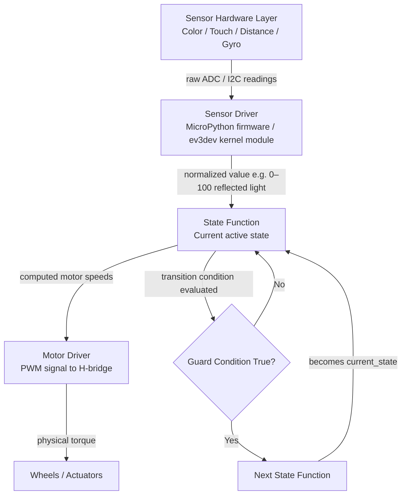

# Lesson 4: Programming Paradigms with State Machine Design

## 1. First-Principles Intuition & Invariants

Every robot is, at its core, a machine that must decide what to do next. That decision depends on where it has been, what it currently senses, and what goal it is pursuing. The naïve approach to robot programming treats each behavior as a flat sequence of commands: move forward for 500 milliseconds, check the touch sensor, turn left, repeat. This imperative, top-to-bottom style feels natural to beginners because it mirrors how humans describe procedures in conversation. For a robot navigating a featureless hallway, it works well enough. The moment your Mindstorms robot must simultaneously track line position, avoid obstacles, respond to a remote signal, and animate an arm mechanism, the flat sequential model collapses into an unmaintainable nest of nested conditionals and timing hacks.

The intellectual breakthrough that solves this problem is recognizing that a robot's behavior is not a sequence of commands but a *graph of conditions*. The robot is always *in some state*, it *transitions* between states in response to *events*, and each state *executes a well-defined behavior* while it is active. This formalism has a name: the Finite State Machine (FSM). It predates digital computers and was formalized by Warren McCulloch and Walter Pitts in their 1943 work on neural logic. When applied to EV3 or SPIKE Prime programming, it transforms spaghetti logic into something a master craftsman would recognize as structurally sound: discrete, testable, and composable.

The invariant at the heart of FSM design is that the robot occupies *exactly one state at any given moment*. This seems like a constraint, but it is actually a gift. It means that for any observed behavior, you can ask a single diagnostic question — "what state is the machine in?" — and the answer fully explains why the robot is doing what it is doing. Contrast this with a tangled imperative program, where the robot's current action depends on a hidden history of flag variables, loop counters, and partially executed branches. The FSM makes hidden state explicit, which is the foundational principle of debuggable embedded software.

Before exploring how this plays out in Mindstorms-specific toolchains, it is worth internalizing the vocabulary precisely. A state is a named configuration of behavior: `LINE_FOLLOW`, `OBSTACLE_AVOID`, `IDLE`, `GRAB_OBJECT`. A transition is a directed edge between two states, guarded by a condition derived from sensor data or elapsed time. An event is any change in the robot's sensory world — a touch sensor press, a color sensor reading crossing a threshold, a timer expiring — that can trigger a transition. An action is work performed either upon entering a state (entry action), while remaining in a state (do action), or upon leaving it (exit action). These four concepts are sufficient to describe any robot behavior of arbitrary complexity, which is why the FSM model has dominated embedded systems design from automotive ECUs to spacecraft attitude control.

Mindstorms hardware enforces its own invariants that shape how FSMs must be constructed. The EV3 brick runs a Linux-based firmware at 300 MHz with 64 MB of RAM; the SPIKE Prime hub runs MicroPython on a 100 MHz ARM Cortex-M4 with 32 MB of storage. Neither platform is fast by desktop computing standards, and both share processor time among sensor polling, motor control, Bluetooth communication, and your program logic. This means that tight polling loops, busy-waiting, and excessive blocking calls are not just bad style — they actively degrade sensor responsiveness and motor smoothness. Well-designed FSMs avoid all of these pathologies by structuring work around *non-blocking state transitions* rather than sequential delays.

The deepest invariant of this lesson is that the gap between block-based and text-based programming is not primarily about syntax — it is about the *granularity of control* each model exposes. The EV3-G block environment (and the newer LEGO Education SPIKE app's Scratch-derived blocks) abstracts away timing, threading, and memory management behind visual wrappers. Text-based environments — MicroPython on SPIKE Prime, ev3dev Python on EV3 — expose those same mechanisms directly, allowing you to implement FSMs with full precision. Understanding both models deeply, and knowing which to use for which problem, is the mark of a Mindstorms specialist.

---

## 2. Core Architecture & Mechanics

### Block-Based Execution: EV3-G and the SPIKE App

The EV3-G environment, built on LabVIEW's dataflow execution model, structures programs as parallel sequences of blocks flowing left to right across the screen. Each horizontal sequence is a *thread*, and the EV3 firmware schedules these threads cooperatively. The critical insight about EV3-G's execution model is that it is *dataflow*, not control-flow: data tokens propagate through wires connecting block outputs to block inputs, and a block executes only when all its input wires carry valid data. This means execution order is determined by data dependency, not by the visual position of blocks on the canvas — a subtlety that surprises programmers arriving from Python or Java backgrounds.

Implementing an FSM in EV3-G uses a variable to hold the current state identifier (typically an integer or string), a main loop containing a Switch block that branches on that variable's value, and individual sequence frames within the Switch that implement each state's do-actions and compute the next state. The structure looks like this in block terms: a large While loop surrounds a Switch block wired to a variable read. Each case of the Switch contains the behavior for that state, and at the end of each case, a variable write sets the new state before the loop iterates. This is architecturally correct, but EV3-G makes the state transition logic visually noisy — large switch structures sprawl across the canvas and become difficult to trace once you have more than five states.

The SPIKE Prime app's block environment, based on Scratch 3.0's event model, structures programs around *hat blocks* that fire when events occur. Each hat block launches an independent script. `When program starts`, `When hub button is pressed`, and `When distance sensor detects less than 10 cm` are all event sources that spawn concurrent script threads. This architecture is natively event-driven and maps cleanly onto FSM transitions for simple cases. The limitation appears when you need a *guarded* transition — one that is only valid when the machine is in a specific state. Scratch-style environments have no built-in mechanism to prevent an event handler from firing when the machine is in the wrong state, so you must guard every handler with an `if [state = X]` conditional at the top. This discipline, once internalized, works reliably, but it must be applied consciously.

### Text-Based Execution: MicroPython on SPIKE Prime and ev3dev Python on EV3

Moving to MicroPython unlocks the full expressive range of FSM implementation. The idiomatic structure for a Mindstorms MicroPython FSM is a class-based design where each state is represented as a function (or method), the machine holds a reference to the currently active state function, and the main loop calls that function on every tick.

Consider a three-state line-follower FSM: `LINE_FOLLOW`, `OBSTACLE_STOP`, and `RECOVERY_SPIN`. The machine structure in SPIKE Prime MicroPython reads as follows:

    from spike import PrimeHub, Motor, MotorPair, ColorSensor, DistanceSensor
    from spike.control import wait_for_seconds, Timer

    hub = PrimeHub()
    motors = MotorPair('A', 'B')
    color = ColorSensor('C')
    distance = DistanceSensor('D')
    timer = Timer()

    def state_line_follow():
        reflected = color.get_reflected_light()
        error = reflected - 50
        correction = error * 0.6
        motors.start_tank(int(50 + correction), int(50 - correction))
        if distance.get_distance_cm() < 15:
            timer.reset()
            return state_obstacle_stop
        return state_line_follow

    def state_obstacle_stop():
        motors.stop()
        if timer.now() > 1.5:
            return state_recovery_spin
        return state_obstacle_stop

    def state_recovery_spin():
        motors.start_tank(-40, 40)
        if distance.get_distance_cm() > 30:
            return state_line_follow
        return state_recovery_spin

    current_state = state_line_follow
    while True:
        current_state = current_state()

This pattern — sometimes called a *state function pointer machine* — has several properties worth noting. Each state function is entirely self-contained: it reads sensors, executes its do-action, evaluates transition conditions, and returns either itself (remain in state) or another state function (transition). The main loop is a single line, which means the loop body has zero overhead beyond the state dispatch. Because no blocking calls appear inside the state functions, the loop runs at the full speed of MicroPython's interpreter, typically 100–300 iterations per second on SPIKE Prime hardware, which is adequate for all standard sensor modalities on this platform.

The ev3dev Python environment on EV3 follows the same pattern but imports from the `ev3dev2` library. Motor control uses `ev3dev2.motor.LargeMotor` and sensor access uses `ev3dev2.sensor.lego`. One important difference is that ev3dev runs on full Linux, so you have access to Python's threading module. This enables *parallel state machines* — a capability that maps directly onto robots with mechanically independent subsystems.

### Signal and Data Flow Architecture

The following diagram captures the signal path through a typical Mindstorms FSM during one execution tick:

The key architectural property this diagram illustrates is the absence of a central event queue. Unlike desktop GUI frameworks where events are buffered and dispatched asynchronously, the Mindstorms FSM pattern processes events *synchronously within the tick*. Each iteration of the main loop is one tick. Within that tick, sensor values are read, the current state function evaluates conditions, and if a transition is warranted, the new state function is returned. There is no latency between condition detection and state transition beyond the duration of the tick itself.

### Concurrency: Running Multiple State Machines in Parallel

A fully articulated Mindstorms robot often involves subsystems that operate independently. Consider a robot with a drive base, a claw mechanism, and an indicator light pattern. Each of these subsystems has its own state machine. On EV3-G, this is handled naturally by the multi-threaded dataflow model — you place each FSM on a separate parallel track, and the EV3 firmware schedules them. On SPIKE Prime MicroPython, you must manage this yourself.

The idiomatic approach is to implement each subsystem as a class with an `update()` method and call all subsystem updates within the master loop:

    class DriveFSM:
        def __init__(self):
            self.state = self._line_follow
        def update(self, color_val, dist_val):
            self.state = self.state(color_val, dist_val)
        def _line_follow(self, color_val, dist_val):
            # proportional control logic
            return self._obstacle_stop if dist_val < 15 else self._line_follow
        def _obstacle_stop(self, color_val, dist_val):
            motors.stop()
            return self._line_follow if dist_val > 30 else self._obstacle_stop

    class ClawFSM:
        def __init__(self):
            self.state = self._open
        def update(self, touch_val):
            self.state = self.state(touch_val)
        def _open(self, touch_val):
            claw_motor.run_to_position(0)
            return self._closing if touch_val else self._open
        def _closing(self, touch_val):
            claw_motor.run_to_position(90)
            return self._closed

    drive = DriveFSM()
    claw = ClawFSM()

    while True:
        cv = color.get_reflected_light()
        dv = distance.get_distance_cm()
        tv = touch.is_pressed()
        drive.update(cv, dv)
        claw.update(tv)

This structure gives you the logical concurrency of multiple independent state machines running in a single-threaded execution context. The robots subsystems do not block each other, sensor reads happen once per tick and are shared across machines, and the entire system state is inspectable at any moment by printing the `state` attribute of each FSM instance.

### Event-Driven Architecture and Interrupt Handling

The term "interrupt" in Mindstorms programming does not refer to hardware interrupts in the strict embedded systems sense — LEGO's firmware abstracts the hardware interrupt controller away from user programs. What it does refer to is a design pattern where certain high-priority events must preempt normal state flow. A common example: regardless of which state the drive FSM is in, a critical battery-low signal should force a safe stop.

The idiomatic Mindstorms solution is a *priority check* at the top of the main loop, evaluated before any state machine update:

    while True:
        if hub.battery.voltage() < 7000:
            motors.stop()
            hub.light_matrix.show_image('SAD')
            break
        cv = color.get_reflected_light()
        dv = distance.get_distance_cm()
        drive.update(cv, dv)
        claw.update(touch.is_pressed())

For less critical but still event-like behaviors — the kind that need to interrupt a running state and then return — you can implement a *Hierarchical State Machine* (HSM), where a parent state wraps child states and transition checks in the parent supersede transitions in the child. This is an advanced pattern but maps naturally onto the class hierarchy MicroPython already provides.

---

## 3. High-Performance Optimization & Failure Modes

### Tick Rate, Sensor Latency, and Loop Invariant Maintenance

The most consequential performance variable in Mindstorms FSM programming is tick rate — the number of times per second the main loop executes. Every `wait_for_seconds()` call inside a state function is a tick-rate killer. If your line-following state contains `wait_for_seconds(0.1)` to pace its corrections, the entire robot is frozen for 100 milliseconds every tick. During that window, the distance sensor is not being read, the claw FSM is not updating, and an obstacle appearing at 20 cm will not trigger the transition until the sleep completes. The loop invariant you must maintain is that *no state function blocks for more than one tick period*. This means replacing all timed waits with timer-guarded transitions, as demonstrated in the `state_obstacle_stop` example above where a `Timer` object tracks elapsed time without blocking.

Sensor noise is the second performance hazard. Raw color sensor reflected light values on SPIKE Prime fluctuate by ±3–5 counts per tick on a smooth surface due to ambient light interference and the sensor's LED modulation timing. If your transition condition is `reflected < 30`, and the true value is hovering around 31, the FSM will thrash — transitioning back and forth between states on alternating ticks. The fix is *hysteresis*: different thresholds for entering and exiting a state. Use `reflected < 28` to trigger the transition *into* a low-reflection state and `reflected > 35` to transition *out*. This 7-count hysteresis band prevents oscillation without adding any timing delay.

The gyro sensor on EV3 (HiTechnic or the built-in SPIKE Prime IMU) accumulates drift over time — typically 1–3 degrees per minute at room temperature. An FSM that relies on absolute gyro heading for more than 60 seconds of cumulative operation will develop navigational errors that corrupt any heading-dependent transition. The mitigation is to implement a *state entry reset*: each time the machine enters a heading-dependent state, snapshot the current gyro value as a local reference and compute all transition conditions as *deltas from that snapshot* rather than absolute values.

### Failure Modes: The Seven Deadly Sins of Mindstorms FSM Design

The first failure mode is the *missing else transition* — a state function that handles the transition condition but forgets to return itself when the condition is false. The function implicitly returns `None`, the main loop assigns `None` to `current_state`, and the next tick crashes with a `TypeError: 'NoneType' is not callable`. Always ensure every code path in a state function ends with a return.

The second is *state explosion* — decomposing behavior so finely that the FSM contains thirty states for a robot that mechanically only has four distinct behaviors. Each additional state adds cognitive overhead without mechanical benefit. The discipline is to ask, for each proposed state, whether the robot's physical behavior is genuinely different from neighboring states. If the only difference is a parameter value (slower speed, tighter turn radius), use a parameterized state function rather than a separate state.

The third failure mode is *sensor read duplication* — calling `color.get_reflected_light()` independently inside multiple state functions in the same tick. On SPIKE Prime, each sensor read involves I2C bus communication, and multiple reads of the same sensor in the same tick both waste time and can return different values (since the physical world changed between reads). Read each sensor exactly once per tick, store the values in local variables, and pass them into all state functions as arguments, as shown in the `drive.update(cv, dv)` pattern above.

The fourth is *action bleed* — performing exit actions in a state's do-loop rather than triggering them once on transition. If your obstacle-stop state continuously commands `motors.stop()` on every tick, you are issuing a stop command 200 times per second. This is usually harmless but wastes motor controller bandwidth and masks the fact that the motor is already stopped. The correct pattern is to call `motors.stop()` once upon *entering* the obstacle-stop state, using an entry-action flag, and then do nothing to the motors during subsequent ticks in that state.

The fifth is *implicit timing* — using loop iteration count as a proxy for time. `for i in range(100): update()` is not 100 milliseconds unless each tick takes exactly 1 millisecond, and in MicroPython it decidedly does not. Use `Timer` objects for all temporal transitions.

The sixth is *unguarded concurrent writes* — two FSM instances calling methods on the same motor object in the same tick. This produces unpredictable motor behavior because the second write overwrites the first within the same control cycle. Assign exclusive hardware ownership to each FSM: the drive FSM owns motors A and B, the claw FSM owns motor C, and no FSM writes to another's motors. If coordination is needed (the drive must pause while the claw operates), implement a *shared flag variable* that one FSM reads and the other writes — never shared motor access.

The seventh, and most insidious, is *behavioral coupling through global mutable state*. It is tempting to use module-level global variables to pass information between state functions. This creates invisible dependencies that make debugging exponential in cost. If `state_recovery_spin` reads a global `recovery_direction` that was set by `state_obstacle_stop`, and `state_obstacle_stop` is later refactored to not always set that variable, `state_recovery_spin` will read a stale value from a previous cycle without any error message. Pass state between machines through the structured `update()` interface and store machine-local memory as instance attributes on the FSM class.

### Debugging Methodology for Mindstorms Embedded Systems

Debugging a running FSM on a Mindstorms robot is fundamentally different from debugging a desktop Python script. You cannot set breakpoints in the conventional sense, the robot is physically moving and cannot be paused without halting its behavior, and the error that manifests (wrong turn at a junction, claw failing to close) may be three state transitions removed from its actual cause.

The professional Mindstorms debugging workflow begins with *state tracing*: printing the name of the current state to the EV3 LCD or SPIKE Prime light matrix on every transition. On EV3-G, a wired display block inside each Switch case serves this purpose. In MicroPython, a one-line `print(current_state.__name__)` after the state dispatch logs the transition sequence to the USB serial console. This trace is your primary diagnostic instrument. When the robot misbehaves, you review the transition log and identify the state from which the wrong transition occurred.

The second tool is *sensor value logging*. When a transition guard behaves unexpectedly, log the sensor value that evaluated the guard alongside the state name: `print(f"{current_state.__name__} | dist={dv:.1f} | color={cv}")`. This lets you correlate transition events with the physical sensor readings that triggered them, which often reveals noise, hysteresis, or calibration issues immediately.

The third tool, specific to EV3, is the **EV3 Brick's built-in data logging** in the EV3-G environment. The Data Logging block records sensor values at configurable sample rates to a `.rdf` file on the SD card, which you can open in the EV3 Lab software for graphical analysis. If your line sensor is oscillating around a threshold, the data log will show the oscillation plainly as a step function that repeatedly crosses your trigger level. Add five counts of hysteresis, and the oscillation disappears.

For behavioral composition problems — cases where two FSMs interact incorrectly — the most effective technique is *temporal isolation*: comment out all but one FSM's `update()` call and verify each machine independently before testing them together. This is exactly the same process a master machinist uses when fitting an assembly: verify each component in isolation before mating surfaces. A robot that malfunctions with four FSMs running simultaneously but works correctly with any three is telling you precisely where the fourth machine is writing data that corrupts the others.

The final debugging tool is physical state visualization using the SPIKE Prime hub's light matrix or EV3 brick's color indicators. Assign each state a distinct light pattern — `LINE_FOLLOW` is a right arrow, `OBSTACLE_STOP` is an X, `RECOVERY_SPIN` is a rotating dot animation — and display it whenever the machine transitions. This turns the robot itself into a live state diagram. You can observe the robot's behavior and its internal state simultaneously, without connecting a USB cable or reading a console. In competition environments where cable debugging is impossible, this visual state trace is not a convenience; it is the only debugging instrument available.

The discipline of FSM design, applied to Mindstorms, is ultimately the discipline of making implicit things explicit. When you name your states, guard your transitions, isolate your subsystems, and instrument your execution, the robot's behavior becomes legible — not just to the machine executing it, but to you, standing at the workbench, debugging a physical artifact that must succeed in the real world. That legibility is the invariant that separates craft from guesswork.
