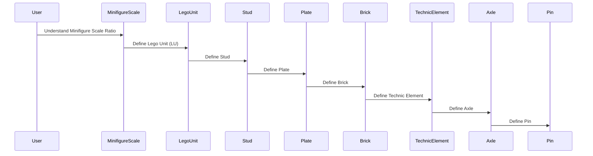

# Foundation: Minifigure Scale
## 1. Conceptual Mental Model (First principles, historical context, and fundamental paradigm shifts)

### First Principles
Minifigure scale is a fundamental concept in Lego construction, representing a standardized scale that allows for consistent and interchangeable building elements. This scale is crucial for maintaining the integrity and aesthetic of Lego models, ensuring that all components fit together seamlessly. The scale is rooted in the physical dimensions of the minifigure itself, which serves as the primary reference point.

### Historical Context
The minifigure, introduced in 1978, was a revolutionary addition to Lego sets. Prior to this, Lego models were built using a variety of scales, which made it difficult to create cohesive and detailed scenes. The introduction of the minifigure standardized the scale, allowing for a more uniform and realistic representation of characters and objects within Lego models. This shift enabled Lego to expand its product line, creating a vast ecosystem of interrelated sets that could be combined to form complex and detailed worlds.

### Fundamental Paradigm Shifts
The adoption of minifigure scale marked a significant paradigm shift in Lego design and construction. It introduced a new level of detail and realism to Lego models, allowing for more intricate and lifelike representations. This shift also facilitated the creation of larger, more complex models, as the standardized scale ensured that all components would fit together seamlessly. The introduction of minifigure scale also paved the way for the development of specialized Lego sets, such as the Lego City and Lego Star Wars lines, which could be built using the same standardized components.

## 2. Essential Terminology & Taxonomy (Comprehensive architectural definitions)

### Minifigure Scale Ratio
**Definition:** The minifigure scale ratio is the standardized scale used in Lego construction, typically represented as 1:48. This means that one unit of measurement in the Lego scale is equivalent to 48 units in real life. For example, a minifigure is approximately 4 cm tall, which corresponds to a real-life height of approximately 1.92 meters.

### Lego Unit (LU)
**Definition:** The Lego unit is the smallest unit of measurement in the Lego scale, equivalent to 1/8 of a centimeter. This unit is used to measure the dimensions of Lego bricks and other building elements. The Lego unit is crucial for ensuring that all components fit together seamlessly and that the scale is maintained consistently.

### Stud
**Definition:** A stud is a small, cylindrical protrusion on the top surface of Lego bricks. Studs are used to connect Lego bricks together, ensuring that they fit together tightly and securely. The diameter of a stud is 4.8 mm, which corresponds to 6 Lego units.

### Plate
**Definition:** A plate is a flat, rectangular Lego element with studs on the top surface. Plates are used to create the base of Lego models and to connect other building elements together. The thickness of a plate is 3.2 mm, which corresponds to 4 Lego units.

### Brick
**Definition:** A brick is a rectangular Lego element with studs on the top surface and a hollow core. Bricks are used to create the walls and other structural elements of Lego models. The dimensions of a standard Lego brick are 9.6 mm x 9.6 mm x 3.2 mm, which corresponds to 12 Lego units x 12 Lego units x 4 Lego units.

### Technic Element
**Definition:** A Technic element is a specialized Lego element used for building mechanical systems and complex structures. Technic elements include gears, beams, and connectors, which are designed to work together to create functional mechanisms. Technic elements are typically larger than standard Lego elements, with dimensions that are multiples of the Lego unit.

### Axle
**Definition:** An axle is a cylindrical element used to connect gears and other mechanical components in Lego models. Axles are typically made of plastic and are designed to rotate smoothly within Technic elements. The diameter of a standard Lego axle is 1.8 mm, which corresponds to 3 Lego units.

### Pin
**Definition:** A pin is a small, cylindrical element used to connect Technic elements together. Pins are typically made of plastic and are designed to fit into holes in Technic elements. The diameter of a standard Lego pin is 1.8 mm, which corresponds to 3 Lego units.

## 3. Architecture & Core Workflow (Detailed ASCII and Mermaid diagrams with step-by-step dataflow)

### ASCII Diagram
```
+-------------------+
| Minifigure Scale  |
+-------------------+
          |
          v
+-------------------+
| Lego Unit (LU)    |
+-------------------+
          |
          v
+-------------------+
| Stud              |
+-------------------+
          |
          v
+-------------------+
| Plate             |
+-------------------+
          |
          v
+-------------------+
| Brick             |
+-------------------+
          |
          v
+-------------------+
| Technic Element   |
+-------------------+
          |
          v
+-------------------+
| Axle              |
+-------------------+
          |
          v
+-------------------+
| Pin               |
+-------------------+
```

### Mermaid Sequence Diagram


## 4. Common Misconceptions & Mental Traps (Subtle edge cases and flawed mental models)

### Misconception: All Lego elements are the same size
**Explanation:** This misconception arises from the fact that many Lego elements are similar in size, but there are many specialized elements, such as Technic elements, that are larger than standard Lego elements. It is important to understand the dimensions of different Lego elements to ensure that they fit together correctly.

### Misconception: The minifigure scale ratio is arbitrary
**Explanation:** This misconception arises from the fact that the minifigure scale ratio was chosen based on practical considerations, such as the size of the minifigure and the need for consistent and interchangeable building elements. The minifigure scale ratio is not arbitrary, but rather a carefully chosen standard that allows for the creation of detailed and realistic Lego models.

### Misconception: The Lego unit is the only unit of measurement in Lego construction
**Explanation:** This misconception arises from the fact that the Lego unit is the smallest unit of measurement in the Lego scale, but there are other units of measurement that are used in Lego construction, such as the stud and the plate. It is important to understand the different units of measurement in Lego construction to ensure that all components fit together correctly.

### Misconception: Technic elements are only used for mechanical systems
**Explanation:** This misconception arises from the fact that Technic elements are primarily used for building mechanical systems, but they can also be used for creating complex structures and other non-mechanical elements. It is important to understand the versatility of Technic elements to take full advantage of their capabilities.

### Misconception: Axles and pins are interchangeable
**Explanation:** This misconception arises from the fact that axles and pins are similar in size and shape, but they serve different functions in Lego construction. Axles are used to connect gears and other mechanical components, while pins are used to connect Technic elements together. It is important to understand the differences between axles and pins to ensure that they are used correctly.

## 5. Socratic Discussion Starters (Advanced questions for deep Socratic exploration)

### Discussion Question 1
How does the minifigure scale ratio impact the design and construction of Lego models? What are the advantages and disadvantages of using a standardized scale in Lego construction?

### Discussion Question 2
What are the key differences between standard Lego elements and Technic elements? How do these differences impact the design and construction of Lego models?

### Discussion Question 3
How can Lego builders use the principles of minifigure scale to create more detailed and realistic Lego models? What are some common mistakes that Lego builders make when working with minifigure scale, and how can they be avoided?
