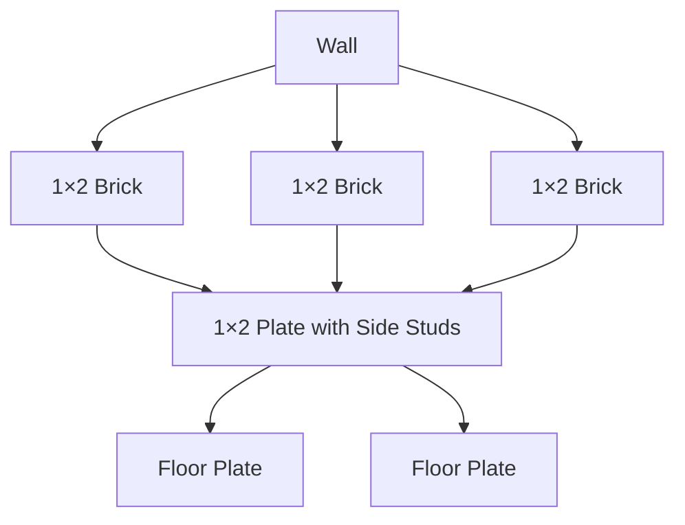

# Lesson 3: Structural Constraints Within Minifigure Scale

## 1. First-Principles Intuition & Invariants

The LEGO minifigure stands precisely four bricks tall (31.68 millimeters from baseplate to crown), representing a design constraint that has fundamentally shaped the physical grammar of System building since 1978. This dimensional anchor creates an inescapable paradox: minifigures exist at a scale where a single stud measures 8 millimeters across, yet they must inhabit architectural spaces that feel proportionally correct to human observers who instinctively understand doorway heights, ceiling clearances, and furniture ergonomics. The resulting tension between geometric possibility and perceptual plausibility defines the entire structural challenge of minifigure-scale construction.

Unlike architectural modeling at larger scales where builders enjoy freedom to interpolate dimensions through specialized parts or even break into microscale abstraction, minifigure-compatible environments must reconcile three immutable physical constraints simultaneously. First, the discrete grid of the stud matrix enforces quantization on all horizontal dimensions—walls cannot exist at 4.3 studs wide, only at four or five studs. Second, the vertical brick height of 9.6 millimeters (compared to the 8-millimeter stud pitch) creates an irrational aspect ratio of 6:5 that prevents perfect cubic modules and forces builders to think in plate heights (3.2 millimeters) to achieve finer vertical resolution. Third, the material properties of ABS plastic under cantilever and compressive loads create hard limits on overhang distances, wall thicknesses, and floor span capabilities that become critical when building structures tall enough to accommodate four-brick-high occupants.

The fundamental invariant governing all minifigure-scale work emerges from this geometric foundation: **one stud equals approximately 250 millimeters in represented real-world space**. This conversion factor derives not from arbitrary designer choice but from inverse engineering the minifigure's height against average human stature. If a minifigure at 32 millimeters represents a 1.75-meter human, the scale factor sits at roughly 1:55. At this ratio, a single 8-millimeter stud projects to 440 millimeters in real space—clearly too coarse. However, practical LEGO architecture consistently operates at an effective 1:31 to 1:33 scale, where door frames measure six studs wide (48 millimeters representing 1.5 meters) and standard wall heights run eight bricks tall (76.8 millimeters representing 2.4 meters). This empirical compression accepts that minifigures have oversized heads and limbs relative to realistic proportions, prioritizing playability and structural feasibility over documentary accuracy.

Understanding this scale compression reveals why certain real-world architectural features become physically impossible in LEGO form. A realistic staircase with 7-inch rises and 11-inch treads would demand that each step occupy less than one stud depth—an impossibility given that even the thinnest plate measures one-third of a stud height. Builders must therefore accept stylized staircases where each step rises one full brick height (three plates) and extends two studs deep, creating a 45-degree angle that would terrify any building inspector but reads as "staircase" to the human visual system. Similarly, furniture pieces operate at a scale approximately 10% larger than strict proportionality would demand, ensuring that minifigures can physically interact with chairs, tables, and beds without their rigid plastic arms and legs creating impossible collision geometry.

The structural physics of LEGO bricks at minifigure scale introduces a second layer of invariants rooted in material science rather than geometry. Each stud-and-tube connection generates a measured clutch force of approximately 25 to 35 centinewtons, engineered to balance ease of assembly against resistance to accidental separation. When builders stack bricks vertically, these connections distribute compressive loads efficiently—a single 2×4 brick can support over 4,000 identical bricks in a pure vertical column before the bottom element deforms. However, this impressive compressive strength vanishes under lateral loads and cantilever stress. A wall built from single-stud-thick elements (a vertical column of 1×N bricks) exhibits catastrophic instability beyond five or six bricks in height, toppling from the slightest horizontal perturbation because the moment arm of gravitational torque exceeds the restoring force of the clutch connections.

Minifigure-scale construction therefore demands structural thickness as a first-order constraint. Walls must run at least two studs thick to achieve stable heights of eight bricks or more, with the two parallel planes of bricks interlocked through staggered overlap patterns that prevent shear failure along vertical seams. Floor plates spanning more than twelve studs between support points require lattice-web reinforcement underneath, typically achieved through perpendicular brick courses that create a grid of support ribs echoing the truss geometry of steel-frame architecture. The builder working at minifigure scale must internalize that every architectural gesture carries a structural cost measured in brick thickness, support columns, and hidden bracing—costs that scale nonlinearly as structures grow taller or wider.

The clutch force variability between new and worn elements introduces a temporal dimension to structural analysis that professional builders ignore at their peril. Fresh bricks from sealed sets exhibit maximum clutch force, often requiring significant thumb pressure to separate. After hundreds of assembly cycles, the microscopic cylindrical tubes inside each brick gradually deform, reducing clutch force by 15 to 20 percent. Large modular buildings incorporating both new and heavily cycled elements therefore exhibit heterogeneous structural properties where some wall sections bond tightly while adjacent sections develop marginal stability. Advanced builders mitigate this through part rotation protocols, moving high-cycle elements to non-structural cosmetic roles and reserving fresh bricks for critical load-bearing joints.

## 2. Core Architecture & Mechanics

The geometric skeleton of minifigure-scale architecture rests on a vocabulary of wall-building patterns that translate structural engineering principles into stud-based modules. The most fundamental pattern, **running bond** or **stretcher bond**, staggers each course of bricks by half a brick length relative to the course below, ensuring that no vertical seam extends through more than one layer. For a two-stud-thick wall built from 1×4 bricks, this pattern alternates between courses where bricks run longitudinally along the wall axis and courses where they span perpendicular, locking the two parallel planes together. The resulting assembly achieves what structural engineers term **composite action**, where the two-stud wall behaves as a single unified member rather than two independent columns that could delaminate under stress.

```text
TOP VIEW - Running Bond Wall (two-stud thickness):

Layer 1 (odd-numbered courses):
[====1×4====][====1×4====]
[====1×4====][====1×4====]

Layer 2 (even-numbered courses):
[==1×4==]        [==1×4==]
     [==1×4==][==1×4==]
[==1×4==]        [==1×4==]

Bricks in Layer 2 span perpendicular to Layer 1,
creating mechanical interlock.
```

Corner construction exposes the fundamental challenge of maintaining running bond integrity where two perpendicular walls intersect. A naive approach stacking 1×4 bricks naively at a right angle creates a vertical fault line through the entire corner—a structural weakness where the building can literally split in half under lateral stress. The canonical solution employs **interlocking corner courses** where every other layer uses shorter bricks (1×3, 1×2, or even 1×1) to allow perpendicular wall elements to interpenetrate at the intersection point. One course might have the north-south wall extend fully through the corner while the east-west wall terminates flush against it; the next course reverses this relationship, creating a three-dimensional weave that bonds the corner into a monolithic junction.

Openings for doors and windows introduce concentrated stress points where the continuous wall structure terminates abruptly, transferring vertical loads from above through narrowed wall sections on either side of the opening. Real-world architecture addresses this through lintels—horizontal load-bearing beams that span the opening and redistribute downward forces. LEGO builders replicate this principle using **header courses**, typically constructed from long plates (1×8, 1×10, or 1×12) that span the full width of the opening plus at least two studs of overlap onto the supporting wall sections on each side. A door opening six studs wide therefore requires a header plate at least ten studs long, with five studs of bearing surface anchoring each end into the wall mass.

The header plate alone provides insufficient strength for spans beyond eight studs or for supporting heavy structures above. Professional builders reinforce critical lintels through **laminated plate construction**, stacking three or four thin plates with staggered seams to create a composite beam with significantly higher bending stiffness than a single thick element. The physics here mirror plywood construction: each plate contributes its tensile and compressive strength along its length, while the clutch connections between layers resist shear deformation that would allow the plates to slide past one another. For maximum performance, builders orient the bottom plate of the laminate with its studs facing down (exposed on the interior ceiling), ensuring that the smooth underside of subsequent plates creates clean bearing surfaces against the layer below.

Floor construction at minifigure scale operates under constraints distinctly different from wall building, as horizontal surfaces experience distributed loads rather than primarily compressive forces. A floor must support the weight of minifigures, furniture, and interior detailing while spanning between walls that may stand twelve, sixteen, or even twenty studs apart. The canonical solution builds floors from large plate elements (8×16, 6×12, or 6×16 plates) arranged in a brick-pattern overlap and anchored to the perimeter walls through sideways-facing studs achieved via **SNOT (Studs Not On Top) bracket geometry**.



This bracket technique employs specialized elements such as 1×2 plates with side studs, 1×1 headlight bricks, or 1×2 plates with clips, creating horizontal attachment points that allow floor plates to lock onto the wall structure without relying solely on friction or gravity. For spans exceeding twelve studs, the floor requires internal support through **drop beams**—vertical brick columns that extend downward from the underside of the floor plate to rest on the floor below, effectively creating a hidden post-and-beam structure beneath the smooth upper surface.

The vertical dimension of minifigure-scale building introduces a periodicity constraint derived from the 6:5 aspect ratio between stud pitch and brick height. Standard interior ceiling heights measure eight bricks tall (76.8 millimeters) to comfortably accommodate minifigures with four bricks of clearance above their crowns. However, builders constructing multi-story structures quickly discover that pure brick-height increments create awkward dimensional relationships when attempting to align interior floors with exterior window rows. The solution leverages **plate-based vertical tuning**, where critical features position themselves at heights measured in plate thicknesses (3.2 millimeters) rather than full brick heights. A windowsill might sit five bricks plus two plates above the floor (52.8 millimeters), allowing the window frame to occupy a six-plate-tall opening that aligns perfectly with the next floor's foundation level.

This vertical arithmetic becomes critical when designing staircases that must bridge floor levels. A typical floor-to-floor rise of eight bricks (76.8 millimeters) demands careful choreography to create a climbable staircase that respects both the three-plate step height convention and the geometric reality of minifigure leg articulation. Most builders settle on staircases that rise one brick (three plates) per step and extend two studs horizontally per tread, creating a 45-degree ascent that traverses eight studs of horizontal distance to gain eight bricks of vertical elevation. The precise staircase geometry follows a parametric relationship:

Total horizontal run = (vertical rise in bricks) × 2 studs  
Number of steps = vertical rise in bricks  
Each step: 1 brick rise, 2 studs depth

Structural stability at these human-scale dimensions requires that staircases integrate into the building's primary load-bearing framework rather than exist as freestanding elements. The canonical approach builds stairs as **enclosed volumes** where each step's riser and tread interlock with perpendicular sidewalls running the full length of the staircase, creating a rigid triangulated box that cannot rack or twist under load.

## 3. High-Performance Optimization & Failure Modes

The pursuit of structural efficiency at minifigure scale demands recognition that LEGO construction operates under two competing optimization pressures: minimizing part count and mass (to reduce material cost and gravitational loads) while maximizing rigidity and connection redundancy (to prevent catastrophic collapse). The naive approach of using the largest possible plates for floor and wall surfaces reduces part count but creates monolithic elements with no internal redundancy—a single failed clutch connection can compromise an entire wall panel. Conversely, building every surface from 1×2 and 1×4 bricks maximizes redundancy but generates assemblies so heavy that lower floors experience compressive creep, gradually separating under the cumulative weight of upper stories.

Advanced builders resolve this tension through **density gradient architecture**, where structural density varies as a function of load criticality. Foundation walls and ground-floor columns employ solid two-stud-thick brick construction with full running bond integrity, accepting the mass penalty in exchange for maximum compressive strength. Mid-level walls transition to **cavity wall construction**, where the inner and outer brick surfaces separate by one stud width, connected only by periodic header bricks that span the gap every four to six studs vertically. This hollow-core approach cuts wall mass by 35 to 40 percent while maintaining bending stiffness through the increased moment of inertia that the separated faces provide—the same principle that makes I-beams more efficient than solid bars of equal mass.

Upper floors and non-load-bearing partitions can adopt even more aggressive mass reduction through **stud-frame construction**, where vertical columns of 1×2 bricks positioned at six-stud intervals carry vertical loads while the intervening wall surfaces consist only of thin plate cladding attached to the frame. This technique directly mirrors wood-frame residential construction, acknowledging that walls primarily resist lateral wind loads and partition space rather than carry significant vertical compression.

The failure modes of minifigure-scale structures cluster into three mechanistic categories: immediate catastrophic failure from insufficient strength, progressive degradation from cyclic loading and fatigue, and geometric instability from inadequate bracing against lateral distortion. Catastrophic failure manifests most dramatically in **cantilever collapse**, where unsupported overhangs exceed the material capacity of the base connection. The physics governing cantilever limits emerges from the moment balance at the fixed support point:

M_applied = F_gravity × L_cantilever  
M_resisting = n_studs × τ_clutch × d_moment_arm

where F_gravity represents the weight of the cantilevered mass, L_cantilever measures the horizontal distance from support to center of mass, n_studs counts the number of stud connections anchoring the base, τ_clutch quantifies the clutch force per stud (approximately 0.30 to 0.35 newtons), and d_moment_arm captures the vertical offset between the neutral axis and the outer stud rows. For a six-stud-wide cantilever beam built from 2×6 plates, the maximum safe overhang before tip deflection becomes unacceptable rarely exceeds eight studs—beyond this, gravitational torque overcomes the clutch forces and the beam sags or detaches entirely.

Builders working on exhibition-grade models must account for **thermal cycling degradation**, where daily temperature fluctuations cause differential expansion between ABS plastic elements and metallic reinforcement pins or external support structures. A large modular building occupying a 64×64 stud baseplate (512×512 millimeters) can experience dimensional changes of ±0.5 millimeters between winter heating and summer air conditioning cycles, sufficient to gradually walk connections apart over months of display. The mitigation strategy employs **floating attachment points** where certain walls connect to the base structure through single-stud connections or clip hinges that allow millimeter-scale movement without transmitting stress into the primary framework.

Geometric instability under lateral loads (accidental bumps, earthquakes, or simply the force of placing a minifigure into a scene) poses the most insidious structural challenge because walls and floors that appear rigid during static assembly can exhibit alarming flexibility once the model grows beyond eight-by-eight studs in plan. The critical insight recognizes that LEGO structures lack the continuous material bonds of welded steel or poured concrete—every stud connection represents a microscopic hinge that permits sub-millimeter rotations. When hundreds of these micro-hinges align along a wall panel, their cumulative angular deflection allows centimeter-scale sway at the top of an eight-brick-tall wall.

Professional builders eliminate this instability through **triangulation and shear wall integration**. The fundamental principle states that any quadrilateral framework becomes rigid when a diagonal brace creates two triangles—and triangles cannot deform without changing their side lengths. In LEGO terms, this means that rectangular room enclosures require diagonal plate elements spanning from one corner toward the opposite corner, creating a rigid truss that prevents the room from racking into a parallelogram. A 16×16 stud room might incorporate 1×12 or 1×14 plates placed diagonally across the underside of the floor, their ends anchored to opposite walls through SNOT brackets.

Interior partition walls serve this bracing function elegantly when positioned perpendicular to exterior walls, creating a cross-braced box structure where each wall restrains its neighbors. The optimal layout arranges interior partitions at six-to-eight-stud intervals, ensuring that no exterior wall segment spans more than this distance without an internal support point. This naturally generates architectural floor plans with regular room divisions—a happy convergence where structural necessity aligns with the spatial rhythm that human observers find aesthetically pleasing in miniature architecture.

The temporal dimension of structural performance reveals itself in **clutch force hysteresis**, where repeated assembly and disassembly cycles permanently deform the cylindrical tubes inside brick cavities, reducing their clamping force on studs. Elements subjected to high-cycle usage—typically floor plates that builders remove repeatedly to access interior details—lose 10 to 15 percent of their clutch force after 50 cycles and up to 25 percent after 200 cycles. Large modular buildings intended for long-term display require **maintenance protocols** where high-wear elements rotate out of critical structural positions every six to twelve months, moving into cosmetic facade roles where reduced clutch force poses minimal risk.

The ultimate structural challenge emerges in **tall tower construction** where minifigure-scale buildings exceed 32 bricks in height (307 millimeters), entering a regime where gravitational moments create tangible compressive stress on base connections and where lateral instability from accidental contact becomes genuinely dangerous. Towers at this scale demand internal **core bracing**—a central structural shaft built from solid brick columns that carries the majority of vertical loads while peripheral walls provide only cladding and lateral stiffness. The core typically occupies a 4×4 or 6×6 stud footprint at the building center, constructed from continuous vertical brick stacks with no interruptions for door openings or service voids. Floor plates attach to this core through cantilevered bracket arms that extend outward to meet the exterior walls, creating a structure where the core acts as a compression post and the floor plates behave as horizontal diaphragms distributing lateral loads.

Builders pushing toward exhibition-scale structures—modular cities occupying multiple baseplates or single buildings exceeding 800 millimeters in height—must eventually confront the reality that LEGO elements alone cannot provide adequate structural performance. The solution lies in **hybrid construction**, where an internal armature of steel wire, threaded rod, or aluminum extrusion creates a hidden skeleton that carries primary loads while LEGO elements provide architectural expression and detail articulation. The ethical question of where a LEGO model ends and a LEGO-clad sculpture begins has occupied community forums for decades, but the structural physics remains indifferent: beyond certain scale thresholds, ABS plastic clutch connections simply cannot resist the gravitational and lateral forces involved, and responsible builders acknowledge this limit rather than watching months of work collapse from hubris.
