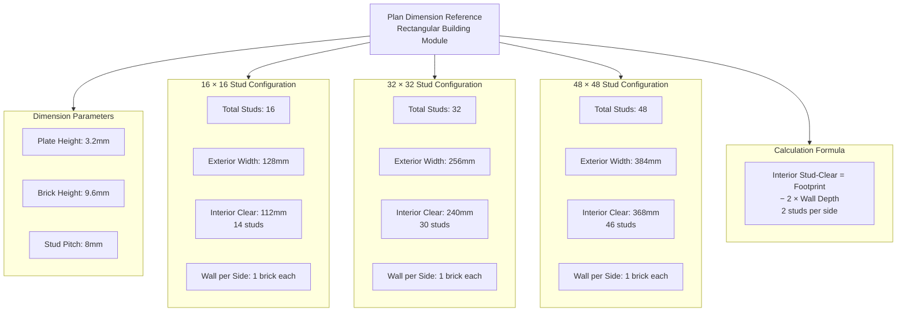
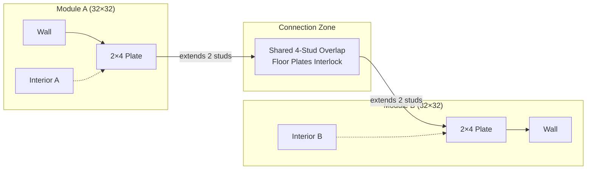

# Lesson 4: Applied Design Patterns in Minifigure Scale

## 1. First-Principles Intuition & Invariants

The minifigure is not merely a toy accessory. It is the irreducible unit of measurement from which every proportional decision in Lego architecture radiates outward. At approximately 4 studs wide at the shoulders and standing 5 bricks (or 6 plates) tall to the top of its cylindrical head-stud, the minifigure imposes a strict physical grammar on any environment built to accommodate it. Walls must be tall enough for a figure to plausibly inhabit a room. Doorways must clear the figure's height. Vehicles must provide a seated footprint that places the figure at a visually convincing ergonomic position. Everything else — window sill heights, staircase risings, table surfaces, cockpit canopies — derives from this single anthropometric anchor.

Understanding the minifigure's physical envelope is the starting point for all applied work. The figure occupies a 2×2 stud footprint on the floor. Standing upright, it reaches roughly 11.5 brick-equivalent plates, counting from the sole of the leg to the top of the head stud. This converts to approximately 46mm in physical height using the standard Lego plate-height of 3.2mm and brick-height of 9.6mm. A single Lego stud-pitch is 8mm on center, and a standard brick stands 9.6mm tall, giving the system an aspect ratio of 8mm horizontal to 9.6mm vertical — a ratio that experienced builders must internalize as deeply as a carpenter knows the depth of a mortise. Any surface, elevation, or opening you design will only read as "correct" to the eye if it respects this geometry.

The core invariants of minifigure scale can be stated plainly. Interior ceilings need a minimum clear height of 6 bricks to allow a standing figure with head-room; 7 bricks reads as a generously proportioned room. Doorways require at least 4 studs of width and 6 bricks of height for a single passage, or 6 studs wide for a double-door. Seated figures in vehicles lower their effective silhouette to roughly 4 bricks above the seat surface, which governs cockpit canopy selection and roofline height on cars and spacecraft alike. Stairs rise comfortably on a 1-brick-rise per 1-stud-run cadence. These numbers are not conventions invented arbitrarily; they emerge directly from the physical shape of the figure itself, and violating them produces environments that look uncanny even to observers who cannot articulate why.

The practical consequence of these invariants is that minifigure-scale building is an exercise in constrained optimization. You are not free to make a building as wide or as tall as an aesthetic impulse suggests; you are negotiating between the figure's fixed envelope, the discrete Lego grid, and the visual language of real-world architecture you are abstracting. The challenge and the craft lie in resolving that triangular tension without sacrificing any vertex of it. A wall section that reads as convincingly as a medieval stone course but that also passes a figure through its archway cleanly, while also sitting stably on the baseplate, requires simultaneous satisfaction of three different constraint domains. This is what separates competent Lego assembly from genuine design practice.

One further invariant deserves early emphasis: the difference between structural and visual scale. A building at true minifigure scale would, if realized as a physical mock-up, stand roughly 6 meters tall for a two-story structure — accurate for real domestic architecture. But Lego buildings are not physically large. They are compressed representations, and the builder must decide from the outset which visual cues carry the most perceptual weight. Roof pitch, window proportion, and door width are the dominant cues the eye uses to infer building scale. Getting these three right can redeem imperfect wall thickness or slightly over-scaled decorative elements. Getting any one of them badly wrong undermines the entire reading, regardless of how precise everything else is.

---

## 2. Core Architecture & Mechanics

### The Structural Grid and Its Three Axes

Minifigure-scale construction operates across three simultaneous spatial systems that experienced builders track in parallel: the stud grid in the horizontal plane, the plate/brick stack in the vertical plane, and the sub-stud offset system made possible by SNOT (Studs Not On Top) geometry. Each axis has its own resolution, and the most sophisticated design patterns exploit all three in coordination.

In the horizontal plane, the 8mm stud pitch is your primary unit. Standard walls built from bricks running lengthwise consume one stud of depth per wall skin, producing a wall roughly 9.6mm thick — close to realistic at minifigure scale, where a masonry wall would read as somewhere between 150mm and 300mm in full scale. Interiors and exteriors compete for stud-depth from a fixed overall footprint, which is why serious builders establish a plan-view dimension table before placing a single brick.

In the vertical axis, the fundamental constraint is the 3:1 plate-to-brick height relationship: three plates stack to exactly one brick's height. This allows mixed plate-and-brick elevations to hit intermediate heights that pure brick stacking cannot reach. A window sill at 2 bricks + 1 plate (21.6mm actual) reads differently from one at 2 bricks (19.2mm), and that difference is perceptible in the finished model. Builders who work exclusively in full-brick increments impose a coarser vertical resolution on their facades, and it shows in the stiffness of the finished surface.

SNOT geometry resolves the tension between the horizontal grid and decorative surface detail by allowing bricks to be oriented with their stud-face pointing outward, forward, downward, or at any orthogonal angle, rather than upward in the default configuration. The critical geometric identity underlying all SNOT work is that five Lego plates equal exactly two studs in height: 5 × 3.2mm = 16mm = 2 × 8mm. This means a bracket or headlight brick that redirects a surface 90 degrees can be aligned perfectly with the stud grid on the redirected face, provided the builder counts plate-heights on the vertical donor structure in multiples of five. Violating this alignment produces a half-stud offset on the SNOT surface that prevents flush tile cladding and forces visible seams.

### The Facade Pattern Language

Facade design for minifigure-scale buildings follows a predictable pattern language, much as pattern languages in architecture organize decisions around recurring problems with known good solutions. The four patterns used most heavily are the recessed window well, the soldier-course lintel, the offset quoin corner, and the tile-flush panel.

The recessed window well places the window element one stud depth behind the outer wall face, creating a shadow line that reads as wall thickness and adds visual depth without requiring a true double-skin wall construction. It is executed by building the wall skin from bricks that frame a 1×2 or 1×3 hole, then inserting a plate offset one stud inward behind the gap, on which the window frame element rests. This sub-pattern solves the common problem that standard Lego window elements are too shallow to read convincingly when flush-mounted; the recess creates the depth cue the eye needs.

The soldier-course lintel mimics the stone or brick arch behavior of real masonry above openings. Rather than leaving the top of a door or window opening flat, builders stack tiles or smooth plates horizontally across the top edge, often using 1×2 or 1×4 tiles on a jumper-plate row to maintain stud-free cleanliness. The visual effect is a pronounced horizontal band that draws the eye across the opening in a way that reads as structural intention rather than incidental geometry.

Corner quoin treatment, borrowed directly from classical and vernacular architecture, alternates brick lengths at building corners to create an interlocking shadow pattern. In Lego, this is approximated by alternating 1×2 and 1×4 bricks at corners in a staggered course pattern, or by using printed tile elements in contrasting color. The goal is to break the visual uniformity of the corner edge and suggest material depth, an important perceptual cue when the wall skin is only one stud thick.

Tile-flush panels, which cover exposed stud surfaces with flat tiles, are essential for any surface that is meant to read as smooth: floors, roads, interior walls, water surfaces. The standard workflow tiles a surface by covering 2×2 areas with four 1×1 tiles, or more efficiently with 2×4 and 2×2 tiles, leaving no exposed studs. Where the panel terminates at a wall, a 1×1 tile with a clip or a 1×1 round tile manages the edge condition. Interior floors in minifigure-scale buildings almost always require full tiling to prevent the stud texture from reading as a coarsely pebbled surface at figure scale.

### The Modular Interface and Connection Architecture

The most architecturally significant structural pattern in minifigure-scale construction is the modular boundary: the interface geometry that allows two independently built sections to connect, align, and separate without structural compromise. The official Lego Modular Buildings series established a de facto standard — a 32×32 stud baseplate footprint with a first floor plate height of 10 bricks, a fixed connection spine of a 2×2 stack with a 2×4 plate extending into the adjacent module at the floor level, and an interior that is completely self-contained except at that connection point. This standard has been adopted and extended by the broader AFOL community because it solves a real engineering problem: how to build large interior environments in transportable, reconfigurable sections.

For custom modular systems, the builder must establish the connection contract before construction begins. This means deciding: at what height does the connection plate sit (always at the bottom of the floor plate stack for ground-floor connections), how wide is the overlap zone, and whether the sidewalk/streetscape tiles extend across the seam or terminate at a clean edge. Failing to specify these parameters up front produces modules that meet at an awkward seam, with tile misalignment or exposed stud rows that break the finished visual.

Interior construction within a module follows a distinct sub-pattern from exterior facade work. Because interiors are viewed only through windows, open walls, or by lifting off a roof section, the detail density requirement is lower but the functional clearance requirement is higher. Every room must pass the figure-placement test: a standing figure must fit without its head-stud pressing against the ceiling plate, and a seated figure on a chair element must have its legs clear of the wall. The practical minimum for a furnished room is 7 bricks of clear ceiling height above the floor plate, allowing chair and table elements (which typically stand 3 to 4 plates tall) with comfortable headroom above.

---

## 3. High-Performance Optimization & Failure Modes

### Detail Density and the Gradient of Proximity

One of the most common failure modes in minifigure-scale work is uniform detail density: treating every surface on a model as an opportunity for maximum decoration, regardless of its visual prominence. The result is visual noise — the eye has no hierarchy to navigate, no surface reads as background, and elements that should anchor the design disappear into the clutter. Professional builders resolve this by applying detail density in proportion to visual proximity, using a simple three-tier gradient.

Primary surfaces are those facing directly toward the typical viewer angle, usually the front facade and any prominently lit side. These receive full treatment: SNOT window wells, tile-flush panels, decorated door surrounds, and any printed elements that carry character. Secondary surfaces, the sides and rear of a structure, receive reduced detail — tiled window frames without recessing, plain brick courses without quoin treatment, and simpler door geometry. Tertiary surfaces, roof undersides, interior wall backs, structural undercarriages of vehicles, receive almost no surface treatment at all because they are either invisible or viewed only incidentally. This gradient is not laziness; it is economy of attention. It makes the model more readable, not less detailed, because the eye can follow a clear hierarchy from primary to secondary to background.

The same gradient principle applies to interior versus exterior. The exterior facade is high-resolution; the interior is functional. Interior walls may be left as exposed stud surfaces if the viewing angle makes them invisible. Floor tiling matters only on floors that will be photographed or regularly handled. Furniture can be highly abstracted — a 2×4 brick as a sofa, a 1×2 tile on a 2×2 plate as a table — without breaking the scale illusion, because the figure in the scene anchors the viewer's interpretation.

### Color Palette Discipline and Material Reading

Scale illusion in Lego depends heavily on color palette discipline. Real buildings read as monolithic because their dominant material — brick, stone, concrete — occupies 70 to 80 percent of the visible surface area, with contrasting accents (window frames, doors, trim) occupying the remainder. Lego builders who reach for too many colors distribute visual weight evenly across the facade, flattening the material reading and producing what experienced builders call the "patchwork" failure mode.

The disciplined approach is to establish one dominant structural color, one contrasting accent color, and one neutral (usually light bluish gray, dark tan, or white) for window and trim elements. All exposed brick courses use the dominant color. All window surrounds, shutters, and door elements use the accent. All glass, tile-flush panels, and sky-facing surfaces use the neutral or trans-clear elements. This three-color constraint forces material clarity: the eye immediately reads "this is a red-brick building with white trim and black window frames" rather than "this is a collection of colored blocks."

Deviating from this discipline is sometimes intentional — a weathered, eclectic street-front building might use four or five colors to suggest different eras of repair and renovation. But the deviation must be purposeful, and the builder must understand what constraint is being relaxed and why, rather than simply reaching for whatever elements are available.

### Structural Failure Modes in Large-Scale Sections

Large minifigure-scale builds, particularly those spanning 48 studs or more in any horizontal direction, face structural failure modes that smaller builds avoid. The most common is horizontal shear at the floor-to-wall interface: when a large modular floor plate is lifted by its edges, the weight of the structure above pulls the wall sections outward, delaminating them from the floor at the connection plate. This is mitigated by running a continuous 1×8 or 1×10 Technic brick course at the base of each wall, connecting to the floor plate through a row of pins or axles that resist lateral pull-out.

A related failure is the racking failure in tall, narrow facade sections: a wall built purely from stacked horizontal courses with no vertical locking elements will develop a lateral wobble at height, because the alternating brick joints provide shear resistance only in the horizontal direction. The fix is to insert 1×1 bricks with side studs or Technic bricks with through-holes at regular vertical intervals, creating vertical tie-columns within the wall mass that lock the horizontal courses together. At every 8 to 10 bricks of vertical height, at least one course should include Technic bricks running the full depth of the wall, with an axle or pin through the wall thickness to create a moment-resistant connection.

Roof sections are chronically understructured in custom builds because builders treat them as aesthetic elements rather than structural covers. A flat roof over a 16-stud span, built from a single layer of plates, will sag noticeably under its own weight within a few days if it carries any decorative elements. The correct construction technique is to build the roof as a plate-and-brick sandwich: a base layer of 2×4 or 2×6 plates, a second layer of 1×2 bricks running perpendicular to the first plate layer, and a top tile skin. This three-layer construction creates a composite section with dramatically better stiffness, analogous to a T-beam in structural engineering, and distributes the tributary weight of any rooftop elements across the full span.

### Vehicle Proportion and the Cockpit Fit Problem

Vehicles at minifigure scale present a distinct suite of proportional challenges. The fundamental problem is that the seated minifigure, with its non-articulating legs locked in a 90-degree hip position, occupies a much wider and shorter silhouette than a realistically scaled seated human would. The figure's hip width is 4 studs; a realistically proportioned compact car cockpit would be 6 to 7 studs wide. This means minifigure-scale vehicles must be slightly over-scaled in width relative to pure architectural scale, or they will look impossibly narrow with figures seated inside.

The practical resolution is to establish vehicle proportions from the inside out. Seat the figure on its 2×2 tile or car-seat element first. Build the floor pan around it with 1-stud clearance on each side, giving a minimum interior width of 4 studs. Add door sill structure on each side, typically 1 stud of wall thickness each, bringing the total vehicle width to 6 studs minimum. Build the roofline up from this floor pan, making sure the headpiece clears the roof plate by at least one plate height. Only after this internal envelope is established should exterior body surfacing, wheel-arch treatment, and nose geometry be resolved. Builders who start with the exterior silhouette and try to fit the figure into it afterward almost always end up with either a figure that sits implausibly high (head breaking the roofline) or a vehicle that is too wide by one or two studs for its length, producing a squat, oversized appearance.

Windscreen element selection is one of the highest-leverage decisions in vehicle design. Official Lego windscreen elements are designed to fit specific stud footprints, and the angle of their rake determines the entire visual character of the vehicle. A 4×3 windscreen at a 45-degree rake reads as 1960s American car or early space-age design. A 6×4 curved windscreen reads as modern aerodynamic forms. The critical constraint is that the windscreen element's footprint must land on the stud grid of the car body without leaving exposed gaps at the base, since those gaps immediately read as errors rather than design features. A body section that is 1 or 2 plates too tall or too short relative to the windscreen element's mounting geometry will produce a visible step at the firewall that no surface tiling can conceal. The fix is always to adjust the floor pan or body-side height in plate increments before committing to the body skin.

### Terrain Construction and the Ground Plane Problem

Terrain is the most underconsidered element in minifigure-scale environments, and poorly executed ground planes undermine even excellent building work. The core problem is that Lego baseplates are perfectly flat and uniformly green or gray, while real ground is textured, varied in elevation, and materially differentiated between road, sidewalk, grass, and soil. A building placed directly on a baseplate with no ground treatment reads as floating in an abstract void rather than situated in a place.

The minimum viable ground treatment is a two-layer approach: cover the baseplate with a skin of tiles, plates, or textured elements that differentiate surface types (smooth gray tiles for road, 2×2 round plates in dark green for turf, tan plates for dirt), then add a kerb transition between road and footpath using 1×1 or 1×2 tiles on edge, achieved through SNOT brackets mounted at the baseplate edge level. This one-to-two plate height difference between road and sidewalk levels is enough to create a readable ground hierarchy without requiring complex sub-baseplate structure.

More ambitious terrain work uses stacked plate layers to create topographic relief. A hillside rising two or three bricks above the base level is built from a stacked pyramid of plates and bricks, clad in a surface skin of irregularly placed 1×1 and 1×2 plates in earth tones, with foliage elements planted into exposed stud rows along the crown. The critical technique is to never leave exposed stud rows on a horizontal terrain surface that is meant to read as natural ground, because the grid pattern of studs immediately reads as artificial and breaks the scale illusion. All horizontal terrain surfaces that are not roads or paved areas must be fully tiled or covered with round plates, foliage, or textured elements that mask the underlying grid.

Water surfaces deserve special mention because they are one of the few terrain types where exposed studs are actively harmful to the illusion. Trans-clear and trans-light-blue 2×2 and 2×4 tiles, laid on a base of solid blue plates, create a convincing water reading when arranged with slight variation in placement direction. The key technique is to angle some tiles at 45 degrees using 1×1 round tiles as pivot points under their corners, breaking the strict grid alignment and creating the slight randomness that water surfaces require. A perfectly grid-aligned water surface reads as a tile floor. The same tiles broken by 10 to 15 degrees of rotation per section read as water.

### Workflow: Building a Module from First Stud to Final Tile

The sequence in which a minifigure-scale module is constructed matters as much as the design decisions within it. Experienced builders follow a layered workflow that proceeds from structural core outward to surface finish, rather than from one end of the model to the other. This sequence minimizes rework and ensures that structural decisions do not become locked in before their downstream consequences are understood.

The workflow begins with floor plan geometry: establish the module footprint in stud dimensions, mark the wall line positions, and verify that door and window openings land on even stud intervals (odd-stud openings require jumper plates to center elements, adding complexity without visual benefit). Once the floor plan is committed, build the full first floor to ceiling height in plain brick before adding any surface detail. This bare-structure phase allows the builder to test figure clearances, verify that door openings are the correct height, and confirm that modular connection plates align before any detail work has accumulated that would make changes expensive. Only after the structural shell passes the figure-clearance test does surface treatment begin, working outward from the building body to window wells, then facade ornament, then ground plane, and finally roofing.

This outside-in constraint check followed by inside-out construction sequence is the most reliable way to avoid the most expensive failure mode in large minifigure-scale projects: discovering that a figure cannot stand in the room you spent four hours decorating, because the ceiling is one plate too low.
