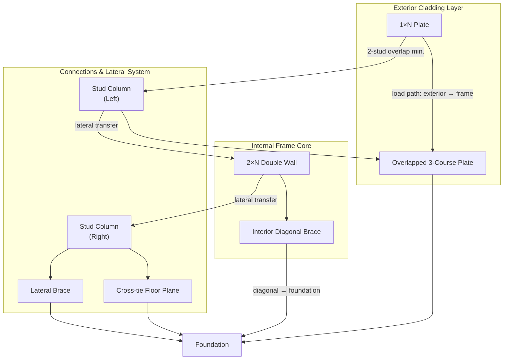

# Lesson 2: Structural Engineering

## 1. First-Principles Intuition & Invariants

The structural integrity of a Lego creation stands as the invisible architecture that separates amateur assemblies from professional masterworks. When we examine failure modes in complex MOCs (My Own Creations), we discover that catastrophic collapse rarely originates from material failure of the ABS plastic itself—rather, structural inadequacy emerges from insufficient understanding of load paths, connection geometry, and the fundamental mechanical principles that govern rigid body assemblies constrained by discrete connection points.

At the foundation of all structural engineering in Lego lies a deceptively simple invariant: every load applied to a structure must trace a continuous path through connected elements to a stable foundation. Unlike continuous materials such as steel or timber where stress distributes smoothly across grain boundaries and molecular bonds, Lego structures concentrate all forces at discrete connection interfaces—the cylindrical clutch power between studs and anti-studs, the friction fit of technic pins in beam holes, and the cantilever moments resisted byplate-to-plate interference. This discretization of load paths creates both opportunity and constraint. Where traditional structural engineering employs differential equations to model continuous stress fields, Lego structural analysis reduces to graph theory: each brick becomes a node, each connection an edge, and structural failure occurs when any edge reaches its maximum moment capacity or when the connection graph permits rigid body rotation around an instantaneous center that should remain constrained.

The clutch power of a standard 2×4 brick—approximately 35 to 45 Newtons of vertical extraction force when new—defines our fundamental unit of structural capacity. This value degrades with repeated connection cycles as the microscopic deformation of the stud cylinder and tube walls accumulates plastic strain, but for structural calculations we conservatively estimate 30 N per connection interface for well-used elements. Critically, this clutch force operates primarily in tension along the stud axis; lateral shear forces between overlapping plates exhibit dramatically lower resistance, typically 8 to 12 N before slip occurs. This anisotropy in connection strength mandates that primary load paths align with stud orientations whenever possible, and that lateral stabilization employs geometric constraint rather than frictional resistance.

The moment of inertia principle from classical beam theory translates directly to Lego assemblies, though with important modifications. A single-width wall of 1×N bricks exhibits negligible resistance to out-of-plane bending—the narrow 8 mm width provides minimal lever arm against rotational moments. Doubling the wall thickness to two studs wide increases the second moment of area by a factor of eight (the cube of the linear dimension), transforming a flexible membrane into a rigid structural plane. This cubic scaling relationship explains why professional architectural MOCs universally employ double-thick walls for any vertical element exceeding 20 studs in height. The mathematics proves unforgiving: a cantilevered beam's deflection scales with the cube of its length and inversely with the cube of its thickness, meaning a 40-stud-tall single-width tower deflects eight times more than a 20-stud tower, but employing a double-width construction reduces deflection by a factor of eight in the opposite direction.

Compression loading introduces a separate failure mode that many builders overlook until catastrophic collapse occurs. ABS plastic exhibits a compressive strength exceeding 80 MPa, far beyond what any realistic Lego structure will experience in the form of material yielding. However, slender vertical elements fail not through crushing but through Euler buckling—a sudden lateral deflection that occurs when compressive stress reaches a critical threshold determined by the element's length-to-thickness ratio and its end constraints. A tall, slender column of 1×1 bricks stacked vertically will buckle at heights between 60 and 80 studs depending on how firmly its ends are constrained, despite each individual brick being capable of supporting hundreds of times the applied load if it were cut to stub length. The Euler critical load formula, modified for the discrete geometry of stacked bricks, reveals that buckling resistance scales with the inverse square of unsupported length—halving the distance between lateral bracing points quadruples the buckling capacity.

This buckling phenomenon demands that vertical load-bearing elements receive lateral constraint at regular intervals, implemented through perpendicular wall intersections, internal bracing frames, or external buttressing. The optimal bracing interval for 1×1 or 2×2 columns under significant compression load sits between 16 and 24 studs of vertical rise, though the precise value depends on the magnitude of applied load and the rigidity of the lateral constraint. A perpendicular wall connected by overlapping plates every three to four courses provides adequate constraint; a single-point connection with no overlap merely creates a hinge rather than true lateral support.

The concept of structural redundancy—providing multiple independent load paths for critical forces—separates robust designs from those that exhibit brittle failure modes. A cantilevered balcony supported by a single layer of plates extending from a wall will catastrophically collapse if any individual plate connection fails, as no alternate path exists to carry the suddenly redistributed load. Introducing a secondary support layer offset vertically by one plate thickness creates redundancy: if one plate detaches, the remaining layer continues to carry load until repair occurs. This principle extends throughout structural design: critical load paths should never rely on singular connection points, and geometric arrangements should ensure that localized failures propagate gracefully rather than triggering cascade collapse.

## 2. Core Architecture & Mechanics

The SNOT revolution—Studs Not On Top building—fundamentally expanded the structural vocabulary available to advanced builders by enabling connection planes rotated 90 degrees from conventional vertical stacking. The essential insight underlying SNOT techniques recognizes that the 5:6 aspect ratio between plate thickness and stud spacing creates natural alignment planes when builders combine these dimensions strategically. Five plates stacked vertically measure precisely 16 mm, while two studs span 16 mm horizontally. This dimensional harmony means that a sideways-mounted bracket attached to a vertical stack can align its studs perfectly with a conventionally oriented surface exactly two studs away.

The headlight brick—a 1×1 brick with studs on both top and one side—serves as the foundational SNOT element from which more complex techniques derive. When builders integrate headlight bricks into a conventional stud-up wall at regular intervals, these elements provide attachment points for sideways-mounted panels, creating smooth vertical surfaces uninterrupted by stud texture. The structural implications extend beyond aesthetics: sideways-mounted plates resist vertical loads through their width dimension rather than their thickness, effectively rotating the structural properties by 90 degrees. A 1×6 plate mounted sideways presents six studs of vertical height with only 4 mm of horizontal depth, enabling thin vertical surfaces that nonetheless possess significant bending resistance in the plane perpendicular to their faces.

The bracket inventory—1×2/1×2 inverted, 1×2/2×2 inverted, and their variants—provides right-angle transitions with geometric precision calibrated to the 5:6 plate-to-stud relationship. Consider the 1×2/2×2 inverted bracket: its lower surface contains two studs oriented conventionally, while its upper surface presents four studs rotated 90 degrees and offset by exactly five plates' worth of distance. Builders can stack five plates on the conventional lower surface, then attach a brick to the rotated upper surface, achieving perfect alignment between the two perpendicular planes. This geometric trick enables complex internal frameworks where horizontal and vertical structural members interlock with full stud connection security rather than relying on friction or clip constraints.

Triangulation principles from truss engineering translate cleanly into Lego structural design, though implementation requires understanding how to construct diagonal members within the rectilinear stud grid. The Pythagorean relationship manifests in several useful ratios: a 3-4-5 right triangle emerges naturally when builders span three studs horizontally and four studs vertically, the hypotenuse measuring five stud-spacings diagonally. Similarly, 5-12-13 and 8-15-17 triangles provide diagonal bracing opportunities at larger scales. Constructing these diagonal members demands specific techniques: for the 3-4-5 triangle, builders typically employ a 1×4 plate spanning the four-stud vertical distance, with a 1×3 plate or technic beam spanning the three-stud horizontal distance. The connection at the right angle requires offset plate attachment using bracket elements, while the hypotenuse can employ clip connections or technic pins inserted at angles through carefully positioned holes.

The internal bracing frame represents the most powerful structural technique for large-scale MOCs, particularly those with significant cantilevers or tall vertical elements subject to buckling. Rather than relying solely on the exterior shell to provide structural integrity, advanced builders construct an independent load-bearing skeleton hidden within the model's volume. This internal framework employs thick walls (minimum two studs wide), frequent perpendicular intersections forming a grid pattern, and vertical integration through overlapped plate layers every three to four courses. The exterior surface layers then attach to this framework, carrying only local loads from their immediate connections rather than participating in the primary load path. This architecture mirrors steel-frame construction in full-scale buildings, where the curtain wall provides weather protection and aesthetics while the internal frame resists all significant structural loads.

Cantilever construction demands careful attention to moment arm geometry and connection distribution. When a beam extends horizontally from a fixed support, gravitational loads at the free end generate a bending moment that scales linearly with distance from the support. A 10-stud cantilever supporting a 100-gram load experiences 1000 gram-studs of moment at the fixed end; doubling the length to 20 studs doubles the moment to 2000 gram-studs even with identical loading. This moment must be resisted by connection forces distributed across the fixed end's attachment plane. A single 2×4 brick provides approximately six to eight stud-connections to the supporting structure; if the cantilever attaches through this single element, those six connections must collectively resist the entire bending moment. Calculating the force per connection reveals whether the design exceeds clutch capacity: for a 20-stud cantilever with 100-gram tip load, the moment divided by the lever arm of the connection group yields individual connection forces that may approach or exceed the 30 N clutch limit, predicting failure.

The solution involves distributing the fixed-end attachment across multiple layers and widening the connection footprint. A three-layer deep connection with each layer two studs wide provides approximately 18 connection points (accounting for overlap), tripling the available moment resistance. Furthermore, positioning these layers with maximum vertical separation increases the lever arm of the resisting couple: connections at the top surface experience tension while those at the bottom surface experience compression, and the vertical distance between these layers directly multiplies their effectiveness. A connection block six plates tall (two bricks) roughly doubles the effective moment resistance compared to a three-plate-tall (one brick) connection, even with identical numbers of studs, because the vertical separation of force couples doubles.

Modular architecture introduces unique structural considerations absent from monolithic builds. When a large MOC separates into discrete modules for transport and reassembly, the connection interfaces between modules become critical failure planes. These joints must simultaneously provide precise geometric alignment, carry structural loads across the interface, and allow for reasonable assembly/disassembly cycles without degradation. The preferred approach employs technic pin connections for large load-bearing joints: four to eight technic pins arranged in a rectangular pattern provide robust shear resistance while allowing repeated disconnection. For alignment precision, including technic axles in dedicated beam channels creates positive location constraint that technic pins alone cannot provide, as pins permit several tenths of a millimeter of lateral play in their holes.

The vertical integration challenge—ensuring that a modular interface transmits vertical loads without progressive settling—requires attention to compression paths. Builders must ensure that weight-bearing surfaces mate across the module boundary with full area contact, rather than transferring load through pin friction alone. Incorporating flat plate surfaces that stack conventionally across the module joint, surrounding but distinct from the technic pin connection array, creates compression load paths that bypass the pins entirely. The pins then function purely for lateral constraint and tension loads, roles for which they excel, while plate-to-plate compression carries vertical forces with zero relative motion between modules.

## 3. High-Performance Optimization & Failure Modes

The optimization of structural efficiency—achieving maximum load capacity with minimum part count and mass—requires systematic analysis of load paths and strategic placement of reinforcement only where stress concentrations demand it. Many builders instinctively over-engineer structures uniformly, creating monolithic masses that waste material in regions experiencing negligible stress while occasionally still failing due to under-reinforcement at critical points. The principle of structural optimization dictates that material should concentrate where stress concentrates, and that regions experiencing minimal load can employ minimal structure.

Conducting informal finite element analysis by hand begins with identifying load application points and support reaction points, then tracing the primary load paths between them. For a cantilevered balcony extending from a building facade, load enters at the balcony floor's outer edge where occupants or display elements rest, then must travel through the floor structure back to the fixed connection at the building wall, then down through the wall to the foundation. Every element along this path experiences significant stress; elements not on this path experience minimal stress and can be lightened or eliminated. Visualization helps: imagine pushing on the structure and observing which members compress or stretch. Those members require reinforcement; orthogonal members that neither compress nor stretch can be thinned.

The identification of failure modes through progressive load testing provides empirical validation of structural designs before catastrophic collapse occurs during display or transport. Builders should apply gradually increasing loads to completed structures while observing deflection, connection creep, and acoustic precursors to failure. A properly designed structure exhibits linear deflection with applied load—doubling the load doubles the deflection—up to a yield point where permanent deformation begins. Non-linear deflection appearing at low loads signals that connections are slipping or that buckling instability approaches. Audible clicking or popping sounds indicate connection separation beginning; these acoustic warnings often precede visible failure by seconds to minutes, providing opportunity for load reduction before collapse.

Quantitative deflection measurements using reference points and calibrated visual observation enable optimization iteration. Mark a fixed reference point on a stable surface adjacent to the structure, then mark a point on the structure that should remain stationary. Apply a known load and measure deflection between these points using a ruler or caliper. Acceptable deflection limits depend on context, but for display models, keeping total deflection under 1% of span length prevents visible sagging. A 50-stud cantilever should deflect less than 0.5 studs (4 mm) under maximum anticipated load. If measured deflection exceeds this limit, reinforcement must increase stiffness—recall that stiffness scales with the cube of beam depth, so increasing connection depth from two to three plates reduces deflection by a factor of 3.375.

The thermal expansion consideration often surprises builders who display MOCs outdoors or in environments with significant temperature variation. ABS plastic's coefficient of thermal expansion sits at approximately 90 × 10⁻⁶ per degree Celsius, meaning a 1-meter-long structure expands 0.9 mm per 10°C temperature increase. For small models this remains negligible, but architectural MOCs spanning several meters can experience millimeter-scale expansion that generates internal stress if rigidly constrained at multiple points. Buildings designed as single monolithic structures fare better than those with multiple independent modules bolted to a rigid base plate, as the monolith expands uniformly while the multi-module assembly fights between expansion of individual modules and constraint imposed by the shared base. If displaying large MOCs outdoors, incorporate expansion joints—deliberate gaps of 1 to 2 mm between major sections that allow thermal movement without generating stress.

Connection fatigue accumulates over repeated assembly and disassembly cycles, degrading clutch power and introducing looseness that compromises structural integrity. Technic pins exhibit excellent fatigue resistance, maintaining tight fit for hundreds of cycles, making them ideal for modular interfaces subjected to repeated connection. Conventional brick studs and tubes degrade more rapidly, particularly the tubes on plate undersides which employ thinner wall sections. After 50 to 100 connection cycles, plates may exhibit noticeable looseness. Critical structural connections in modular designs should therefore employ technic hardware rather than stud-based attachment when repeated disassembly is anticipated. If stud connections are unavoidable, rotating which specific elements connect at critical joints—using different bricks on alternating assembly cycles—distributes fatigue across multiple parts rather than concentrating wear on a single connection pair.

The transport case design for modular MOCs deserves as much engineering attention as the MOC itself, as vibration and impact loads during transport frequently exceed static display loads by orders of magnitude. Internal bracing within the transport case, using foam padding shaped to support the model at strong points rather than contacting fragile details, prevents resonant vibration from exciting the model's natural frequencies. Identifying these natural frequencies requires simple impulse testing: gently tap the assembled model with a fingertip and observe which structures vibrate or ring. These resonant modes will amplify during transport vibration, potentially causing fatigue failure even without direct impact. Damping resonant modes requires either stiffening the vibrating element (increasing its natural frequency above the transport vibration spectrum) or introducing damping material (soft fabric or foam) that contacts the vibrating surface and dissipates energy through friction.

The failure mode catalog for Lego structures includes several characteristic patterns that experienced builders learn to recognize and mitigate preemptively. Progressive connection slip manifests as gradual sagging or rotation under constant load, indicating that static friction between elements is marginal and will eventually lose to gravitational moments. This failure mode responds to increased connection overlap—adding additional plate layers with offset seams distributes load across more stud interfaces. Sudden brittle fracture, where a structure fails instantaneously with no warning deflection, indicates either material failure of plastic elements (rare except with age-degraded or chemically damaged parts) or shear failure where connection force exceeds clutch capacity by a wide margin. Brittle failure demands fundamental redesign rather than incremental reinforcement, as the load path itself proves inadequate. Buckling instability, characterized by sudden lateral deflection of a compression member accompanied by dramatic stiffness reduction, requires introduction of lateral bracing at mid-span rather than strengthening the buckled member itself—additional material at the buckling location proves ineffective because the buckling wavelength simply adjusts to span between the reinforced point and the member's end.

Advanced builders develop intuition for structural efficiency by comparing part count and mass between equivalent structures employing different techniques. A brute-force solid wall of plates achieves rigidity through sheer mass, while an internal frame with thin exterior cladding achieves comparable rigidity with 40 to 60 percent of the part count by concentrating material in the primary load paths. This efficiency gain translates directly to cost reduction in large MOCs and, more importantly, to reduced gravitational loads that would otherwise burden the supporting structure. A 5-kilogram architectural model with inefficient internal structure might require only 3 kilograms if rebuilt using optimized frame techniques, reducing foundation loads by 40 percent and potentially eliminating an entire class of deflection and settlement issues.
