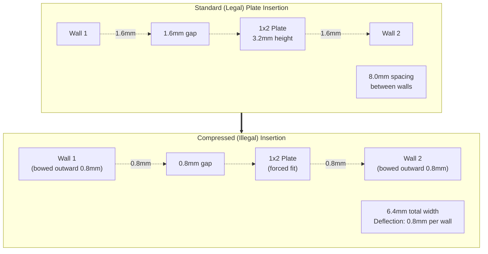

# Lesson 3: Advanced Integration

## 1. First-Principles Intuition & Invariants

The transition from competent builder to master architect occurs not through the accumulation of parts, but through the deliberate violation of design intent. Every LEGO element emerges from the Billund factories with an implicit contract: studs face upward, plates stack in integer-height increments of 3.2 millimeters, and assemblies obey the orthogonal grid defined by the 8mm stud spacing. Yet the most compelling architectural achievements in the AFOL community systematically transgress these conventions, exploiting tolerances, leveraging geometric quirks, and applying forces the designers never anticipated. This contradiction—that excellence requires breaking the rules while respecting the underlying physics—defines the advanced integration challenge.

The term "illegal building" carries unfortunate connotations of recklessness, but its proper interpretation concerns structural integrity rather than regulatory compliance. An illegal technique applies stress concentrations to elements beyond their design envelope, introduces cantilever moments that exceed plastic yield thresholds, or creates joint geometries prone to creep under sustained load. The master builder distinguishes between temporarily illegal assemblies—those that become stable once surrounding structure distributes forces—and permanently compromised connections destined for catastrophic failure during handling or display. This distinction demands physical intuition about polymer behavior under multiaxial stress states, an understanding rarely codified in instruction manuals but essential for pushing technique boundaries.

Greebling, a term borrowed from industrial light and magic model-making, describes the application of fine-scale surface articulation to suggest mechanical complexity. Where novice builders perceive greebling as decorative chaos, the advanced practitioner recognizes it as controlled visual noise serving specific perceptual functions: establishing scale hierarchy, directing eye movement across surfaces, and creating local contrast that prevents monotony across large uniform areas. The difference between effective greebling and cluttered incoherence lies in adherence to underlying rhythmic structures—grids, radial patterns, or fractal recursion—that provide organizational logic beneath apparent randomness.

Texture replication confronts a fundamental impediment: LEGO elements possess inherently faceted geometry with sharp transitions between surfaces, while real-world materials exhibit continuous gradations, weathering patterns, and stochastic variation. The solution space divides into two complementary approaches. Macrotexture strategies employ aggregate patterns—shingling tiles to approximate wood grain, interlocking plates at slight angles to suggest masonry courses, or layering transparent elements with printed details to create depth. Microtexture techniques exploit the dimensional vocabulary of small parts: clips, brackets, teeth, and mechanical connectors assembled at densities approaching the resolution limit of human visual acuity at typical viewing distances of 50 to 100 centimeters.

Color theory in LEGO departs from traditional painting or digital workflows because the palette remains fundamentally discrete and inventory-constrained. The System comprises approximately 60 current production colors, though availability varies dramatically by element geometry—a specialized bracket may exist in only six colorways while common plates span the full spectrum. This constraint transforms color selection from an artistic choice into an optimization problem balancing visual intent against parts acquisition difficulty and cost. Furthermore, LEGO plastic exhibits distinct surface properties across color families: dark bluish gray and black absorb light with minimal specular reflection, white and light bluish gray produce strong highlights under directional lighting, and transparent colors transmit and scatter light in ways that fundamentally alter adjacent color perception. The advanced builder internalizes these optical behaviors, predicting how color combinations will render under varied illumination conditions rather than relying on digital renders that often fail to capture real-world material interactions.

Microscale construction—typically defined as building at scales below minifigure compatibility, often 1:200 or smaller—inverts the normal hierarchy of structural and cosmetic concerns. At conventional scales, internal framework provides strength while exterior cladding defines appearance; these roles remain distinct and separable. At microscale, nearly every visible element must simultaneously bear loads and communicate form. A 1x1 plate with clip becomes simultaneously a structural joint, a window detail, and a vertical texture element. This multiplicity demands ruthless efficiency: wasted volume, redundant connections, or non-load-bearing decoration represent failures of integration. The microscale builder thinks in terms of element *density*—the information content per cubic stud—rather than piece count alone.

The invariant underlying all advanced integration techniques is the principle of *emergent resolution*: compelling detail arises not from miniaturization to the limits of part availability, but from the strategic deployment of resolution gradients. The human visual system possesses extraordinary sensitivity to edges, transitions, and local contrast but relatively poor absolute spatial frequency discrimination. A model succeeds when it provides high detail where focal attention naturally falls—focal points, silhouette boundaries, areas of high curvature—while reducing complexity in peripheral or occluded regions. This perceptual optimization allows the builder to concentrate labor and rare parts where they deliver maximum visual return while accepting lower fidelity in less critical zones. The amateur attempts uniform detail density across the entire model and exhausts resources; the master creates visual hierarchy through deliberate variation.

## 2. Core Architecture & Mechanics

The fundamental illegal building techniques partition into four mechanical classes based on the deviation from standard connection geometry: stud-to-side connections, compression-based assemblies, clip-based elastic deformation, and stacked plate offset violations. Each exploits different material properties and introduces distinct failure modes requiring specific mitigation strategies.

Stud-to-side connections place cylindrical studs into gaps never intended to receive them: the space between two adjacent studs, the 0.8mm gap between a brick side wall and a plate perimeter, or the interior void of a technic brick where pin holes reside. The classic 1x1 headlight brick exemplifies this technique, providing a recessed stud perpendicular to normal stud orientation. By inserting this sideways stud into the gap between two studs on a perpendicular surface, builders achieve 90-degree orientation changes without specialized brackets. The mechanical reality involves significant friction—the stud diameter of 4.8mm must compress slightly to fit into a nominal 8mm stud pitch that already accommodates two 4.8mm studs, leaving insufficient clearance for a third. This interference fit generates hoop stress in surrounding ABS plastic, approaching but not exceeding the yield strength if insertion occurs gradually and surrounding elements constrain deflection. Long-term creep becomes the primary failure mechanism: under sustained compressive load, ABS exhibits viscoelastic relaxation that gradually reduces grip strength over months or years. Mitigation requires distributing these connections across multiple attachment points and ensuring that loss of any single joint cannot trigger progressive collapse.

Compression-based assemblies, colloquially termed "brick stuffing," pack elements into volumes geometrically insufficient to contain them at zero stress. The prototypical example inserts a 1x2 plate into the gap between two parallel walls separated by 1.5 plates (4.8mm) rather than the 2-plate minimum (6.4mm) required for unstressed fit. The 0.5-plate deficit (1.6mm) distributes across the plate thickness and wall deflection, generating bidirectional bending stress. The technique succeeds because LEGO plates possess surprisingly large elastic limits—temporary deflections of 2-3mm recover without permanent set if loads remain below approximately 30 seconds duration during assembly. Once neighboring elements lock into place, they provide reaction forces that reduce stress to sustainable levels. The critical design parameter is the load path geometry: compression must resolve through multiple elements in parallel rather than cascading through a single structural chain. A common error places stuffed assemblies near model edges where insufficient surrounding structure exists to redistribute forces, resulting in elements spontaneously ejecting during handling.



Clip-based elastic deformation leverages the designed flexibility of specific elements—bar holders with clip, modified plate with handled bar, minifigure hand assemblies—but applies them outside intended use cases to achieve angles, curves, or offsets impossible through rigid connections. A bar holder clip exerts approximately 2-3 Newtons of gripping force on a 3.18mm diameter bar, sufficient to maintain position under model self-weight but loose enough to permit deliberate repositioning. By attaching multiple clips along a flexible bar or chain element, builders create compound curves with local tangent directions defined by clip positions. The mathematical model approximates a discretized Euler-Bernoulli beam: each clip acts as a displacement boundary condition, and the connecting bar minimizes bending energy to assume a smooth curve interpolating these constraints. Failure occurs through either clip fatigue—the polycarbonate or ABS fingers work-harden after hundreds of insertion cycles and lose elasticity—or through bar torsion accumulation, where multiple clips impose incompatible twist angles that sum to exceed the bar's torsional yield limit. Preventive design distributes angular change across maximum bar length and avoids concentrating multiple clips within short segments.

Stacked plate offset violations systematically introduce half-plate (1.6mm) or third-plate (1.07mm) height errors that accumulate across multiple courses to achieve vertical positioning impossible through standard integer plate stacking. The technique exploits the clearance between stud tops and the underside tube geometry of overlaying plates—nominally 0.1-0.2mm under zero load. By inserting thin elements (1x1 tiles, cheese slopes, modified plates with reduced underside tube depth) that locally reduce effective plate height, builders create cumulative offsets. Five standard plates measure 16.0mm in height; substituting one plate with a tile (no underside tubes) reduces this to approximately 15.2mm, an 0.8mm deficit. Stacking two such assemblies side-by-side produces a 0.8mm height difference exploitable for detailed surface articulation. The compounding error introduces shear stress at each misaligned interface—studs engage tubes at non-perpendicular angles, generating lateral forces absent in properly aligned assemblies. Containment requires surrounding each offset stack with properly aligned structure that constrains lateral deflection and prevents buckling under vertical loads.

Greebling architecture follows a hierarchical generation process analogous to procedural detail synthesis in computer graphics, though implemented through manual assembly rather than algorithmic automation. The first-order structure establishes primary surface subdivision: large panels, major mechanical features, or architectural bays define the gross composition. Second-order greebling applies within these subdivisions, typically at 4x4 or 6x6 stud module scales, introducing secondary forms like recessed panels, raised borders, or symmetric mechanical details. Third-order detail operates at individual element scale—single 1x1 plates, clips, or tiles placed to suggest fasteners, vents, or worn detail. This fractal-like hierarchy ensures visual interest at multiple viewing distances: from across a room, first-order composition dominates; at arm's length, second-order patterns emerge; and close inspection reveals third-order minutiae rewarding detailed examination.

The critical constraint governing greebling density is the Nyquist criterion adapted for visual perception: detail features must maintain spacing of at least two element widths to remain individually resolvable rather than blurring into undifferentiated texture. A surface covered with 1x1 plates at every stud position reads as uniform stippled texture, not discrete detail. Introducing gaps—alternating occupied and empty studs in a checkerboard or more complex pattern—allows individual elements to register as distinct features. The optimal density varies with viewing distance following the small-angle approximation: an element subtending less than approximately 0.02 radians (roughly 1 degree of visual angle) at typical viewing distance loses individual identity and contributes only to aggregate texture. For a 1x1 plate (8mm width) viewed at 50cm distance, this corresponds to barely resolvable detail; at 1 meter, it merges into texture. This psychophysical constraint, not builder preference, determines effective greebling scale.

Texture replication through LEGO elements necessarily operates through *abstraction* rather than *simulation*—the goal is to evoke material character through strategic cues rather than point-by-point geometric correspondence. Brick textures exemplify this principle: real masonry exhibits continuous mortaring between slightly irregular units with surface pitting and color variation. LEGO replication uses offset 1xN plates or tiles in alternating courses (running bond pattern) with 1-plate vertical spacing suggesting mortar lines. The abstraction succeeds because it captures the dominant spatial frequency (brick dimensions and course rhythm) while omitting high-frequency detail (surface roughness, weathering) that would require sub-element resolution. The perceptual system accepts this stylization as "brick-ness" despite obvious geometric simplification.

Wood grain texture presents a distinct challenge because its characteristic appears as continuous variation rather than discrete units. Effective approaches layer elements at slight rotational offsets: a series of 1x6 tiles placed with 5-degree rotation steps creates undulating lines suggesting growth rings or planking. Alternatively, mixing tan and dark tan elements in approximately 3:1 ratios with small clusters of like colors mimics the light/dark banding of wood grain without attempting literal reproduction. The critical insight is that texture recognition relies on statistical properties—spatial frequency distributions, dominant orientations, local correlation lengths—not exact geometry. Replication succeeds when these statistical signatures approximate the target material within the resolution limits of LEGO elements.

Weathering and surface damage—critical for military models, post-apocalyptic scenes, or aged architecture—employ several complementary techniques. Sparse application of dark bluish gray 1x1 plates or tiles onto lighter base colors suggests dirt accumulation or paint loss. Deliberately breaking regular patterns (omitting tiles from otherwise uniform coverage, introducing color outliers) implies damage or wear. At larger scales, systematic structural deflection—plates or panels bowing outward, walls at non-perpendicular angles—communicates structural fatigue. These techniques exploit a perceptual bias: human vision interprets pattern deviations as recent changes to an originally regular state, automatically inferring a narrative of deterioration. This cognitive shortcut allows minimal added parts to communicate significant aging, provided the underlying "pristine" pattern remains evident enough for the deviation to register as intentional rather than builder error.

Color theory application begins with understanding LEGO's palette organization. Colors cluster into temperature families: warm reds, oranges, yellows versus cool blues, greens, purples, with tan, brown, and gray serving as neutrals bridging both groups. Within each family, LEGO provides 2-4 value steps: bright light blue, medium azure, dark azure, and dark blue form a blue family value scale. Effective color blocking respects two constraints simultaneously: sufficient local contrast to define edges and features, and global harmony maintaining temperature consistency or implementing deliberate temperature shifts for compositional effect. A common amateur error places high-saturation complementary colors adjacent without neutral buffering—bright red directly against bright green creates visual vibration at their boundary, fatiguing the eye. Introducing dark bluish gray or tan at the interface provides perceptual relief while maintaining the overall color scheme.

LEGO plastic exhibits metameric properties—color appearance shifts under different illumination spectra. Colors selected to harmonize under warm incandescent lighting may clash under cool fluorescent or daylight conditions. Blues and purples demonstrate particularly strong metamerism: medium azure appears vibrant under cool white LEDs but dulls toward gray under warm lighting. Advanced builders photograph test assemblies under multiple light sources and adjust color selections based on anticipated display conditions. This empirical approach supersedes theoretical color wheel relationships because LEGO's pigment formulations deviate from idealized primaries and because lighting context dominates perceived color relationships.

Microscale architecture requires radical reconceptualization of form-building logic. At minifigure scale, a building's corner might employ 8-10 elements: structural bricks, cladding plates, decorative tiles, window frames, interior backing. At 1:200 microscale, that entire corner must fit within the volume of a single 1x2 brick. This 10:1 compression demands that every element shoulder multiple representational burdens. A 1x1 tile simultaneously represents a window bay, provides local color accent, and serves as attachment point for upper-story structure. There is no budget for single-purpose parts.

The microscale design process inverts normal workflows. Instead of conceiving a form and then determining how to build it, the advanced microscale builder catalogs the volumetric and visual properties of available small elements—1x1 round plates, cheese slopes, 1x1 cones, clips, brackets—and assembles forms by stacking these primitive visual properties. A 1x1 cone suggests a tower finial, lighthouse top, or rocket nose purely through its shape, independent of absolute scale. By arranging multiples with appropriate spacing and support, the builder creates composition from vocabulary, much as a poet selects words from a dictionary constrained by meter and rhyme scheme.

Critical to microscale success is the establishment of a *scale key*—a consistent visual language defining what real-world dimensions each LEGO dimension represents. If 1 stud width = 4 meters of real-world building width, then a 1-plate height represents approximately 1.6 meters of building story height (maintaining realistic proportions). Once established, this scale key must remain consistent throughout the model. Violations are immediately perceptible: a door that should be 3 plates tall according to the scale key but is actually 2 plates reads as "wrong" even to viewers who cannot articulate why. The human visual system is exquisitely sensitive to proportion violations, an evolutionary adaptation for face recognition co-opted for architectural assessment.

```text
MICROSCALE SCALE KEY EXAMPLE (1:200 architectural)
1 stud width (8mm)        → 1.6m real-world
1 plate height (3.2mm)    → 0.64m real-world
1 brick height (9.6mm)    → 1.92m real-world

Typical building story: 3m → ~4.7 plates → 1 brick + 1 plate
Window: 1.5m tall → ~2.3 plates → 2 plates (acceptable approximation)
Door: 2.1m tall → ~3.3 plates → 1 brick (slight compression, visually acceptable)
```

## 3. High-Performance Optimization & Failure Modes

Optimization of advanced integration techniques requires balancing multiple competing constraints: structural integrity, parts availability, assembly complexity, and visual fidelity. Unlike conventional engineering where constraints are well-defined and often quantifiable, LEGO optimization involves significant subjective judgment. What constitutes "sufficient" structural integrity for a display model versus a frequently handled toy? How much additional assembly time justifies a 5% visual improvement? These questions lack universal answers, demanding that the builder develop personal standards calibrated to intended use cases.

Structural optimization for models employing extensive illegal techniques follows a defensive design philosophy: assume that 20-30% of non-standard connections will degrade or fail over a 5-year lifespan, and ensure that this partial failure does not cascade. The implementation employs redundant load paths—multiple independent structural elements capable of supporting critical masses—and strategic compartmentalization. Large models subdivide into sections connected through robust, legal interfaces. If an interior illegal connection fails, the section remains stable through perimeter structure, and the section-to-section joints prevent propagation. This modular approach also facilitates repairs: a compromised section detaches for rework without disturbing the entire model.

Quantitative stress estimation for LEGO structures remains largely empirical due to the complex geometry of studded connections and the nonlinear material properties of ABS plastic. However, useful heuristics guide design decisions. A 2x4 brick in pure axial compression can support approximately 100-200N before stud deformation or cracking becomes likely—sufficient to support a column of 1000-2000 similar bricks. In practice, bending moments and shear forces reduce effective capacity to perhaps 10% of this theoretical maximum. For cantilever beams, limiting spans to approximately 6-8 studs per plate-height of beam depth prevents noticeable deflection under self-weight. A 2-plate-thick beam should not cantilever beyond 12-16 studs without intermediate support; exceeding this invites visible sag and eventual plastic creep. When illegal techniques introduce point loads or stress concentrations, conservative practice reduces these span limits by 30-50%.

Clip-based assemblies demand particular attention to fatigue life. Polycarbonate clips (typically transparent or translucent colors) exhibit excellent elasticity but suffer from stress whitening—microscopic crazing—after repeated flexure. These crazed regions lose transparency and eventually fracture. The design mitigation accepts clips as sacrificial wear components: orient assemblies so clip replacement is possible without complete disassembly, and maintain spare clips in anticipated failure-prone positions. ABS clips (opaque colors) resist crazing but offer less elastic range before permanent set. Optimal design matches clip material to duty cycle: polycarbonate for assemblies requiring repeated adjustment during construction but becoming static once complete; ABS for permanent installations where elastic range matters less than long-term dimensional stability.

Parts availability optimization recognizes that not all LEGO elements are created equal in terms of procurement difficulty and cost. Common elements like 1x2 plates and 2x4 bricks cost $0.01-0.03 in bulk on secondary markets; rare colors of specialized parts may exceed $1.00 per element. A design requiring 500 common elements and 50 rare elements might cost $10-$15 in parts; substituting the rare parts with only slightly less ideal common alternatives might reduce cost to $5-$7. The visual degradation is often negligible—a bracket available only in dark bluish gray replaced with black usually has imperceptible impact—but the economic improvement is substantial. Advanced builders maintain mental catalogs of available elements by color and consciously design within these constraints rather than specifying ideal but unobtainable parts.

The workflow for parts-optimized design inverts the traditional creative process. Instead of conceiving a vision and sourcing parts to realize it, the builder first surveys available inventory, identifies interesting combinations and subassemblies possible with on-hand parts, and constructs vision from possibility space. This constraint-based creativity often produces more original results than unconstrained ideation because it forces the builder into unfamiliar combinations and workarounds that would never emerge from a "perfect parts" scenario. The aesthetic that emerges—making virtue of limitation—distinguishes experienced builders from beginners who attempt to bend reality to match idealized conceptions.

Assembly complexity optimization involves minimizing subassembly count, reducing step count requiring awkward hand positions or viewing angles, and eliminating order-dependent construction sequences where step N must precede step M despite no structural reason. The ideal assembly permits progressive construction from a single starting point with each addition immediately and unambiguously locked in place. Deviation from this ideal is sometimes necessary—interior details that must be installed before roof closure, for instance—but each violation should be deliberate and minimized. A useful metric is the "hand position count": how many distinct grip reorientations are required during assembly. Designs exceeding 20-30 reorientations for a moderate-sized model (500-1000 pieces) indicate assembly inefficiency; optimized designs achieve the same complexity in 10-15 reorientations.

Greebling optimization addresses the tendency for excessive detail to produce visual chaos rather than enrichment. The diagnostic symptom is loss of focal hierarchy: the eye scans the surface without settling on any dominant feature, experiencing fatigue rather than engagement. The corrective applies deliberate simplification: identify 2-3 primary focal points (typically points of high curvature, strong light/shadow transitions, or compositionally significant locations) and *increase* detail density in these areas while simultaneously *reducing* density in surrounding regions. This exaggerates contrast between high-interest and low-interest zones, guiding viewer attention deliberately. The principle extends from traditional art composition (where focal areas receive refined detail while backgrounds employ broader strokes) but requires conscious effort in LEGO because the uniform element size tempts uniform application.

Quantitative greebling metrics are possible: measure the variance in local element density across the model surface. Low variance (uniform density everywhere) correlates with visual boredom or chaos depending on absolute density level. High variance with clear spatial organization—dense regions concentrated at specific locations, smooth gradients between high and low density areas—correlates with compelling composition. A practical target is 3:1 maximum-to-minimum density ratio: the most detailed zone should employ approximately three times the parts per square-stud as the least detailed zone. Larger ratios risk appearing inconsistent or unfinished; smaller ratios fail to establish sufficient hierarchy.

Texture replication optimization balances two failure modes: insufficient abstraction producing literal but unconvincing results, and excessive abstraction losing material character entirely. The diagnostic for insufficient abstraction is the "uncanny valley" effect: the texture is obviously attempting to represent a specific material but falls short in ways that highlight rather than conceal the compromise. Better to abstract further, simplifying to evocative suggestion rather than failed simulation. The diagnostic for excessive abstraction is ambiguity: viewers cannot identify the intended material. The optimum lies at the *minimum sufficient abstraction*: the simplest representation that reliably evokes correct material identification without requiring conscious analytical interpretation.

Empirical testing provides the most reliable optimization guidance: construct small test sections (6x6 or 8x8 studs) exploring different abstraction levels, photograph them at typical viewing distances, and assess which version most immediately reads as the target material. This iterative prototyping invests perhaps 30-60 minutes and 50-100 parts per material but prevents committing hundreds of parts and hours to an ineffective approach. The advanced builder maintains a reference library of successful texture solutions—photographed or physically preserved—cataloged by material type for reuse in future projects.

Color optimization for legal palette constraints employs several strategies when ideal colors are unavailable. Substitution within the same temperature family maintains harmony: if medium azure is unavailable, dark azure or bright light blue preserve the cool-blue character. Strategic desaturation replaces unavailable saturated colors with near-neutral equivalents: unavailable dark red substitutes with dark brown; missing olive green becomes dark tan. The perceptual system tolerates desaturation more readily than temperature shifts because saturation primarily affects vividness rather than fundamental color identity. Dithering—alternating two available colors at small scale to optically mix toward an unavailable intermediate—succeeds when viewing distance is sufficient for the dithered elements to fall below resolution threshold. At 1-meter viewing distance, alternating 1x1 plates in sand blue and medium azure create an effective intermediate blue-gray that neither color provides individually.

Color bleeding, where visually bright colors placed adjacent to dark colors create apparent halos or outlines, represents a particular failure mode in LEGO models due to the high reflectance of light colors and the strong local contrast at element boundaries. Mitigation employs transition zones: a 1-plate or 1-stud band of medium-value neutral (light bluish gray, tan) between high-contrast color areas. This buffer reduces the local derivative of brightness change, diminishing the perceptual halo effect. Alternatively, deliberately exploit the effect for graphic emphasis: a thin line of white or bright light yellow against dark blue or black creates a striking outline that can define shapes or suggest illumination without requiring transparent elements or lighting installations.

Microscale structural optimization confronts a paradox: reduced mass proportionally reduces gravitational loads, but LEGO connection strength does not scale downward equivalently. A 1:50 scale model experiences gravitational stress 1/50th that of a full-scale model per unit volume, but a 1x1 plate-to-plate connection provides no less absolute grip force than a 2x4 brick-to-brick connection. This scale-invariant connection strength makes microscale models disproportionately robust relative to their size—a useful advantage. However, it also means that inefficient structure pays no penalty and may persist undetected until handling loads (which do not scale favorably) induce failure. Design validation requires deliberate stress testing: inverting the model, grasping it at non-intended lifting points, applying gentle torsion to check for weak shear planes.

Microscale detail optimization asks: which features are structurally necessary, which enhance recognition or character, and which are merely habitual? A 1:200 building may have structurally modeled window mullions at 1:50, but at 1:200, individual windows may be represented by single 1x1 tiles. The mullions have become irrelevant—not because they are unimportant at full scale but because they fall below the resolution threshold of the microscale representation. Eliminating them is not compromise but appropriate abstraction. The disciplined microscale builder constantly interrogates each element: does this enhance legibility or merely satisfy the urge to include detail? If the model reads equally well without it, omit it.

The failure mode matrix for advanced integration summarizes stress mechanisms, detection methods, and mitigations:

**Stud-to-side connections:** Stress mechanism is hoop stress and creep in surrounding elements. Detection: periodic inspection for loosening or element drift. Mitigation: redundant attachment points, surrounding structure constrains deflection, avoid at model perimeters.

**Compression assemblies:** Stress mechanism is bending and sustained elastic deflection. Detection: spontaneous element ejection, visible wall bowing. Mitigation: parallel load paths, containment within robust framing, limit compression duration during assembly.

**Clip-based elastic deformation:** Stress mechanism is cyclic fatigue and stress whitening. Detection: crazed appearance in transparent clips, permanent set in opaque clips. Mitigation: polycarbonate for construction-phase flexibility, ABS for permanent installations, maintain spare parts for replacement.

**Stacked plate offsets:** Stress mechanism is shear stress at misaligned interfaces. Detection: lateral element deflection, buckling under vertical load. Mitigation: surround each offset stack with properly aligned structure, limit accumulated offset to < 1 brick height per vertical span.

**Excessive greebling density:** Stress mechanism is cognitive, not mechanical—viewer attention fatigue. Detection: absence of clear focal points, uniform visual noise. Mitigation: establish 3:1 density variance, concentrate detail at compositional focal points.

**Failed texture abstraction (uncanny valley):** Stress mechanism is perceptual dissonance between intent and execution. Detection: viewer uncertainty about material identity, conscious "trying to figure out what it's supposed to be." Mitigation: increase abstraction, prioritize characteristic spatial frequencies over literal geometry.

**Color palette constraint violation:** Stress mechanism is visual inharmony or unavailable parts blocking construction. Detection: unwanted vibrancy or dullness, inability to source specified colors. Mitigation: temperature-family substitution, strategic desaturation, optical dithering at appropriate scales.

**Microscale detail over-specification:** Stress mechanism is parts budget exhaustion, structural fragility, assembly complexity. Detection: construction time exceeds available attention span, frequent rebuilds due to fragility. Mitigation: ruthlessly eliminate below-threshold detail, prioritize silhouette and proportion over surface articulation.

The advanced practitioner internalizes these failure modes and their countermeasures to the point of automaticity. Design proceeds with implicit awareness of stress distributions, perceptual resolution limits, and material behavior without conscious calculation at each decision point. This internalization, more than any catalog of techniques, distinguishes mastery: the ability to navigate complex constraint spaces while maintaining design intent, structural integrity, and visual coherence simultaneously. The techniques described here are not recipes to apply mechanically but rather a conceptual framework within which the builder develops judgment, intuition, and ultimately, craft.
