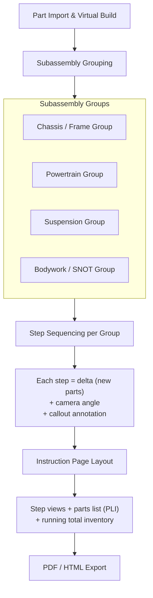

# Lesson 4: Presentation Documentation

## 1. First-Principles Intuition & Invariants

There is a persistent myth in the LEGO community that a great MOC speaks for itself. It does not. A model that took three hundred hours to engineer, that employs a custom planetary gearbox behind a fully tiled exterior, that solves a structural problem no commercial set has ever addressed — that model, photographed under a kitchen fluorescent against a cluttered table and uploaded as a 480p JPEG, will receive seventeen views and die quietly in a forum thread. The presentation layer is not cosmetic. It is the transmission medium through which months of technical labor reach the people capable of appreciating it.

This principle has an engineering corollary worth internalizing: information fidelity degrades at every stage of a communication chain. The gap between what your model *is* and what a viewer *perceives* grows with every compromise in documentation quality. A blurry photograph of a suspension geometry that took weeks to develop conveys exactly as much as a blurry photograph of a child's first freeform build. The camera cannot distinguish craft from chaos unless the photographer gives it the conditions to do so. This is not a soft aesthetic concern — it is a hard constraint on whether your work transmits its technical content to its intended audience.

The invariants that govern presentation documentation are three, and they apply regardless of medium, platform, or model complexity.

The first invariant is **faithful representation of technical content**. Every presentation decision — angle selection, lighting setup, instruction granularity — must maximize the signal-to-noise ratio between what you built and what a viewer reconstructs mentally from your documentation. A suspension rocker arm shot from straight overhead collapses its geometry into a flat silhouette. The same part photographed from thirty degrees below the axle centerline reveals its pivot geometry, its range of motion, and its relationship to the chassis in a single frame. The goal is not beauty for its own sake but dimensionality: giving the viewer enough spatial and mechanical information to understand the build as a three-dimensional, functional object.

The second invariant is **replicability**. Advanced practitioners sharing MOCs are participating in an open-source tradition. Even when you are not publishing formal instructions, your documentation should contain enough information — part callouts, subassembly photographs, dimension references in studs — that a skilled builder could reconstruct your work. This is both a community obligation and a marker of technical maturity. A builder who cannot document their own work cannot fully audit it, because documentation forces you to articulate choices you may have made intuitively during construction. The act of writing instructions routinely reveals structural errors and suboptimal routing that survive in the model only because nobody, including the builder, had to describe them in sequence.

The third invariant is **contextual honesty**. The LEGO community has a sharp eye for digital trickery, and its respect economy is built on physical reality. Stud.io renders can supplement physical photography but should never substitute for it, and renders presented without disclosure as photographs will eventually damage your credibility. Edited backgrounds are acceptable; edited geometry is not. Part counts should be accurate. Scale references — whether a minifigure, a ruler, or a known-size LEGO element placed in frame — should be present in at least one photograph of any build where scale is relevant to understanding the design. These practices are not bureaucratic conventions; they are the substrate on which trust in your technical claims rests.

Understanding these three invariants before touching a camera or opening BrickLink Studio reframes the work. You are not making marketing material. You are producing technical documentation that happens to need to be visually compelling, in the same way that a well-drawn engineering diagram happens to be visually elegant. The elegance is a consequence of precision, not a decoration applied over it.

---

## 2. Core Architecture & Mechanics

### Photography: Light, Geometry, and Camera Control

The physical mechanics of MOC photography resolve into three interacting systems: light quality and direction, camera geometry relative to the model, and depth-of-field management. Mastering each in isolation is straightforward. Coordinating all three for a single frame requires deliberate practice, and the interaction effects between them are where most intermediate builders lose control of their results.

**Light quality** is the single variable that separates amateur snapshots from publication-grade documentation. Hard light — direct sun, an undiffused speedlight, an overhead LED panel — produces sharp, high-contrast shadows that read as clutter across a tiled surface. Every stud edge, every panel seam, every minor dust particle becomes a shadow with the same visual weight as your intentional geometry. Soft light, produced by bouncing a source off a large white reflector, shooting through a diffusion panel, or working in open shade on an overcast day, wraps around forms and suppresses the micro-shadow noise. The standard professional setup for a mid-to-large MOC is a two-light configuration: a primary softbox at roughly forty-five degrees to the model's front plane, elevated to simulate overhead daylight, and a fill card (a piece of white foam board) opposite to lift the shadow side without adding a competing light direction. This fills the shadow side to roughly a 3:1 ratio — enough separation to feel three-dimensional, clean enough to read part geometry without distraction.

For detail shots of gearing, pin connections, or structural joints, a small LED panel or ring light positioned close to the subject and angled to rake across the surface at a low angle will reveal surface texture and mechanical articulation that front-on soft light would flatten. This is the same technique machinists use with an inspection light when checking a machined surface for high spots. Light raking at a shallow angle turns surface topology into visible shadow information.

Color temperature matters for LEGO specifically because LEGO's color palette is saturated and precise. Light Bley and Dark Bley — LEGO's standard medium and dark grays — are separated by roughly fifteen Munsell value steps in physical reality but collapse to near-identical tones under warm (tungsten) lighting. Shooting at daylight-balanced 5500K to 6000K preserves the color separations LEGO's designers engineered into the palette. If you are shooting under mixed sources — a window and an LED panel simultaneously — gel or color-balance one of them to match the other, because the resulting color cast will render some parts inaccurately and confuse any viewer who tries to identify parts from your photographs.

**Camera geometry** operates on two axes: horizontal angle around the model and vertical elevation relative to it. The standard documentation set for a completed MOC should include a primary three-quarter view from slightly above eye level (approximately ten to twenty degrees of elevation), a straight-on orthographic front, a side, and a rear — the same four views a mechanical drawing uses, for the same reason. Beyond the orthographic set, two or three additional angles chosen to emphasize the model's signature technical features complete the primary gallery. For a Technic supercar, one of those feature angles will inevitably be an undercarriage shot showing drivetrain routing, taken with the model elevated on a transparent stand and the camera shooting upward from below.

The elevation of the camera relative to the model is the axis most practitioners miscalibrate. Shooting down on a model from too steep an angle compresses vertical elements and reads as a toy snapshot. Shooting from too low an angle makes structural bracing and internal routing invisible. The correct elevation is model-specific: for a large display model, human eye level at the model's approximate midpoint is a reasonable starting approximation. For a vehicle, an angle that shows the top plane at roughly a one-to-one ratio with the side plane gives a sense of proportion that matches how a physical vehicle reads. Dial this in by moving the camera, not by adjusting the model — the model's pose should be fixed to its intended display orientation.

**Depth of field** in LEGO photography is a tool, not a default. A large LEGO model at a reasonable shooting distance will fall across a depth range that exceeds the focal plane of a wide-open lens, so the choice is whether you embrace selective focus or pursue full sharpness through focus stacking. For documentation purposes — instructions, technical callouts, forum sharing where viewers need to identify specific parts — full sharpness is almost always correct. Close your aperture to f/8 to f/11, compensate with a tripod and remote shutter or timer, and use continuous lighting of sufficient intensity to maintain a reasonable shutter speed at ISO 100 to 200. For editorial or artistic hero shots, selective focus can isolate a signature feature — a custom gearbox, a printed tile, an articulated mechanism — and direct the viewer's attention effectively, but this approach works only as a supplement to a complete sharp documentation set, never as a replacement.

The workflow for a complete photography session follows a logical sequence. Begin by cleaning the model: a soft natural-hair brush (a wide watercolor brush works well) removes dust and fingerprints from tiled surfaces before shooting. Set your background — a large sheet of smooth white card, a custom printed backdrop, or a physical diorama scene depending on your intent — and position it far enough behind the model that it falls out of focus even at smaller apertures. Lock your exposure settings once you have dialed them in for the primary three-quarter shot and do not change them through the orthographic set, so that all four orthographic views are directly comparable. Reserve exposure adjustments for the feature detail shots, where you may be working much closer and need to recalculate for the new framing.

### Instruction Generation: From Build Sequence to Rendered Documentation

Instruction generation for a LEGO MOC is a software and cognitive workflow with two primary toolchains: **BrickLink Studio 2.0** (the dominant choice for the advanced community) and **LDraw with MLCad or LPub3D** (the older open-source pipeline that remains viable for builders already embedded in that ecosystem). Studio has largely superseded LDraw-based instruction generation for new practitioners because its parts library update cycle is faster, its renderer (POV-Ray integration via the Photo-Realistic mode) produces cleaner outputs, and its instruction generation interface is more accessible without sacrificing granularity.

The core data structure of a Studio instruction file is a **build sequence graph**: an ordered list of subassembly steps, each of which defines a delta — the set of parts added relative to the previous step — along with a camera viewpoint that makes that delta maximally legible. The challenge of instruction authoring is that the build sequence that optimizes *construction ease for a first-time builder* is almost never the same sequence in which you *built the model yourself*. Expert builders often close structural access points early, route flexible elements before they're constrained, and add cosmetic tiling last, in ways that create dead ends for a builder following along without that contextual knowledge. Good instruction design re-sequences the build to maintain accessibility: internal mechanisms before exterior panels, structural framework before connection points, and always a clear buffer of access to whatever goes in next.

Within Studio's instruction editor, each step's camera angle is the highest-leverage parameter you control. The camera must be positioned so that every part added in the current step is simultaneously visible and unambiguous. Where a step adds parts on opposite faces of the model, you have two options: split the step into two substeps, each with its own camera angle, or select an isometric viewpoint that makes both faces simultaneously visible if the model's geometry permits it. Studio's instruction renderer does not automatically choose the optimal viewpoint — it defaults to the last camera position you used, which is rarely correct for the next step — so each step requires manual camera adjustment. This is tedious but non-negotiable. An ambiguous camera angle in a critical structural step will cause builders to assemble the wrong part orientation, which in a Technic mechanism can mean a gear mesh that is off by one tooth, a steering rack that binds, or an axle that is too short by one stud.

Part List Indicators (PLIs) in Studio are automatically generated per step and show every new part introduced in that step with a count. Review these against your actual step delta, because Studio's part detection can miscategorize parts with similar identifiers — particularly between axle lengths, beam lengths with and without offset, and connector variants. The most reliable audit method is to compare the PLI visually against your 3D step view: every part highlighted in the step view should appear exactly once in the PLI, and the PLI should contain no parts that are not highlighted. Any discrepancy indicates either a part placed in the wrong step group or a Studio database mismatch that requires manual correction.

Color accuracy in Studio exports depends on your rendering mode. The standard (non-photorealistic) instruction renderer uses flat-shaded colors from Studio's internal LEGO color database, which are closely calibrated to official LEGO colors and adequate for instruction purposes. The photorealistic renderer introduces ambient occlusion and material reflectance, which makes the output look more physical but can reduce color accuracy under certain lighting conditions and significantly increases render time. For pure instruction generation, the standard renderer at high output resolution (300 DPI minimum for print-quality PDF) is the correct choice. Photorealistic rendering is appropriate for cover pages, hero images within an instruction booklet, and standalone digital sharing, not for step-by-step views where part identification clarity takes absolute priority.

### Instruction Layout Standards

A finished instruction booklet follows the visual conventions the official LEGO design team has refined over decades, and deviating from them without a specific reason creates friction for experienced builders who have internalized those conventions. The standard page layout places the step view at two-thirds of the page area, the PLI in the upper right, and a running part counter in the lower right corner. Each page carries a step number in a consistent position. Subassembly call-outs — where a pre-assembled unit is shown built separately before being attached to the main model — appear in a boxed inset with their own mini-sequence. If your model uses a custom color not available in the standard LEGO palette, note this explicitly in a legend or annotation page. If it uses third-party elements, parts from the BrickLink Catalog that are not official LEGO production parts, or printed elements that must be sourced separately, that information belongs in a parts availability note at the front matter of the booklet.

---

## 3. High-Performance Optimization & Failure Modes

### Workflow Optimization for Large and Complex MOCs

The critical performance bottleneck in Studio-based instruction generation is not render time but **step decomposition time**: the cognitive work of deciding how to partition a complex model into a logical, buildable sequence. For models above roughly 1,000 parts, the combinatorial space of possible sequences becomes unmanageable if approached part by part. The professional approach is to work at the subassembly level first, treating each logical mechanical group (chassis, gearbox, suspension corner, bodywork panel) as an atomic unit in the top-level sequence. Within each group, the internal sequence is determined independently. This hierarchical decomposition reduces the sequencing problem to manageable size and produces instructions that are naturally organized around the model's mechanical architecture, which makes them easier to follow because the builder understands what they are building at every phase.

For models with mirrored bilateral symmetry — which describes the majority of vehicles and many architectural models — a critical efficiency gain comes from completing one side's instruction sequence fully and then mirroring it. Studio supports symmetry operations on subassemblies, but verify mirror operations carefully: Technic beams with offset holes, liftarms with angled connection points, and printed tiles with directional graphics do not simply mirror. Any part with a geometry or graphic that distinguishes left from right must be manually adjusted after a symmetry operation.

The most expensive failure mode in instruction production is discovering a **build sequence deadlock** late in the documentation process: a configuration where part A cannot be installed until part B is in place, but part B requires access that part A's installation blocks. These deadlocks are almost always present in complex MOC builds because advanced builders assemble with full spatial knowledge of the finished model and can physically navigate access constraints that a first-time builder following instructions cannot. The mitigation is a **dry run build**: after completing the instruction sequence in Studio, actually rebuild the physical model from scratch following only your written instructions, treating yourself as a builder with no prior knowledge of the model. Every point at which you find yourself instinctively reaching past a written step to handle a constraint you know exists is a documentation failure. Mark it, revise the sequence, and re-run the affected pages.

### Community Engagement Protocols

Publishing a MOC documentation package — photographs, instruction PDF, parts list in BrickLink XML format — is an act of participation in a technical community with well-established norms. Understanding those norms matters for how your work is received and cited.

The primary platforms for advanced MOC documentation are **Rebrickable** (for instruction and parts list hosting, with direct BrickLink Studio integration), **MOCpages** (declining in traffic but still hosting a significant archive), and **Eurobricks** (the dominant forum for high-level technical discussion, particularly for Technic). Flickr remains the standard for high-resolution photography sharing among serious builders. Each platform has a different audience expectation: Rebrickable users are primarily builders looking to replicate your model and expect a complete, accurate parts list and functional instructions. Eurobricks readers are analysts and practitioners who want to understand your design decisions at a technical level and expect clear photographs of internal mechanisms, honest discussion of compromises, and willingness to engage with questions about structural choices. Flickr audiences include both groups and add a substantial aesthetic-first contingent.

A well-structured Eurobricks presentation post for an advanced MOC follows a loose but broadly respected convention. It opens with a primary hero photograph and a brief technical summary: scale, part count, key mechanical features, and any novel engineering solutions the build contains. It then presents the complete photography set including internal mechanism shots, and closes with an honest technical discussion — what worked, what you would do differently, and what constraints shaped the design decisions you made. This last section is what separates documentation from promotion, and it is the section that earns substantive technical engagement from the community's most experienced members. Builders who present their work without acknowledging its limitations are perceived as either inexperienced or defensive, and neither perception invites the kind of detailed critique that improves practice.

Attribution in the LEGO community operates differently than in strictly commercial creative contexts, but it is taken seriously. If your model draws on a mechanism published by another builder — a suspension geometry that adapts Efferman's proven double-wishbone layout, a steering mechanism based on a technique documented by Sariel — that attribution belongs in your presentation text, not buried in a reply comment. The community's shared technical vocabulary advances because builders can trace the lineage of techniques and understand which problems a given solution was originally designed to solve. Failing to attribute is not merely a social infraction; it actively degrades the community's ability to evaluate whether your adaptation improves on, or simply copies, the original approach.

### Portfolio Curation and the Longitudinal Record

A builder's public portfolio is a longitudinal technical record, not a highlights reel. The temptation to curate only your most successful models is understandable, but it produces a distorted signal: a portfolio in which every build appears to have succeeded on the first attempt, in which no constraints appear, and in which no evolution of technique is visible. This flatters the ego but discourages newer builders who cannot reconcile their own experience of repeated failure and iteration with the seamless perfection implied by an over-curated portfolio.

The functional structure of a portfolio for an advanced MOC builder organizes work by technical domain rather than chronology or subjective quality. A section on structural engineering showcases models where rigidity under load was the primary design challenge. A section on powertrain design shows gearbox and drivetrain work. A section on scale modeling work shows finishing and SNOT technique. This organization allows a viewer to understand your range and depth simultaneously, and it makes your portfolio useful as a technical reference rather than simply a gallery. When a builder is researching how to execute a specific mechanism, a domain-organized portfolio is searchable in a way that a chronological gallery is not.

Maintaining documentation fidelity across an evolving portfolio means keeping your instruction files, parts lists, and high-resolution photographs in a format that remains accessible as software versions change. BrickLink Studio's `.io` format is reasonably stable, but the safest archival format for instruction content is an exported PDF, because PDF renders are version-independent. Store your source `.io` files alongside the PDFs with a clear naming convention that includes the model name, part count, and date. Store raw photograph files at their native resolution even if you only publish compressed versions online; a photograph that was adequate for a forum in 2024 may need to be relicensed for a printed publication in 2027, and re-shoots are not always possible.

### Licensing Considerations

Licensing for MOC documentation occupies an unusual legal space because the underlying parts are LEGO's intellectual property, the specific assembly is the builder's creative expression, and the instructions are a creative and functional work in their own right. LEGO Group's Fair Play policy permits non-commercial fan creation and sharing, including instruction publication, as long as the content does not compete directly with official LEGO products, does not use official LEGO IP (characters, set names, trademarks) in a way that implies endorsement, and is not used to sell counterfeit or unofficial building elements.

For the instructions themselves as a creative work, the standard community practice is to publish under a **Creative Commons Attribution-NonCommercial-ShareAlike (CC BY-NC-SA)** license. This permits free sharing and adaptation of your instructions provided attribution is maintained, the use is non-commercial, and derivative works carry the same license terms. This aligns with the community's open-source ethos while preventing commercial exploitation of your documentation without permission. If you intend to sell instructions — a practice that has become common for high-quality, large-scale MOCs, with distribution typically through Rebrickable's paid instructions platform — you are stepping outside the pure CC framework into a direct commercial transaction, which requires that you have independently designed all elements of the build and are not replicating patented official mechanisms verbatim.

The more practically urgent licensing question for most advanced builders is **photography rights** when their models appear in community publications, YouTube reviews, or fan magazines. Establish explicitly in any communication with a media outlet what rights they are acquiring. The standard reasonable grant is a one-time right to publish specific named photographs in a specific named publication or video, with attribution. A perpetual royalty-free license to your entire photographic archive is not standard, is not implied by community membership, and should not be agreed to casually. Your documentation photographs are your primary record of your own work and retain value beyond any single publication context.

Understanding these constraints precisely before you publish a major MOC saves significant friction later and ensures that the documentation package you produce — the photographs, instructions, parts lists, and presentation text — remains under your control, attributable to your authorship, and available to the community on terms you have deliberately chosen.
