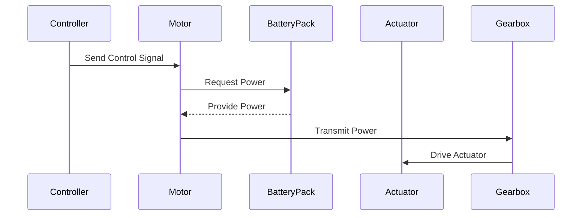

# Foundation: Motorized
## 1. Conceptual Mental Model (Beginner Intuition & First Principles)

### Introduction to Motorized Lego

Imagine you are building a city in Lego, and you want to bring it to life with moving parts. This could be as simple as a car that rolls across the road or as complex as a crane that picks up and places Lego blocks. The introduction of motors into Lego sets opens up a world of possibilities, allowing you to create dynamic and interactive models. 

At its core, a motorized Lego model is a system that converts electrical energy into mechanical energy. This conversion is achieved through a motor, which is a device that spins or moves when electricity is applied. The motor is controlled by a battery pack and often a controller, which can be as simple as a switch or as complex as a programmable microcontroller.

### Historical Motivations

The concept of motorized Lego models has its roots in the desire to create more realistic and engaging play experiences. Lego has been evolving since its inception in the 1940s, and the introduction of electric motors in the 1980s marked a significant milestone. This innovation allowed Lego enthusiasts to build models that could move on their own, simulating real-world machines and vehicles.

### Real-World Intuitive Analogies

To better understand motorized Lego, consider the analogy of a toy car. A toy car is a simple mechanical system that moves when you wind it up or push it. In a motorized Lego model, the motor takes the place of the winding mechanism or the push, providing a continuous source of motion. Just as a toy car has wheels that roll on a surface, a motorized Lego model has parts that move according to the design of the builder.

## 2. Essential Terminology & Taxonomy (Foundational Glossary)

| Term                | Definition                                                                 | System Context                                                                 |
|---------------------|------------------------------------------------------------------------------|--------------------------------------------------------------------------------|
| Motor               | A device that converts electrical energy into mechanical energy.             | The motor is the core component that drives the movement in a motorized Lego model. |
| Battery Pack        | A power source that provides electrical energy to the motor.                 | The battery pack is essential for powering the motor and other electronic components. |
| Controller          | A device that sends signals to the motor to control its speed and direction. | The controller can be a simple switch or a programmable microcontroller.          |
| Gearbox             | A mechanism that changes the speed and torque of the motor.                  | The gearbox is used to adjust the speed and power of the motor to suit the design. |
| Sensor              | A device that detects changes in the environment and sends signals to the controller. | Sensors can be used to add feedback and control to the motorized model.         |
| Actuator            | A component that moves in response to a control signal.                      | Actuators can be motors or other devices that perform specific actions in the model. |

## 3. Architecture & Core Workflow (Detailed ASCII & Mermaid Diagrams)

### ASCII Diagram

```
+-------------------+       +-------------------+       +-------------------+
|     Controller    |       |       Motor       |       |     Battery Pack  |
+-------------------+       +-------------------+       +-------------------+
         |                           |                           |
         |                           |                           |
         v                           v                           v
+-------------------+       +-------------------+       +-------------------+
|      Signal       |------>|      Power        |------>|      Power        |
+-------------------+       +-------------------+       +-------------------+
         |                           |                           |
         |                           |                           |
         v                           v                           v
+-------------------+       +-------------------+       +-------------------+
|      Actuator     |<------|      Gearbox      |<------|      Motor        |
+-------------------+       +-------------------+       +-------------------+
```

### Mermaid Sequence Diagram



## 4. Common Misconceptions & Mental Traps (Beginner & Intermediate Pitfalls)

### Misconceptions

1. **Motor Speed Equals Model Speed:** A common misconception is that the speed of the motor directly translates to the speed of the model. In reality, the speed of the model is influenced by the motor, gearbox, and the design of the model itself.
2. **Battery Life Equals Model Duration:** Another misconception is that the battery life directly determines how long the model can run. While the battery life is a factor, the efficiency of the motor and the load on the system also play significant roles.
3. **Complexity Equals Better Design:** Some beginners believe that a more complex design with multiple motors and sensors is always better. However, a well-designed model can be simple yet effective, and complexity should be added only when necessary.

### Mental Traps

1. **Overlooking Safety:** Beginners often get excited about the possibilities of motorized Lego and may overlook safety precautions. It is crucial to ensure that all components are properly connected and that the model is stable to prevent accidents.
2. **Ignoring Tolerances:** Precision is key in motorized Lego models. Even small tolerances can affect the performance of the model. It is essential to measure and cut parts accurately to ensure smooth operation.
3. **Failing to Test Components:** Before assembling the entire model, it is important to test individual components to ensure they work as expected. This can save time and frustration during the assembly process.

## 5. Socratic Discussion Starters (Bridging to Intermediate Mastery)

### Discussion Questions

1. **How does the choice of motor and gearbox affect the performance of a motorized Lego model?**
2. **What are the trade-offs between using a simple controller and a programmable microcontroller in a motorized Lego model?**
3. **How can sensors be used to enhance the functionality and realism of a motorized Lego model?**

These questions are designed to encourage deep thinking and exploration of the principles and techniques involved in motorized Lego models. By engaging with these questions, learners can bridge their beginner intuition to a more intermediate understanding of the subject.
