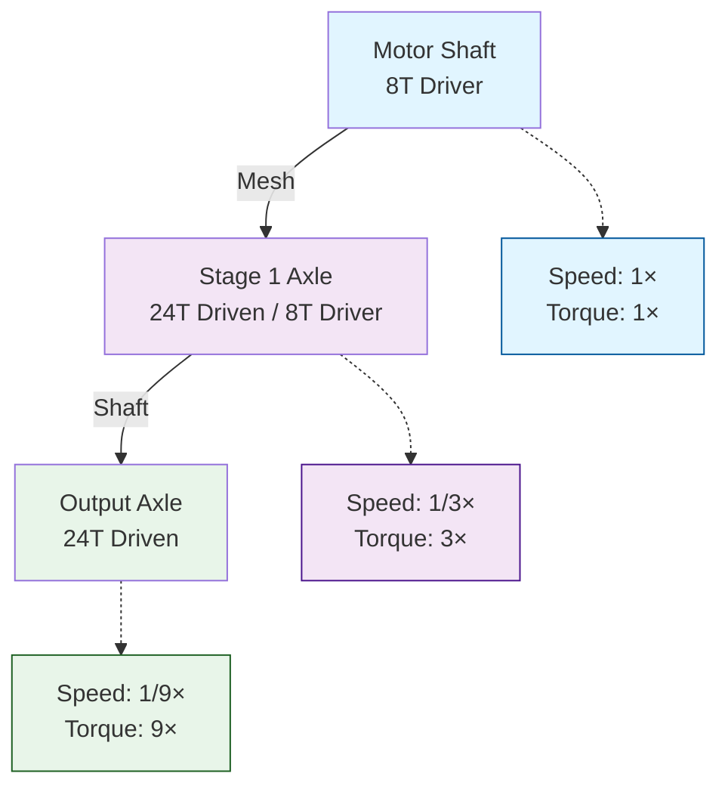

# Lesson 2: Gear Systems, Mechanical Advantage, Torque Multiplication

## 1. First-Principles Intuition & Invariants

There is a physical law hiding inside every Lego Technic gear mesh, and it is as unforgiving as gravity: power is conserved. When you spin a small gear against a large one, you do not create extra force from nothing. You trade speed for torque, or torque for speed, and the exchange rate is set by the ratio of tooth counts. Understanding this law at the level of intuition, not merely formula, is what separates a builder who assembles gear trains from one who designs them.

Torque is rotational force. It is the tendency of a spinning shaft to twist something connected to it, and it is measured as force multiplied by the radius at which that force acts. A motor produces a fixed torque at its output shaft under a given electrical load. If you want the shaft downstream to push harder than that motor can deliver alone, you must accept that it will push slower. The gear ratio is the lever arm you insert between the motor and the work.

The fundamental ratio formula is $R = N_{\text{driven}} / N_{\text{driver}}$, where $N$ is tooth count. When R is greater than 1, you are in reduction: the driven shaft turns slower than the driver, but every Newton-meter of input torque is multiplied by R at the output. When R is less than 1, you are in overdrive: the driven shaft spins faster, but output torque is divided by R. This reciprocal relationship is the central invariant of every gear system you will ever build in Technic. Efficiency losses complicate the picture slightly, but they do not repeal the law; they tax it.

Lego has been producing its System-compatible gear library for decades, and the parts themselves encode the physics. The 8-tooth spur gear, the 24-tooth gear, the 40-tooth crown, the 12-tooth bevel, the 20-tooth bevel, and the worm gear each occupy specific roles in the mechanical toolkit precisely because their tooth counts produce ratios that are useful in practice. An 8-tooth driver meshing with a 40-tooth driven wheel gives $R = 40/8 = 5$, meaning five full turns of the input shaft produce one full turn of the output, and output torque is five times the motor's delivered torque before friction losses. This is not an approximation; it is exact, because integer tooth counts produce integer or simple fractional ratios by design.

The critical invariant that every advanced practitioner must internalize is that rotational power, $P = \tau \cdot \omega$ (torque times angular velocity), is constant through an ideal gear mesh. When you trace a signal from an L motor through three successive reduction stages, the power at the final shaft should theoretically equal the power at the motor pinion. What changes at each stage is only the distribution between torque and speed. Real systems fall short of this ideal because every gear mesh introduces friction, every axle bends slightly under load, and every gear tooth deforms microscopically under contact stress. Those losses accumulate, and by the final stage of a deep reduction train, they can consume a significant fraction of your original power budget.

This is why motor selection matters before gear selection. The Lego Power Functions and Powered Up ecosystem offers the M motor, L motor, and XL motor as the primary actuators in a motorized build. The M motor produces relatively modest torque but runs at higher no-load speed, making it suitable for high-speed, low-load mechanisms where a moderate overdrive or small reduction keeps it in its efficient operating band. The L motor is the workhorse: moderate speed, moderate torque, and a stall current the system can sustain without immediately browning out a battery box. The XL motor produces substantially more torque at lower speed and is the natural choice for drivetrains, heavy lifts, and any mechanism where the gear train itself is relatively short because the motor is already slow. Matching motor to gear train is not an afterthought; it is the first design decision.

The concept of mechanical advantage is older than engineering as a formal discipline. When Archimedes described levers, he identified the same ratio-and-fulcrum relationship that governs a gear mesh. A gear train is simply a series of levers that happen to be round. Each tooth contact is a momentary lever interaction, and the ratio of the two gear radii determines whether force is amplified or diminished. Because Lego gears have a fixed module (the ratio of pitch diameter to tooth count), two gears of different tooth counts will mesh correctly, and their pitch radii are directly proportional to their tooth counts. This means you can reason about mechanical advantage using tooth counts alone, without measuring actual gear diameters.

One invariant that trips up builders working with multi-stage gear trains is the direction of rotation. Each spur gear mesh reverses the direction of rotation. Driver turns clockwise, driven turns counter-clockwise. Add a third gear as an idler, and the output turns clockwise again. When you are assembling a final drive where both wheels must spin in the same direction for forward motion, counting your mesh inversions is not optional; it is part of the design specification.

---

## 2. Core Architecture & Mechanics

### Spur Gear Trains: The Workhorse Architecture

The spur gear train is the foundational building block of Lego Technic motorized systems. Two gears with parallel axes whose teeth mesh along a shared tangent plane. The geometry is simple, the engagement is predictable, and the System's beam-and-hole grid enforces precise center distances so that any two Lego spur gears with compatible modules will mesh without adjustment.

A single-stage reduction using an 8-tooth driver and a 24-tooth driven gear gives R = 3. That same 24-tooth gear can then drive a second 8-tooth gear (now a driver again), which meshes into another 24-tooth gear, giving a second stage of R = 3. The total reduction across two stages is $R_{\text{total}} = R_1 \times R_2 = 3 \times 3 = 9$. This is the compound gear train, and it is how builders achieve large overall reductions without the physical space penalty of trying to mesh a tiny gear directly with an enormous one. The 8-to-40 ratio of 5 is the largest single-stage reduction available with standard Technic spur gears; anything beyond that requires compounding.

The beam grid that makes Lego so precise also constrains it. Gear centers must fall on integer or half-integer stud intervals, because axle holes in Technic beams are spaced on the standard 8mm Lego unit. Not every tooth-count combination produces a center distance that lands cleanly on the grid. The 8/24 and 8/40 pairings are explicitly designed to mesh at whole-stud center distances. The 16-tooth gear meshes cleanly with itself (1:1 ratio, two studs center-to-center) and with the 8-tooth (1:2, though the center distance requires careful beam selection). When you are planning a gear train, checking that every mesh lands on a valid beam position is a prerequisite, not a revision step.



This cascade illustrates one of the most important structural decisions in a compound train: the intermediate axle must carry both the driven gear of the first stage and the driver gear of the second stage. That axle is under torsional load equal to three times the motor's input torque. If you use a single-stud connection (a plain axle through a beam with no cross-block bracing), that axle will flex, the mesh clearance will increase, teeth will skip under load, and the reduction will collapse. For any intermediate shaft carrying more than roughly 2× motor torque, brace it at both ends with axle connectors locked into structural beams, and use the cross-hole bushings to prevent lateral migration.

### Bevel Gear Architecture: Routing Power Around Corners

Bevel gears allow you to change the axis of rotation by 90 degrees, which is indispensable when a motor must mount horizontally to drive a vertically oriented output shaft, or when chassis geometry demands routing a drivetrain around an obstacle. Lego produces 12-tooth and 20-tooth bevel gears, as well as the older 12-tooth and 36-tooth crown gear combination. The 12-tooth-to-20-tooth bevel pair gives a ratio of $20/12 \approx 1.67$, which is a modest reduction with a right-angle turn. The 12-to-36 crown combination gives a ratio of 3, which is equivalent to the common 8/24 spur pair but with the axis change included.

Bevel gears are more sensitive to axial positioning than spur gears. The tooth geometry is conical, and the pitch cones of the two meshing gears must meet at the same apex point for correct contact across the full tooth face. In practice on Lego, this means that the axle carrying the bevel gear must be fully seated and laterally constrained so that the gear does not migrate away from its mesh partner under load. If you observe audible clicking or skipping from a bevel pair under moderate load, axial play is almost always the cause. Fit a half-bushing or a friction-pin retainer against the gear hub face to eliminate the gap.

For a right-angle drivetrain in a motorized crawler or heavy-lift mechanism, the preferred architecture is to perform any high-ratio speed reduction using spur gears on the motor's horizontal shaft before the bevel turn, rather than relying on the bevel pair to provide the reduction. The reason is friction: bevel gears have a larger contact patch and more sliding action across the tooth face than equivalent spur gears, so their efficiency per stage is lower. Doing the heavy reduction work in spur and using the bevel only for the direction change preserves more of the motor's power for the actual work.

### Worm Gear Architecture: Self-Locking Reduction

The worm gear is mechanically distinct from every other gear type in the Technic library, and understanding why requires thinking about the geometry of tooth engagement rather than simply the ratio. A Lego worm gear, in a single rotation, advances the mating gear by exactly one tooth. If the mating gear has 24 teeth, the ratio is 24:1 in a single-stage mesh. That is an enormous reduction from one compact mechanism, and it is the primary reason builders reach for the worm gear when they need to lift, clamp, or position something precisely.

The property that makes the worm gear uniquely valuable also makes it uniquely inefficient. Because the helix angle of the worm thread is very shallow, the tooth contact between worm and wheel involves a high degree of sliding friction rather than the rolling contact that characterizes spur and bevel gears. Efficiency for a Lego worm-and-wheel mesh is typically in the range of 40 to 60 percent, compared to 90 to 95 percent for a well-meshed spur pair. This means that of every Watt your motor delivers to the worm shaft, only 0.4 to 0.6 Watts emerges as useful torque at the wheel. The rest becomes heat, vibration, and wear on the worm thread.

The self-locking behavior arises from the same geometry. When the worm drives the wheel, the shallow helix angle means the gear wheel cannot back-drive the worm: the contact forces resolve at an angle that is steeper than the friction angle, so the worm and wheel lock in place the moment the input torque drops to zero. This is architecturally invaluable for a motorized linear actuator, a steering mechanism, or a crane hook: the load is held by the gear mesh itself, with no need for a brake or clutch. For a motorized Lego arm or elevating platform, a worm-and-wheel final stage means the arm stays exactly where the motor left it, without power.

The practical consequence for design is to place the worm stage last in the gear train, after all spur reduction. This maximizes the torque the worm shaft receives (and therefore the output torque it can deliver after losses), and it means only the final, slow shaft experiences the worm's inefficiency. If you put the worm early in the train and then follow it with spur gears, the spur stages downstream must carry enormous torques while the upstream spur stages are starved of the power eaten by the worm.

```text
Gear Train Architecture Decision Map:

Motor → [Spur reduction stages] → [Bevel turn if needed] → [Worm final stage] → Load
        HIGH efficiency (90–95%)    MODERATE efficiency       LOWER efficiency
        for torque build-up         (75–85%) for axis         (40–60%) as self-
                                    redirection               locking output
```

### Backlash: The Tolerance Gap You Cannot Eliminate

Backlash is the small amount of rotational free play between two meshing gears, arising from the deliberate clearance between a gear tooth's working flank and the opposing tooth space. In Lego gears, backlash is built into the injection-molded tooth geometry to ensure that two gears on a fixed beam-grid center distance will mesh without binding even with minor dimensional variation from part to part. This clearance is a manufacturing necessity and an engineering compromise.

For a simple open-loop mechanism like a conveyor or a continuous-rotation output, backlash is inconsequential. The gears spin in one direction, and the contact flanks are always loaded. The clearance on the unloaded side is irrelevant to function. The problem emerges in positioning applications, reversing drivetrains, and robotic mechanisms where the direction of load changes. When you reverse a motor, the gear teeth must travel through the backlash angle before the contact shifts to the opposite flank and torque is re-established. During this travel, the output shaft is effectively disconnected from the motor. In a steering mechanism, backlash manifests as a dead zone in the steering response centered on straight-ahead, which makes fine directional corrections impossible without oversteering past the target.

Backlash accumulates across a gear train in proportion to the number of stages. Each mesh contributes its own clearance, and when referred to the output shaft, that clearance is amplified by the reduction ratio of all subsequent stages. A one-degree backlash at a final-stage driver gear is still one degree at the output. But a one-degree backlash at the first-stage driver gear is multiplied by the entire downstream reduction ratio, potentially producing tens of degrees of output shaft dead zone. This is why reducing backlash at the early stages of a high-ratio compound train is disproportionately important: a tighter-fitting gear mesh near the motor pays dividends through the entire downstream train.

---

## 3. High-Performance Optimization & Failure Modes

### Stage Count, Friction Budget, and the Law of Diminishing Returns

Every gear stage you add to a train takes a friction tax on the power flowing through it. For a spur pair in good condition with a lightly loaded axle, that tax is roughly 5 to 10 percent per stage. With three reduction stages, your total efficiency is approximately $0.92^3 \approx 0.78$, meaning you are delivering about 78 percent of motor power to the output. Add a worm stage and that falls to around $0.78 \times 0.50 = 0.39$. Less than half your motor's output reaches the work.

The practical implication is aggressive: use the fewest stages that achieve your required ratio. If a 1:9 reduction can be achieved in two stages (8/24 × 8/24, or 8/40 × 24/24 idler combinations), do not use three stages because three "felt simpler to design." The two-stage train will deliver more torque, run cooler, stall less readily under spike loads, and stress its structural elements less. For heavy-load applications like a motorized bulldozer blade, crane, or tracked vehicle, start by calculating the minimum reduction needed to bring the output speed into a useful range (typically 20–80 RPM for most large Technic mechanisms), then work backward to find the most efficient two-stage or three-stage compound that achieves it.

One powerful optimization is the double-compound, where you use a 40-tooth gear as an intermediate driven gear rather than a 24-tooth, then drive from the same axle with an 8-tooth down to a final 24. The ratios become $40/8 = 5$ for the first stage and $24/8 = 3$ for the second, giving a total of 15:1 in two stages. A conventional 8/24 × 8/24 chain achieves only 9:1 in two stages. Reaching 15:1 without a worm gear in two spur stages, and with the efficiency advantages spur gears provide over worm, is a meaningful architectural win.

### Clutch Gears and Stall Protection

The Lego clutch gear (element 32584) is one of the most underused components in advanced Technic motorized builds. It is a spur gear with an internal slip mechanism calibrated to disengage when the transmitted torque exceeds a threshold, allowing the motor to continue spinning freely rather than stalling. Motor stall is not just a performance failure; it is a thermal event. A stalled brushed DC motor draws locked-rotor current, which can be three to five times its running current, and that current dissipates entirely as heat in the motor windings. Prolonged stall destroys motors.

The clutch gear belongs in every motorized build where the mechanism can reach a hard mechanical stop: a linear actuator at the end of its travel, a crane hook hitting the structural frame, a steering rack reaching its lock-to-lock limit. Place the clutch gear in the high-speed section of the gear train, as close to the motor as possible. At that position, the torque passing through the clutch is low (pre-reduction), so the clutch's slip threshold is not exceeded during normal operation, only when the downstream mechanism truly jams. If you place the clutch gear at the high-torque output end of the train, the torque there may exceed the clutch's slip threshold even during normal loading, causing nuisance slipping and lost motion.

### Structural Failure Under Gear Load: Root Causes and Mitigations

The most common structural failure in a motorized Technic gear train is not tooth breakage; it is axle bending. Lego axles are made from a relatively soft ABS-based compound, and they deflect under torsional and bending loads. When an axle bends, the gear it carries moves away from its intended mesh center, increasing backlash on one side and potentially forcing gear tooth interference on the opposite side. Tooth interference under load produces the characteristic rhythmic clicking that builders learn to recognize as the precursor to accelerating wear and eventual tooth stripping.

The mitigation is simple but must be applied systematically: every loaded axle must be supported at both ends by an axle hole in a structural element, and the spacing between those two support points should be minimized. An axle that spans four stud-lengths between supports will deflect far less than the same axle spanning eight stud-lengths. For high-torque intermediate shafts, supplementing both endpoints with cross-block axle connectors locked perpendicular to the beam framework creates a triangulated support structure that resists bending in both planes. The beam framework itself should be cross-braced with Technic beams oriented at 90 degrees to the primary load direction, turning a planar frame into a torsionally stiff box section.

Gear tooth wear is a secondary failure mode, but it compounds over operating cycles. The 8-tooth gear is particularly susceptible because each of its eight teeth is in contact with the driver gear roughly five times more frequently than the equivalent tooth on a 40-tooth gear in the same mesh. This unequal wear rate means the 8-tooth gear in a high-cycle mechanism will strip its teeth long before the larger gear shows meaningful wear. Inspect 8-tooth gears after every significant build session in heavily loaded applications; replace them preemptively rather than waiting for in-field tooth loss, which typically triggers a cascade strip of the mating gear as well.

### Load Analysis: Working Backward from the Mechanism

The professional approach to gear train design begins not with the motor but with the load. Define the force or torque the mechanism must produce at its output, then design the reduction ratio to deliver that torque from the motor you have selected, with an appropriate safety margin for friction and shock loading.

As a worked example, consider a motorized lifting arm that must hold and raise a 500-gram payload at a 10-centimeter moment arm from the pivot. The required output torque is $\tau = F \times r = (0.5 \text{ kg} \times 9.81 \text{ m/s}^2) \times 0.10 \text{ m} = 0.49 \text{ N·m}$, approximately 49 N·cm. An L motor produces roughly 4–5 N·cm of stall torque. To deliver 49 N·cm at the output with 75% drivetrain efficiency, the required gear ratio is $R = 49 / (4.5 \times 0.75) \approx 14.5:1$. The double-compound spur train described earlier (8/40 × 8/24 = 15:1) covers this requirement with a small margin. A single-stage 8/40 worm-less spur train at 5:1 would stall immediately under the load. The calculation takes thirty seconds and prevents hours of rebuilding.

Shock loading deserves explicit treatment. A wheeled vehicle hitting an obstacle, a crane hook snagging momentarily, or a linear actuator reaching a hard stop at speed all produce instantaneous torque spikes that can be two to five times the calculated steady-state load. Apply a shock factor of at least 2× to your required output torque when sizing the gear ratio and selecting whether to include a clutch gear. For mechanisms that reverse direction under load, such as a steering system that must actively correct against a road-crown force, add a further 20 to 30 percent margin to account for the backlash traversal and re-engagement shock at each direction change.

### Measuring What You Built: The Empirical Check

Theory tells you what a gear train should do; a free-spin test and a load test tell you what it actually does. After assembling a gear train, hold the output shaft stationary and turn the motor shaft by hand through its full range. You are feeling for binding, uneven resistance, and the tactile signature of tooth interference. The resistance should be smoothly periodic, completing one full cycle per output shaft revolution, with no sudden hard spots. Any hard spot indicates either axle misalignment or a gear mesh that is too tight, often caused by a beam frame that has racked slightly out of square during assembly. Square the frame with a cross-beam before proceeding.

Under power, run the mechanism unloaded first and monitor the motor's current draw if you have a battery box with an ammeter, or simply listen to the motor's acoustic signature. A smoothly loaded motor produces a steady hum at a consistent pitch. A gear train with a binding mesh will produce a periodic pitch variation at a frequency corresponding to the rotation rate of the offending gear. Identify the problem gear by counting the period of the pitch variation against the known gear speeds in the train, correct the mesh, and re-run. Building the habit of this empirical loop, design to calculation, build to structure, verify by hand, verify under power, is what transforms a capable Technic builder into a reliable one.
