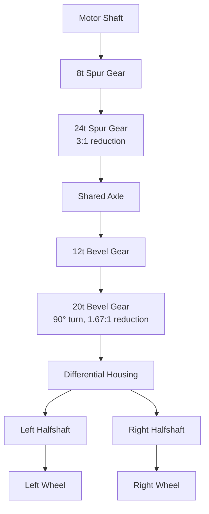

# Lesson 3: Drivetrain Architectures, Power Transmission, Linkages

## 1. First-Principles Intuition & Invariants

Every motorized Lego model is ultimately an argument made in plastic: a claim that rotational energy, introduced at a motor shaft, can be transformed, redirected, split, amplified, and finally delivered to a wheel, track, or actuator in a controlled and useful way. The drivetrain is the physical proof of that argument. Understanding it at a first-principles level means understanding where energy goes, why some of it disappears, and why the geometric and mechanical decisions you make early in a build cascade into every performance characteristic downstream.

The foundational invariant of any drivetrain is the conservation of power. In an ideal, frictionless system, the power entering a gear mesh equals the power leaving it. Power is the product of torque and angular velocity, and their relationship is reciprocal: when you increase mechanical advantage through a reduction gear stage, you multiply torque and divide speed by the same ratio. A 24-tooth gear driving an 8-tooth gear produces a 3:1 speed increase and a corresponding 1:3 torque reduction. Reverse those gears and you get a 3:1 torque multiplication at one-third the speed. This reciprocity is not optional. It is not a design preference. It is the governing equation of every power transmission system you will ever build.

In Lego Technic, the motors available to you — the L Motor, XL Motor, and the newer Control+ Large Angular Motor — each occupy a distinct operating point on the torque-speed curve. The XL Motor produces higher stall torque but runs at a lower free-spin RPM than the L Motor. The Control+ Large Angular Motor adds absolute position feedback, which matters enormously for steering and suspension linkage control, but its peak torque is similar to the XL. When you design a drivetrain, you are matching the motor's operating point against the mechanical load. A heavily geared-down motor connected to fat 56mm tractor wheels on a crawler will operate near stall torque under load, generating heat in the motor windings and stress in the plastic gear teeth. An undergeared motor spinning fast wheels on a smooth surface will spin freely and efficiently but have no grunt when the terrain changes. The practitioner's job is to place the motor's operating point in the efficiency valley between those two failure modes.

Friction is the thief that steals from every gear mesh, every axle-in-bushing interface, every chain link articulation. In a real Lego drivetrain, each gear stage introduces somewhere between 2% and 5% loss depending on alignment, lubrication, and axle flex. A three-stage compound gear reduction can therefore arrive at the output shaft with 85% to 90% of the input power at best. This seems acceptable until you recognize that every worm gear stage cuts that number further and dramatically — a single worm-to-wheel mesh in Technic can consume 40% to 60% of input power as heat and friction, because the sliding contact geometry of a worm is inherently lossy compared to the rolling contact of spur gears. Worm gears earn their place in designs that require self-locking — a crane that must hold a lifted load without motor power, a linear actuator that must not backdrive — but they are expensive in terms of power budget, and stacking them is a fast path to a stalled motor.

The mechanical invariants extend to structural behavior. Axles in Lego are cross-shaped in cross-section, which provides excellent torsional rigidity for their diameter but concentrates bending stress at support points. Any unsupported axle span longer than three to four stud-lengths under significant torque will flex visibly, introducing misalignment at the gear mesh and exponentially increasing wear and noise. This is not a Lego peculiarity — it is the same shaft deflection problem that mechanical engineers calculate using Euler-Bernoulli beam theory. The practical rule is: support every axle at both ends, and add a mid-span support for any driven axle longer than five studs. Friction-fit bushings (the smooth gray half-stud-height cylinders) accomplish this, as do Technic bricks with cross-axle holes when the axle passes through a structural member. The difference between a drivetrain that grinds itself to ruin in ten minutes and one that runs clean for hours is almost always a missing bushing.

## 2. Core Architecture & Mechanics

### The Axle System and Gear Meshing Geometry

The Technic axle system is built around a 1.0-stud spacing grid, where one stud equals 8mm. Gears mesh correctly only when their center-to-center distance satisfies the sum of their pitch radii. For the standard Technic gear family, center distances follow a simple rule: an 8-tooth gear has a 4mm pitch radius, a 16-tooth gear has an 8mm pitch radius, a 24-tooth gear has a 12mm pitch radius, and a 40-tooth gear has a 20mm pitch radius. This means an 8t and a 24t gear mesh at a center distance of 16mm — exactly two studs — and a 16t and a 24t mesh at 20mm, which is 2.5 studs, achievable using a Technic beam with a half-stud offset via a bent liftarm or a 1x2 beam with axle hole mounted sideways.

The newer Technic gear system introduced in the 2010s adds the 12-tooth double-bevel gear (a small bevel gear that meshes both axially and perpendicularly) and the 20-tooth bevel gear, which are the standard building blocks for right-angle drives. A 12t double-bevel driving a 20t bevel produces a 1.67:1 reduction while redirecting the axis of rotation by 90 degrees. This is the standard Technic architecture for transferring drive from a longitudinally mounted motor to a transverse axle, and it appears in virtually every Technic car and truck platform from the 8880 Super Car forward.

The following diagram illustrates a two-stage compound reduction feeding a rear-axle differential, which is the backbone layout of most Technic four-wheeled drive models:

The compound 3:1 spur reduction followed by the 1.67:1 bevel drive delivers a combined 5:1 overall reduction from motor to wheel. If the motor turns at 180 RPM under load, the wheels turn at 36 RPM. With a 56mm wheel (circumference ≈ 176mm), that produces a ground speed of roughly 6.3 meters per minute — appropriate for a heavy hauler, far too slow for a racing car, but tunable by adjusting the spur stage ratio without touching the bevel geometry.

### Differentials: Mechanics and Lego Implementation

A differential is one of the most elegant mechanisms in mechanical engineering, and Technic has included dedicated differential housings since the 1980s. Its purpose is to allow the two driven wheels on an axle to rotate at different speeds while still receiving torque from a single input. This is essential for cornering: the outer wheel must travel a longer arc than the inner wheel in the same time, so it must spin faster. Without a differential, one driven wheel must slip against the ground in every turn, destroying efficiency and making steering feel wooden and resistant.

The Technic small differential housing (part 62821 or the older large differential 65414) contains three bevel gears inside: one driven by the input shaft (the ring gear that is part of the housing itself) and two side gears, each connected to a halfshaft leading to a wheel. When the vehicle drives straight, all three internal gears rotate as a locked assembly and no relative motion occurs between the side gears. When the vehicle corners, the side gear on the outer wheel rotates faster than the housing, and the side gear on the inner wheel rotates slower by exactly the same amount, with the differential spider gears accommodating the speed difference. The sum of the two output speeds always equals twice the input speed — this is the fundamental differential equation, and no amount of creative Lego building changes it.

The critical limitation of an open differential, which is what every Technic differential is by default, is that it always routes torque to the path of least resistance. If one wheel lifts off the ground and spins freely, the differential delivers essentially all torque to that wheel and zero to the grounded wheel. For off-road crawler builds, this is catastrophic. The practitioner's solution in Lego is to lock the differential by inserting a cross axle through the housing's side gear ports and fixing them to the housing, eliminating the differential action entirely and creating a solid axle. This sacrifices cornering grace for traction, which is exactly the right trade-off for a rock crawler or tracked vehicle powertrain.

For four-wheel-drive architectures, a center differential or transfer case is needed to distribute power between the front and rear axles. In Technic, this is typically accomplished with a second differential housing used as a center unit, or by running a single longitudinal driveshaft from the rear bevel to a forward bevel via a chain of spur gears. The Set 42110 Land Rover Defender implements a center differential explicitly, using a third differential housing to allow front-rear speed variation during turns, which is mechanically correct behavior for a full-time 4WD system.

### Clutch Assemblies and Overload Protection

The Technic clutch gear (part 32498, also called the slip gear) is a 24-tooth spur gear with internal friction plates that allow it to slip above a set torque threshold. It is not adjustable — the slip torque is fixed by the spring preload built into the part — but it serves a vital function: protecting both the motor and structural members from torque spikes. In a stall event, without clutch protection, the motor draws maximum current and delivers its full stall torque directly into the gearbox. If the mechanical advantage is high, the resulting force at the output can shear plastic gear teeth, crack liftarms at pin holes, or strip axle splines.

The correct placement of a clutch gear is as close to the motor output as possible, in the first gear stage after the motor shaft.
