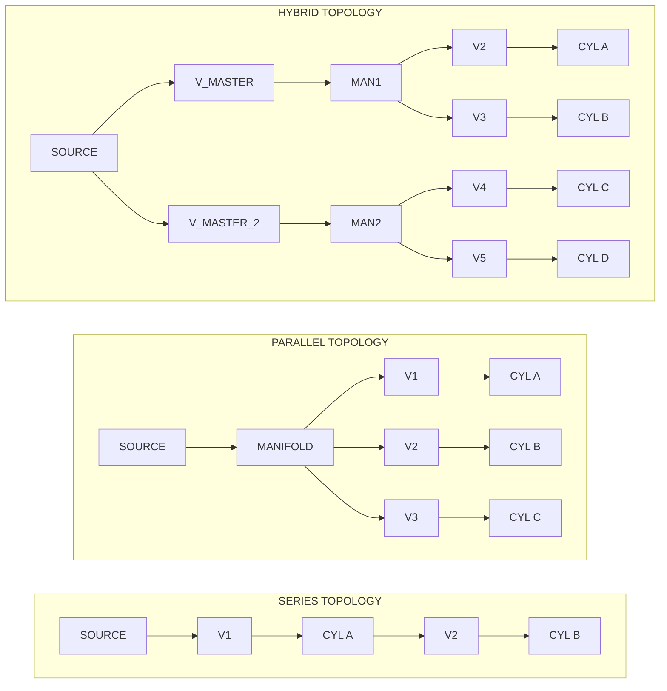

# Lesson 3: Pneumatic Circuit Design

## 1. First-Principles Intuition & Invariants

There is a particular satisfaction in watching a Lego pneumatic system execute a precisely choreographed sequence — a crane arm extending, a claw closing, a platform lifting — driven entirely by compressed air routed through a web of plastic tubing and miniature valves. That satisfaction is earned, not accidental. It is the product of understanding how air behaves as a working fluid, and how the architecture of a circuit either harnesses or squanders that behavior.

Lego's pneumatic ecosystem, introduced in the early 1980s and substantially redesigned in the 2000s with the compact "new-style" components, operates at gauge pressures between roughly 0.3 and 1.0 bar when driven by the standard hand pump, and somewhat higher when driven by a motorized pump. These are modest pressures compared to industrial pneumatics, but the physics governing flow, force, and loss are identical. What changes is the scale of consequence: a pressure drop that an industrial engineer would dismiss as negligible can be catastrophically significant when your total working pressure is less than one atmosphere above ambient.

The foundational invariant of any pneumatic circuit is continuity of mass flow. Air is compressible, which means unlike hydraulic fluid, it stores energy in proportion to volume and pressure. When you pressurize a reservoir you are not merely moving air from one place to another; you are accumulating potential energy in the elastic deformation of the air itself. The ideal gas relationship $PV = nRT$ governs this storage. At constant temperature, doubling the pressure in a fixed volume doubles the stored mass of air, and therefore doubles the available work you can extract. This distinction between pneumatics and hydraulics shapes every design decision in this lesson: air circuits can accumulate energy, they respond to load with pressure decay rather than stall, and they are forgiving of small leaks in ways that hydraulic systems are not, while simultaneously being unforgiving of large-volume losses in ways that hydraulics are not.

The second invariant is Hagen-Poiseuille flow resistance. For the laminar, low-Reynolds-number flows that dominate Lego-scale tubing, volumetric flow rate $Q$ through a tube of radius $r$ and length $L$ is proportional to $r^4 / L$. The fourth-power dependence on radius is the single most important physical fact in this lesson. Lego's standard tubing has an internal diameter of approximately 2.4 mm. Restricting that diameter by half — through a kinked tube, a poorly seated fitting, or routing through a valve body with a narrowed orifice — reduces flow capacity by a factor of sixteen. This is not a theoretical curiosity. It is the reason a circuit that works perfectly on a bench with 30 cm of tubing fails sluggishly when deployed in a model with 90 cm of runs and four intermediate valve connections.

The third invariant concerns actuator force. A Lego pneumatic cylinder develops force $F = P \cdot A$, where $A$ is the bore cross-section. The old-style large cylinder has a bore of approximately 16 mm, giving an area of roughly 200 mm². At 0.8 bar gauge pressure, this produces about 16 N of thrust — enough to lift a substantial subassembly, but not unlimited. The new-style small cylinder, with a bore near 9 mm, produces roughly 5 N at the same pressure. Understanding these figures precisely is what separates a practitioner who over-engineers every linkage "just in case" from one who matches actuator selection to load with engineering discipline.

Before drawing a single tube in a circuit, you must therefore fix three quantities in your mind: the total pressure your source can sustain under continuous demand, the flow rate each actuator requires to achieve its desired stroke velocity, and the force each actuator must deliver at the working pressure. Every circuit architecture decision that follows is a strategy for satisfying all three simultaneously.

---

## 2. Core Architecture & Mechanics

### Circuit Topology: Series, Parallel, and Hybrid Configurations

A pneumatic circuit is a graph. Nodes are components — pumps, valves, cylinders, reservoirs, tees. Edges are tubes carrying flow. The topology of that graph determines how pressure and flow distribute across the system under every operating condition, including the failure conditions you have not yet imagined.

In a **series configuration**, actuators share a single flow path. Pressurized air must pass through each upstream valve before reaching a downstream cylinder. The practical consequence is that operating any actuator draws pressure and flow from all subsequent actuators in the chain. If your pump is running continuously and your first cylinder is mid-stroke, the second cylinder sees whatever pressure remains after the first has drawn its demand. Series circuits are appropriate only when actuators operate in strict temporal sequence with sufficient dwell time between operations for pressure to recover. A robotic arm where the shoulder rotates, then pauses, then the elbow extends, then pauses, is a viable series topology. A gripper that must simultaneously close while an arm lifts is not.

In a **parallel configuration**, each actuator branch connects independently to a common pressure manifold. Every branch sees the same supply pressure (minus any localized pressure drop in its own tubing run), and actuators can operate simultaneously without robbing each other of pressure. The trade-off is that simultaneous operation of multiple actuators multiplies the instantaneous flow demand on the source. If your pump — or your accumulator — cannot sustain that combined flow, pressure collapses across all branches together rather than selectively starving the downstream branch as in a series circuit. Parallel circuits are almost always the correct architecture for Lego builds with more than two actuators, but they require honest accounting of total system flow capacity.

The **hybrid** configuration combines both: actuators within a functional group (say, all axes of a manipulator arm) share a parallel sub-manifold, while distinct functional groups (the arm and a separate conveyor) are series-connected through a master switching valve. This allows you to isolate entire subsystems when they are not in use, conserving pressure for the active subsystem.

The following diagram illustrates these three topologies. Each rectangle represents an actuator (cylinder), each diamond a switching valve, and the double-line source node represents the pump/accumulator combination.

### Valve Mechanics and Switching Logic

Lego's switching valves are manually operated spool valves. Internally, a sliding spool with O-ring seals redirects flow between the supply port, two cylinder ports (extend and retract), and an exhaust port. When the spool is in the neutral-center position, both cylinder ports are connected to exhaust, and the supply is blocked. This is a critical safety characteristic: a valve left at center allows a loaded cylinder to drift slowly under gravity as internal leakage bypasses the spool. For holding loads, you must either add a check valve downstream of the switching valve, or design mechanical latches to bear the load independently of cylinder pressure.

The new-style compact valves (as found in sets 42043, 42054, and others) have a noticeably shorter spool travel than the old-style valves. This reduces the dead zone between switch positions but also makes inadvertent partial switching more likely under vibration. When routing valve actuating linkages from Technic frames, always ensure the control lever reaches a positive detent at both extremes of travel. A valve that sits 70% across its travel range delivers degraded flow through a partially restricted orifice.

For automated sequencing without a Power Functions or Powered Up controller, Lego builders have historically used **mechanical cam sequencing**: a rotating cam lobe driven by an M-motor presses the valve spool at timed intervals. The angular position of the cam lobe encodes the timing of each switch event. This technique requires careful alignment of cam geometry to valve spool travel, and the cam profile must be ground (or in Lego terms, assembled from curved Technic plates) to provide a dwell angle long enough for the cylinder to complete its full stroke before the cam releases the valve.

### Accumulator Design and Sizing

An accumulator is a fixed-volume reservoir that stores compressed air between pump cycles and supplies instantaneous flow to actuators faster than the pump alone could provide. In Lego circuits, accumulators are built from the dedicated reservoir component (the grey or yellow cylindrical tank) or improvised from large airtight chambers formed by sealed Technic frames — though the latter approach requires meticulous sealing with grease or compliant gasket material and should be tested for leak-down before structural integration.

The sizing question is: how large must the accumulator be to supply a given actuator stroke without pressure dropping below the minimum required to generate the necessary force? Working through the math gives useful intuition. Suppose your small cylinder (bore 9 mm, stroke 20 mm) requires pressure above 0.5 bar gauge to generate enough force to actuate a linkage. The swept volume of that cylinder is $V_{cyl} = \pi \cdot (4.5\text{ mm})^2 \cdot 20\text{ mm} \approx 1270\text{ mm}^3 \approx 1.27\text{ cm}^3$. If your accumulator starts at $P_0 = 0.9$ bar gauge (absolute: 1.9 bar) and must end at $P_f = 0.5$ bar gauge (absolute: 1.5 bar), then by Boyle's Law:

$$V_0 = \frac{P_f \cdot (V_0 + V_{cyl})}{P_0}$$

Solving: $V_0 (P_0 - P_f) = P_f \cdot V_{cyl}$, so $V_0 = \frac{P_f \cdot V_{cyl}}{P_0 - P_f} = \frac{1.5 \times 1.27}{0.4} \approx 4.8\text{ cm}^3$.

The standard Lego reservoir holds approximately 20 cm³. This means a single reservoir can comfortably operate that small cylinder through several strokes before requiring repressurization — provided there are no significant tubing losses, which brings us directly to pressure drop analysis.

### Pressure Drop Analysis

Every meter of tubing, every valve body, every tee fitting, and every bend in a Lego pneumatic circuit introduces a pressure drop between source and actuator. For the flow velocities and tube dimensions typical of Lego circuits, this drop can be approximated as resistive (proportional to flow rate) rather than turbulent (proportional to flow rate squared), which simplifies analysis considerably.

The practical tool is not the full Hagen-Poiseuille equation but its intuitive implication: **model each tube segment as a resistor and each accumulator as a capacitor in an RC electrical analog.** The time constant $\tau = R \cdot C$ of a branch tells you how quickly pressure propagates from the accumulator to the cylinder. A long, narrow tube (high $R$) feeding a large-bore cylinder (high $C$, because more volume must fill to build pressure) produces a sluggish response. Shortening the tube by 50%, rerouting to eliminate bends, or upsizing to larger-bore tubing all reduce $R$ and therefore $\tau$.

In practice, map your tubing runs before assembly. Measure total tube length in each branch. Identify any path where the tube must pass through a valve body (each standard Lego valve body adds an equivalent resistance of roughly 50–80 mm of tube), bend around a Technic frame member (each 90° bend adds approximately 30 mm equivalent), or pass through a tee junction. Sum these equivalent lengths per branch. Branches whose equivalent length exceeds 400 mm will show perceptible lag at typical operating pressures and deserve redesign — shorter physical routing, or if routing is constrained by the model geometry, a branch accumulator placed close to the actuator rather than relying on the central reservoir alone.

---

## 3. High-Performance Optimization & Failure Modes

### Efficiency Optimization: Minimizing Dead Volume and Leak Loss

Dead volume is the air that must be pressurized on every cycle but performs no useful work: the volume inside valve bodies, tee fittings, and the tubing between valve and cylinder that is pressurized during extension but exhausted on retraction without having moved anything. In a Lego circuit with long tubing runs, dead volume can equal or exceed the swept volume of the cylinder itself, meaning half or more of every pump stroke is wasted repressurizing tube contents rather than driving the piston. The solution is mercilessly short tubing between valve and cylinder. Route the switching valve as close to the actuator as mechanically possible, even if this requires locating it in an awkward part of the model. Every centimeter of tube between valve outlet and cylinder port is dead volume on retraction.

Lubrication has an outsized effect on circuit efficiency at Lego scale. The O-rings and sliding seals in cylinders and valves generate significant friction relative to the available pneumatic force. Applying a small amount of silicone grease (not petroleum-based grease, which degrades ABS) to cylinder seals and valve spool O-rings during assembly reduces static friction breakaway force, improves sealing to reduce internal leakage, and extends component life. The difference in a freshly greased cylinder versus a dry one is often a 15–20% improvement in stroke velocity under identical pressure conditions.

Exhaust restriction is a less obvious source of inefficiency. When a cylinder retracts, air from the rod side must exhaust through the valve body. If the exhaust path is partially obstructed — by a kinked tube left connected to the exhaust port, or by routing exhaust through additional valve stages — back-pressure on the exhaust side reduces the net pressure differential driving the piston. Lego valves vent to atmosphere through a small port; ensure this port is unobstructed and that no tubing is inadvertently routed to it.

### Safety Interlocks and Redundancy

A pneumatic interlock prevents one actuator from operating unless another actuator has completed its stroke and is in a defined position. In industrial systems, this is typically achieved with pressure-sensing pilot valves that only pass supply pressure when a downstream cylinder has reached end-of-travel. In Lego, the equivalent mechanism is a **mechanically actuated valve triggered by the cylinder's physical end position**: the cylinder's clevis or rod attachment drives a small cam or lever that physically shifts a secondary valve's spool, only then admitting pressure to the next stage.

This is not a theoretical nicety. Consider a Lego model where a horizontal slide must fully extend before a vertical lift cylinder engages. If both cylinders are operated simultaneously from a parallel manifold, the lighter-loaded cylinder will reach end-of-travel first and may allow the linkage to overextend or jam. The mechanical interlock eliminates this race condition entirely at the physics level, requiring no electronic sensing or software logic. The cylinder's own stroke provides the switching signal.

For high-consequence subassemblies carrying heavy loads — a pneumatically actuated counterweight, a lifting arm that swings over other components — a redundant mechanical latch is essential. This is a Technic ratchet or pin-lock mechanism that engages when the cylinder reaches the extended position, holding the load independently of pneumatic pressure. If a hose disconnects, a valve spool sticks at center, or the pump is turned off, the mechanical latch prevents uncontrolled collapse. The pneumatic cylinder drives the motion; the mechanical latch holds the position. Never ask compressed air alone to hold a static load for extended periods.

### Failure Mode Analysis and Troubleshooting

The most common failure in a Lego pneumatic circuit is not a dramatic burst but a slow, insidious leak. Because the system operates at modest pressures, even a loose tube fitting that would be inconsequential in a hydraulic system can drain the entire circuit in under a minute. Leak-testing methodology is essential before structural integration of tubes into a model. With all valves closed and the circuit pressurized to working pressure, listen in a quiet environment (a fully sealed room, or while holding the suspect fitting near your ear) for the whisper of escaping air. Applying a thin soap-water solution to fittings and watching for bubble formation is more reliable than auditory detection for small leaks.

Hose kinking is the second most common pathology, and it is often invisible after model assembly because the tube passes through internal Technic frame channels. If a cylinder operates correctly on the bench but fails to extend in the installed model, the first diagnostic step is to pressurize the circuit with all valves open and trace every tube run, flexing each segment gently while observing actuator response. The cylinder will often surge at the moment a kinked tube is momentarily opened. The fix is rerouting with gentler bend radii (minimum bend radius for Lego tubing is approximately 15 mm before significant flow restriction begins) or using a tee fitting to split a constrained run across two parallel tubes, halving the effective resistance while keeping each tube within safe bend geometry.

Valve spool contamination is a failure mode experienced by builders who disassemble and reassemble pneumatic components frequently. Lego valve bodies are not designed for repeated field disassembly; the O-rings are press-fit into grooves machined into the ABS housing, and aggressive disassembly stretches or misseats them. If a valve begins to pass air in the neutral position (the spool is centered but the cylinder drifts), the internal O-ring seal has been compromised. The remediation is relubrication with silicone grease applied sparingly through the valve ports with a syringe, working the spool back and forth to distribute grease across the O-ring contact surfaces. Replacement with a new valve is the more reliable fix for a circuit where pressure holding is critical.

Pump output degradation over time is frequently misdiagnosed as a circuit pressure problem. The pump's internal valve — a flap check valve that prevents back-flow from the circuit into the pump chamber — loses sealing effectiveness after extended use as the flap fatigues. The symptom is progressively slower pressurization for a fixed number of pump strokes, with no audible external leak. Testing this requires isolating the pump from the rest of the circuit with a manual valve: if the circuit holds pressure indefinitely with the valve closed but drains immediately when the pump reconnects, the pump's internal check valve is the culprit.

### Circuit Documentation: Flow Diagrams as Design Tools

An advanced practitioner documents the pneumatic circuit before building it, not as an afterthought. The schematic uses a consistent symbol vocabulary: a rectangle for each cylinder annotated with bore diameter and stroke; a diamond for each manual valve annotated with port count; a cylinder symbol for the reservoir annotated with volume; lines for tubing annotated with length in millimeters. Arrows indicate flow direction under each switching condition. Each branch is labeled with its calculated equivalent length and the resulting estimated pressure drop at the expected flow rate.

This document is not bureaucratic overhead. It is the instrument that reveals — before you have threaded 60 cm of tubing through a finished structural frame — that your longest branch will show a 0.15 bar drop under load, reducing your 0.8 bar supply to 0.65 bar at the cylinder, and that this is still sufficient for your required force with a 25% margin. Or it reveals that it is not, and that you need a branch accumulator, or a shorter routing, or a larger-bore actuator. The schematic is the cheapest form of prototype you have.

For complex circuits — four or more actuators, multiple interlocks, shared manifolds — a **sequencing chart** complements the schematic. Each actuator occupies a row; time (or cycle step) runs along the horizontal axis; a horizontal bar indicates the extended state; its absence indicates retraction. Interlock conditions are marked as vertical dependency arrows between rows. This chart makes sequencing errors obvious in two dimensions of ink that would require three or four physical iterations to discover in plastic and tube.

Mastery of Lego pneumatic circuit design is ultimately mastery of constraint. The pressure is modest. The tubes are small. The valves are manually operated plastic. Within these constraints, circuits of surprising sophistication and reliability are possible — but only when the designer understands that every centimeter of tube, every valve spool, every fitting is a resistor consuming the pressure budget that the actuator needs to do its work. Treat the circuit as a coherent thermodynamic system, document it before you build it, and the air will go exactly where you intend it.
