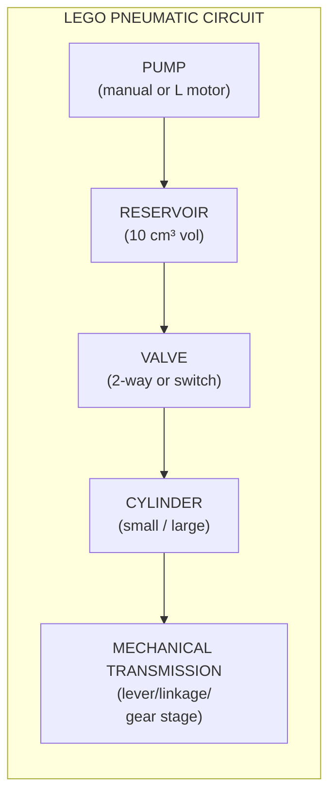
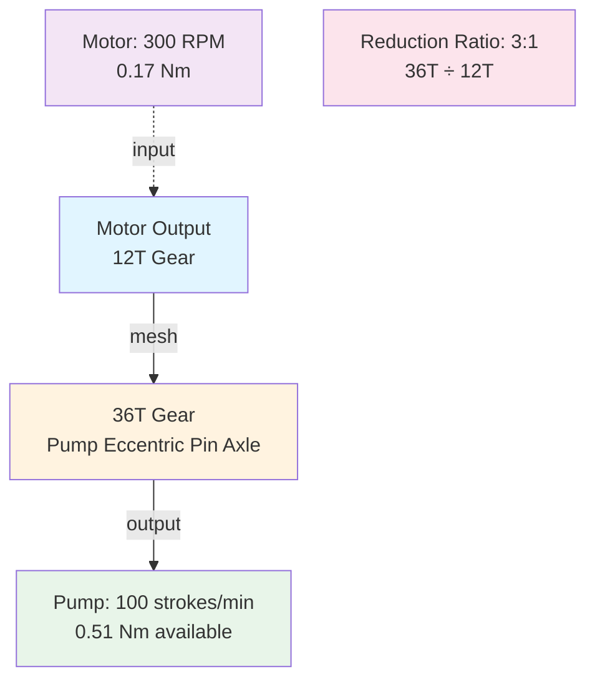
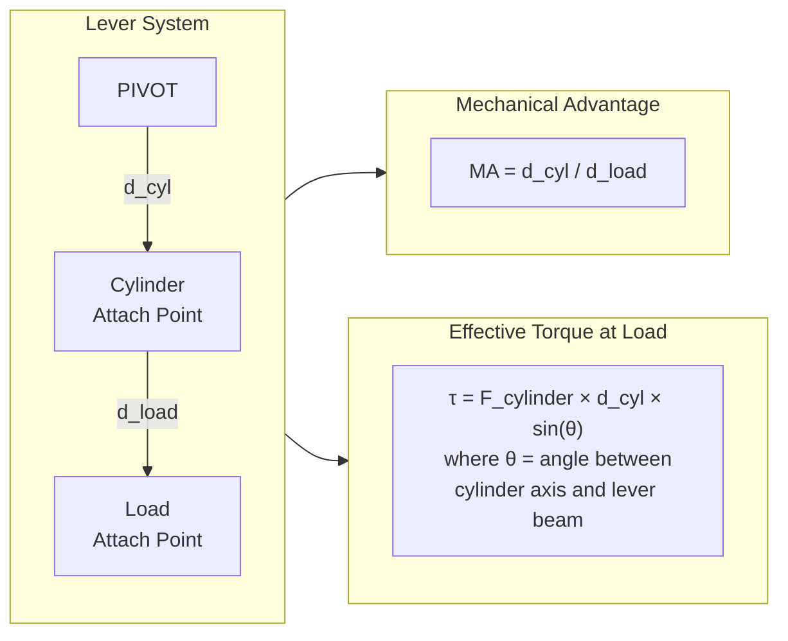

# Lesson 4: Pneumatic Mechanisms

## 1. First-Principles Intuition & Invariants

There is something quietly remarkable about a Lego pneumatic system. It operates on principles that Pascal codified in the seventeenth century, yet it assembles in minutes from colored plastic components that click together with the same satisfying certainty as any other Technic beam. Compressed air, routed through two-millimeter rubber tubing and switched by a toggle valve the size of a fingertip, can lift a 200-gram load, sequence a multi-stage excavator arm, and return to rest position with zero electrical input. Understanding why this works, and why it fails in specific, predictable ways, begins with one invariant that governs every pneumatic circuit you will ever build: pressure is force per unit area, and area is the lever you control at design time.

Pascal's Law states that a pressure applied to an enclosed, incompressible fluid transmits equally in every direction throughout that fluid. Air is not strictly incompressible the way hydraulic oil is, but at the low pressures Lego pneumatics operate—typically 15 to 30 PSI (1.0 to 2.1 bar) depending on the pump configuration and tubing integrity—the compressibility effect is small enough that the system behaves hydraulically for practical purposes. What this means at the bench is that every component in your circuit experiences the same working pressure simultaneously once the air column equilibrates. A single manual pump stroke, or a continuous mechanical pump driven by an L motor, charges the entire network to the same pressure. The cylinder that actuates first is not the one with more pressure behind it; it is the one with the lowest mechanical resistance opposing extension, which is determined by the load it carries and the internal friction of its seals.

The Lego pneumatic cylinder family has existed since the mid-1980s, with the most significant redesign arriving in the 1990s alongside the addition of the two-way valve (part 2793c01) and the compact pump (part 74510). The modern pneumatic cylinder comes in two practical bore sizes: the small cylinder with an approximately 10 mm bore and 20 mm stroke, and the large cylinder with an approximately 15 mm bore and 24 mm stroke. The force a cylinder delivers is calculated as:

$$F = P \times A = P \times \frac{\pi d^2}{4}$$

At 20 PSI (0.138 MPa), the small cylinder generates approximately 10.8 N of push force, and the large cylinder generates approximately 24.3 N. These are theoretical maximums. Real-world values sit 15 to 20 percent lower once you account for internal seal friction and the pressure drop across any valve or length of tubing in the circuit. Write 8–10 N and 18–20 N on your mental datasheet as working figures. The moment you try to lift a load exceeding these values without mechanical advantage amplification, you will watch the cylinder stall mid-stroke—a failure mode so common in novice builds that it functions almost as a rite of passage.

The core invariant that separates an expert pneumatic build from an amateur one is this: the pneumatic system supplies force; the mechanical system shapes it. A well-designed lever, gear stage, or linkage arm can multiply cylinder output force by a factor of three or four before it ever reaches the working end of the mechanism. Conversely, a poorly designed transmission wastes half your available force in friction, and no amount of pump pressure recovers that energy. The engineer who understands this invariant spends as much time designing the mechanical advantage of the linkage as specifying the cylinder bore.

One further invariant governs timing and sequencing, and it is rooted in the physics of volume: a cylinder strokes when the pressure behind it exceeds the resistive load, and a larger reservoir of compressed air means the pressure in the circuit drops less steeply as cylinders extend. The official Lego pneumatic reservoir (part 76625) holds approximately 10 cm³ of air. A single large cylinder has a displacement volume of roughly 4.2 cm³. Without a reservoir, charging the circuit with one pump stroke and then opening a valve results in an immediate pressure drop as the cylinder consumes a large fraction of the stored volume. With a reservoir inline, the same stroke moves the cylinder more decisively, with less velocity stall at mid-extension. This is not intuition—it follows directly from the ideal gas law. If you halve the volume into which a fixed mass of air can expand, you double the pressure. Increasing reservoir volume at a given pump stroke count therefore raises both peak pressure and pressure stability throughout the cylinder's travel.

---

## 2. Core Architecture & Mechanics

### The Circuit Topology

A complete Lego pneumatic circuit has five functional layers: the pressure source, the storage and distribution manifold, the control valves, the actuators, and the mechanical transmission that converts linear cylinder motion into useful work. Understanding each layer independently, and then understanding how they interact, is the prerequisite for any build that behaves predictably under load.

The pressure source is either the manual hand pump (part 74510), which delivers approximately 0.5 cm³ of air per stroke, or a motorized pump assembly where an L or XL motor drives the pump piston through an eccentric cam linkage. The motorized variant runs at around 1–2 Hz pumping frequency when coupled through a 1:3 speed-reduction gear stage, which is the practical sweet spot: fast enough to maintain pressure under moderate load, slow enough that the motor does not stall against pump back-pressure. At 1:1 direct drive, the pump loads the motor heavily and heats it within two minutes of continuous operation. At 1:5 reduction, the pump frequency drops below 0.7 Hz and the system cannot replenish pressure as fast as a large cylinder consumes it during rapid cycling. The 1:3 stage hits the crossover point where thermal and flow requirements balance.

The reservoir connects inline between the pump and the first valve. Its non-return valve (the small check valve built into the pump head) ensures that air stored in the reservoir cannot back-flow through the pump when the piston returns. Without this check valve, every pump retraction stroke would vent the stored pressure through the pump intake port, and the reservoir would never accumulate meaningful charge. This is why removing the reservoir from the circuit and connecting the pump directly to a valve produces noticeably sluggish actuation: each valve opening draws directly from the pump's last stroke volume rather than a larger stored charge.

The two-way toggle valve (part 2793c01, available in blue and grey color variants, identical in function) is a spool-type valve with three ports. In one toggle position, the inlet port connects to the extend port and the retract port vents to atmosphere. In the other position, the extend port vents and the inlet connects to the retract port. This is a classic 3/2 directional control valve in pneumatic engineering terminology. The key dimensional reality for builders is that the valve toggle requires approximately 2–3 N of lateral force to switch, which matters enormously when you are designing an automatic mechanical actuation trigger using a Technic beam as a cam follower. Too light a cam lobe and the valve does not fully switch; too heavy and the driving mechanism binds.

The pneumatic switch (part 15c01) is a pressure-sensitive on/off valve rather than a directional control valve. It opens at a threshold pressure and closes below it, making it useful for pressure-relief or sequencing triggers, though it is less commonly used in custom builds because the threshold is not adjustable. Its most reliable application is as a safety vent when you are testing a circuit at elevated pump counts—more than 25 manual pump strokes into a sealed circuit with no cylinder movement will begin to stress tubing connections at the push-fit joints.

### Actuator Sequencing

Sequencing is the craft of making two or more cylinders actuate in a defined order rather than simultaneously. Because the entire circuit is at a single pressure, all valve-open ports see the same driving force. The only way to impose order is to control when each valve opens. There are three sequencing strategies in Lego pneumatics, each with distinct mechanical implications.

The first strategy is **mechanical cascade sequencing**, where the physical end-of-stroke position of cylinder A mechanically triggers the valve for cylinder B. This is accomplished by mounting the valve toggle for the B circuit so that the piston rod of cylinder A, at full extension, contacts and toggles it. The timing precision of this method is roughly ±1 mm of cylinder stroke, which translates to approximately ±0.1 seconds of timing jitter at typical actuation speeds. For excavator arm sequences where Stage 1 (boom) must fully extend before Stage 2 (dipper) begins, cascade sequencing is the most mechanically robust solution because it requires no electronics and cannot be disrupted by pressure fluctuations. The build challenge is mechanical interference clearance: the valve toggle must sit exactly where the rod terminus arrives at full extension, which often requires a 1-stud offset bracket or a half-stud SNOT adjustment to position precisely.

The second strategy is **volume-differential timing**, where you exploit the fact that a cylinder connected through a longer or narrower tube charges more slowly than one connected through a shorter tube. At identical valve-open conditions, the cylinder receiving air through 30 cm of tubing will begin extending roughly 0.08 seconds after the cylinder connected by 10 cm of tubing, because the pressure wave propagates through a larger dead volume before reaching the piston. This technique is fragile under varying load conditions and is best treated as a crude backup rather than a primary sequencing mechanism.

The third and most controllable strategy for builders who integrate Powered Up or Power Functions motors is **electro-pneumatic sequencing**, where a servo or M motor physically actuates each valve toggle at a programmed time step. The Lego pneumatic valve accepts a 3-stud-travel beam connected by a push-pull linkage to a servo output horn, allowing the valve to be toggled under software control. This opens the possibility of dwell-time sequencing: cylinder A extends, hold for 500 ms, cylinder B extends, hold for 300 ms, both retract.

### Gear Ratios and Pneumatic Drive

Coupling a motor-driven pump to a gear stage changes the trade-off between pump stroke frequency and motor torque demand. The relationship is worth modeling explicitly. The Lego L motor produces 0.4 N·m of stall torque and approximately 0.17 N·m at peak efficiency (around 300 RPM). The pump piston requires a peak force of roughly 8–12 N at 25 PSI to push air through the check valve, applied over a crank radius of approximately 4 mm in the standard cam configuration. That translates to a peak torque demand of:

$$\tau_{\text{pump}} = F_{\text{peak}} \times r_{\text{crank}} = 10 \text{ N} \times 0.004 \text{ m} = 0.04 \text{ N·m}$$

At first glance this seems well within the L motor's capacity even at 1:1, but the pump load is not constant—it peaks sharply at the compression half of the stroke and drops to near zero on retraction. This impulsive loading creates speed ripple in the motor shaft, and at 1:1 direct drive that ripple is large enough to cause brief ESC-equivalent stall events in the motor controller, which the Lego electronics interpret as a fault condition and respond to by briefly cutting power. A 1:3 reduction gearing reduces the peak torque ripple seen by the motor by the gear ratio, from 0.04 N·m to 0.013 N·m, which sits comfortably in the continuous operating band.

The practical gear stage for a pump drive train looks like this: a 12-tooth gear on the motor output meshes with a 36-tooth gear on a secondary axle (1:3 reduction). The secondary axle carries the eccentric pin that drives the pump piston rod through a connecting rod assembly. The 36-tooth gear also gives you a convenient attachment point for a secondary cam lobe if you are using mechanical cascade valve switching—mount the cam concentrically with the pump drive gear and size the lobe dwell angle to match your desired valve-open duration, measured in degrees of gear rotation.

### Lever Mechanics and Mechanical Advantage

The lever is the most commonly under-analyzed component in a Lego pneumatic build. A cylinder that generates 10 N of push force can lift 30 N of load if the lever geometry provides a 3:1 mechanical advantage, and it can lift only 5 N if the geometry inadvertently inverts the ratio. The mechanical advantage of a lever connected to a pneumatic cylinder depends on two independently varying quantities: the moment arm from the pivot to the cylinder attachment point, and the moment arm from the pivot to the load attachment point.

$$MA = \frac{d_{\text{cylinder attachment}}}{d_{\text{load attachment}}}$$

In a Lego context, these distances are constrained to stud-grid increments of 8 mm. A cylinder pinned to a lever arm 3 studs (24 mm) from the pivot, pushing a load attached 8 studs (64 mm) from the pivot, gives a mechanical advantage of 24/64 = 0.375—the cylinder must generate 2.67 times the load force to move it. This is a configuration that appears frequently in novice builds where the builder positions the cylinder at the end of the arm that is visually closest to the cylinder's natural mounting point, without checking the lever geometry. Swapping the attachment points—cylinder 8 studs out, load 3 studs out—inverts the ratio to 2.67:1 and transforms a stalling mechanism into one with margin to spare.

There is a second geometric effect that is frequently missed: the angle between the cylinder axis and the lever arm changes as the cylinder strokes, and this angle directly affects the torque transferred to the lever. The effective moment arm is not the fixed distance to the pivot pin; it is that distance multiplied by the sine of the included angle between the cylinder and the lever. At 90°, efficiency is perfect. At 30°, only half the cylinder force contributes to rotation—the rest is wasted as a compressive load through the pivot pin. For this reason, well-designed Lego pneumatic linkages position the cylinder attachment point such that the cylinder is close to perpendicular to the lever at the midpoint of its useful travel, accepting reduced efficiency at the extremes in exchange for maximum torque where the mechanism does its primary work.

---

## 3. High-Performance Optimization & Failure Modes

### Optimizing Cycle Time and Force Delivery

The most significant performance bottleneck in a continuously cycling pneumatic system is pressure recovery time—the interval between one cylinder completing its stroke and the next cylinder having sufficient pressure to begin its stroke with full force. If your pump cannot replenish the reservoir before the next valve opens, each successive cycle degrades: the cylinder strokes more slowly, stalls earlier in its travel, and eventually fails to reach its end stop. This manifests in excavator models as a "drooping bucket" mid-cycle or a linear actuator that retracts incompletely before the next sequence stage begins.

The solution is reservoir volume management. The Lego reservoir adds approximately 10 cm³ to the system. You can stack two or three reservoirs in parallel (connected T-junction style from a single pump output port) to triple the buffer volume. At 20 PSI, three reservoirs store enough charge to complete two full large-cylinder strokes before pressure drops below 15 PSI, which is the practical minimum for reliable actuation against a 15 N load. Increasing reservoir volume beyond three units gives diminishing returns because the pump output per second becomes the limiting factor rather than stored volume.

The motorized pump gear stage can be optimized by selecting a crank radius that maximizes pump stroke volume per revolution without exceeding the motor's continuous torque rating. The standard Lego eccentric pin sits at a 4 mm radius, delivering 0.5 cm³ per stroke. A custom eccentric using a 2×2 plate offset instead of a pin moves the crank to a 6.4 mm radius, increasing displacement to approximately 0.8 cm³ per stroke—a 60 percent improvement—at the cost of higher peak force on the pump piston. At 1:3 motor-to-pump gearing and 300 RPM motor speed, the modified crank delivers approximately 1.6 cm³/second of compressed air. That replenishes a large cylinder's displacement volume (4.2 cm³) in 2.6 seconds, which is fast enough for all but the highest-frequency cycling applications.

Tubing friction losses are small but not negligible at higher flow rates. Each 90° bend in a Lego rubber tube increases resistance slightly; more importantly, a kinked tube—any bend with a radius smaller than approximately 10 mm—can partially collapse the tube lumen and reduce flow by 40 to 60 percent. Routing tubes along the natural curvature of Technic beams and using T-junction connectors to redirect flow rather than bending the tube sharply eliminates this failure mode almost entirely. When routing tubes internally through a compact model, leave at least a 2-stud clearance radius at every change of direction.

### Failure Mode Analysis

Lego pneumatic systems fail in a small number of well-defined ways, and each failure has a physical signature that makes diagnosis straightforward once you know what to look for.

**Pressure loss with no visible leak** is almost always a push-fit joint that has been compromised by repeated assembly and disassembly. The small plastic barbs on Lego tube connectors are designed for a finite number of insertion cycles, typically around 50, before the barb no longer creates a reliable seal against the tube's inner diameter. The diagnostic test is methodical: pressurize the system to approximately 20 PSI (15 to 20 manual pump strokes into a sealed circuit with all valves closed) and then listen systematically from the pump outward. A failing joint will produce a faint hiss at pressure. The fix is replacing the tube segment at that joint with a fresh cut from a spool, ensuring the cut is square and clean so the tube seats fully over the barb. A tube cut at an angle will seal only on its leading edge and will fail under cyclical pressure.

**Cylinder stall at mid-stroke** indicates either insufficient system pressure or insufficient mechanical advantage, as discussed in the lever analysis above. To distinguish between the two: watch the pump stroke count required to hold the cylinder in a stalled position. If pressure is the culprit, the stall position advances with more pump strokes, eventually reaching full extension. If the lever geometry is the problem, additional pumping does not help—the cylinder remains stalled at the same position regardless of pressure, because the available force in Newtons is geometrically insufficient to overcome the load torque at that arm angle. The remediation for geometric stall is redesigning the lever attachment, not adding pump strokes.

**Valve that does not fully switch** is a mechanical interference or force-budget problem. The valve toggle requires 2–3 N to change state. If you are using a cam-driven or linkage-driven auto-switch, calculate the force your mechanism delivers at the moment of contact. A beam actuated by a cylinder 2 studs from its pivot, contacting the valve toggle 6 studs from its pivot, transmits only 2/6 = 0.33 of the cylinder's force to the valve toggle. At 10 N cylinder output, the toggle receives 3.3 N—just enough to trigger. Add any friction in the linkage pivot pins and you drop below threshold. The fix is shortening the drive side of the lever (move the cylinder attachment closer to the valve toggle contact point) or lubricating the linkage pivots with a small amount of PTFE dry lubricant on the axle.

**Air lock in the retract port** occurs when the vent port on a two-way valve is inadvertently connected to the reservoir instead of left open to atmosphere. When both ports feed compressed air, the cylinder cannot stroke in either direction because pressure equalizes across both piston faces. This is the most confusing failure mode for novice builders because the system appears fully pressurized but nothing moves. The diagnostic is visual: trace every tube from each valve port and confirm that exactly one port on every two-way valve is an open exhaust to atmosphere, identifiable because no tube is attached to it.

### Real-World Build Validation: A Pneumatic Sorting Arm

A concrete validation exercise brings the foregoing analysis into physical practice. Consider a pneumatic sorting arm that uses two cylinders in cascade sequence: Cylinder A extends a horizontal arm outward over a conveyor; Cylinder B, mounted on the arm, then extends downward to push an object off the conveyor surface. The arm must return both cylinders before the next sort cycle.

Begin by establishing the load analysis for Cylinder B, which bears the full cantilever weight of the arm's moving section plus the push force required to displace the target object. If the arm section weighs 180 g (1.8 N) and the push force is estimated at 5 N, the total Cylinder B load is 6.8 N. The small cylinder's working force of 8–10 N provides 1.2–3.2 N of margin. This is acceptable but marginal. Position Cylinder B's attachment point 2 studs from the arm pivot and the push contact 1 stud from the pivot for a 2:1 mechanical advantage, which raises the effective output at the contact point to 16–20 N and the margin to a comfortable 9–13 N.

Cylinder A must carry the total lateral load of the extended arm plus whatever reaction forces Cylinder B's extension generates through the structure. Calculate this as the arm's moment arm from the base pivot. If the arm extends 10 studs (80 mm) and the total arm assembly with Cylinder B weighs 250 g (2.5 N), the bending moment at the base pivot is 2.5 N × 0.08 m = 0.2 N·m. Mount Cylinder A's attachment point 4 studs from the base pivot. The required force is 0.2 N·m / (4 × 0.008 m) = 6.25 N. The large cylinder's working force of 18–20 N gives a margin of nearly 3:1, which is appropriate given that the cascade trigger—Cylinder A's rod pressing the Cylinder B valve at full extension—must overcome valve switching force without the arm structure deflecting enough to miss the toggle.

Validate the cascade trigger geometry first with no air pressure: manually push Cylinder A to full extension and confirm that the rod terminus contacts the Cylinder B valve toggle squarely and displaces it through its full switching travel. If the contact is oblique, the toggle may switch incompletely under dynamic conditions even though it switches reliably under slow manual push. A 1×2 flat tile bonded to the rod terminus with a friction pin, presenting a flat contact face to the valve toggle, corrects oblique contact and ensures consistent switching across the full range of arm structural deflection under load.

Charge the system to 20 PSI before beginning cycle testing. Run 10 consecutive sort cycles and measure: Does Cylinder A reach full extension on every cycle? Does the cascade trigger fire consistently? Does Cylinder B retract fully before Cylinder A begins its retraction stroke? Any inconsistency in the first 10 cycles that is not present in cycles 2 through 4 but reappears by cycle 8 is a pressure recovery signature—the reservoir is not fully recharged between cycles. Add a second reservoir in parallel to the first and repeat the test. Inconsistency that appears only under load but not in a no-load bench test is a force-margin failure, addressable by the lever geometry changes described above. A build that passes 50 consecutive loaded cycles without a stall, misfire, or leak has achieved production-grade reliability for a Lego pneumatic mechanism, and that standard is both attainable and worth pursuing.
