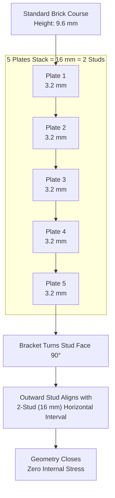

# Lesson 1: Foundational Principles of LEGO Set Design

## 1. First-Principles Intuition & Invariants

There is a reason that a single LEGO stud, pressed onto a waiting tube, produces a sound so satisfying it has become a kind of cultural shorthand for precision. That click is not accidental. It is the physical expression of a tolerance held to within 0.002 mm across billions of manufactured elements, the result of ABS plastic injected at 232°C into tool-steel molds machined to watchmaker standards. Before a designer places a single brick, understanding that click—what it demands structurally, what it permits aesthetically, and where it fails—is the whole foundation of the craft.

LEGO's system rests on two invariants that everything else derives from. The first is the **stud pitch**: the center-to-center distance between adjacent studs is exactly 8 mm in the horizontal plane. The second is the **plate-to-brick height ratio**: one standard brick stands 9.6 mm tall (the stud included), while one plate stands 3.2 mm tall, giving a ratio of exactly 3 plates per brick. These two numbers—8 mm and 3.2 mm—are the genome of the entire system. Every connection, every offset, every geometric trick in the advanced builder's vocabulary traces back to their relationship. The horizontal-to-vertical ratio of a single stud footprint is therefore 8 : 3.2, or 2.5 : 1. This non-integer ratio is not a flaw; it is the source of the system's richness. Because studs and plates do not tile cleanly in three dimensions using only right angles, builders are forced into creative geometric negotiations that produce structural strength and visual dynamism that a pure cubic grid never could.

The practical consequence of the 2.5:1 ratio is the foundational rule of SNOT construction: **five plates equal two studs** in height (5 × 3.2 mm = 16 mm = 2 × 8 mm). This equivalence is the key that unlocks sideways building. A bracket or hinge plate rotated 90° about the horizontal axis lets you present a stud face outward, sideways, or downward, and as long as your build honors the 5:2 plate-to-stud relationship at every connection point, the geometry closes perfectly, with zero stress on the clutch interface. Violating this ratio—even by a single plate—introduces a 3.2 mm misalignment that the ABS will resist elastically before failing in fatigue or visually telegraphing as a gap in a smooth surface.

The second invariant of set design, less arithmetical but equally binding, is the **relationship between module and narrative**. A LEGO set is not simply an object; it is a compressed spatial story. The building process itself is the first reading of that story, and the finished model is the second. Every great set designer understands that the sequence in which a builder assembles a model shapes their comprehension of its internal logic. If the structural spine of a building is built in the first twenty steps and then hidden beneath cladding, the builder carries a felt sense of that spine through the rest of the assembly. If the spine is added last as a cosmetic afterthought, the finished model feels hollow even when it is not, because the builder never internalized the load path. This is not subjective; it shows up in the structural outcomes. Builders who understand what they are constructing tighten their connections more deliberately. The lesson for the designer is that build sequence is a design material, not an afterthought.

Understanding brick properties at the material level closes the first-principles picture. Standard ABS (acrylonitrile butadiene styrene) has a glass transition temperature of approximately 105°C, a tensile strength around 40 MPa, and a Young's modulus near 2.3 GPa. These numbers mean that ABS is relatively stiff but not brittle at room temperature—it will deform plastically before fracturing, which is why a stressed LEGO connection bends before it snaps. The clutch mechanism itself works through a combination of the stud's slight interference fit with the tube wall (a press fit on the order of 0.05–0.1 mm) and the elastic recovery of the ABS after the stud fully seats. Repeated connection and separation cycles work-harden the contact faces microscopically and reduce clutch force over time, which is why old elements from the 1970s often feel looser than new ones under identical conditions. For the set designer, this means that elements expected to bear dynamic or repeated loads—Technic pin holes, axle sockets, hinge knuckles—must be sized and reinforced with the assumption of some clutch degradation over the model's service life.

---

## 2. Core Architecture & Mechanics

A set design has a layered internal architecture, and understanding how those layers interact determines whether the finished build feels like a coherent object or a collection of parts that happen to be touching. The layers, from innermost to outermost, are the **structural skeleton**, the **infill and transition zone**, and the **surface shell**. Each layer has distinct mechanical requirements, and the expert designer makes deliberate material choices at each one rather than allowing the aesthetic choices of the shell to dictate the structural logic of the skeleton.

```text
┌─────────────────────────────────────────────────────┐
│                   SURFACE SHELL                     │
│  (Tiles, smooth plates, SNOT panels, printed parts) │
├─────────────────────────────────────────────────────┤
│              INFILL & TRANSITION ZONE               │
│  (Bracket stacks, 1xN plates, cheese slopes,        │
│   SNOT brackets bridging skeleton to shell)         │
├─────────────────────────────────────────────────────┤
│               STRUCTURAL SKELETON                   │
│  (Liftarms, thick bricks, Technic beams,            │
│   cross-axles, pin-joined triangular frames)        │
└─────────────────────────────────────────────────────┘
```

The structural skeleton carries all primary loads. In a large architectural model—say, a modular building at minifigure scale—the skeleton is typically a grid of 2×4 and 2×6 bricks laid in a **running bond** pattern, the same offset-course logic that masonry has used for centuries. The mechanical reason is identical in both cases: aligning vertical joints between courses creates a continuous shear plane that propagates cracks and allows the structure to rack under lateral load. Offsetting joints by half a unit breaks every potential shear plane at every course boundary. In LEGO terms, a wall built with aligned joints can be pulled apart laterally with moderate force because only the clutch friction between horizontally adjacent elements resists the racking. A running bond wall distributes that same lateral force across interlocking elements at every level, dramatically increasing rack resistance.

For large spans, the skeleton benefits from **cross-bracing with Technic beams and pins**. A Technic beam used as a hidden internal member bridging two parallel walls converts what would otherwise be two independent cantilevered stacks into a single box section. The moment of inertia of a closed box section scales as the cube of its depth, so even a shallow internal frame adds disproportionate stiffness against bending. The standard Technic beam hole-to-hole pitch of 8 mm means Technic geometry and standard brick geometry share the same horizontal grid, allowing clean integration at any course level where a plate thickness allows the beam to sit flush.

The infill and transition zone is where most of the geometric problem-solving happens. The transition from a vertical Technic skeleton to a sideways-studded SNOT surface requires a bracket or hinge element to rotate the stud orientation, and then the 5:2 plate-to-stud rule must close the geometry. The following diagram shows the stacking logic for a common sideways panel connection:



When this closure fails—when a designer attempts a SNOT panel connection that is off by one plate—the result is an internal stress of 3.2 mm distributed across whichever connections are forced to bridge the gap. In thin cosmetic cladding this produces a visible bow; in a structurally loaded connection it concentrates shear stress at the weakest clutch pair in the stack. The fix is always to audit the plate stack from the nearest rigid datum (usually the baseboard or a full-brick course) and correct the count before the shell is attached.

Load distribution in a large set follows the same logic as any civil structure: gravity loads want to travel the shortest path to the ground, and wherever a load path is interrupted or forced to detour, stress concentrates. In LEGO terms, this means that heavy elements—motors, battery boxes, large curved panels built up from dozens of small tiles—should be positioned directly above columns or walls, not cantilevered on horizontal plates. A 1×8 plate cantilevered four studs from its last support acts as a beam in bending. The tensile stress on the bottom face of that plate is resisted entirely by the clutch friction of whatever element is attached to its underside. Under a point load at the tip, that clutch friction is the only thing preventing rotation about the support, and it will yield before the ABS fractures—meaning the connection simply pops apart. The practical rule is to limit unsupported cantilever spans to no more than three studs for plates and no more than six studs for full bricks, and to triangulate any cantilever that must exceed these limits by running a diagonal brace back to the main structure.

---

## 3. High-Performance Optimization & Failure Modes

The gap between a set that holds together under normal handling and one that survives years of repeated assembly, play, and transport comes down to a small set of optimization decisions made at the design stage. Each failure mode has a specific structural cause, and each cause has a targeted remedy. Working through these systematically is what separates the advanced practitioner from the casual builder.

**Racking and lateral instability** is the most common failure in large architectural models. The symptom is a model that feels solid when gripped at the base but twists measurably when pushed sideways at the top. The cause is a skeleton with no triangulation in the vertical plane—essentially a moment-frame structure relying on the rigidity of its connections rather than geometry. The remedy is to introduce diagonal elements: either a Technic liftarm run diagonally inside a hollow wall section, or a cross-brace hidden inside a floor plate that ties opposing walls together. Even a single internal diagonal per 16×16 stud wall section reduces racking stiffness by roughly an order of magnitude compared to an unbraced frame of equivalent height.

**SNOT delamination** occurs when a sideways-studded surface panel separates from the main structure under handling loads. The proximate cause is almost always a geometry closure error (the 5:2 plate count violation described above), but the underlying cause is frequently that the bracket or hinge element anchoring the panel has only one or two studs of connection back to the skeleton. The fix is to increase the contact area between bracket and skeleton. A 1×2 bracket has a single stud face; replacing it with a 1×4 bracket doubles the moment arm resisting panel rotation and quadruples the number of clutch connections carrying shear. Where geometry permits, stacking two brackets vertically and staggering their stud positions distributes the load further.

**Baseboard flex** is a failure mode specific to large modular builds where multiple 32×32 baseplates or frame modules must connect edge-to-edge. A single 32×32 baseplate is notably flexible under its own weight because it is a thin ABS sheet with no bending stiffness in its plane. The standard professional remedy is to build a **perimeter frame** of 2×4 bricks around the underside perimeter of the base, two courses tall, before any superstructure is added. This converts the flat plate into a shallow box beam, and the increase in bending stiffness is proportional to the square of the frame depth—two courses of brick (19.2 mm) produces a dramatic improvement over the bare plate. For transport, the frame also provides a grippable edge that distributes hand-load across the perimeter rather than concentrating it at a single corner.

**Color banding and visual tension** are the aesthetic analogs of structural failure. Color banding occurs when a designer applies color in horizontal stripes that coincide with structural layer boundaries, inadvertently emphasizing the modularity of the construction rather than the coherence of the subject. The remedy is to treat color as a material that must cross structural joints. If the structural skeleton is built in one color and the SNOT shell in another, the contrast will read as a seam regardless of how precisely the geometry closes. Using a neutral structural color (black or dark bluish-gray for most subjects) and reserving subject-appropriate colors for the shell eliminates the problem.

Visual tension arises when the proportions of the finished model conflict with the subject's real proportions due to the discretization imposed by the 8 mm stud grid. A human face, for example, has a width-to-height ratio near 0.75 at life scale, but on a 10-stud-wide mosaic that ratio can only be approximated within the resolution of the grid. The designer's tool here is to work at a scale where the discretization error is below the visual threshold—generally, a scale where the smallest meaningful detail in the subject subtends at least two studs in the model. For a minifigure-scale building facade, this means windows must be at least 4 studs wide and 3 bricks tall to read as windows rather than arbitrary holes. Dropping below this threshold produces models that feel blocky even when their overall proportions are correct, because the texture of the surface is communicating a different scale than the outline.

The deepest optimization a set designer can make is to treat **form and function as a single variable** rather than two constraints to be balanced against each other. The best LEGO sets are ones where the structural solution and the aesthetic solution are the same solution. A arch built from wedge plates and 1×1 round bricks to approximate a curve is simultaneously a structural compression element and a visual statement about the building's architectural language. A Technic liftarm hidden inside a column is a structural necessity, but if it also provides the attachment point for an interior detail, it earns its existence twice. Designing for this kind of double-utility requires holding the structural and aesthetic models simultaneously in mind from the first brick, which is why the opening lesson of this curriculum returns, at the end, to the same point it started: the click of a stud on a tube is not just a fastener engaging. It is a decision locking in, with its structural consequences, its aesthetic implications, and its place in the build sequence all determined at once. Train yourself to hear all three simultaneously, and the rest of set design becomes a series of increasingly precise expressions of that same moment.
