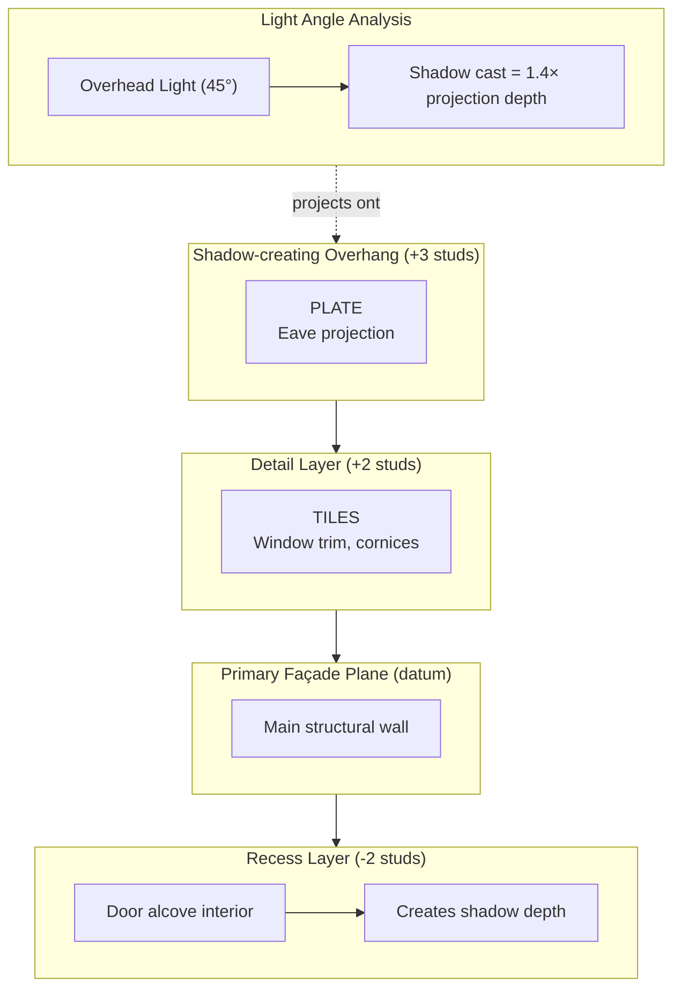

# Lesson 2: Spatial Composition and Layout Architecture

## 1. First-Principles Intuition & Invariants

The architecture of spatial composition in Lego set design operates under a fundamental constraint that transforms limitation into creative advantage: every build exists within a discrete, quantized volumetric envelope where spatial relationships are governed by the 8mm stud pitch and the 9.6mm plate height unit. This mathematical foundation—a ratio of 5:6 between horizontal and vertical resolution—creates an anisotropic design space that forces builders to think simultaneously in orthogonal precision and diagonal approximation. Unlike traditional architectural drafting where curves and angles flow continuously, Lego spatial composition demands that designers master the art of visual suggestion through stepped geometry, forcing the eye to interpolate smooth transitions from fundamentally rectilinear components.

The master set designer recognizes that effective spatial composition emerges not from filling available volume, but from establishing hierarchical relationships between occupied and negative space. Consider the canonical Lego modular building: a 32×32 baseplate provides 1,024 stud positions, yet exceptional designs typically occupy only 60-70% of available footprint area, preserving breathing room that allows individual architectural elements to register distinctly against controlled voids. This principle of compositional restraint extends vertically as well—a façade that rises uniformly to maximum height reads as monotonous, while one that creates a skyline rhythm through varied rooflines establishes visual interest through what architects call "figure-ground reversal," where the negative space of the sky becomes as compositionally active as the positive mass of the structure itself.

Depth layering constitutes the primary mechanism through which Lego builds transcend their inherent flatness. A single-plane façade, regardless of detail density, registers as scenographic and unconvincing. Dimensional authenticity emerges when builders establish at least three distinct depth planes: a primary structural plane that defines the overall building envelope, a secondary detail layer projecting 1-2 studs forward (window trim, balcony railings, cornices), and a tertiary shadow-creating recess layer set 1-2 studs back (doorway alcoves, window reveals, decorative insets). This tripartite depth strategy exploits the physics of light occlusion—even under diffuse ambient lighting, a 16mm forward projection creates sufficient shadow to generate perceptual separation, while a recessed element reads as architecturally intentional rather than merely textured.

The invariant principle governing all successful spatial composition in Lego is the establishment of a clear focal hierarchy. Human visual perception operates through saccadic eye movements, with gaze settling on high-contrast edges, geometric anomalies, and areas of maximal detail density. A compositionally sophisticated build guides this visual scanning pattern through deliberate asymmetry and scaled complexity gradients. The focal point—whether a central entrance portal, a corner tower, or a dramatic roofline feature—must command 30-40% more geometric complexity than surrounding elements, employing techniques such as color contrast (a dark blue door against tan brickwork), scale disruption (an oversized window breaking the rhythm of smaller fenestration), or unique part geometry (a printed tile or specialized mold breaking the pattern of standard bricks). Secondary focal points should register at approximately 60-70% of primary focal complexity, creating a visual cascade that prevents compositional chaos while maintaining interest across the entire build envelope.

Scale relationships within Lego construction operate under the tyranny of minifigure proportion, which establishes an anthropometric reference that viewers instinctively measure against real-world spatial experience. The canonical minifigure stands 4 bricks (32mm) tall, representing approximately 1.7 meters of human height, yielding a mathematical scale factor of roughly 1:53. This ratio creates immediate perceptual challenges: a standard 1×4 brick represents 340mm of real-world dimension, meaning a single-stud wall thickness translates to an absurdly massive 425mm structural wall—thicker than most castle fortifications. Advanced builders mitigate this scale distortion through selective compression, using plate-thickness walls (3.2mm representing 170mm) in domestic interiors while permitting brick-thickness structural elements only where visual mass serves compositional purpose, such as load-bearing corner pilasters or defensive fortification walls.

The compositional tension that elevates exemplary Lego architecture from competent to exceptional emerges from the deliberate violation of visual equilibrium. A perfectly symmetrical façade, while demonstrating technical control, produces compositional stasis—the eye completes the pattern prediction instantly and disengages. Sophisticated builds introduce calculated asymmetries: a tower positioned off-center by 2-4 studs, a roofline that rises in stages rather than uniformly, a fenestration pattern that establishes rhythm through variation rather than repetition. This asymmetric tension must remain bounded—shifts beyond 30% of total width register as error rather than intention—but within that envelope, compositional dynamism transforms static geometry into visually active architecture.

## 2. Core Architecture & Mechanics

The structural implementation of spatial composition begins with the establishment of a build grid that defines primary circulation paths, load-bearing structural zones, and flexible detail areas. For a canonical 32×32 modular building, the optimal spatial partition allocates an 8-stud-deep front façade zone, a 16-stud-deep interior volume, and an 8-stud-deep rear service zone. This tripartite division mirrors real architectural practice where street-facing elevations receive maximum decorative investment, interior spaces optimize functional efficiency, and rear elevations prioritize utility over aesthetics. The front façade zone thickness—64mm in physical dimension—provides sufficient depth for window reveals (2 studs), exterior wall thickness (1 stud minimum), and interior wall finish (1 stud), leaving 4 studs for architectural articulation through projecting elements such as balconies, cornices, or textured surface treatment.

Within this established grid, vertical composition follows a rhythmic structure governed by floor-to-floor heights that balance minifigure clearance requirements against visual proportion. Standard residential floor heights employ 9-11 brick heights (72-88mm), representing 3.8-4.6 meters in real-world scale—taller than typical domestic construction but necessary to accommodate minifigure headroom plus the visual mass of floor structures and ceiling details. Commercial or institutional spaces may expand to 13-15 brick heights, providing sufficient volume for tall windows and mezzanine features. These vertical intervals establish a modular rhythm that propagates through the entire build: window headers repeat at consistent intervals, floor lines register as continuous horizontal bands, and roofline terminations occur at harmonically related heights (a three-story structure might rise to 33 bricks, establishing a 1:2:3 golden ratio relationship between ground, upper floors, and roofline).

Depth layering implementation requires systematic attention to connection geometry and structural load paths. When projecting elements forward from the primary façade plane, builders must ensure continuous load transfer through techniques such as cantilever bracketing (inverted bracket pieces placed beneath projecting balconies), vertical pilaster supports (1×1 bricks or profile bricks forming pseudo-columns beneath overhangs), or horizontal beam structures (plates spanning between load-bearing points). A balcony projecting 3 studs forward without support reads as structurally implausible; the same balcony supported by decorative corbels or thin pilasters registers as architecturally coherent. This principle extends to recessed elements: a window set back 1 stud from the façade plane requires surrounding brickwork to form a reveal box, with header bricks spanning the top of the opening and sill plates defining the bottom threshold.

Focal point establishment operates through a combinatorial system of geometric, chromatic, and textural differentiation. At the geometric level, the primary focal element should violate the established modular rhythm: if windows repeat at 6-stud intervals, the focal window spans 8 studs. If the façade consists primarily of flat 1×n brick courses, the focal area incorporates projecting headers or recessed panels. Chromatic differentiation exploits Lego's constrained palette strategically—a primarily tan building gains a focal accent through dark red or dark blue door surrounds, creating 40-60% luminance contrast that draws the eye immediately. Textural differentiation layers in part variety: while the bulk of the façade might employ standard bricks and plates, the focal zone introduces printed tiles, textured bricks (log bricks, masonry bricks), or specialized molded elements (arches, lattice panels, barrel components) that register as unique within the visual field.

Scale relationship management requires constant calibration between minifigure-relative and visually plausible proportions. Door openings present the most critical dimensional challenge: a minifigure requires 4 bricks of clearance height (32mm), but scaling to real-world dimensions (approximately 2.1 meters) produces a door that reads as institutional rather than residential. Advanced builders employ visual compression by designing door frames that measure 5 bricks tall but incorporate a 1-brick-thick header element that reduces perceived opening height to 4 bricks, maintaining functional clearance while suggesting typical residential door proportions. Window design follows similar logic: a 1×4 window opening represents a 1.7-meter-wide aperture in scaled terms, absurdly large for residential fenestration. Subdividing this opening with a central 1×1 profile brick mullion creates two 1×1.5 panes, each representing a more plausible 0.8-meter window width while maintaining the overall 1×4 compositional footprint.

Compositional tension implementation manifests through systematic pattern disruption calibrated to remain within perceptual tolerance bounds. In a row of five windows spaced at 6-stud intervals, compositional tension emerges by shifting the central window 1 stud off-center, or by making the central window 2 studs wider than its neighbors, or by introducing a balcony beneath the second window from the left rather than the symmetrically obvious center position. These asymmetric moves activate visual scanning behavior—the eye seeks to reconcile the pattern deviation, maintaining engagement rather than completing the pattern prediction and moving on. Vertical asymmetry operates similarly: a three-story tower positioned not at building center but 4 studs offset creates diagonal sight lines that guide the eye through the composition in a Z-pattern rather than allowing the gaze to stall at a central focal point.

The mechanical implementation of compositional unity across disparate elements requires establishing visual linking strategies that create perceptual coherence despite geometric variation. Color banding—horizontal stripes of contrasting color that repeat across façade elements—acts as a visual tie that unifies otherwise disconnected features. A dark tan base course rising 2 bricks high, repeated as a stringcourse at second-floor level and again as a cornice beneath the roofline, creates three horizontal accents that bind the composition together regardless of intervening fenestration patterns. Vertical linking elements such as corner quoins (alternating colors in a vertical stack) or pilaster strips (1×1 profile bricks creating pseudo-columns) establish vertical rhythms that frame horizontal composition zones, preventing the build from reading as an undifferentiated stack of horizontal layers.

## 3. High-Performance Optimization & Failure Modes

The optimization of spatial composition for maximum visual impact within constrained part budgets requires ruthless prioritization of detail investment. A finite part count forces a zero-sum trade-off: every additional detail element in one area depletes available complexity elsewhere. Master builders employ a detail gradient strategy where focal zones receive 3-4× the part density per square stud compared to supporting areas. A 32×32 modular façade might allocate 200-250 parts to the central entrance bay (4×8 stud area), achieving detail density of 6-8 parts per square stud, while flanking wall sections employ 2-3 parts per square stud through simpler brick coursing patterns. This gradient ensures that limited parts generate maximum perceptual impact—the eye forgives simplification in peripheral zones when the focal area delivers sufficient geometric richness.

Depth layering optimization confronts the structural reality that every forward projection consumes rare attachment points and introduces cantilever stress. Builders maximize depth impact while minimizing structural complexity through the strategic use of jumper plates (1×2 plates with centered stud) that enable half-stud offsets, allowing a 1-stud projection to appear as 1.5 studs through asymmetric positioning. Similarly, tile-over-plate stacking creates the visual impression of deeper overhangs without requiring full brick-thickness projections—a 1×6 tile placed atop a 1×4 plate projects the tile's leading edge 1 stud forward while maintaining continuous structural support across the 1×4 plate's rear attachment studs. This technique reduces cantilever loading while preserving the shadow-creating geometry necessary for depth perception.

The failure mode of compositional over-articulation manifests when builders layer excessive geometric variation without establishing clear hierarchical relationships. A façade that employs simultaneously varied fenestration patterns, multiple competing roofline geometries, aggressive color blocking, and dense textural variation across all areas collapses into visual noise—the eye cannot establish a scanning hierarchy and perceives the build as chaotic rather than complex. The corrective strategy imposes a strict geometric simplification rule: any compositional zone should employ a maximum of two geometric variations simultaneously (window size AND color accent, but not window size AND color accent AND textural variation AND depth projection). This binary variation limit maintains perceptual legibility while preventing the composition from flattening into monotony.

The inverse failure mode—compositional under-articulation or "brickwall syndrome"—occurs when builders fail to introduce sufficient variation to maintain visual engagement. A 32×32 façade built as pure 1×n brick coursing with uniform fenestration spacing registers as an exercise in inventory management rather than architectural expression, regardless of technical precision. The diagnostic signature of under-articulation is the absence of visual rest points: when scanning the build, the eye finds no area that commands extended attention, resulting in rapid perceptual completion and disengagement. The corrective protocol requires introducing at least one element per 8×8 stud compositional zone that violates the established pattern—a window of different size, a textural accent such as a printed tile, a depth variation such as a recessed panel, or a color accent breaking the dominant palette.

Scale relationship failures typically manifest as "dollhouse syndrome," where internal spatial volumes accurately serve minifigure functionality but external massing reads as disproportionately massive. A three-story modular building with proper 9-brick floor heights rises to 27 bricks (216mm) plus roof structure, representing approximately 11.5 meters in scaled height—taller than most three-story residential structures. This vertical exaggeration occurs because minifigure head clearance and floor structure thickness consume proportionally more vertical height than in real architecture. Advanced mitigation strategies employ architectural features that visually compress perceived height: horizontal banding at floor lines creates the illusion of multiple shorter stories, mansard or hipped roofs reduce apparent height through sloped profiles, and the strategic placement of vertical elements such as chimneys or towers establishes comparative relationships that make the main building mass appear less tall by contrast.

The optimization of compositional tension under asymmetric constraints requires systematic testing of visual weight distribution. A build achieves compositional balance not through symmetric mass placement but through equivalent visual weight across the vertical centerline—a small, high-detail element on one side balances a larger, low-detail element on the opposite side. Quantifying visual weight involves multiplying geometric complexity (part count per area), color contrast (deviation from dominant palette), and depth articulation (projection/recess magnitude) to produce a composite weight value. Balanced compositions maintain weight ratios within 0.7-1.3:1.0 across the centerline; ratios beyond this range produce perceptual tipping where the build appears to lean toward the heavier side despite structural stability.

Workflow optimization for iterative compositional refinement employs a three-phase build strategy that prevents premature detail commitment. Phase one establishes the primary structural envelope and major spatial divisions using only standard bricks and plates, creating a "massing model" that validates overall proportions, floor heights, and volumetric relationships without investing in detail elements. This skeleton structure should consume no more than 30% of target part budget, preserving flexibility for compositional adjustment. Phase two introduces secondary depth layering and fenestration patterns, testing focal hierarchy and visual flow while maintaining the ability to relocate or resize elements without dismantling structural foundations. Only in phase three—after spatial composition has been validated through the neutral assessment of photographs taken from typical viewing angles—does the builder commit to tertiary detail investment such as textured surfaces, printed tiles, and specialized molded elements.

The pathological failure mode of structural inadequacy beneath compositional ambition manifests when builders prioritize visual geometry over load-bearing reality, producing builds that sag, twist, or delaminate under their own mass. Large projecting elements such as balconies or cornices require explicit engineering: a 1×6 plate cantilevering 4 studs forward from a façade generates approximately 15 grams of moment force at its attachment point—negligible in isolation, but when eight such projections stack vertically, cumulative shear stress can exceed the holding capacity of plate-to-brick friction alone. The engineering solution introduces discrete vertical load paths: 1×1 bricks or profile bricks positioned as pseudocolumns beneath each projecting element, transferring gravitational load directly to the baseplate rather than relying on friction coupling. This structural realism simultaneously solves the engineering challenge and enhances visual plausibility, as viewers intuitively recognize the load-bearing logic of vertical supports.

Advanced compositional optimization employs negative space as an active design element rather than residual absence. A courtyard, archway, or colonnaded passage reads not as missing structure but as intentional volumetric carving that creates interior/exterior ambiguity and enhances depth perception. The implementation of negative space volumes requires careful attention to edge definition: an open courtyard surrounded by continuous walls registers clearly as intentional void, while an open area flanked by discontinuous structural elements appears incomplete. The boundary condition treatment employs columns, arches, or railings that define the negative space edge without occluding it, maintaining the perceptual openness while providing clear geometric termination.

The ultimate optimization challenge in Lego spatial composition involves achieving narrative legibility—the capacity for a build to communicate its intended architectural character, historical period, and functional purpose through purely geometric means. A medieval castle must read as medieval through crenellations, arrow slits, and heavy stonework massing even without heraldic banners or printed shield elements. A Victorian townhouse must telegraph its period through bay windows, decorative cornices, and vertical proportions independent of color choice. This narrative encoding operates through the systematic deployment of period-specific geometric signatures: Gothic architecture employs pointed arches and vertical emphasis, Classical architecture features triangular pediments and columnar orders, Modernist design emphasizes horizontal ribbons and asymmetric massing. The builder's mastery manifests in the ability to evoke these architectural languages through pure Lego geometry, leveraging the medium's quantized spatial grid not as limitation but as the generative constraint that transforms simple bricks into architecturally literate expression.
