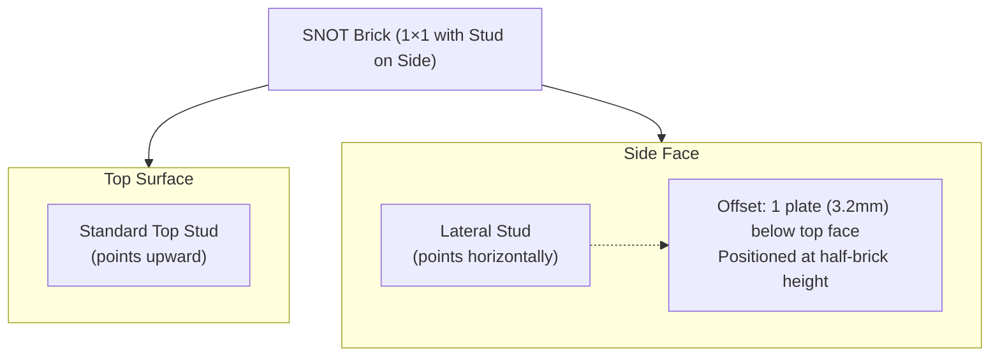
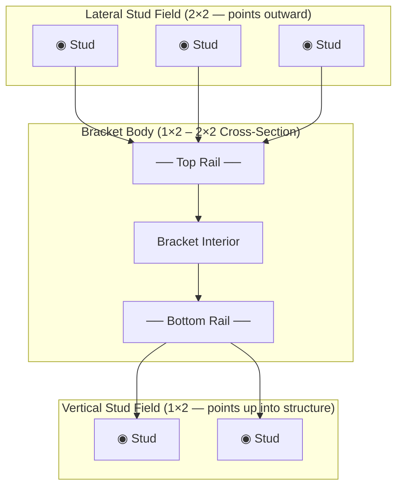

# Lesson 1: SNOT Fundamentals and Core Bonding Mechanics

## 1. First-Principles Intuition & Invariants

There is a moment, familiar to every builder who has worked seriously with Lego, when the grid stops being a constraint and becomes a coordinate system. Standard construction treats that coordinate system as fixed: studs face up, plates stack vertically, and the entire vocabulary of the build is organized along a single axis. SNOT — Studs Not On Top — is the discipline of reasoning about all three axes simultaneously, exploiting the fact that every brick face carries bonding geometry and that the Lego system's dimensional ratios encode precise, exploitable relationships between orientations.

To build with SNOT is not simply to turn a brick sideways for aesthetic effect. It is to treat the Lego System as a three-dimensional modular grid with a known metric, and to navigate that grid with the same rigor a machinist brings to workpiece coordinate offsets. The practitioner who understands *why* the numbers work can design reorientation joints that land flush, resolve awkward offsets with single-part solutions, and build structures that are simultaneously smooth-surfaced, internally triangulated, and dimensionally coherent. The practitioner who does not understand them will produce builds that look almost right — surfaces that are off by half a stud, seams that don't close, and panels that bow under their own weight.

### The Dimensional Invariant

The foundational invariant of the entire SNOT discipline is a ratio, and it must be internalized as physical intuition before any technique makes sense. A standard Lego stud has a pitch — center-to-center distance in the horizontal plane — of **8 mm**. A standard plate has a height of **3.2 mm**. A standard brick (which is three plates tall) therefore has a height of **9.6 mm**. These are not approximate design decisions; they are the fixed metric of the system, and every SNOT geometry either satisfies them exactly or introduces a compensation.

The critical relationship is this: the stud pitch (8 mm horizontal) and the plate height (3.2 mm vertical) do not share a common integer multiple. Five plates equal 16 mm vertically, which equals exactly two stud pitches horizontally. This is the master ratio:

**5 plates = 2 studs**

Written as a proportion: 5 × 3.2 mm = 16 mm = 2 × 8 mm. When you rotate a row of bricks 90 degrees and need the resulting studs to align with a horizontal grid, this ratio is the bridge. It is the number you count on your fingers when you are at the table with parts in hand, and it is the number you check first when a sideways-mounted element refuses to seat cleanly.

Extending this: one full brick height (9.6 mm) does not resolve cleanly against stud pitch at integer plate counts, which is why brick-height offsets in SNOT construction always decompose into plate counts rather than brick counts. A builder who thinks in bricks when planning a SNOT joint will consistently arrive at fractional misalignments. A builder who thinks in plates will find exact solutions.

### Why Standard Orientation Breaks Down

A large-scale Lego model built entirely in standard orientation carries a surface vocabulary of studs and anti-studs — the circular clutch rings visible on every exposed top face. For certain subjects (terrain, rock formations, industrial machinery) this texture is acceptable or even desirable. For architectural facades, vehicle bodywork, curved organic forms, or any surface that must read as smooth from a viewing distance, exposed studs destroy the illusion. The alternative — covering every surface with tiles — works on horizontal planes but fails the moment a surface needs to be vertical, angled, or curved, because tiles require a stud beneath them, and standard-orientation bricks provide studs only on their top faces.

SNOT solves this by providing lateral stud faces. When a brick is mounted sideways, its studs point horizontally, providing attachment points for tiles, plates, and further bricks on what was previously a featureless side wall. The joint that makes this possible — the sideways attachment mechanism — is provided by a family of parts collectively called SNOT bricks, headlight bricks, and bracket plates, each of which carries both a standard vertical stud interface and a secondary lateral or recessed interface that enables 90-degree reorientation.

The structural implication is profound. A SNOT assembly is not just a cosmetic skin applied over a standard skeleton. When designed correctly, the sideways-mounted elements interlock with the main structure through perpendicular clutch forces, adding rigidity in axes that standard stacking cannot address. A wall built from standard bricks stacked vertically resists vertical compression well but is relatively weak against lateral shear — the layers can slide against each other. The same wall with SNOT-mounted bricks locked perpendicular into it creates a cross-grain bond that behaves more like a woven structure, distributing shear load through clutch friction in multiple planes simultaneously.

---

## 2. Core Architecture & Mechanics

### The Bonding Geometry of a Lego Clutch

Before examining SNOT-specific hardware, it is worth dissecting exactly what a Lego clutch connection is at the mechanical level, because SNOT joints impose that same clutch geometry in unfamiliar orientations and you need to predict the resulting forces.

A Lego stud is a hollow cylindrical boss, 4.8 mm in outer diameter, projecting 1.8 mm above the top face of the brick. The anti-stud — the tube inside the bottom of a brick or plate — is 4.8 mm in inner diameter, toleranced so that the stud-to-tube fit produces a controlled interference of approximately 0.1 mm. This interference generates the clutch force: ABS plastic deforms elastically at that scale, the cylinder is gripped circumferentially, and the resulting friction is sufficient to resist disassembly without tools under normal structural loads. The joint is not threaded, not latched, and not adhesive — it is purely elastic interference fit repeated across the array of studs engaged.

The force required to separate a single stud from its anti-stud has been measured experimentally at approximately 4–5 N under clean, room-temperature conditions, dropping to 2–3 N as parts age and the ABS surface hardens. A 2×4 brick engages eight studs simultaneously, so the bond resists roughly 32–40 N of direct pull-out force. More importantly, the clutch is highly resistant to shear parallel to the stud axis — you cannot slide a brick sideways off its mount without first disengaging the studs, because the cylindrical geometry converts lateral force into a component that presses studs harder against their tube walls. This is why stacked Lego structures handle horizontal loads surprisingly well despite being assembled without fasteners.

In a SNOT joint, these same clutch forces act in a rotated frame. A sideways-mounted plate grips its host studs with the same interference, but those studs now point laterally, so the pull-out direction is horizontal and the shear direction is vertical. The joint is mechanically identical to a standard connection — it is simply rotated 90 degrees in the world frame. This matters because it means SNOT connections carry the same load ratings as standard connections in their local frame. A builder should not treat a SNOT joint as structurally inferior simply because it is sideways; it is inferior only if fewer studs are engaged or if the loading geometry happens to align with the pull-out axis.

### SNOT Hardware: The Primary Parts Family

The workhorse of SNOT construction is the **1×1 brick with stud on side** (commonly called the SNOT brick, Lego part 87087 in its most common modern form). It is a single-stud brick with an additional stud protruding from one face. The lateral stud is not centered at mid-brick height; it sits 3.2 mm below the top face, which places it at exactly one plate height below the top of the brick. This offset is not arbitrary. It means that when the SNOT brick is embedded in a standard brick layer and a tile or plate is attached to its lateral stud, the outer face of that attached element lies flush with the adjacent surface only under a specific dimensional condition that the builder must verify.

The **headlight brick** (Lego part 4070, one of the oldest SNOT-enabling parts in the system, introduced in 1980) takes a different approach. It is a 1×1 brick with a recessed anti-stud socket on its front face rather than a projecting stud. An element placed into this socket seats its stud 3.2 mm inward from the front face of the headlight brick, with the element's face flush with the headlight brick's front face. This recessed geometry makes the headlight brick the preferred choice for flush panel work, where you want the outer surface of a sideways-mounted tile to sit exactly even with the surrounding brick face rather than standing proud of it.

**Bracket plates** (the 1×2–1×2, 1×2–2×2, and 1×2–1×4 families) represent the high-capacity SNOT hardware. These are L-shaped plate elements that provide a horizontal stud field on one leg and a vertical stud field on the other, with the transition geometry designed so that the two fields satisfy the 5-plate-to-2-stud dimensional relationship. A 1×2–2×2 bracket allows a 2×2 field of studs to point laterally from a structure while engaging two standard studs on the vertical face, and because the bracket is a single molded part rather than a stack of individual SNOT bricks, it is stiffer and faster to integrate.

The critical dimensional check for any bracket is that the transition between the two stud fields does not introduce an offset. For the standard bracket family, TLG has designed these transitions to be dimensionally exact — the lateral stud field aligns with the same 8 mm grid as the vertical field when the 5-plate relationship is satisfied by the surrounding structure. If the surrounding structure is at the wrong height, the lateral studs will be off-grid and nothing will seat cleanly.

### The 5:2 Relationship in Practice: A Worked Example

Consider a vertical wall panel built sideways. You want a 10-stud-wide wall section, all tiles, to read as a smooth surface at 90 degrees to the main build axis. The tiles must be mounted on sideways-facing studs. Those studs must span the full height of the wall section in standard brick heights so that the assembly integrates with the rest of the build.

Each row of sideways-mounted tiles is one tile (or plate) tall in the rotated frame, which is 3.2 mm per row. A 10-row panel is therefore 10 × 3.2 mm = 32 mm tall in the wall's local height axis. 32 mm in the standard vertical axis equals 10 plates exactly. But 10 plates is not a clean multiple of a brick height (3 plates = 9.6 mm), and you cannot build to 10 plates with whole bricks without mixing in loose plates. Plan instead for a panel height that is a multiple of 5 plates — 5, 10, 15, 20 — because those heights correspond to 2, 4, 6, 8 stud pitches respectively in the sideways dimension, allowing the panel to terminate at a stud boundary on both left and right, integrating cleanly into the horizontal grid of the main structure.

A 15-plate-tall wall section (48 mm) will give you 6 stud pitches of sideways coverage. At each stud position you mount a SNOT brick or bracket. The wall's height of 15 plates breaks into 5 bricks exactly (15 ÷ 3 = 5), so the main structure can be built in full bricks without loose plates. This is the design decision that separates fluent SNOT work from trial-and-error assembly: choosing overall dimensions that satisfy both the vertical brick grid and the horizontal stud grid simultaneously.

---

## 3. High-Performance Optimization & Failure Modes

### Achieving Flush Surfaces: The Offset Calculation

The most common failure in beginner SNOT work is a panel face that sits 1.6 mm proud of or recessed from the target surface. This is not a random error — it has a specific cause and a specific cure.

When a tile (1.6 mm thick) is mounted on a laterally-projecting stud, the outer face of the tile stands 1.8 mm (stud height) + 1.6 mm (tile body) = 3.4 mm proud of the face of the host SNOT brick. The face of a standard brick in the adjacent column stands at 0 mm offset (it is flush with its own face). The resulting step between the tile surface and the adjacent brick face is 3.4 mm, which is visually conspicuous. To eliminate it, you need the tile face to be flush with the outer face of the surrounding structure, which requires that the surrounding structure extend 3.4 mm forward of the SNOT brick's face — almost exactly one plate thickness (3.2 mm) forward. The 0.2 mm discrepancy is within the tolerance of the system and can usually be absorbed; in practice, adding one additional plate thickness of standoff behind the SNOT brick is the standard fix.

The headlight brick solves this differently: its recessed socket pulls the attached stud 3.2 mm inward, so a tile mounted in the headlight sits with its outer face nearly flush with the headlight's own front face. This is why headlight bricks appear so frequently in smooth facade work — they eliminate the standoff calculation entirely for simple single-layer panels.

### Structural Rigidity: When SNOT Becomes a Liability

SNOT construction introduces a category of failure that standard stacking does not: **out-of-plane peel loading**. In a standard stack, the worst-case load on a clutch joint is pull-out along the stud axis, which the clutch resists well. In a SNOT assembly, a plate mounted on a lateral stud can be loaded in a direction that levers the plate away from the host brick face, using the stud as a fulcrum. The effective force multiplied by the lever arm can exceed the clutch's shear resistance even under modest applied loads, causing the panel to delaminate from the structure at its attachment points.

The mitigation strategy is structural integration rather than surface attachment. Rather than mounting SNOT elements only on the outer face of a wall, design the structure so that SNOT-mounted layers interleave with the internal structure at every 5-plate interval. A SNOT panel that is bonded to the backbone at three depth layers — front, middle, and back — cannot peel without shearing all three bond lines simultaneously. This is architecturally equivalent to through-tenoning in woodworking: the connection spans the full thickness of the material rather than gripping only the surface.

For large panels exceeding roughly 20 studs in any dimension, consider implementing a secondary back-structure of Technic liftarms or standard beams running perpendicular to the panel plane and anchored to the main build at regular intervals. Technic axles passed through brick axle holes (present on Technic bricks and many modern modified bricks) lock the panel against out-of-plane translation entirely, independent of clutch friction. This hybrid approach — clutch for in-plane load, Technic pinning for out-of-plane load — is standard practice in professional-level competition builds and large-scale display models.

### The Half-Stud Offset: Managing the 4 mm Problem

There is a secondary dimensional relationship that advanced SNOT work encounters frequently: the half-stud offset. The stud pitch is 8 mm, but many parts in the system have features positioned at 4 mm increments — half a stud pitch. The most important of these is the **1×2 jumper plate** (part 3794), which provides a single centered stud over a two-stud footprint, effectively offsetting the stud grid by 4 mm. This allows tiling patterns, panel joints, and feature placement to be centered over odd-stud-count spans that would otherwise leave a half-stud gap at each end.

In SNOT work, the half-stud offset appears whenever you try to center a symmetrical sideways panel over an odd-stud-width structure. A facade 5 studs wide has its centerline at 2.5 studs — 20 mm from either edge. No standard brick or tile has its center at 20 mm from an edge stud; the nearest are at 16 mm (a 2-stud element centered at the third stud position) and 24 mm (a 3-stud element). The jumper plate resolves this by allowing one element in the row to sit at 20 mm exactly, so the symmetry is achievable without leaving any exposed anti-stud or partial stud gap.

When combining half-stud offsets with SNOT reorientation, the dimensional resolution requires holding both the 5-plate constraint and the 4 mm constraint simultaneously. The practical procedure is to plan the sideways panel's width in stud units first, resolve any centering requirements with jumper plates or 1×1 tiles on the vertical structure before reorienting, and only then mount the SNOT hardware. Attempting to introduce jumper offsets after the SNOT layer is already committed will result in cumulative misalignment that cannot be corrected without disassembling back to the backbone.

### Failure Mode Reference

The most reliable diagnostic for a failed SNOT joint is **directional**: in which direction does the assembly not close?

If a sideways-mounted tile refuses to seat flat and tilts outward at one edge, the host structure is not at a 5-plate multiple height. Count the plates from the nearest whole-stud vertical reference and add or remove plates until the count is a multiple of 5.

If a sideways panel closes cleanly but the outer surface is stepped relative to the adjacent brick faces, verify the standoff geometry: add a plate-thickness spacer behind the SNOT bricks, or switch to headlight bricks for zero-standoff mounting.

If a sideways panel closes cleanly and is flush but exhibits a 4 mm lateral shift — the left-right position is off by half a stud relative to the intended grid position — there is a missing or misplaced jumper plate somewhere in the horizontal grid of the host structure.

If the panel is flush, correctly positioned, but rocks under load, the clutch engagement depth is insufficient. This almost always means the SNOT bricks are themselves not fully seated into the host structure — a single non-seated stud anywhere in the mounting row will introduce a tilt that propagates through the full panel. Press each SNOT brick individually against a hard surface to fully engage all its studs before mounting the panel elements.

Mastering these diagnostics is what distinguishes a practitioner who understands the geometry from one who is iterating by feel. SNOT construction is entirely deterministic: every surface offset, every grid alignment, every load path can be predicted from the dimensional invariants before a single part is placed. The 5-plate rule, the stud pitch, the clutch interference fit, and the peel-load risk are the four variables that govern every joint in the discipline. Build from those invariants outward, and the system will reward you with surfaces and structures that are not only visually seamless but mechanically coherent.
