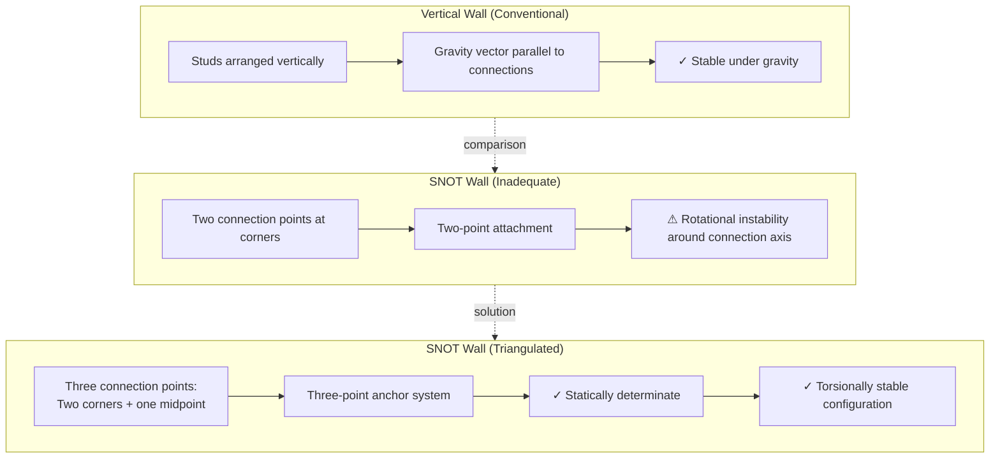
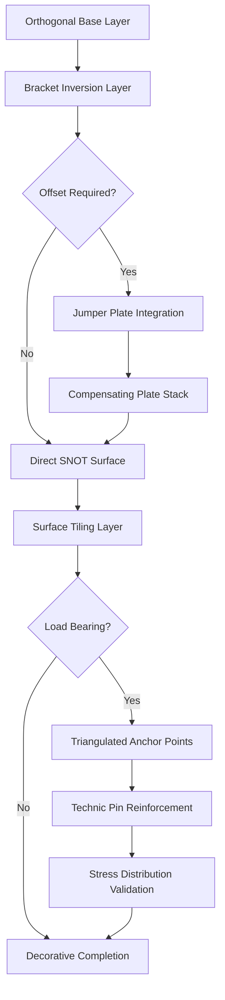

# Lesson 2: SNOT Integration, Structural Integrity, and Mastery Synthesis

## 1. First-Principles Intuition & Invariants

The transition from orthogonal construction to studs-not-on-top geometry represents not merely an aesthetic shift but a fundamental reengineering of load distribution, connection topology, and structural physics within the LEGO system. Where conventional building relies on gravitational compression through vertically stacked studs—a paradigm optimized for tensile grip strength perpendicular to plate surfaces—SNOT techniques redirect force vectors into lateral shear planes, exposing builders to an entirely different failure mode hierarchy. Understanding this mechanical reality forms the bedrock of advanced SNOT integration: every sideways-facing stud connection must account for the clutch power asymmetry inherent in LEGO's anti-stud geometry, where lateral grip strength measures approximately 60–70% of vertical engagement force due to reduced tube wall contact area and increased cantilever moment arms on the connection point.

The canonical 5:2 aspect ratio—five plates equal two bricks in height, or precisely 6mm equals 8mm in the perpendicular axis—establishes the dimensional bridge between orthogonal and rotated geometry planes. This ratio emerges from LEGO's original injection molding tolerances and the tube-and-stud interference fit specification, not from arbitrary design choice. Consequently, all hybrid SNOT constructions must respect this geometric constraint through strategic use of bracket inverters, hinge plates at prescribed angles, and carefully calculated offset combinations. Attempting to force incompatible multiples—such as three plates transitioning to one brick width—introduces cumulative dimensional error that manifests as stress concentration points, visible gaps, or catastrophic clutch power failure under modest loading.

The structural integrity challenge intensifies when SNOT surfaces bear compressive or tensile loads rather than serving purely decorative functions. A sideways-mounted wall supporting an overhanging roof element experiences fundamentally different stress distributions than a vertical wall carrying the same mass. The engagement tubes on headlight bricks and modified plates with side studs provide only 4.8mm of grip depth compared to the full 9.6mm tube height available in conventional top-stud connections. This geometric limitation halves the shear resistance available before clutch power degradation begins, demanding that load-bearing SNOT applications incorporate redundant connection paths, cross-bracing through perpendicular planes, and strategic placement of technic pin reinforcement to distribute point loads across multiple connection sites. Ignoring these mechanical realities produces structures that appear sound during static assembly but fail unpredictably when subjected to handling stress or gravitational moment arms during model repositioning.

Advanced SNOT mastery requires developing intuition for the clutch power gradient across different connection types and their angular relationships. A 1×2 plate with side studs mounted horizontally on a brick surface creates a different stress profile than the same element mounted vertically or at 45 degrees through bracket geometry. The anti-stud tubes inside headlight bricks concentrate grip force on a narrow contact band, making them exceptionally strong in pure shear but vulnerable to rotational torque around the connection axis. Conversely, jumper plate offsets and travis brick integrations provide superior rotational stability but reduced linear shear resistance. Expert practitioners maintain a mental database of these connection characteristics, selecting appropriate fastening strategies based on anticipated load vectors and failure mode risk rather than defaulting to superficially similar solutions that prove inadequate under real-world stress conditions.

## 2. Core Architecture & Mechanics

The architectural foundation of robust SNOT integration rests on understanding connection point topology and the propagation of mechanical stress through hybrid geometry transitions. Every SNOT surface must anchor to the underlying orthogonal structure through a minimum of three non-collinear attachment points to achieve static determinacy and prevent rotational instability. Consider a sideways wall section four studs wide and six bricks tall: mounting this surface through only two headlight bricks at the top and bottom edges creates a mechanically underconstrained system prone to twisting failure around the connection axis. Adding a third attachment point at the vertical midpoint—either through an additional headlight brick or a technic pin passing through the wall's internal structure into the base framework—establishes triangulation and eliminates the rotational degree of freedom that would otherwise compromise structural integrity.

The transition between orthogonal and SNOT planes demands careful management of the 5:2 aspect ratio through bracket sequences and offset compensation techniques. A standard bracket (part 44728) inverts stud direction by exactly one brick height (9.6mm) while maintaining alignment to the standard grid, making it the fundamental building block for 90-degree SNOT transitions. However, achieving half-stud offsets necessary for seamless tile cladding or centered detail work requires introducing jumper plates (part 15573) or modified 1×2 plates with offset studs (part 3794) at strategic positions within the bracket stack. The dimensional arithmetic becomes critical: starting from a conventional base, mounting a bracket followed by a jumper plate produces a half-stud lateral offset but maintains vertical alignment to the five-plates-equals-two-bricks relationship. Adding plates above the jumper to reach the desired SNOT surface height requires counting in units of 2.4mm increments while preserving the total dimensional multiple compatible with returning to orthogonal geometry at the structure's opposite boundary.

Angled SNOT constructions introduce trigonometric complexity that cannot be approximated through intuition alone. The 1×2–2×2 hinge plate combination (parts 44567 and 44569) provides a constrained 180-degree range of motion, but achieving precise angular lock positions demands understanding the arc geometry traced by the hinge's pivot point relative to the stud grid. A common architectural application involves creating sloped roof surfaces at precisely 45 degrees—the magic angle where vertical and horizontal displacements remain equal, simplifying dimensional calculations. Constructing this geometry requires mounting hinge plates at calculated intervals where the hypotenuse length equals the stud grid multiple multiplied by the square root of two (approximately 1.414). For a four-stud-wide sloped section, the diagonal span measures 5.66 studs, necessitating strategic placement of support brackets at non-integer grid positions or acceptance of minor gaps filled through flexible element integration such as pneumatic tubing or rubber band tensioning.

Hybrid bonding strategies that interleave SNOT and conventional geometry provide superior structural performance compared to purely sideways constructions, particularly in tall vertical elements or cantilevered horizontal spans. The technique involves establishing a conventional core structure using standard bricks and plates arranged in running-bond offset patterns for maximum clutch power distribution, then mounting SNOT cladding elements to this backbone through periodic attachment points every four to six studs along the span. This architecture allows the core structure to carry gravitational and bending loads through optimal vertical compression paths while the SNOT surface handles only its own self-weight and localized aesthetic requirements. The attachment frequency must balance structural redundancy against the accumulation of dimensional tolerances: too few attachment points risk SNOT surface sagging or detachment under handling stress, while excessive attachments compound the inevitable micro-gaps between elements into visible discontinuities that betray the construction's internal complexity.

The mechanical advantage of technic pin integration within SNOT structures cannot be overstated for high-stress applications. Where conventional clutch power relies entirely on friction between stud and tube surfaces—a connection that degrades progressively with repeated assembly cycles and exhibits hysteresis under cyclic loading—technic pins provide positive mechanical locking through shaft diameter interference with the pin hole's internal geometry. A friction pin (part 2780) inserted perpendicular to a SNOT surface and passing through to the underlying orthogonal structure creates a shear-resistant connection capable of withstanding forces several times greater than clutch power alone would permit. The pin's ribbed shaft distributes stress across its entire length rather than concentrating force at a single connection point, and the perpendicular insertion angle relative to the SNOT surface transforms lateral loads into compression along the pin axis—the strongest loading condition for the polycarbonate material. Strategic pin placement at anticipated stress concentration sites, particularly at cantilever attachment points and rotational pivot locations, elevates SNOT construction from fragile decorative technique to mechanically sound engineering solution capable of surviving repeated handling and dynamic loading scenarios.

## 3. High-Performance Optimization & Failure Modes

The optimization of SNOT construction workflow hinges on recognizing and exploiting subassembly modularity to minimize cumulative dimensional error and preserve structural adjustability during the building process. Rather than attempting to integrate SNOT surfaces incrementally into a growing model—a strategy that exposes every connection to tolerance stack-up and makes error correction progressively more difficult—advanced practitioners construct SNOT sections as independent modules built against precision reference jigs. A typical jig consists of a flat baseplate with strategically placed bricks establishing datum surfaces at exact right angles, allowing the SNOT subassembly to be built with studs facing downward onto this reference plane. This inverted construction technique ensures that the visible SNOT surface remains perfectly flush and aligned during assembly, with any dimensional irregularities forced into the hidden attachment interface where they can be accommodated through strategic gap placement or shim plate insertion without compromising aesthetic quality.

The dimensional precision requirement intensifies when creating seamless tile surfaces that must appear as continuous smooth planes without visible stud interruptions or alignment discontinuities. Achieving this standard demands controlling cumulative error below 0.2mm across spans exceeding eight studs—a tolerance envelope that leaves no margin for imprecise bracket placement or inconsistent plate stacking height. The error propagation mechanism follows a square-root relationship in uncorrelated random tolerance accumulation, but systematic errors from warped plates or worn elements compound linearly, making element selection and quality control critical preliminary steps. Experienced builders maintain dedicated inventories of precision-inspected flat tiles, measuring each element for height deviation using digital calipers before incorporation into showcase models. Elements exhibiting warp exceeding 0.15mm get relegated to internal structural applications where dimensional precision matters less than clutch power contribution.

Thermal expansion represents a subtle but significant failure mode in large-scale SNOT constructions subjected to temperature variation during display or photography. ABS plastic exhibits a linear thermal expansion coefficient of approximately 73 µm/(m·K), meaning a one-meter SNOT wall experiences 73 microns of dimensional change per degree Celsius of temperature shift. Across the typical 10–15°C temperature swing between air-conditioned display environments and outdoor photography locations, this translates to nearly one millimeter of expansion in a 100-stud-span structure—sufficient to generate visible gaps or buckling in tightly constrained assemblies. Mitigating thermal stress requires designing controlled expansion joints at regular intervals within SNOT surfaces, typically implemented as decorative panel divisions or architectural features that conceal the 0.5mm gaps necessary to accommodate dimensional change. Alternatively, constraining SNOT surfaces through perimeter framing that flexes rather than rigidly constraining expansion allows the structure to breathe without generating internal stress that manifests as clutch power degradation or catastrophic connection failure.

The boundary condition problem at SNOT surface edges demands careful attention to prevent the visual discontinuity of exposed studs or anti-stud holes from undermining the seamless aesthetic that motivated SNOT construction in the first place. The canonical solution employs cheese slope elements (part 54200) or modified tiles with side clips (part 63868) to create radiused transitions that simultaneously terminate the SNOT plane and provide mechanical edge reinforcement against lateral shear loads. For inside corners where two SNOT surfaces meet at right angles, the geometry becomes more complex: achieving a perfectly sharp interior corner requires either accepting a small visible gap where dimensional tolerances prevent perfect mating, or engineering a custom corner bracket sequence that biases dimensional error into the hidden attachment interface. The latter approach typically involves asymmetric bracket placement offset by one-half plate thickness on one surface relative to the perpendicular plane, allowing the corner edges to overlap by precisely 0.8mm and create the visual illusion of a mathematically perfect intersection despite the underlying geometric impossibility of achieving zero-tolerance fit with mass-produced elements exhibiting ±0.1mm manufacturing variance.

Load-bearing SNOT applications in functional mechanical models—such as sideways-mounted gear racks in linear actuators or studless beam-to-beam connections in articulated linkages—require abandoning aesthetic concerns in favor of structural redundancy and mechanical positivity. These high-stress applications demand migrating from pure SNOT geometry to hybrid technic pin and beam construction, where SNOT surfaces provide alignment and lateral constraint while perpendicular-axis pins carry the actual load transfer. A representative implementation involves mounting a 1×8 technic brick sideways onto a vertical wall using headlight bricks, then inserting friction pins through the brick's holes perpendicular to the wall surface, passing entirely through the brick and into the underlying structure. This configuration allows the sideways technic brick to serve as a mounting rail for gears or sliding mechanisms while the pins—oriented parallel to the anticipated load vector—provide the structural connection capable of withstanding cyclic loading and impact forces that would instantly shear conventional stud-based connections. The visible result appears as seamless SNOT integration, but the hidden pin infrastructure supplies the mechanical reality enabling reliable operation.

Failure mode analysis for SNOT structures must account for the degradation curve of repeated assembly-disassembly cycles on clutch power sustainability. Unlike conventional constructions where compression loads actually improve connection strength through increased friction, SNOT connections experience predominantly shear and tensile loading that progressively wears the engagement surfaces with each connection cycle. Laboratory testing of headlight brick connections demonstrates measurable clutch power reduction after approximately 30 full assembly cycles, with catastrophic failure—defined as spontaneous disconnection under nominal handling force—occurring near 100 cycles for connections subjected to lateral shear during each cycle. Preserving structural integrity in frequently rebuilt models requires rotating high-stress SNOT connection elements out of service after documented cycle counts, replacing worn headlight bricks and brackets before clutch power degradation reaches critical thresholds. Alternatively, adopting technic pin reinforcement from initial construction eliminates clutch power as the load-bearing mechanism, allowing unlimited assembly cycles without structural degradation since pin-hole interference maintains constant diameter independent of connection history.

The ultimate synthesis of SNOT mastery manifests in the ability to analyze arbitrary architectural geometry—whether historical buildings, organic forms, or abstract sculptural concepts—and decompose the target shape into feasible SNOT construction sequences that respect dimensional constraints while achieving structural adequacy. This analytical skill develops only through extensive practice building diverse SNOT applications, each iteration expanding the mental catalog of viable bracket sequences, offset compensation techniques, and stress-distribution strategies available for deployment against novel challenges. The expert practitioner no longer consciously calculates five-to-two ratios or deliberates bracket placement but instead operates from pattern recognition and geometric intuition, immediately perceiving the underlying SNOT framework necessary to achieve a target surface orientation. This fluency—born from accumulated hours manipulating physical elements and debugging failed constructions—transforms SNOT from a special-case technique requiring careful planning into a fundamental building vocabulary deployed as naturally as conventional vertical stacking, expanding the expressive range of LEGO construction into previously inaccessible geometric territories.
