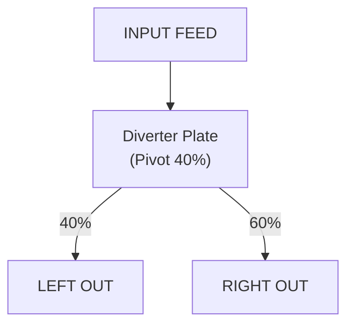
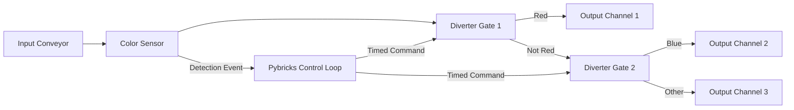

# Lesson 2: Actuated Sorting Systems

## 1. First-Principles Intuition & Invariants

Every sorting system, at its mechanical heart, is a decision made physical. Where passive sorting exploits geometry, gravity, and size exclusion to route objects without any deliberate intervention, actuated sorting inserts a moment of agency into that process — a controlled, timed mechanical action that reads a condition and redirects a flow. In Lego Technic, that transition from passive to actuated is not merely an added motor bolted onto an existing ramp. It represents a fundamental architectural shift, one that demands the builder think simultaneously about mechanical timing, structural stiffness, power transmission, and control logic as a unified system rather than a collection of independent subsystems.

The invariant that governs every actuated sorting mechanism is the relationship between decision latency and object transit time. If a sorting gate takes 0.4 seconds to fully deflect from one output channel to another, and your conveyor delivers an object every 0.3 seconds, you have designed a system that is structurally incapable of sorting correctly regardless of how elegant its control logic may be. This timing constraint is the master invariant, and experienced Technic builders learn to design around it from the very first gear selection, not as an afterthought during commissioning. Every mechanical choice — gear ratio, motor selection, gate pivot geometry, pneumatic cylinder bore — either tightens or relaxes your timing budget. Understanding which levers control that budget is what separates a practitioner who builds sorting machines from one who merely assembles them.

A second invariant concerns mechanical compliance. Sorting gates and barriers must be stiff enough to reliably redirect objects without deflection, yet their drive chains must include some form of overload protection so that a jammed gate does not strip a gear or stall a motor into thermal shutdown. In a production Technic build, this is typically achieved through the deliberate inclusion of a clutch gear (part 76244 or the older 18947) in the gate's drive train. The clutch gear is not a compromise — it is a precision instrument that defines the maximum torque the system will tolerate, and placing it correctly requires understanding where in the gear chain torsional stress is highest.

A third invariant is load balance across output channels. When a system routes objects to two or more bins, the downstream capacity of each channel must be matched to the fraction of objects it will receive. An unbalanced system where one bin fills faster than it can be cleared will cause backpressure, jamming, or overflow that cascades upstream and corrupts the entire sorting sequence. Load balancing is therefore not an operational concern to be solved after the machine is built — it is a design constraint that shapes the geometry of your output chutes, the spacing of your conveyor, and the duty cycle of your actuators.

Underpinning all of this is the concept of the sorting cycle, defined as the complete temporal sequence from the moment an object enters the detection zone to the moment it clears the active output gate. Every actuator in the system must complete its action within this cycle, and the cycle time is bounded below by the physics of your fastest component (the sensor or the control brick's polling rate) and above by your slowest (almost always the mechanical gate travel time). Designing a high-performance actuated sorting system in Lego Technic is fundamentally the discipline of minimizing cycle time while maintaining mechanical reliability across tens of thousands of repetitions.

---

## 2. Core Architecture & Mechanics

### The Gear-Based Switching Diverter

The simplest actuated switching mechanism uses a rotating diverter plate driven directly through a compact gear train. The diverter plate itself is a Technic liftarm or a cluster of tiles mounted on a central axle, positioned at the junction of two output chutes so that its angular position determines which path is open. When the plate sits at roughly 30° from horizontal, objects rolling or sliding down the input ramp deflect to the left channel; rotate the plate 60° clockwise and the same objects route right.

The motor driving this diverter is almost always an M-Motor or Small Angular Motor (SAM, part 54696) rather than the larger L or XL motors. The reasoning is mechanical rather than electrical: the gate assembly has very low rotational inertia, so the extra torque of a larger motor adds nothing while its physical bulk makes tight packaging around the junction point difficult. The M-Motor's output shaft spins at approximately 390 RPM under no load, which is far too fast for precise gate positioning. A two-stage reduction using a 24-tooth gear driving an 8-tooth gear (ratio 3:1) followed by a 20-tooth gear driving a 12-tooth gear (ratio 1.67:1) gives a combined reduction of roughly 5:1, bringing output shaft speed to approximately 78 RPM and multiplying torque by the same factor. At this speed, a 90° gate rotation takes about 190 milliseconds — fast enough to operate between items spaced 0.5 seconds apart on a moderate-speed conveyor.

The pivot geometry of the diverter plate matters enormously. Mounting the pivot axle at the leading edge of the plate means the tip of the plate sweeps a large arc as it rotates, potentially clipping objects that are still in transit. The correct placement is at approximately 40% of the plate's length from its upstream end, which minimizes tip-arc radius while keeping the deflection surface long enough to intercept objects reliably across the full width of the input chute.



For a Lego-native implementation, the axle carrying the diverter plate sits in two 2×2 Technic beam segments flanking the chute walls, braced with 1×3 liftarms running perpendicular to the axle to prevent the walls from racking under the lateral force that the deflected objects will exert every cycle.

### Servo-Controlled Gates and Barriers

Where the gear-driven diverter plate handles binary routing (left or right), a servo-controlled gate mechanism opens the possibility of holding objects in a staging buffer and releasing them one at a time under precise temporal control. This is the architecture used for synchronized multi-channel output loading, where the system must release a specific number of objects into each channel before closing the gate and opening the next.

In Lego Technic, the Powered Up Medium Angular Motor (part 46096 in the 45603 set) is the closest native component to an angular servo. Unlike the older M-Motor which runs open-loop, the Medium Angular Motor contains a built-in absolute encoder and is controlled via the Powered Up protocol to rotate to a specified degree position and hold that position against external load. When programmed through Pybricks (the preferred firmware for practitioners working in Python), this motor can be commanded with a single instruction: `await motor.run_target(100, 0)` moves the motor shaft to 0° at 100 deg/s, while `await motor.run_target(100, 90)` opens the gate to 90°. The motor's internal PID controller holds position with ±2° accuracy, which corresponds to roughly ±0.5 mm of lateral displacement at the gate tip for a 15-stud-long gate arm — more than sufficient precision for Technic-scale objects.

The gate geometry for a barrier-type sorter differs from the diverter plate. Rather than rotating across the flow path, a barrier gate descends vertically into it. A gate arm built from a 1×9 liftarm with a row of tiles glued (or friction-fitted) along its lower face forms an effective barrier when rotated 90° downward from its resting position above the chute. A 24-tooth gear on the motor shaft driving a 24-tooth gear on the gate axle gives a 1:1 ratio, maximizing speed at the cost of torque — appropriate here because the barrier encounters minimal load during normal operation. The clutch gear is inserted one stage upstream of the gate axle so that if an object becomes wedged under the descending barrier, the clutch slips before the motor stalls.

### Pneumatic Sorting Actuation

Pneumatic sorting in Technic occupies a distinct design space from electric motor actuation. Where motors provide continuous rotary motion that must be mechanically converted to linear or angular displacement, pneumatic cylinders provide direct linear actuation with forces that are proportional to cylinder bore and supply pressure. The small Technic pneumatic cylinder (part 15552) has a bore of approximately 10 mm and delivers roughly 4–5 N of push force at the pressure generated by the Technic pneumatic pump running at pump-lever actuation frequency. The larger cylinder (part 48989) develops correspondingly greater force and is appropriate for heavier objects or longer gate throws.

The key operating parameter in a pneumatic sorting gate is the extend/retract cycle time, which is a function of cylinder displacement, tube internal diameter, and the speed at which the pump pressurizes the reservoir. At moderate pump rates, the small cylinder extends fully in roughly 300–500 ms, making it slower than a well-geared electric gate for binary sorting decisions but considerably more forceful and mechanically simpler. The absence of a gear train means fewer failure points and virtually no backlash — the cylinder is either extended or retracted, with no intermediate positions (unless intentionally throttled via needle valve).

A pneumatic gate for sorting typically uses a cylinder mounted in a vertical pusher configuration: the cylinder extends horizontally from one chute wall, and its push rod bears against a hinged gate flap pivoted at the opposite wall. When the cylinder is retracted, the gate flap hangs free and objects pass through. When the cylinder extends, the push rod deflects the flap across the chute, redirecting objects to the alternate channel. The flap pivot should be placed at the upstream corner of the junction so that the flap requires minimal force to deflect once extended — the cylinder need only hold it in position, not push against the full lateral force of a moving object.

Timing pneumatic actuation with an electric conveyor requires acknowledging that pneumatic response has a characteristic lag from the moment the pump valve actuates to the moment the cylinder reaches full extension. This lag must be measured empirically for your specific tube length and cylinder size (typically 150–400 ms), then subtracted from the detection-to-sort delay in your control logic.

### Timing Synchronization Between Input Feed and Sorting Decisions

Synchronization is the problem that separates a Technic sorting machine that works from one that works reliably. The challenge is that the input feed, the sensor, the control logic, and the actuator are all operating in parallel with their own temporal characteristics, and those characteristics must be explicitly orchestrated so that the gate is in the correct position at the moment the object arrives at it — not when the detection event fires.

The timing model for a two-stage sorting system looks like this:

```text
Timeline (ms):

t=0     Object detected by color sensor at P_detect
t=Δd    Detection processed, sorting decision computed (typically 20–50ms in Pybricks)
t=Δd+Δm Motor/cylinder actuation begins
t=Δd+Δm+Δt  Gate reaches target position (Δt = mechanical travel time)
t=T_arrive  Object arrives at gate

Constraint: (Δd + Δm + Δt) < T_arrive
```

The transit time `T_arrive` from the sensor position to the gate position is determined by conveyor belt speed and the physical distance between the sensor and gate, which the builder controls directly. The correct design strategy is to maximize this distance within the available build envelope. A sensor placed 20 cm upstream of the gate on a conveyor running at 5 cm/s gives a transit time of 4,000 ms — ample headroom for any Technic actuator to respond. The mistake builders make is placing the sensor as close to the gate as possible in an attempt to minimize the machine's footprint, which compresses the timing budget until the slightest variation in motor speed or object position causes a mis-sort.

In Pybricks, the synchronization loop for a simple two-channel sorter looks like this:

```python
from pybricks.hubs import InventorHub
from pybricks.pupdevices import Motor, ColorSensor
from pybricks.parameters import Port, Direction, Color
from pybricks.tools import wait

hub = InventorHub()
gate = Motor(Port.A, Direction.CLOCKWISE)
sensor = ColorSensor(Port.B)
conveyor = Motor(Port.C, Direction.CLOCKWISE)

GATE_LEFT  = 0    # degrees
GATE_RIGHT = 90   # degrees
TRANSIT_MS = 800  # measured: sensor-to-gate at current belt speed
GATE_SPEED = 200  # deg/s — calibrated to reach position within 400ms

conveyor.run(300)

while True:
    color = sensor.color()
    if color == Color.RED:
        wait(TRANSIT_MS - 400)
        gate.run_target(GATE_SPEED, GATE_RIGHT, wait=True)
    elif color == Color.BLUE:
        wait(TRANSIT_MS - 400)
        gate.run_target(GATE_SPEED, GATE_LEFT, wait=True)
    wait(50)
```

`TRANSIT_MS - 400` precomputes the advance trigger time, subtracting the 400 ms gate travel time so the gate arrives at position just before the object does. This constant must be calibrated on the physical machine because belt slip, object mass, and ramp angle all introduce small deviations from theoretical belt speed.

### Load Balancing Across Multiple Output Channels

When a sorting system routes objects to three or more output channels, the probability that any one channel receives objects at a rate that overwhelms its downstream capacity becomes a real operational concern. Load balancing in a Technic context is primarily a structural design problem: each output chute must have sufficient buffer capacity (measured in object-lengths) to absorb the statistical variation in arrival rate before it propagates upstream and stalls the input conveyor.

The mermaid diagram below shows the signal and mechanical flow of a three-channel actuated system using two sequential diverter gates:



This cascade architecture has the advantage of simplicity — each gate is a binary device, and cascading two binary gates produces three output paths — but it introduces asymmetric timing because Gate 2 is downstream of Gate 1. Objects routed through Gate 1 to Channel 1 never reach Gate 2, so Gate 2 only needs to be in position when Gate 1 is in its pass-through state. The control logic must account for this dependency so that Gate 2 is not commanded to move while Gate 1 is in transition, which would corrupt the timing model for objects currently in transit between the two gates.

The buffer length for each output chute is calculated from the worst-case burst frequency: if the input conveyor can deliver a maximum of one object every 0.5 seconds and the downstream bin takes 10 seconds to remove its contents, the minimum chute buffer must hold 20 object-lengths. In practice, Technic builders extend output chutes along the bottom of the frame using 1×15 liftarms as chute sidewalls and smooth tiles as the floor, with each chute angled at 10–15° from horizontal so that objects slide under gravity without requiring additional conveyor actuation in the output zone.

---

## 3. High-Performance Optimization & Failure Modes

### Minimizing Gate Travel Time Without Sacrificing Reliability

The single most effective way to reduce gate travel time is to minimize the angular displacement the gate must traverse to transition between output states. A gate that travels 90° takes roughly twice as long as one that travels 45°, so redesigning the gate geometry to achieve full redirection with less rotation directly halves the mechanical component of your cycle time. This is achieved by lengthening the gate arm so that a smaller rotation produces the same lateral displacement at the gate tip, or by repositioning the pivot closer to the center of the chute width so that neither extreme position requires a large angle from horizontal.

The second optimization is to run the gate motor continuously in the correct direction rather than commanding it to a stop-and-hold position. A gate that swings past its target position, contacts a physical hard stop, and rebounds slightly under spring tension settles faster and more repeatably than one relying solely on motor PID to hold position. In practice, this means building a small rubber-band detent or a 1×1 round plate hard stop into the gate assembly so that the motor drives the gate firmly against a mechanical reference rather than trying to hold it in mid-air. The Medium Angular Motor's positional PID becomes a supplement to, rather than the primary source of, positional accuracy.

The clutch gear deserves special attention here. Its slipping torque is fixed by the spring preload built into the part — approximately 0.08 N·m for the standard Technic clutch gear. If your gate encounters objects with mass sufficient to deflect the gate arm against that torque, the clutch will slip and the gate will no longer be in the correct position for subsequent objects. The diagnostic is straightforward: if you observe intermittent mis-sorts that do not correlate with sensor errors or timing anomalies, the clutch is slipping under object impact. The remedy is either to increase gate stiffness (shortening the gate arm to reduce the moment arm of the impacting force) or to place the clutch gear further upstream in the drive train where the torque it experiences is reduced by the downstream gear reduction.

### Sensor Reliability and False Trigger Mitigation

The Powered Up Color Sensor (part 37308) measures reflected light intensity across red, green, and blue channels and computes a hue classification that the firmware maps to named colors. Its accuracy is highly sensitive to ambient light conditions, sensing distance, and object surface finish. Matte objects absorb more light and produce lower-amplitude readings than glossy objects of the same color, which can cause the firmware to misclassify a dark matte red brick as "none" or "brown" if the sensing distance is not calibrated.

The correct sensing distance is 5–8 mm from the sensor face to the object surface, and the sensor should be enclosed in a 2×4 or 2×6 Technic frame with the top and sides covered by opaque plates to block ambient light. This shroud is not optional in any environment with varying natural light — a window changing from overcast to direct sun across a 20-minute session can shift the sensor's baseline enough to change how it classifies borderline colors.

False triggers from sensor glint (a momentary high-intensity reflection as an object's leading edge enters the sensing zone) are mitigated in software by requiring that the detected color persist across two consecutive polling cycles before a sorting decision is committed. With a 50 ms polling interval, this adds 50 ms of latency to the detection event but eliminates nearly all glint-induced mis-sorts.

### Jam Detection and Automatic Recovery

A fully autonomous sorting system must handle jams without human intervention, because jams are not edge cases in a production Technic machine — they are routine events driven by statistical variation in object geometry, orientation, and feed rate. The architectural approach is to monitor motor current draw (accessible via `motor.load()` in Pybricks, which returns a percentage of rated stall torque) and trigger a recovery sequence when load exceeds a threshold for more than a defined duration.

A practical recovery sequence for a conveyor jam looks like this: when `conveyor.load()` exceeds 80% for more than 300 ms, halt the conveyor, run it in reverse at half speed for 500 ms, then resume forward motion at full speed. This reversal dislodges most single-object jams without requiring mechanical intervention. If the jam persists through two reversal cycles, the system stops and illuminates the hub's status light in red — a signal to the operator that the jam requires physical inspection. This graduated escalation strategy keeps the machine running autonomously through minor jams while ensuring that serious jams (caused by an object oriented perpendicular to the conveyor, for example) do not cause downstream damage by forcing objects through a blocked gate.

### Synchronization Drift and Long-Run Timing Degradation

Over extended operation (several hundred sorting cycles), timing constants that were calibrated during commissioning can drift due to belt stretch, gradual bearing wear in axle connections, and thermal expansion of the LEGO structure under motor heat. Belt stretch is the dominant factor: a Technic rubber belt that spans 20 studs will elongate by roughly 2–5% over 500 cycles of full tension, reducing effective conveyor speed and increasing the actual `T_arrive` transit time for a fixed sensor-to-gate distance.

The mitigation is to implement a periodic recalibration routine — a software sequence that, when triggered by the operator pressing the hub button, runs the conveyor at its operating speed and measures the time between a test object passing the sensor and arriving at a downstream photogate (a second color sensor aimed at a plain gray surface, which registers the shadow of a passing object as a color-class change). This measured transit time updates `TRANSIT_MS` automatically without requiring manual measurement or code modification. Embedding this calibration capability in the machine from the first build is a mark of practitioner-level design discipline, and it transforms a machine that degrades gracefully into one that maintains its performance specification across its entire operational life.
