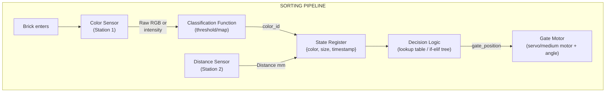

# Lesson 3: Sensor-Feedback Sorting Logic

## 1. First-Principles Intuition & Invariants

Every sorting machine, whether it moves parcels through a distribution warehouse or bricks across a Lego tray, reduces to a single repeated decision: *given what I know about this object right now, where should it go?* The elegance of that question conceals its difficulty. In the physical world, "what I know" is never a clean datum — it is a noisy, time-varying signal extracted from imperfect sensors, filtered through software, and acted upon by mechanical components that introduce their own delays and tolerances. Building an intelligent Lego sorter forces you to confront every layer of that problem in miniature, which is precisely why it is such a rich engineering discipline.

The core invariant of sensor-feedback sorting is **measurement before commitment**. A conveyor belt or rotating arm has already begun moving an object before the decision logic fires, so the system must be designed to complete classification within the time window the object occupies the sensor zone. Miss that window and you are not sorting — you are guessing. This timing constraint is not abstract: at a belt speed of roughly 5 cm/s (achievable with a single LEGO medium motor at moderate power) and a color sensor detection zone approximately 1–2 cm in diameter, your program has somewhere between 200 ms and 400 ms to read, classify, and dispatch a gate signal. Every line of code and every block in SPIKE Prime or MINDSTORMS EV3-G has a measurable execution cost, and the advanced practitioner designs around those costs deliberately.

The second invariant is **classification confidence, not classification certainty**. The LEGO Color Sensor — both the EV3 variant and the SPIKE Prime color sensor embedded in the hub — does not return a Pantone swatch. It returns a reflected light intensity across red, green, and blue channels (and ambient), from which the firmware derives a color label via a threshold-based lookup table burned into the sensor's microcontroller. Those thresholds were calibrated against LEGO's own plastic brick colors under controlled factory lighting. Your workshop has different ambient light. The brick surface may be scratched or dusty. A yellow brick under warm incandescent light will produce R/G/B readings that drift toward the orange classification boundary. Designing for confidence means your logic must include a validity check: "Is this reading strong enough to trust?" before committing to a sort destination.

The third invariant concerns **state**. A single-criterion sorter — sort by color only — is stateless per object: each brick is an independent event. The moment you introduce multi-criteria sorting (sort by color *and* size) the system acquires state. The color is measured at station one; the size is measured at station two. The result of station one must survive in memory until station two's reading is complete, and the two readings must be correctly associated with the same physical object. If your conveyor carries two bricks simultaneously, you now have a small queue to manage. This is not a software curiosity — it is the mechanical reality of any real pipeline sorter, and the LEGO MINDSTORMS and SPIKE programming environments expose it in ways that teach genuinely transferable engineering principles.

The LEGO MINDSTORMS EV3 brick runs a Linux-based firmware (specifically a Texas Instruments AM1808 processor at 300 MHz with 64 MB RAM) and executes programs written either in the graphical EV3-G environment (a LabVIEW derivative) or MicroPython via the EV3 MicroPython image. The SPIKE Prime hub carries a Nordic nRF52833 (Cortex-M4 at 64 MHz, 256 KB RAM) and runs MicroPython on top of a custom LEGO firmware. These hardware constraints matter: they set the floor on sensor polling rate, the ceiling on how much classification history you can buffer, and the latency between a sensor event and a motor command. The EV3's comparatively generous RAM lets you hold deep object queues; the SPIKE Prime's tighter constraints push you toward leaner, more event-driven architectures.

---

## 2. Core Architecture & Mechanics

### The Sensor Signal Path

Understanding how a measurement becomes a motor command requires tracing the full signal path from photon to pivot. The LEGO Color Sensor illuminates the target with its own integrated LED, reads reflected light through a photodetector array, and returns values over a proprietary UART bus (EV3) or I²C-derived LPF2 protocol (SPIKE/Technic). The EV3 color sensor polls at approximately 10 ms intervals when queried in reflected light intensity mode; the SPIKE Prime color sensor updates at a similar rate when polled in a loop. Neither sensor broadcasts autonomously — your program must ask for a reading, and the latency between asking and receiving is roughly 5–15 ms depending on bus load and execution context.

The practical consequence is that a tight polling loop running `while True: color = sensor.color()` on SPIKE Prime MicroPython executes approximately 50–80 iterations per second under typical conditions. That is fast enough for a belt moving at 5 cm/s but leaves little margin at 15 cm/s. If you add print statements for debugging, each `print()` call on the SPIKE Prime consumes 10–30 ms of UART transmission time and can halve your effective polling rate. Remove all print statements from production code and use the hub's LED matrix or a small status variable instead.

The signal path from sensor to motor looks like this:

### Color Classification: From Raw Readings to Confident Labels

The EV3 color sensor in color-detection mode returns one of eight discrete labels: none, black, blue, green, yellow, red, white, brown. This is convenient but opaque — you cannot see which R/G/B reading mapped to "red" or how close the reading was to the boundary between red and orange (which LEGO maps to red). For robust sorting, particularly when dealing with colors that are genuinely adjacent (yellow vs. orange, medium azure vs. light blue), you should work in **reflected intensity mode** and implement your own classification function.

In SPIKE Prime MicroPython, the color sensor returns a tuple of (red, green, blue, ambient) when queried with `sensor.get_rgb_intensity()`, each value ranging from 0–1023. A simple nearest-neighbor classifier in this 3D color space is both fast enough and sufficiently accurate for Lego bricks:

    # Station calibration readings (collect under your actual lighting)
    CALIBRATION = {
        'red':    (820, 110, 95),
        'yellow': (760, 680, 90),
        'blue':   (95,  210, 740),
        'green':  (100, 650, 130),
        'white':  (900, 880, 850),
        'black':  (55,  50,  48),
    }

    def classify_color(r, g, b, threshold=180000):
        best_label = 'unknown'
        best_dist  = float('inf')
        for label, (cr, cg, cb) in CALIBRATION.items():
            dist = (r - cr)**2 + (g - cg)**2 + (b - cb)**2
            if dist < best_dist:
                best_dist  = dist
                best_label = label
        return best_label if best_dist < threshold else 'unknown'

The `threshold` parameter is your confidence gate. Any reading whose squared Euclidean distance from the nearest calibration point exceeds this value is classified as `'unknown'` rather than forced into the closest bucket. Set it empirically: place each known brick color under the sensor, record the actual distance to its calibration centroid, and choose a threshold that sits comfortably above the worst-case legitimate reading but below the nearest inter-class boundary. In practice, 150,000–250,000 works well for the SPIKE Prime sensor under consistent artificial lighting.

Calibration itself deserves a dedicated procedure at build time. Mount the sensor at a fixed standoff distance — 8 mm is the LEGO color sensor's optimum for reflected light — and hold each brick color in place for two seconds while your calibration script records 20 readings and averages them. Store those averages as your `CALIBRATION` dictionary. Rerun calibration whenever you change the ambient lighting or relocate the machine.

### Distance Measurement for Size Classification

The LEGO EV3 Ultrasonic Sensor measures distance from roughly 3 cm to 250 cm with ±1 cm accuracy at close range. The SPIKE Prime distance sensor (time-of-flight, 940 nm infrared) achieves sub-centimeter resolution below 20 cm, which is precisely the range useful for distinguishing brick heights on a conveyor. At 100 mm standoff, the sensor can reliably distinguish a 1-plate brick (~3.2 mm height), a 1-stud brick (~9.6 mm), and a 2-stud-tall brick (~19.2 mm), because those height differences produce proportional changes in the returned distance: approximately 3.2 mm, 9.6 mm, and 19.2 mm respectively relative to the conveyor surface.

The practical sorting approach is to mount the distance sensor above the conveyor looking straight down at a fixed standoff of, say, 60 mm above the belt. An empty belt reads 60 mm. A 1-plate brick reads approximately 56.8 mm; a standard 1-stud brick reads approximately 50.4 mm; a 2-stud-tall brick reads approximately 40.8 mm. These are clean separations — the gaps between categories are 3–9 mm wide, well above the sensor's noise floor. Define size bins with a simple range check:

    def classify_size(distance_mm, standoff_mm=60):
        height_mm = standoff_mm - distance_mm
        if height_mm < 1.5:
            return 'empty'
        elif height_mm < 6.0:
            return 'plate'
        elif height_mm < 14.0:
            return 'brick_1h'
        else:
            return 'brick_2h'

This function is deterministic and executes in under 1 ms, which is well within the pipeline budget.

### State Management for Multi-Criteria Sorting

When color and size are measured at different physical stations, the system must bind those two readings to the same object. The natural data structure is a small queue — a Python `deque` or a fixed-length list — where each entry represents one object in transit between Station 1 (color) and Station 2 (size).

    from collections import deque

    TRANSIT_QUEUE = deque(maxlen=4)   # holds up to 4 in-flight objects

    # At Station 1 (color sensor):
    color_id = classify_color(r, g, b)
    TRANSIT_QUEUE.append({'color': color_id, 'size': None, 'ts': time.ticks_ms()})

    # At Station 2 (distance sensor), triggered by presence detection:
    if TRANSIT_QUEUE and TRANSIT_QUEUE[0]['size'] is None:
        TRANSIT_QUEUE[0]['size'] = classify_size(dist)

    # At the gate, dispatch the head of the queue:
    if TRANSIT_QUEUE and TRANSIT_QUEUE[0]['size'] is not None:
        obj = TRANSIT_QUEUE.popleft()
        gate_pos = DISPATCH_TABLE[(obj['color'], obj['size'])]
        gate_motor.run_to_position(gate_pos, speed=80)

The `DISPATCH_TABLE` is a Python dictionary keyed by `(color, size)` tuples, mapping to motor angles in degrees. For a three-bin sorter with two colors and two sizes, the full table has four entries, each with an integer motor angle. For a six-bin machine, it has however many (color, size) combinations your physical layout supports, with an `'unknown'` catch-all entry.

The timestamp field (`'ts'`) serves a secondary purpose: stale objects. If Station 2 never sees an object that Station 1 registered — perhaps the brick fell off the belt, or a jam prevented its advance — the queue entry ages. A watchdog check compares the current time against the timestamp and discards entries older than the theoretical transit time (belt_length_mm / belt_speed_mm_per_s × 1.3 as a generous margin). This prevents ghost dispatches where a gate fires for an object that is no longer in the system.

### Decision Logic and the Dispatch Table

The decision logic layer is architecturally the simplest part of the system but the most consequential to get right. Its job is to convert a completed `(color, size)` pair into an unambiguous motor command. Resist the temptation to encode this logic as a nested if-elif tree: dispatch tables are more readable, easier to extend, and simpler to validate at a glance.

    DISPATCH_TABLE = {
        ('red',    'plate'):   -90,
        ('red',    'brick_1h'): -90,
        ('red',    'brick_2h'): -90,
        ('blue',   'plate'):    0,
        ('blue',   'brick_1h'): 0,
        ('blue',   'brick_2h'): 45,
        ('yellow', 'plate'):    45,
        ('yellow', 'brick_1h'): 90,
        ('yellow', 'brick_2h'): 90,
        ('unknown', None):      0,    # center/reject bin
        (None,     'empty'):    0,    # no object present
    }

    def dispatch(color, size):
        return DISPATCH_TABLE.get((color, size),
               DISPATCH_TABLE.get(('unknown', None), 0))

The `.get()` with fallback ensures the system never throws a `KeyError` on an unexpected combination. It routes any unclassified object to the reject bin at position 0, which should physically lead to a tray or return loop where you can inspect anomalous pieces.

---

## 3. High-Performance Optimization & Failure Modes

### Throughput and Loop Timing

The limiting factor in sorting throughput is almost always the mechanical response time of the gate, not the sensor classification speed. A LEGO medium motor rotating a gate arm 90° at full power takes approximately 300–400 ms. If the gate must return to neutral before accepting the next object, the minimum inter-object spacing on the belt is dictated by that cycle time. At 5 cm/s, 400 ms of gate response means objects must be spaced at least 2 cm apart on the belt — achievable with a simple physical separator (a brick with a tine or a cam-driven pusher that releases one object at a time from a hopper).

You can recover roughly 100 ms of that budget by precomputing the gate destination for the *next* object while the gate is still moving for the current one. This is a software pipeline stage: dispatch the gate command for object N, then immediately poll sensors and classify object N+1 so its gate command is ready the moment the motor reports position reached. SPIKE Prime MicroPython's `Motor.run_to_position()` is non-blocking when called with `wait=False`, which enables exactly this pattern.

Sensor noise is a subtler throughput killer. If the color sensor sits in a fixed position and the brick passes beneath it on a belt, the transition from "no brick" to "brick present" produces a rising edge in the reflected intensity that your polling loop must catch on the leading face of the brick, not midway across it. Mount a simple trigger: a secondary distance sensor or even a touch sensor with a lightweight lever arm set a few centimeters upstream of the color sensor. When the trigger fires, your program takes a burst of three color readings separated by 10 ms and majority-votes the result. Three readings cost 30 ms, eliminate most single-sample noise spikes, and still fit comfortably within the detection window.

### Ambient Light Compensation

Ambient light is the most common source of classification failures in a workshop environment. The color sensor's integrated LED is intentionally weak, so that at the nominal 8 mm standoff distance the LED illumination dominates reflected signal. Move the sensor standoff to 20 mm and ambient contributions become significant. The practical fix is to shield the sensor's field of view with a small enclosure built from black LEGO tiles — four 1×4 tiles and two 2×2 corner tiles can form a tunnel that the brick passes through, excluding lateral ambient light entirely. This single physical change typically reduces misclassification rates from 10–15% to under 2% without any software change.

If physical shielding is insufficient, implement a software ambient correction. At program startup, with the belt stopped and no brick under the sensor, record the ambient R/G/B baseline. Then subtract that baseline from every subsequent reading before passing values to the classifier:

    r_corrected = max(0, r_raw - r_ambient)
    g_corrected = max(0, g_raw - g_ambient)
    b_corrected = max(0, b_raw - b_ambient)

The `max(0, ...)` clamp prevents the rare case where ambient light changes after calibration and would otherwise produce negative corrected values.

### Fault Tolerance When Sensor Input Conflicts

The most sophisticated challenge in sensor-feedback sorting is handling conflict: the moment when what the sensor says contradicts what the system believes should be true. These conflicts manifest in several specific patterns.

**Sensor disagreement** occurs in a multi-pass architecture where you re-read the same brick through the same sensor and get different results. If the brick's surface has two colors (a printed brick, a sticker, or a brick that is half one color and half another), successive readings genuinely differ. The correct response is not to pick the first reading or the most recent one, but to flag the brick as `'ambiguous'` and route it to a human-inspection bin. Build this explicitly into your dispatch table as a valid output category.

**Queue desynchronization** occurs when the pipeline's object count and the queue's object count diverge. This can happen if a brick bounces, doubles up, or is detected twice by the entry trigger. The symptom is that the gate fires for a phantom object just as a real object is arriving. The mitigation is a **presence confirmation gate**: after classification, re-verify the brick is still in the detection zone (distance sensor should read less than standoff) before appending to the queue. If the sensor already reads empty, the brick was a transient reflection artifact and should not enter the queue.

**Motor overrun** occurs when the gate motor is commanded to a position it cannot physically reach because a brick is already in the bin opening or a liftarm has shifted. The motor stalls, consuming current and potentially heating the EV3/SPIKE hub's motor driver. The EV3 MicroPython `ev3dev2` library exposes motor stall detection via `is_stalled`; SPIKE Prime MicroPython exposes a motor position that stops updating when load exceeds the driver's threshold. Implement a stall watchdog that detects no position change over 200 ms and responds by: first reversing the motor by 10°, then retrying the target position once, and on second failure, halting the belt and setting the hub's LED to red to signal a jam requiring human intervention.

**Lighting transients** — a person walking past the machine, a cloud passing outside, a lamp switching on — produce sudden step changes in ambient readings that can corrupt the ambient baseline mid-run. A moving average over the last five ambient readings (taken at the start of each object cycle, before the belt feed trigger fires) provides a continuously updated baseline that adapts to slow drift while ignoring fast transients. The window of five readings at one per second of cycle time spans five seconds of history — long enough to smooth gradual changes, short enough that a 60-second sustained lighting change will be absorbed before it corrupts classifications.

### Extending to Three or More Criteria

A three-criteria sorter — color, size, and shape (round vs. rectangular, distinguishable by measuring reflected light intensity at two lateral positions) — requires a third measurement station and a correspondingly deeper state object in the queue. The architecture scales cleanly: add a station, add a field to the queue entry, add a column to the dispatch table key tuple. The combinatorial explosion of the dispatch table is manageable because LEGO piece categories are finite and known in advance. A sorter handling six colors × three sizes × two shapes requires 36 table entries — still a hand-editable Python dictionary.

What does not scale gracefully is the inter-station spacing. Each additional measurement station adds physical distance between first detection and final dispatch, which means more objects can be simultaneously in-flight in the pipeline and the queue must be correspondingly deeper. At four objects in-flight, a `maxlen=4` deque suffices. At eight, you need robust stale-entry expiry logic, because the probability of a jam or dropped brick during a longer pipeline is meaningfully higher. The engineering discipline is to match your `maxlen` and your timestamp expiry window precisely to the physical length of your pipeline, with both values derived from measured belt speed rather than guessed.

The deeper principle running beneath all of this is that sensor-feedback sorting is a **control system**, not a lookup system. The measurements are inputs, the motor positions are outputs, and the relationship between them is maintained by state that must be actively managed, validated, and protected against corruption. LEGO gives you just enough sensors, just enough actuators, and just enough programmability to build a system that is genuinely non-trivial to get right — which is precisely why the practitioners who do get it right understand something real about feedback control, measurement uncertainty, and fault-tolerant state machines that extends far beyond the LEGO workbench.
