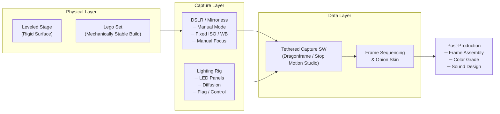

# Lesson 4: Production Pipeline, Optimization, and Troubleshooting

## 1. First-Principles Intuition & Invariants

Stop motion animation transforms the discontinuous into the apparently continuous through a fundamental deception: the human visual system's persistence of vision. When discrete images are presented at rates exceeding approximately 10–12 frames per second, the phi phenomenon—our brain's tendency to perceive motion from sequential still images—creates the illusion of fluid movement. This perceptual threshold forms the bedrock invariant upon which all stop motion production rests. For Lego animation specifically, the standard playback rate of 24 frames per second (matching theatrical film) or 30 frames per second (matching NTSC video standards) establishes the temporal resolution within which all physical manipulation must occur.

The production pipeline for Lego stop motion is fundamentally a precision choreography between three coupled systems: the physical scene with its mechanical constraints, the capture apparatus with its optical and temporal consistency requirements, and the animator's manipulation protocol that must maintain sub-millimeter positional accuracy across hundreds or thousands of discrete frames. Unlike traditional animation where errors can be erased or redrawn, stop motion is an additive, forward-marching process where each captured frame becomes immutable evidence of the physical world state at that instant. This irreversibility imposes severe constraints on workflow design: a single frame containing an accidentally visible hand, a shifted light stand, or a bumped background element can cascade into hours of reshooting.

The core invariants that govern successful Lego stop motion production emerge from this unforgiving relationship between physical reality and captured image. First, the camera must maintain absolute spatial and optical consistency across the entire shooting session—any deviation in position, focal length, aperture, or white balance creates perceptible discontinuities that the viewer's visual system will flag as errors in the motion continuum. Second, the lighting environment must remain temporally stable within the exposure variance tolerance of the sensor, typically requiring consistency within ±0.3 stops of light intensity to avoid visible flicker. Third, the Lego constructions themselves must possess sufficient mechanical rigidity to resist drift from gravitational settling, thermal expansion, or accumulated manipulation stress across the multi-hour or multi-day shooting period required for even short sequences.

These invariants create a production paradigm fundamentally different from live-action cinematography or digital animation. Where live action embraces continuous time and digital animation operates in an entirely virtual workspace with infinite undo capability, stop motion exists in a hybrid domain where physical reality must be manipulated with digital precision while maintaining analog continuity. The animator functions simultaneously as sculptor, cinematographer, and mechanical engineer, each frame requiring microadjustments measured in fractions of a stud width while maintaining global narrative coherence across potentially thousands of such adjustments.

## 2. Core Architecture & Mechanics

The physical architecture of a Lego stop motion production environment consists of nested stability hierarchies, each designed to isolate the animation stage from environmental perturbations. The foundation begins with the shooting surface itself, which must exhibit near-zero deflection under the combined load of the set, camera rig, and animator's incidental contact during frame manipulation. A rigid table constructed from 19mm plywood or MDF over a frame of 5×10cm lumber, leveled with adjustable feet and verified with a precision spirit level or digital inclinometer, provides the baseline reference plane. Carpet or suspended flooring introduces unacceptable vibration coupling; concrete slabs or ground-floor installations over compacted earth offer superior isolation from footfall-induced oscillations.

The camera mounting system forms the second stability tier. Friction-based tripod heads, regardless of quality, introduce creep under sustained load—the camera will shift position measurably over the hours required for extended shooting sessions. The only acceptable mounting solutions employ either positive-locking mechanisms (gear-driven pan/tilt heads with friction brakes supplemented by mechanical locks) or fixed-position overhead rigs where the camera is secured to a rigid gantry structure via bolted mounting plates. For complex shots requiring camera motion (dollies, tilts, pans), the movement must be mechanically indexed with reproducible increments, typically achieved through stepper motor-driven sliders or rotary stages controlled via programmable motion control systems like Arduino-based rigs running modified Grbl firmware.

Camera configuration operates under the principle of complete manual control—every automatic function represents a potential source of frame-to-frame inconsistency and must be disabled. The exposure triangle (ISO, aperture, shutter speed) is locked at values chosen during the initial test shoot and never altered mid-sequence. ISO is set to the base native sensitivity of the sensor (typically ISO 100 or 200 for most modern cameras) to minimize electronic noise. Aperture selection balances depth of field against diffraction limits: for Lego scenes where minifigures are the primary subjects, f/5.6 to f/8 provides adequate depth to maintain sharpness across a figure's 4-stud height while avoiding the resolution degradation that emerges beyond f/11 on APS-C sensors due to diffraction-limited resolution. Shutter speed becomes irrelevant for static subjects but should be set to values ensuring motion blur matches the intended aesthetic—1/50 second for 24fps output creates natural blur matching theatrical film conventions, though many Lego animators prefer 1/100 or faster to maintain crisp edges on the plastic elements.

White balance must be set to a fixed Kelvin value matching the color temperature of the lighting rig, never left on auto white balance which will shift between frames as the camera's metering responds to different color compositions in the scene. LED panels, if used, should be rated for CRI (Color Rendering Index) values above 95 and verified to be flicker-free at the intended frame rate—budget LED fixtures often employ pulse-width modulation at frequencies that interact destructively with camera shutter speeds, creating banding or intensity variations. Traditional tungsten halogen work lights or photographic video lights provide naturally continuous spectra but generate substantial heat that can warp baseplate-mounted builds through thermal expansion of APS plastic over extended shooting sessions.

Focus is achieved manually with live view magnification, targeting the hyperfocal distance for the chosen aperture to maximize depth of field across the subject plane. Many DSLR and mirrorless cameras provide focus peaking overlays that highlight in-focus edges in real-time, invaluable for verifying critical focus on minifigure faces or mechanical details. Once established, focus must be locked—both electronically via lens switches and physically via tape or friction locks on the focus ring to prevent accidental rotation during animator hand movements near the camera.

The software capture layer, typically implemented through tethering software like Dragonframe (the industry standard for professional stop motion) or open-source alternatives like qStopMotion, provides three critical functions beyond simple shutter release. First, onion skinning overlays the previous frame as a semi-transparent ghost image over the live camera view, allowing the animator to judge incremental position changes with sub-pixel precision. The typical workflow involves setting onion skin opacity to 50–70% and toggling between full-opacity previous frame and live view to verify that the intended motion increment has been achieved. Second, frame sequencing and numbering ensure that captured images maintain strict chronological order with embedded metadata—file naming conventions like `shot_001_frame_0001.CR2` provide both human-readable organization and safeguards against accidental overwrites. Third, instant playback at target frame rates allows animators to review the last 10–20 frames in real-time motion, catching drift, jitter, or unintended movements before they propagate through subsequent frames.

## 3. High-Performance Optimization & Failure Modes

Production efficiency in Lego stop motion is governed by the animator's ability to maintain consistent frame capture cadence while minimizing setup waste and reshoot requirements. The fundamental time metric is frames per hour, which for experienced animators working on dialogue-driven character animation typically ranges from 30–50 frames per hour, translating to 1.25–2 seconds of finished footage for every hour of production time at 24fps. This seemingly glacial pace results from the compounding overhead of three distinct operations that must occur for each frame: minifigure manipulation with verification of position stability, camera trigger with exposure completion and tethered transfer, and animator review via onion skin comparison and short playback scrub.

Optimizing frame capture cadence begins with ergonomic workspace design that minimizes animator reach distance and body position changes between frames. The camera's tethering cable, power adapter, and lighting cables must be routed outside the animator's primary motion envelope to prevent accidental snagging—cable management via overhead suspension or floor-level cord covers eliminates the single most common cause of mid-shoot disasters (yanked camera cables rotating the camera body on its tripod mount). The animator's chair or stool should position hands at a comfortable working height relative to the stage surface without requiring sustained reaching or hunching, as postural fatigue degrades fine motor control over multi-hour sessions and increases the probability of accidental collisions with set elements.

Minifigure manipulation technique directly impacts both frame rate and animation quality. The fundamental challenge lies in achieving precise incremental position changes (typically 0.5–2mm per frame for walking cycles, smaller for subtle acting performances) while avoiding three failure modes: figure drift from incomplete seating of legs onto stud connections, torso twist from asymmetric hand pressure during repositioning, and limb spring-back from stressed living-hinge joints in arms and legs. Professional animators develop a systematic manipulation protocol: approach the figure from a consistent direction (typically from behind to avoid shadowing the camera view), apply downward pressure through the torso while adjusting legs to ensure stud engagement, then manipulate arms with attention to shoulder rotation axis. Between manipulation and shutter release, a 2–3 second settling pause allows any mechanical spring-back to stabilize and dissipates table vibrations from hand contact.

Lighting consistency failures manifest as frame-to-frame flicker, most commonly caused by three mechanisms. Fluorescent or low-quality LED fixtures that rely on AC mains frequency exhibit 100Hz (50Hz mains) or 120Hz (60Hz mains) flicker that may not be visible to the naked eye but will create alternating bright/dim frames when capture rate is not synchronized to line frequency. Thermal drift in LED driver circuits causes gradual intensity shifts over the 30–90 minute warm-up period after power-on, necessitating a lighting system warm-up protocol before beginning critical shooting. Finally, ambient daylight contamination—even from supposedly light-controlled rooms where window seals are imperfect—creates slow-drift color and intensity shifts as outdoor illumination changes over the hours of a shooting day. The mitigation hierarchy is absolute environmental control (windowless interior rooms or complete blackout curtains), high-CRI constant-current LED panels verified flicker-free with slow-motion camera tests, and mandatory lighting system warm-up before commencing frame capture.

Drift and jitter represent the most insidious failure modes because they accumulate imperceptibly across dozens of frames before becoming visible in playback as unintended motion or vibration. Drift occurs when set elements shift position gradually under gravitational settling or thermal expansion—a baseplate not fully secured to the stage surface may slide fractions of a millimeter per frame, creating apparent camera pan or set rotation. Jitter arises from inconsistent minifigure positioning between frames, typically from inadequate stud seating or from the animator inadvertently bumping background elements during figure manipulation. The diagnostic protocol for drift involves marking reference points on both the stage and set using low-tack tape or registration pins, then verifying at 10-frame intervals that these references maintain fixed relationships. For jitter, the onion skin review must focus on background elements rather than the animated figure—if stationary set pieces show position variation frame-to-frame, the scene must be reshot from the point where jitter first appeared.

Camera-induced failures, though less frequent than set or lighting issues, can invalidate entire shooting sessions if undetected. The most catastrophic is accidental focal length change on zoom lenses, creating imperceptible field-of-view shifts that compound into visible perspective distortion over dozens of frames. The mitigation is either use of prime (fixed focal length) lenses exclusively, or physical locking of zoom rings with friction tape and regular verification against marked positions. Autofocus systems, even when disabled in camera menus, sometimes re-engage due to inadvertent button presses or power-cycle resets—the safety protocol is to verify focus lock before every shooting session and to disable autofocus both electronically via menu and mechanically via lens-body switch.

The post-production integration phase begins with a quality control pass where the complete image sequence is reviewed at full playback speed, then at half-speed for subtle drift detection, then via frame-by-frame advance for verification of figure positioning continuity. Modern non-linear editing software (DaVinci Resolve, Adobe Premiere Pro, Final Cut Pro) imports stop motion image sequences directly via frame rate specification dialogs—critical settings include confirming the intended frame rate matches the capture cadence assumption, and setting color space/gamma to match camera output (typically Rec.709 for DSLR footage). Color grading for Lego animation typically requires minimal correction if lighting was controlled properly during capture, but batch adjustments to lift shadows (exposing detail in black bricks) or slight saturation boosts (compensating for diffusion-induced color flattening) are common finishing touches.

The most sophisticated optimization approach employs motion control rigs for camera movements, effectively trading setup complexity for reproducible, drift-free camera motion. A basic linear slider driven by a stepper motor controller allows precise dollying or tracking shots where the camera advances by exact increments between frames—typical implementations use OpenBuilds V-slot aluminum extrusion rails with NEMA-17 motors controlled via Arduino running motion control firmware. Programming involves calculating the total camera travel distance, dividing by the number of frames in the shot, and commanding the motor to advance by the resulting per-frame increment (e.g., 600mm travel over 120 frames = 5mm per frame). The motion control system must pause after each movement increment to allow mechanical settling before triggering the camera shutter, typically requiring 1–2 second dwell times.

Advanced practitioners integrate multiple motor axes for complex moves: pan/tilt heads, focus pullers, and even automated lighting intensity ramps. The coordination of these multi-axis systems demands either commercial motion control software (Dragonframe's DMC-16 controller) or custom firmware that synchronizes multiple stepper drivers to a master timeline, ensuring that camera translation, rotation, and optical adjustments occur in lockstep with the frame advance sequence. The investment in such infrastructure—often exceeding $1000 for even modest two-axis systems—only justifies itself for productions requiring multiple complex camera moves or for animators producing sufficient volume that setup time amortization becomes favorable.

Troubleshooting protocols must operate within the constraint that stop motion production is a forward-marching, largely irreversible process where detected failures often necessitate partial or complete reshoot of affected sequences. The decision tree for failure response hinges on the failure's temporal extent and severity. Single-frame anomalies (a visible support wire, an accidentally included hand, a figure toppling) can sometimes be corrected through frame interpolation or digital painting in post-production if the error spans fewer than 3–4 frames. Systematic errors (lighting drift across 50 frames, gradual camera defocus, consistent background jitter) almost always require reshooting because interpolation artifacts or digital correction would introduce more perceptible defects than the original error.

The psychological dimension of stop motion troubleshooting cannot be underestimated—the animator must cultivate the discipline to halt production immediately upon detecting errors rather than hoping the problem will resolve or become invisible in the final edit. This runs counter to the natural cognitive bias toward completion and the sunk cost fallacy that whispers seductively about the wasted hours already invested in a flawed sequence. Professional practice demands ruthless quality standards and immediate remediation, because every frame captured beyond the point where a failure mode emerges compounds the eventual reshoot burden.
