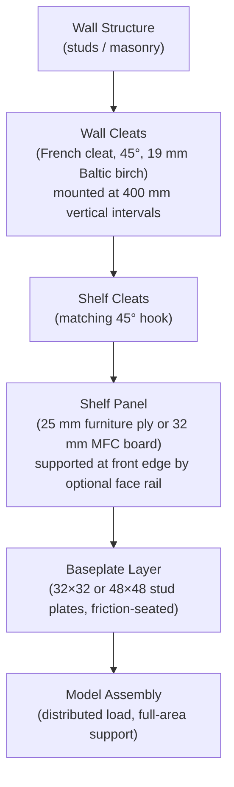

# Lesson 3: Display Framework Construction

## 1. First-Principles Intuition & Invariants

There is a particular tension at the heart of every serious Lego collection: the same objects that reward close examination demand protection from handling, yet the same care taken to preserve them makes them invisible. A model sealed in a box or stacked behind others on a shelf ceases, in a meaningful sense, to exist. Display framework construction is the craft of resolving that tension—designing shelving and wall-mounted systems that hold, present, and protect built models at scale while keeping every piece legible, accessible, and structurally sound under its own weight.

Before touching a single bracket or beam, an advanced practitioner must internalize the first principle that governs every display decision: Lego bricks are not passive cargo. They are dimensionally exacting assemblies with known mass, predictable geometry, and specific vulnerabilities. A large Technic supercar model—say, the 42143 Ferrari Daytona SP3—masses approximately 1.5 kg fully assembled and spans roughly 580 mm in length. A modular building from the Creator Expert line sits between 700 g and 1.2 kg and is predominantly vertical, meaning its center of mass is elevated relative to its footprint. These are not abstract figures; they define the minimum shelf depth, the maximum cantilever span before deflection becomes visible, and the fastener spacing required to keep wall-mounted rails from pulling away under load.

The second invariant is dimensional determinism. The standard Lego stud pitch is 8 mm, and the relationship between stud height and plate height is fixed at 3.2 mm per plate, with a standard brick standing 9.6 mm tall (three plates). This system is internally consistent to tolerances measured in hundredths of a millimeter. Display frameworks that honor this geometry—shelf depths that land on multiples of 8 mm, divider spacing tuned to known model widths—allow you to rearrange and restock with zero interference fitting. Frameworks that ignore it produce the characteristic frustration of a model that almost fits, overhanging an edge by 6 mm or clashing with a neighboring baseplate.

The third invariant concerns structural mode. Lego models loaded onto a shelf are experiencing a combined loading condition: gravitational compression through vertical elements, bending moment at cantilevered subassemblies (wings, crane arms, outriggers), and lateral shear if a model is nudged or the shelf vibrates. The models themselves resist these loads through stud friction, beam triangulation, and pin connections. Your display framework must not introduce new loads that the model was never designed to bear. This means supporting baseplates fully across their area, never point-loading a model at a single connection stud, and ensuring that thermal or humidity-driven shelf deflection cannot transfer lateral force into fragile sub-assemblies.

Aesthetically, the invariant is contrast without competition. The display structure should recede visually so the models advance. Matte black or dark grey powder-coated steel shelving, natural hardwood with a low-sheen oil finish, and white melamine with integrated lighting all serve this purpose. Glossy, busy, or strongly colored framework materials compete with the polychrome surface of a Lego model and fragment the visual field that the collector is trying to unify.

## 2. Core Architecture & Mechanics

A complete display framework architecture divides into four interacting layers: the wall or floor anchor system that transfers all load into the building structure, the primary rail or upright members that distribute that load laterally, the shelf panels themselves that carry distributed model weight, and the micro-positioning fixtures—dividers, risers, and display bases—that govern individual model placement and orientation.

### Anchor Systems and Load Paths

Wall-mounted systems require fasteners that reach structural elements: timber studs at 400 mm or 600 mm on-center in timber-frame construction, concrete anchors for masonry, or dedicated wall-track systems like IKEA SKÅDIS or Elfa that distribute load across a continuous rail bolted at multiple points. The critical calculation is straightforward. If a shelf span between two upright supports is 900 mm and carries six mid-sized models averaging 800 g each, the total distributed load is 4.8 kg, applying a bending moment at each support of approximately 4.8 × 9.81 × 0.45 = 21.2 N·m. Standard 19 mm MDF at 300 mm depth will deflect visibly at that span; 25 mm furniture-grade plywood or a steel shelf with a rolled front lip will not. For collections exceeding 20 kg per linear meter of shelving—a threshold easily reached by a full Technic or Star Wars UCS row—you must anchor into studs or use a continuous French cleat system that spreads load across the entire wall bay.

The French cleat deserves particular attention because it aligns naturally with the modular logic of Lego itself. A French cleat is a wall-mounted strip of material (typically 18–19 mm plywood or aluminum extrusion) ripped at 45 degrees, with a matching 45-degree hook on the shelf or bracket. The interlocking angle means gravity loads the joint in compression, not tension, and the continuous horizontal run of the wall cleat allows infinite repositioning of shelves without additional fasteners. For a Lego display wall, mill your wall cleats from 19 mm Baltic birch plywood at 90 mm wide, rip them at 45 degrees on the table saw, and mount them to studs at 400 mm vertical intervals using 100 mm structural screws at every stud crossing. The corresponding shelf cleats, ripped from the same stock, hook over the wall cleats and carry the shelf panel. This system supports 50+ kg per linear meter when fastened correctly and allows an entire shelf row to be relocated in under two minutes—precisely the operational flexibility that a growing collection demands.

The architecture described above maps to the following structural hierarchy:

Every load introduced at the model layer travels upward through this hierarchy without accumulation at any single joint, which is the structural condition you must maintain as the collection grows.

### Shelf Panel Design and Baseplate Integration

The shelf panel is where display framework construction intersects most directly with Lego's dimensional system. Baseplates are the canonical model substrate—the 32×32 stud plate (255 mm × 255 mm) and the 48×48 stud plate (383 mm × 383 mm) are the standard formats—and incorporating them directly into the shelf surface solves three problems simultaneously: it registers models with sub-millimeter precision, prevents lateral sliding under vibration, and communicates to any viewer that a model's position is intentional rather than arbitrary.

The most effective implementation routes a continuous channel or rebate into the shelf surface at a depth of exactly 3.2 mm—one Lego plate height—so that a standard baseplate sits flush with the shelf surface when seated. This is achievable with a router and a 3.2 mm straight bit in a single pass with a fence guide, or by laminating a 3.2 mm hardboard sheet onto the shelf panel in the zones between baseplate positions. The baseplates then click into the exposed stud field or are simply friction-rested in the rebate. Either approach means the model's bottom layer of bricks sits at shelf-surface level, eliminating the visual step between model and shelf that makes an otherwise clean display look unfinished.

Shelf depth is a function of your deepest model in each row, not an average. The Millennium Falcon (75192) has a nominal depth of 445 mm. A display shelf housing that model must offer at least 460 mm of clear depth to accommodate the model fully without its rear subassemblies overhanging the shelf edge. Front overhang by 10–15 mm is aesthetically acceptable and even desirable—it allows angled viewing from below—but rear overhang places the model's center of mass behind the shelf's center of support, introducing a tipping moment that stud friction alone may not reliably resist. Gravity-safe rule: at least 60% of the model's footprint depth must rest on supported shelf surface.

### Wall-Track Modular Systems

For practitioners who prefer not to build bespoke cabinetry, commercial wall-track systems offer a credible substrate provided their load ratings are matched to actual collection weight. The Elfa system (available through The Container Store and international equivalents) uses a continuous extruded aluminum wall track mounted into studs, from which bracket arms project at any spacing. The bracket arms accept standard shelf boards and are rated to 25 kg per bracket pair at 600 mm extension. This modular approach mirrors the Lego design philosophy of standardized connectors enabling infinite configuration—the same ethos that makes a Lego Technic beam interoperable with pneumatic hose clips and linear actuator mounts.

IKEA's Kallax system warrants specific treatment because it has become, de facto, the most common Lego storage and display platform in the community. Its 33 cm × 33 cm internal cube dimension is non-accidental: a 32×32 stud baseplate (255 mm) fits with 37.5 mm of clearance on each side, sufficient for models up to approximately 320 mm in footprint dimension. The Kallax's particleboard back panel is not structural and must not be used for wall anchoring; the side panels carry vertical load, and the shelf pins carry horizontal load. For models exceeding 2 kg per cube—the 10305 Lion Knights' Castle masses 4.3 kg—reinforcing the shelf pin holes with 6 mm steel inserts pressed into the particleboard is prudent.

### Lighting Integration and Visual Hierarchy

Lighting is not optional at the advanced practitioner level; it is structural in the visual sense. Without directional light, the depth and texture of trans-clear elements, metallic pieces, and printed tiles collapse into a flat read. LED strip lighting in 5000 K to 6500 K color temperature (neutral to cool daylight) renders trans-blue and trans-clear elements correctly and avoids the yellow cast that warm-white LEDs introduce into white and light-bluish-grey parts.

Mounting position matters as much as color temperature. A strip mounted at the front underside of the shelf above illuminates models from above and forward, casting shadows behind rear elements and giving the display depth. A strip mounted at the rear of the shelf, aimed forward, creates a backlight halo that is visually dramatic but reduces readability of dark-colored parts. The most versatile configuration uses both: 60% of lumens from the overhead-front position, 40% from a rear bounce strip aimed at the shelf back panel (painted matte white to act as a diffuse reflector). Dimmable controllers on each zone allow you to tune this ratio to the specific model population on each shelf row.

## 3. High-Performance Optimization & Failure Modes

### Scaling to Collection Depth

A display system that works beautifully for twenty models begins to strain at sixty and fails at two hundred unless it was designed for scaling from the outset. The primary failure mode at scale is indexing collapse: you can no longer locate a specific model without scanning the entire surface. The solution is spatial zoning enforced by the physical framework itself, not by memory. Assign each shelf bay or Kallax column to a Lego theme or sub-theme, and use the shelf depth dimension to encode access priority: models you interact with frequently sit at the front 150 mm of the shelf; display-only models occupy the rear zone.

Label integration at the shelf level—not the model level—preserves model aesthetics while enabling rapid inventory management. A Dymo or Brother P-Touch label affixed to the shelf edge or to a removable acrylic strip in front of each baseplate position carries the set number, name, and year of the model occupying that position. This practice pays compound dividends during reorganization because it makes the absence of a model as legible as its presence.

For collections exceeding 150 displayed models, a companion spreadsheet or Rebrickable inventory list keyed to shelf coordinates (Bay 3, Shelf 2, Position 4) transforms the display wall from a passive exhibition into an active, queryable asset. The physical coordinate system should use permanent reference marks—a small engraved number or adhesive index dot at each baseplate position—that survive reorganizations without confusion.

### Structural Failure Modes and Mitigations

The most common structural failure in Lego display construction is shelf sag under long-term creep loading. Particleboard and MDF both exhibit viscoelastic creep: under a sustained load below their elastic limit, they continue to deflect over months and years. A shelf that shows no measurable deflection at installation may sag 4–6 mm over three years under a 15 kg distributed load. This deflection is not catastrophic, but it is visually disqualifying and can cause a baseplate at mid-span to rock, destabilizing taller models.

The mitigation is threefold. First, choose shelf materials with high stiffness-to-weight ratio: 25 mm furniture-grade plywood (Baltic birch or hardwood-core) has roughly twice the creep resistance of 25 mm MDF at the same thickness. Second, reduce effective span by adding a mid-span support—a vertical upright or a center wall cleat bracket—for any shelf exceeding 800 mm. Third, pre-camber the shelf slightly (2–3 mm upward bow) before installation by shimming the center of the shelf cleat; long-term creep will bring it to flat rather than sagging below horizontal.

A second failure mode is specific to wall-track systems: anchor pull-out under impact loading. When a shelf-mounted model falls or is knocked, the impulse load can be five to ten times the static weight. A wall track fastened with undersized screws into drywall anchors rather than studs will pull free under these conditions. The rule is unambiguous: every load-bearing track mount goes into a structural member. No drywall anchor, however rated, is an acceptable substitute for a stud or masonry anchor when the consequence of failure is a 10 kg shelf assembly falling onto models below.

The third failure mode is model-level: stud joint creep and clutch fatigue. Baseplates that have carried the same assembly for years develop a bias in their stud friction from the sustained compression of the model's bottom layer. When you eventually disassemble for reorganization, these studs may feel stiffer or, in older ABS formulations, may have micro-cracked around the stud perimeter. Rotating models off their display baseplates every 12–18 months—moving them to fresh plates or reassembling from storage—prevents this. It also gives you a natural audit cycle to check for dust accumulation, UV discoloration (position your display away from direct sunlight or use UV-filtering acrylic panels), and any sub-assembly that has begun to warp or separate.

### Accessibility Without Compromise

A display framework that makes every model equally inaccessible is functionally a storage system with aesthetic pretensions. True accessibility means that any model can be removed in under thirty seconds without disturbing its neighbors. This imposes a planning discipline: no model should require another to move first. Practically, this means a minimum 40 mm lateral clearance between models at their widest points, baseplates that are individually removable without lifting over adjacent models, and shelf spacing that allows a model's tallest element to clear the shelf above by at least 25 mm—enough for a confident two-handed grip.

Tiered risers built from Lego bricks themselves—a row of 2×8 bricks three to four courses high, capped with a tile layer for a smooth surface—elevate rear models above front models within a single shelf depth, granting both rows simultaneous visual legibility and individual physical access. This approach is dimensionally exact because the riser is itself a Lego assembly: a four-brick riser stands 38.4 mm tall, which is a precisely known elevation that you can account for in lighting and sightline planning. It also allows the riser to serve double duty as a micro-storage unit by embedding small-part containers within its hollow interior, accessed from the rear of the shelf.

The measure of a successfully executed display framework is not its visual impact on the day of completion but its operational stability over years of active use. When a framework is correctly anchored, dimensionally tuned to the Lego system, structurally matched to actual model weights, and spatially organized for retrieval, it becomes invisible in the best sense—the models occupy the full attention, and the structure simply holds.
