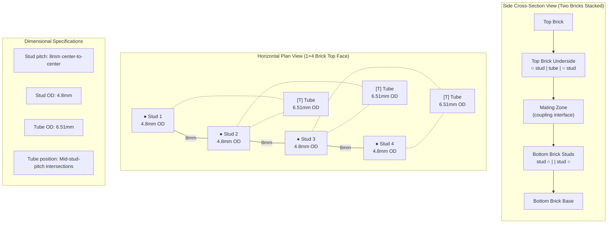

# Lesson 1: Brick Taxonomy, Stud Geometry, Dimensional Standards

## 1. First-Principles Intuition & Invariants

There is a deceptive simplicity to a Lego brick. Hold one between your fingers and you encounter what feels like a child's toy: a bright plastic rectangle with a row of cylindrical bumps on top. Turn it over and you find hollow tubes recessed inside a walled cavity. Set two bricks together and they click with a tactile finality that feels both trivial and inevitable. It is only when you begin building at scale — when you are designing a load-bearing studless frame for a Technic supercar, or engineering a SNOT panel where four different brick orientations must resolve to a flush face — that the underlying precision of the System reveals itself. The Lego brick is not a toy component approximated to some convenient dimension. It is a precisely engineered spatial unit built on a coherent dimensional grammar that has remained backward-compatible for more than sixty years.

Understanding that grammar at the level of an advanced practitioner means beginning not with individual parts but with the System itself as a constraint language. Every brick, plate, tile, and bracket in Lego's catalog is an expression of a small set of invariants — fixed numerical relationships from which every spatial decision in a model can be derived. Violating these invariants produces stress, misalignment, and structural failure. Working fluently within them allows the builder to predict, without touching a single physical piece, exactly how complex multi-directional assemblies will resolve.

The fundamental unit of Lego's spatial grammar is the **stud pitch**, standardized at exactly **8 mm**. This is the center-to-center distance between adjacent studs in both the X and Y axes of the grid. All horizontal layout decisions in a System build collapse back to this number. A 2×4 brick occupies 16 mm × 32 mm of horizontal footprint. A 1×6 plate is 48 mm long. The stud pitch is not arbitrary. At 8 mm, the system is large enough for injection-molded tolerances to maintain consistent coupling force across millions of parts, yet small enough that fine-grained geometry — curves, offsets, compound angles — remains achievable with combinations of standard elements.

The vertical axis is governed by a different and critically important relationship. A standard System **brick** is **9.6 mm tall**, measured from the bottom of the brick's wall to the top of its stud. A **plate** is exactly one-third of that height, at **3.2 mm**. This 3:1 plate-to-brick ratio is the first invariant every practitioner must internalize as an automatic reflex: three stacked plates equal one brick in height, every time, without exception. The stud itself adds nothing to this stack height because it inserts into the tube or anti-stud of the layer above, disappearing into the coupling geometry. What this means in practice is that a column of bricks and a column of plates can be brought into exact vertical registration whenever the plate count is a multiple of three, allowing mixed brick-and-plate construction to terminate flush on any course.

The relationship between horizontal and vertical pitch defines the system's most practically important ratio: the **LDU (Lego Design Unit)** coordinate grid used in digital tools like **BrickLink Studio** and **LDraw**. In LDraw's coordinate system, 1 LDU equals 0.4 mm in real-world units, making a stud pitch exactly 20 LDU and a plate height exactly 8 LDU. A full brick height is 24 LDU. These numbers are worth memorizing not for their own sake but because they allow you to reason about spatial geometry in integer arithmetic — a convenience that becomes critical when you are calculating SNOT offsets or stacking Technic frames against System panels and need to verify dimensional consistency before committing to a physical build.

The material from which all these parts are made is **ABS (Acrylonitrile Butadiene Styrene)**, with modern production parts shifting partially toward more sustainable alternatives including recycled ABS and bio-based polyethylene in specific element categories (notably transparent and botanical elements). For the structural practitioner, ABS's relevant properties are its glass transition temperature of approximately 105°C, its relatively low creep under sustained load at room temperature, and its slight dimensional sensitivity to temperature change. A brick that couples with ideal force at 20°C will be marginally tighter at 10°C and marginally looser at 35°C. At the scale of a single connection this is irrelevant. At the scale of a large stressed-frame assembly, it is worth noting — particularly if the model is transported through significant ambient temperature changes.

Tolerance within the stud-tube system is specified to maintain a coupling force of approximately **1.7 to 4.5 newtons** per stud, depending on element age, material batch, and element type. This range is deliberate. It is loose enough to allow repeated connect-disconnect cycles without wear degradation over thousands of presses, yet tight enough to ensure the bond resists incidental separation. The practitioner significance: not all stud-tube couplings are equivalent. A stud coupling into an anti-stud tube (the cylinder inside a standard brick) behaves differently from a stud coupling into the **underside anti-stud ring** of a plate, and both differ from the coupling force of a **Technic pin** in a beam hole. Mapping these differences informs structural decisions in ways that raw catalog browsing never will.

---

## 2. Core Architecture & Mechanics

### The Stud-Tube Coupling Mechanism

The elegance of the Lego coupling system lies in how it achieves precise registration and consistent grip simultaneously, using a geometry that is entirely self-locating. A stud is a hollow cylinder, 4.8 mm in outer diameter and 1.7 mm tall, centered on each 8 mm grid node of a brick's top face. The wall of the stud is not uniform — it carries a very slight draft angle outward from base to tip to aid ejection from the injection mold without requiring measurable dimensional compromise. The inside of the stud is open, communicating with the hollow interior of the brick cavity below.

The receiving geometry on a brick's underside consists of two distinct structures depending on the element type. A **standard System brick** (height 9.6 mm, three stud pitches wide or longer) has **interior tubes** — hollow cylinders, 6.51 mm outer diameter, running from the ceiling of the brick's cavity down to its open base, positioned on the grid such that each tube falls between four studs in the layer below. These tubes are not simply cylindrical spacers; they serve triple duty as coupling receivers, structural ribs that resist lateral compression of the brick walls, and mold-core anchors during manufacturing. When a stud from the brick below enters the tube, the stud's outer wall presses against the tube's inner bore with the slight interference that generates coupling force. The fit is not a slip fit or a press fit in the engineering sense — it falls in between, in a range the Lego Group specifies as a **transition fit**, where nominal dimensions are designed to yield consistent engagement force rather than retention by material deformation.

A 1×1 or 1×2 brick does not have room to accommodate interior tubes between its studs. These bricks instead use the outer wall of the brick cavity itself as the coupling surface. A 1×1 brick's cavity inner diameter is sized to receive one stud on its circumference. A 1×2 brick's cavity catches two studs along its longer axis using a single elongated internal rib rather than a tube. This is why 1×2 bricks in demanding structural applications sometimes exhibit slightly lower lateral resistance than wider bricks: the coupling interface is a wall-to-stud contact rather than a full cylindrical bore contact.

The anatomy of the coupling system can be mapped geometrically:



The plan view reveals a critical point: tubes are not aligned under studs — they fall at the interstices of the stud grid. This offset means that the structural load path from stud to tube to base is never vertically direct. Compressive loads applied through a stud travel laterally through the tube walls before reaching the brick floor, introducing a small bending moment into the tube-wall interface. At Lego load scales this is entirely benign, but it explains why very tall unsupported brick columns under point loads exhibit a subtle tendency to rack rather than crush.

### Plate and Tile Geometry

The plate introduces a dimensional wrinkle that trips up builders who have not fully committed the vertical grid to memory. At 3.2 mm, a plate is exactly one-third the height of a brick (9.6 mm), which makes the arithmetic clean. What is less obvious is that the stud on a plate is dimensionally identical to the stud on a brick: 4.8 mm outer diameter, 1.7 mm tall. The plate body is simply a 3.2 mm-tall version of a brick, with no interior tubes because the cavity height is insufficient to accommodate them. Instead, plates couple via a thin internal web and the outer wall geometry.

A **tile** (also called a smooth plate in catalog nomenclature) removes the stud from a plate entirely, leaving a flush top surface. Tiles are coupled to the layer below through the same underside geometry as plates but offer no coupling surface to anything placed on top. This is relevant structurally: a tile-topped assembly provides no lateral registration for elements placed horizontally on top of it, which is acceptable when tiling is a final surface layer but problematic if incorrectly used in an intermediate load-bearing course.

The **jumper plate** — most commonly encountered as the 1×2 jumper — introduces a half-stud offset by placing a single centered stud on a 1×2 footprint. The stud center sits at the 4 mm midpoint between the two standard grid positions, shifting any element coupled above it by exactly half a stud pitch (4 mm) in one axis. This is the practitioner's primary tool for resolving assemblies that require sub-grid positioning, particularly in SNOT work where vertical and horizontal grid systems must be reconciled.

### SNOT Geometry and the 5:2 Plate-to-Stud Relationship

SNOT (Studs Not On Top) construction places bricks sideways, forward, or in compound orientations to achieve features impossible in standard stacking: flush side faces, embedded textures, horizontal studs for outward-facing coupling, and compound-angle geometry. The practitioner working in SNOT must have one ratio hardwired into spatial reasoning: **5 plates equal 2 studs in height**.

The arithmetic: 5 plates × 3.2 mm = 16 mm. Two stud pitches = 2 × 8 mm = 16 mm. This equivalence means that a sideways-mounted element spanning 2 studs horizontally has exactly the vertical extent of 5 stacked plates. Any SNOT assembly that must register flush between a horizontal run and a vertical stack can resolve to a clean meeting line only when this ratio is satisfied.

The bracket family — especially the 1×2–1×2 bracket and the 1×2–2×2 bracket — is the most common tool for introducing sideways stud faces into a standard stacking layout. Each bracket occupies a known volume in the standard grid and presents an outward stud face at a precisely defined offset from the base plane. Getting SNOT assemblies right is primarily an exercise in counting this offset carefully and verifying that the bracket's outward stud face is positioned to accept exactly the number of plates or bricks required to close the gap to the nearest grid surface.

```text
SNOT vertical registration (side view):

Standard stack:                    SNOT panel (sideways brick):

  ┌───┐  ← plate (3.2mm)             →→→ 2 stud pitches = 16mm
  ├───┤  ← plate (3.2mm)                 must equal 5 plates height
  ├───┤  ← plate (3.2mm)             5 × 3.2mm = 16mm ✓
  ├───┤  ← plate (3.2mm)
  └───┘  ← plate (3.2mm)
  
  Total: 16mm = 2 stud pitches
```

### Technic Hole Integration and the Modular Offset

Technic beams introduce a third dimensional element: the **Technic hole**, an 4.8 mm diameter circular bore passing through the beam at every stud pitch along the beam's length. These holes accept **Technic pins** (3-mm diameter, friction or smooth, depending on pin type) and **Technic axles** (cross-section profile, not round). The hole centers in a Technic beam are positioned 3.9 mm above the beam's lower surface when the beam sits on a standard stud grid, centered within the beam's 7.8 mm height.

The Technic beam's height of 7.8 mm (not 8 mm — this is the actual molded wall height excluding stud) aligns the axle holes with the stud grid's midplane. When a Technic beam is placed alongside standard System bricks, its hole centers fall precisely at the half-stud-height position relative to the stud grid, allowing cross-referencing between studded and studless construction at defined mating surfaces.

---

## 3. High-Performance Optimization & Failure Modes

### Tolerance Stack-Up in Large Assemblies

A single stud-tube coupling has a nominal positional error of approximately ±0.1 mm in both X and Y under normal coupling force. This is tight enough to feel precise in a small assembly. Across a large model — say, a 100-stud-long base plate with subassemblies attached at multiple points along its length — tolerance errors accumulate. A stack of 10 couplings in series, each at the high end of its positional tolerance band, can place the final element nearly 1 mm off its theoretical grid position. This matters in applications like aligning hinge plates across a hinged door panel, where misalignment manifests as binding or a gap that opens and closes as the hinge moves.

The mitigation strategy for practitioners is to design registration from both ends of a long run rather than allowing error to accumulate in one direction. Building a symmetric assembly with a central keystone element — a brick or Technic pin that locks both halves relative to a known reference — prevents the accumulation pattern. In BrickLink Studio, the collision detection and snapping geometry will show idealized positions, but it cannot simulate manufacturing tolerance scatter, so a large Studio assembly that appears perfectly flush may need a physical half-stud shimming correction when built from real parts.

### Coupling Force Degradation and Part Age

ABS deforms very slightly under sustained coupling force. In practice, old bricks — particularly those manufactured before the mid-1990s, when Lego's ABS formulation was refined — tend to have looser stud-tube coupling than contemporary elements. The practical consequence for practitioners sourcing parts from BrickLink or sorting through older collections: mixed-era assemblies may exhibit locally variable coupling force, with some connections firm and others loose within the same plane. This is a structural risk in models where the coupling bond is doing meaningful work rather than simply holding cosmetic elements in place.

The fix is straightforward. Firm old-brick couplings in load-bearing areas by cross-bracing with Technic pins through adjacent holes when possible, or by routing the structural load path through newer elements rather than relying on stud-tube friction in old stock.

### SNOT Failure: Stress from Non-Integer Offsets

The most common structural failure mode in SNOT work is not dimensional error but dimensional rigidity in an assembly that the builder has inadvertently over-constrained. When a SNOT panel is attached at both its top and its sides to a surrounding standard grid, any deviation from perfect 5:2 resolution creates a stressed condition where two rigid elements are physically pulling against each other. In ABS, this stress does not cause immediate fracture — it causes the weaker coupling point (usually the bracket-to-brick interface) to resist seating fully, resulting in a panel that sits 0.3–0.5 mm proud of the surrounding surface and refuses to click flush.

The diagnostic is tactile before it is visual: an over-constrained SNOT assembly requires noticeably more force to press flat than a free coupling, and it springs back slightly when released. The resolution is to audit the plate count in the vertical registration path and verify the 5:2 ratio at every mating surface. One extra plate in a 5-plate stack — making it 6 plates, or 19.2 mm against a 16 mm stud span — produces exactly this symptom.

### Axle Torsion and Long-Span Structural Runs

In mixed System-and-Technic construction, builders frequently run Technic axles across long horizontal spans to carry cross-members or pivot points. Axles in Lego are made from ABS of slightly higher stiffness than standard brick material, but they are not rigid over long unsupported spans. An axle longer than approximately 8 studs (64 mm) under even moderate lateral load will exhibit measurable torsional deflection and centerline sag, causing pivot points to bind and gears on the axle to shift out of mesh.

The professional mitigation is never to leave long axles unsupported. Intermediate beam supports at every 4-stud interval — using standard Technic beams with through-holes that the axle passes through without pinning — provide bending restraint without preventing rotation. This is architecturally equivalent to a bearing span in machine design. It distributes the deflection load over multiple support points rather than leaving the axle as a simply-supported beam between two endpoints, dramatically increasing the effective stiffness of the span.

### Workflow: Verifying Dimensional Fit in BrickLink Studio Before Physical Build

For complex assemblies, the practitioner's highest-leverage tool is to construct the entire spatial logic in Studio before ordering parts. The workflow that experienced builders use is not to drag-and-drop elements visually but to work from anchor points outward, using the grid snapping and LDU coordinate display to verify every critical dimension explicitly.

For a SNOT panel assembly, the workflow looks like this:

1. Place the base plate and lock it as the origin reference in the model tree.
2. Add the bracket elements that will carry the sideways stud faces, snapping them to precise grid positions.
3. Place one plate on each outward stud face and count upward in plate increments, verifying in the Transform panel that the cumulative Y-offset (in LDU) matches the expected stud-pitch multiple.
4. Close the loop by placing the top-registration element (the brick or plate row that completes the enclosing frame) and use Studio's collision indicator to confirm it seats without penetration or gap.
5. Export the parts list and check part availability before physical procurement, substituting equivalent elements in discontinued colors or molds where necessary.

This verification workflow catches the over-constraint problems and tolerance stack-up issues before they consume build time and require disassembly of a half-completed physical model.

### Part Identification and Catalog Discipline

An advanced practitioner navigating the Lego parts ecosystem needs fluency with two classification systems simultaneously. The **Lego internal part number** (the number molded on the underside of most elements) is the definitive identifier within official Lego sets and instructions. The **BrickLink part number** (used on BrickLink's marketplace and in Studio's part library) is the number most builders encounter when sourcing. These do not always agree: Lego has re-used mold numbers across different elements in its history, and BrickLink's catalog has its own disambiguation layer that separates by mold variant and print pattern.

The specific area where this creates practitioner errors is in the bracket and modified-plate category. The 1×2–2×2 bracket exists in several mold variants with subtly different stud-face offsets — older variants have a half-plate positional difference from newer molds. Building a large SNOT run with mixed bracket generations will produce exactly the stress symptoms described above even when the plate-count arithmetic is correct. The fix is to verify part variant numbers, not just part names, when sourcing at scale — and to use Studio's specific part variant selection rather than accepting the default catalog entry.

Understanding Lego's dimensional system at this depth converts an assembly process that might otherwise feel like trial and error into a geometry problem with deterministic solutions. Every offset, every flush face, every bridged connection between stud and studless frame has a correct answer that can be computed from the invariants — and once those invariants are truly automatic, the creative and structural possibilities of the System expand dramatically.
