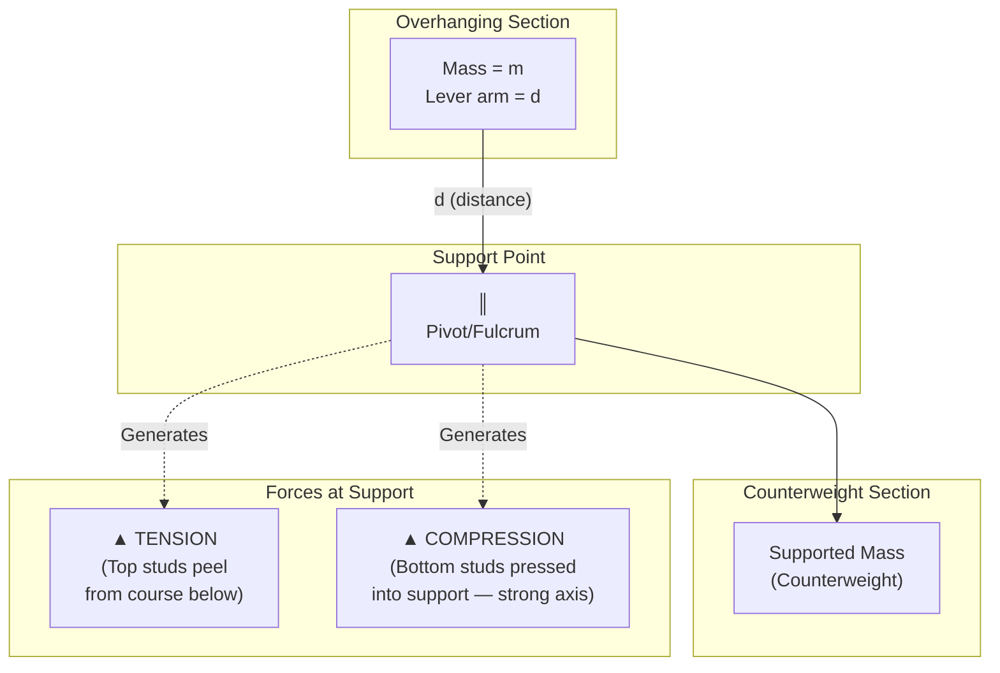

# Lesson 2: Structural Principles, Load Distribution, and Assembly Patterns

## 1. First-Principles Intuition & Invariants

Every Lego System assembly is a friction-bound structure. No adhesive joins its elements, no fasteners penetrate them, and no weldments fuse their material. The entire structural integrity of a System model—from a forty-brick wall to a cantilevered bridge—depends on the interference fit between the hollow cylindrical studs on one element and the receiving tubes on the element above. This interference fit, known in the building community as clutch power, is the product of elastic deformation: the 4.8mm-diameter stud, crowned with a slight taper, presses into the tube cavity of the brick above, causing the tube walls to deform outward by a few hundredths of a millimeter. The ABS plastic's elastic recovery generates a radial clamping force that locks the stud in place. That clamping force, multiplied by the friction coefficient between two clean ABS surfaces (approximately 0.4 to 0.5), yields the shear resistance that prevents bricks from sliding apart under lateral load, and the tensile resistance that prevents them from pulling apart under peel or bending.

The critical structural asymmetry is that shear strength at the stud-tube interface substantially exceeds tensile strength. A single new stud-tube pair resists roughly 2 to 3 newtons of pull-apart force along the vertical axis. In shear—sliding along the horizontal plane—the same joint resists significantly more, perhaps 5 to 10 newtons, because the tube wall engages the stud along its full 1.7mm height, creating a broader friction contact area and a mechanical interlock that vertical pull cannot exploit. This asymmetry governs every structural decision in System building: walls resist shear (wind, bumping, lateral pressure) far better than they resist peel (lifting, bending, cantilever tipping), and the builder's job is to arrange elements so that anticipated loads act through the strong axis rather than the weak one.

ABS itself is never the weakness. The material's compressive strength is extraordinary relative to the loads a Lego structure will encounter. Tests have demonstrated that a single 2×2 brick can support over 400 kilograms before the ABS yields in compression. No Lego structure will approach this limit. Every failure you will encounter—and every failure this lesson teaches you to prevent—occurs at the interfaces between elements, not within the plastic itself. The studs peel, the tubes slip, the shear planes delaminate. The material stands; the joints fail.

This insight yields four structural invariants that govern all System construction, and violating any one of them in a load-bearing application guarantees eventual failure.

The first invariant is overlap. A brick must engage at least two studs on the element beneath it to form a structural joint rather than a pivot. A single-stud connection allows rotation—the brick can tip in any direction around that one point. Two studs along one axis prevent tipping in that axis but not in the perpendicular axis. The minimum robust overlap engages a 2×2 footprint: four studs, two in each axis, creating a joint that resists rotation in all directions. In practice, every brick in a structural wall should span across the joint between two bricks beneath it, tying them together rather than merely resting on one.

The second invariant is shear plane disruption. Every horizontal interface between two courses of bricks is a potential shear plane—a surface along which lateral force can cause one course to slide relative to the next. If the vertical joints between bricks in successive courses align, the shear plane is continuous: a single crack can propagate through the entire wall. The structural remedy is staggering: offsetting the joints in each course so that every brick spans across a joint in the course below, breaking the shear plane and forcing any lateral force to transfer through the stud-tube friction of overlapping bricks rather than sliding along a continuous gap.

The third invariant is lateral bracing. A wall, however well bonded, has negligible resistance to force applied perpendicular to its face. It is a line element, tall and thin, and it will topple outward at the slightest push unless it is braced by something that resists force in the perpendicular direction. A corner where two walls meet provides this bracing, as does an internal buttress, a floor plate tying two walls together, or a Technic liftarm cross-brace running diagonally. No wall stands alone.

The fourth invariant is plate reinforcement. The 3.2mm plate is the most structurally important element in the System inventory because it bonds two brick courses together with a density of stud connections that a brick-to-brick course alone cannot achieve. A plate bonded between two brick courses engages the studs of the course below through its underside and the tubes of the course above through its own studs, creating a mechanical link that dramatically increases shear resistance at that interface. Plate courses also add vertical dimension in increments of 3.2mm, enabling the half-stud offsets that make running bond and other staggered patterns geometrically possible. The arithmetic of the 5:2 ratio—five plate heights equal two stud widths (5 × 3.2mm = 16mm = 2 × 8mm)—is not an accident but a designed geometric relationship that the entire System exploits for interlocking, SNOT integration, and offset bonding.

A final observation on dead weight: unlike many engineered structures where mass is primarily a liability that must be supported, in Lego construction the dead weight of bricks actively stabilizes the assembly. Each brick's weight presses down on the studs below, increasing the normal force at every interface, which increases friction in the shear direction. A dense, solid wall of 2×4 bricks has more shear resistance per course than a hollow wall of the same dimensions, not only because it has more stud-tube pairs, but because the weight of the bricks themselves increases the clamping force at each pair. This is a subtle but important principle: gravity is your ally in System construction, pressing the structure together and amplifying clutch power in the direction where it is strongest.

## 2. Core Architecture & Mechanics

The stud-tube interface is the atomic joint of System construction. Understanding its geometry and force transmission is prerequisite to all structural design.

A standard System stud rises 1.7mm above the brick's top surface, measures 4.8mm in diameter, and is hollow, with a wall thickness of approximately 1.2mm. The receiving tube in the element above has an inner diameter fractionally less than 4.8mm—enough to create the interference fit when the stud is pressed in, but not so tight as to make assembly difficult. The tube sits 0.8mm inboard from the element's edge, positioning it directly beneath the stud of a same-size brick stacked above. This alignment is what makes the System modular: the stud-tube axis is always on the 8mm stud grid, and every element is designed to preserve this grid relationship.

When a vertical load presses down on a brick, that load transmits through the brick's top surface to its internal tube walls, down through the side walls, and into the studs of the element below. Each stud carries an equal share of the load—N studs carry 1/N of the total—assuming the load is centered and the element above is rigid enough to distribute uniformly. A 2×4 brick under centered vertical load transmits force through eight studs, each carrying one-eighth. If the load shifts off-center, the distribution becomes uneven: studs on the loaded side carry more, studs on the far side carry less, and at sufficient eccentricity the far-side studs enter tension as the element tries to tip. This is the mechanism of cantilever failure.

Lateral load—force parallel to the ground plane—creates shear at every course interface. The magnitude of shear force at any given interface equals the total lateral force acting on all courses above that interface. The bottom course of a ten-course wall experiences the full lateral force of all ten courses above it; the top course experiences only its own. Shear resistance at each interface is the sum of clutch power across all engaged stud-tube pairs at that level. A running bond wall of 2×4 bricks has four studs engaged per brick per interface, and the staggered overlap means each interface has bricks from two adjacent courses contributing studs, yielding a total shear resistance proportional to the number of bricks times four studs times the per-stud shear force.

The bonding pattern determines how effectively the invariants are satisfied. Four patterns matter for structural work: stack bond, running bond, header bond, and English bond.

Stack bond is the weakest pattern. Every brick sits directly above the one below, with all vertical joints aligned. There is no overlap, no shear plane disruption, and no interlocking between adjacent bricks in the same course. A stack bond wall is a set of independent columns held together only by clutch power at each interface, with no load sharing between columns. Stack bond is appropriate for decorative cladding but should never be used for structural walls. It violates the second invariant by maintaining continuous shear planes through every course.

Running bond—also called stretcher bond—is the standard structural pattern and the one you will use for the majority of walls. Each course is offset from the course below by half the brick length. For 2×4 bricks, this means a 2-stud (16mm) offset. Every brick spans across the joint between two bricks below it, engaging two studs on each neighbor. The shear plane is disrupted at every course: a lateral crack cannot propagate through the wall because it must cross through a brick at every other course.

```text
Running Bond (top view, 2×4 bricks, 2-stud wall)

Course 3: |[][]  [][]  []|    ← each [] is one 2×4 brick
Course 2:   |[][]  [][]  []|
Course 1: |[][]  [][]  []|
            ↑ 2-stud offset (half brick)
```

Header bond places bricks perpendicular to the wall's running direction, so that the short end faces outward along the wall face. A 2×4 brick placed as a header spans the wall's two-stud thickness and engages four studs on each of the two bricks below. Header bond advances the wall only 2 studs per course (the width of one brick) rather than 4 studs (the length), but it creates a transverse bond—tying the wall's front face to its back face—which running bond does not. This transverse bonding is essential for hollow walls, where two parallel wythes must be connected to act as a single structural unit rather than two independent walls that can deform independently.

English bond alternates courses of stretchers and headers, combining the longitudinal overlap of running bond with the transverse tying of header bond. It is the strongest of the four patterns and should be used for walls that must resist significant lateral force or that carry structural load from upper floors or roof elements. The alternating pattern means that every other course ties the wall's two faces together, and the stagger between stretcher and header courses disrupts shear planes in both the longitudinal and transverse directions.

```text
English Bond (top view, 2×4 bricks, 2-stud wall)

Course 2: [HH][  str  ][  str  ][HH]    (header, stretcher, stretcher, header)
Course 1: [  str  ][  str  ][  str  ]    (stretcher, stretcher, stretcher)
                                                ↑ "str" = 2×4 laid lengthwise
                                                ↑ "HH"  = 2×4 laid crosswise (header)
```

Corner construction is where most walls fail in practice. A corner is the intersection of two walls running in perpendicular directions, and its structural integrity determines whether the walls brace each other or merely butt against each other with no mechanical connection. A tied corner interlocks: the last brick of each course in one wall extends into the other wall's course, and the two walls alternate which provides the tying brick on successive courses. In a running bond corner with 2×4 bricks, the tying brick is a 2×4 placed perpendicular to its wall's direction, spanning into the other wall. This creates a header-bond transverse tie at every corner. The pattern repeats with each course: wall A provides the tying brick on course 1, wall B on course 2, wall A on course 3, and so on. The result is that neither wall can topple outward without tearing studs from the tying brick, which is itself held by the perpendicular wall's course. Plate courses at corners are especially valuable: a single 2×4 plate spanning across the corner, bonded to bricks in both walls, creates a continuous diaphragm that resists corner opening in both directions simultaneously.

```text
Corner Interlock (top view)

Course 1:  [  2×4  ][  2×4  ][2×4→]     wall A →  last brick turns corner
                            [↓]       wall B (perpendicular, running downward)
                            [↓]
                            [↓]
Course 2: [2×4→][  2×4  ][  2×4  ]     wall B's brick turns corner
          [↓]
          [↓]                           wall A (perpendicular)
          [↓]
```

Plate courses should be inserted every three to four brick courses in any wall that will bear lateral load. A plate course is a single layer of plates—1×4 or 2×4 plates, 3.2mm high—laid across the top of a brick course, covering the joints between bricks and bonding the course below to the course above. The plate's low profile means it contributes minimal height but maximal stud density. A 1×4 plate spanning a joint between two 2×4 bricks engages four studs on each brick below and presents four studs to the brick above, creating a shear connection that is denser and more uniform than a brick-to-brick interface alone. In practice, a wall with plate courses every third course has roughly twice the lateral resistance of a wall built without them. The optimal ratio in heavy structural walls is two brick courses followed by one plate course, repeated for the full height of the wall.

The 5:2 ratio is the geometric key that unlocks offset patterns beyond the standard running bond. Five plate heights equal exactly two stud widths (5 × 3.2mm = 16mm = 2 × 8mm), which means a stack of five plates is as tall as two studs are wide. This relationship enables the construction of half-stud-offset walls, where each course is shifted by 4mm (half a stud) rather than a full stud width. The jumper plate—a 1×2 plate with a single centered stud (part 87552 or equivalent) rather than the standard two—is the tool for achieving half-stud offsets in the horizontal plane. When used in a running bond pattern, jumper plates create walls with joints offset by a half stud, producing a denser interlock that engages more stud-tube pairs per unit of wall length. The trade-off is that jumper plates engage only one stud per element, halving the per-element clutch power, so they should be used in combination with full-width plates in alternating courses to maintain structural integrity.

Cantilever mechanics deserve careful analysis because they represent the limiting case where the stud-tube interface's weak axis—tension—is the primary load path. A cantilever is a wall or beam that extends beyond its support, with the overhanging mass creating a bending moment at the support edge. The bending moment M equals the overhanging mass m times the distance d from the support edge to the center of mass of the overhang: M = m × d. This moment creates a force couple: compression at the bottom of the wall (pressing the bottom bricks into the support) and tension at the top (pulling the top bricks away from the course below). The tension acts through the stud-tube interfaces at the top of the wall, and when it exceeds the clutch power of those studs, peeling begins.



The peeling failure is progressive and top-down. The topmost course peels first because it has the longest lever arm from the support edge. Once it separates, the course below becomes the new topmost, and it peels next. The structure unzips from the top, each course failing in sequence, with the rate of failure accelerating because each peeling course adds its mass to the overhang, increasing the bending moment for the remaining courses.

Three strategies extend the cantilever limit. The first is mass distribution: placing heavy brick concentrations on the supported side of the cantilever to counterbalance the overhanging mass. The supported-side mass creates a restoring moment that opposes the cantilever moment, reducing the net tensile force at the top studs. The second is plate reinforcement: plate courses at the support edge add clutch power by increasing stud density at the critical interface, distributing the tensile force across more studs. The third is interlocking depth: using longer bricks (2×6, 2×8) for the courses near the support edge means more studs engage at the critical interface, and the deeper overlap means the bending moment must overcome more stud-tube pairs to initiate failure.

A practical cantilever limit for a running bond wall of 2×4 bricks, five courses tall, with no counterweight, is approximately 2 to 3 studs of overhang before the first peel initiates. With a plate course at the support edge and 2×6 bricks in the bottom three courses, this extends to 4 to 5 studs. With active counterweight—a solid mass of bricks on the supported side at least equal to the overhanging mass—the limit extends further, bounded only by the structural integrity of the support itself. For any cantilever exceeding 5 studs of overhang, the structure should be analyzed as a beam with a pinned support at the cantilever root, and the tensile force at the top interface should be estimated as the bending moment divided by the wall height times the number of studs at the interface. If this force exceeds approximately 2 newtons per stud, peeling will occur.

SNOT integration—Studs Not On Top—alters the load path in ways that can be exploited structurally. When a brick is placed with its studs pointing sideways, its strong axis (the axis along which studs resist compression through the brick body) rotates from vertical to horizontal. A SNOT bracket or bracket plate can transfer vertical load from a normally oriented brick into lateral load on a SNOT-oriented brick, which resists through shear rather than compression. This is useful for creating lateral braces that engage the wall's weak direction: a SNOT panel bonded to the side of a wall through brackets converts the wall's lateral load into shear load on the panel's stud-tube interfaces, which, as established, are stronger in shear than in tension. The SNOT panel effectively rotates the load from the wall's weak axis into the panel's strong axis.

The tongue-and-groove edge connection between adjacent bricks in the same course provides a secondary structural link that is often overlooked. The side walls of System bricks feature a slight lip at the base that creates a friction fit with the adjacent brick's side wall when pressed together. This connection is far weaker than the stud-tube interface—perhaps 0.5 to 1 newton per stud of contact length—but it contributes to in-plane stability, preventing adjacent bricks in the same course from separating under minor lateral force. The edge connection is not load-bearing in the structural sense, but it reduces the reliance on stud-tube friction for in-course integrity and is the reason that tightly packed walls feel more rigid than loosely assembled ones.

Pythagorean bracing with Technic elements provides the only method for creating true rigid diagonal bracing in the System. A wall braced by a diagonal Technic liftarm forms a triangle, and a triangle is the only polygon that cannot deform without changing its side lengths. The 3-4-5 right triangle is the most practical: three studs along one wall, four along the perpendicular wall, and a 5-stud liftarm as the hypotenuse. The liftarm is pinned at both ends using Technic friction pins, creating a rigid connection that prevents the wall from racking—the parallelogram deformation that topples unbraced walls. The 5-12-13 triangle serves the same purpose at larger scale, for walls 12 or more studs tall. Any Pythagorean triple creates a right triangle buildable with whole-stud dimensions on the System grid, and the hypotenuse liftarm locks the two legs against relative movement.

## 3. High-Performance Optimization & Failure Modes

Optimizing a System structure for maximum rigidity means maximizing clutch power at every critical interface and ensuring that all loads act through the strong axis of the stud-tube joint. The following construction sequences apply the invariants and mechanics from the previous sections to specific structural problems you will encounter.

### Wall Construction: Running Bond with Plate Reinforcement

1. Lay the foundation course: 2×4 bricks placed end-to-end with no gap, aligned on the 8mm grid. This course defines the wall's footprint and must be perfectly aligned, because errors here propagate upward and compound with each course.

2. Lay the second course offset by 2 studs (half a brick length). Each 2×4 brick should span the joint between two bricks in the first course, engaging two studs on each. Verify that no vertical joint aligns with a joint in the course below.

3. Lay a plate course—1×4 or 2×4 plates, 3.2mm high—across the top of the second course, centered on each joint, engaging two studs on each brick below.

4. Repeat the pattern: two brick courses in running bond, one plate course. This 2:1 brick-to-plate ratio provides maximum practical plate reinforcement without making the wall more plates than bricks.

5. Every fifth course, insert a header course: place 2×4 bricks perpendicular to the wall direction, spanning the wall's full depth. This ties the front and back wythes together and creates transverse bond.

6. At corners, alternate the tying brick between the two walls on each course. Course 1: wall A's last brick turns the corner. Course 2: wall B's last brick turns the corner. The plate course should span both walls at the corner with a single plate, bonding them into a diaphragm.

### Cantilever Construction

1. Build the supported mass first: a solid block of interlocking bricks at least twice the mass of the intended overhang. The supported block must be at least as wide as the overhang is long.

2. Establish the support edge—the line beyond which the cantilever begins—and place a plate course at this edge to maximize stud density at the critical interface.

3. Build the first cantilever course using the longest available bricks (2×6 or 2×8), extending from the supported block into the overhang. Each brick should span at least 4 studs back into the supported block and extend 2 to 3 studs into the overhang.

4. Build the second course offset by 2 studs so that each brick spans a different set of joints in the course below. Maintain the offset for the full height of the cantilever.

5. Keep the cantilever height to 3 or 4 courses. Taller cantilevers have longer lever arms at the top, which means earlier peeling. If greater height is needed, increase the supported mass proportionally.

6. Add a plate course at the top of the cantilever to bond the uppermost courses. The top plate course is where peeling initiates, and the added stud density directly resists the first peel force.

### Diagonal Bracing: 3-4-5 Triangle

1. Identify the wall segment to be braced. Measure 3 studs along the wall's base from the corner or buttress point.

2. From that point, measure 4 studs up the wall, perpendicular to the base. This defines the vertical leg of the triangle.

3. Place a 1×5 Technic liftarm spanning from the 3-stud point on the base to the 4-stud point on the wall. The geometry of the 3-4-5 triple guarantees that the liftarm spans this distance exactly on the 8mm grid.

4. Secure the liftarm at both ends with Technic friction pins, seated fully into Technic bricks or Technic plates embedded in the wall and base. Use locked pins (part 2790) for permanent structures or friction pins (part 4459) for assemblies that may be disassembled.

5. For walls longer than 8 studs, add intermediate braces at 6- to 8-stud intervals. Each brace forms a 3-4-5 triangle with the wall and base. For walls taller than 12 studs, use a 5-12-13 triangle with a 1×13 liftarm.

### Failure Mode Catalog

Five failure modes recur in System construction: delamination, unzipping, peeling, buckling, and corner separation. Each has a distinct cause and a specific remedy that follows directly from the invariants.

**Delamination** is the separation of courses along a shear plane. It occurs when lateral force exceeds the shear resistance at an interface, causing one course to slide relative to the next. The cause is always insufficient overlap or a continuous shear plane created by aligned vertical joints. Inspect the delaminating interface: if the joints in the courses above and below the interface are aligned, you have a continuous shear plane. The remedy is to insert plate courses at the delaminating interface and to re-stagger the bonding pattern so that no continuous vertical joint runs through more than two consecutive courses. If delamination occurs at a specific height in a tall wall, that is the interface with the lowest stud density—typically where the bonding pattern changes or where a course of 1×N bricks was used instead of 2×N.

**Unzipping** is the progressive top-down failure of a cantilever or a wall under lateral load, where each course peels away from the one below it in sequence. The cause is bending moment exceeding tensile clutch power at the top of the structure. The remedy is to add counterweight on the supported side to reduce the net bending moment, insert plate courses at the failure initiation point to increase stud density where peeling begins, and use longer bricks in the lower courses to engage more studs at the support edge. Unzipping is the signature failure of cantilevers and of walls subjected to force at their top edge; if you see top-down progressive failure, the load path is through tension, and you must either reduce the load or increase tensile resistance at the top.

**Peeling** is the detachment of a single course or element from the one below it, without progressive failure of the entire wall. It occurs at cantilever tips, at the edges of braced walls under lateral load, and at any point where a local bending moment creates tension that exceeds local clutch power. Unlike unzipping, peeling is localized: one brick or one course lifts, but the rest of the structure holds. The remedy is to add a plate course at the peeling location, to extend the peeling element's overlap with the course below (use a longer brick that spans further back into the supported region), or to redistribute the load by adding mass elsewhere on the structure to change the bending moment distribution.

**Buckling** is the lateral deflection of a tall, slender wall under vertical load or its own weight. It occurs when the wall's height-to-thickness ratio—its slenderness ratio—is too high, and the wall bows outward at mid-height. The cause is insufficient lateral bracing. A 2-stud-thick wall (16mm) should not exceed approximately 12 courses (115mm) in height without buttressing, and approximately 20 courses (192mm) with buttresses every 6 studs along its length. The remedy is to add buttresses at intervals, to tie the wall to a perpendicular wall or floor plate at the top, or to thicken the wall by making it 4 studs deep instead of 2. A floor plate at the top of the wall that connects to a parallel wall on the far side transforms the wall from a free-standing column into a panel restrained at both top and bottom, dramatically increasing its buckling resistance.

**Corner separation** is the pulling apart of two walls at their intersection, where the tying bricks detach from one wall and the corner opens into a visible gap. The cause is tensile force at the corner exceeding the clutch power of the tying bricks, usually due to lateral load on one wall creating a moment that the corner cannot resist. The remedy is to add plate courses at the corner—a single 2×4 plate spanning across the corner, bonded to bricks in both walls, creates a diaphragm that resists corner opening in both directions. Use longer tying bricks (2×6 instead of 2×4) to engage more studs at the corner, and ensure that the tying bricks alternate between walls on successive courses so that neither wall's tying bricks are all in the same course.

### Stability Invariants in Multi-Brick Assemblies

The closed-loop principle is the ultimate stability invariant. A structure that forms a closed structural loop—four walls tied at four corners, with floor plates bonding the walls at intervals—has a stability that no linear wall can achieve. Each wall braces the two walls it intersects, and the loop as a whole resists torsion, lateral force in both directions, and differential settlement. The floor plates act as diaphragms, distributing lateral force from any wall to all four walls. A structure composed of closed loops cannot rack: the loops are geometrically rigid, and force applied in any direction is resolved into compression and shear in the wall elements, both of which are the strong-axis loads for the stud-tube interface.

If your structure contains linear walls that do not return to form closed loops, those walls are cantilevers regardless of their orientation, and they must be braced as such. A wall that runs 20 studs from a corner with no return at its far end is a cantilever in the lateral direction: it has no bracing perpendicular to its face, and it will deflect under modest lateral force. The remedy is either to close the loop (add a return wall at the far end) or to brace the wall with buttresses or diagonal Technic bracing at intervals along its length.

The practical test for structural integrity is the lateral push test: apply a modest lateral force—a fingertip push, approximately 1 to 2 newtons—to each wall face at mid-height. If the wall deflects more than 1mm, it needs bracing. If a corner opens, with a visible gap appearing between the walls, the corner tying is insufficient—add plate courses at the corner and verify that tying bricks alternate between walls on successive courses. If a course delaminates, insert plate courses at the delaminating interface. The push test takes seconds and catches failures that would otherwise occur under handling, transport, or display.

For structures intended to be moved or transported, apply the push test after lifting the structure 50mm and setting it back down. The slight impact of setting down is equivalent to a lateral acceleration of roughly 0.5g, and it will reveal any interface that is near its clutch power limit. If the structure survives the lift-and-set test, it will survive normal handling. If a course shifts or a corner opens, the affected interface is below its necessary safety margin, and the remedies above should be applied before the structure is moved again.
