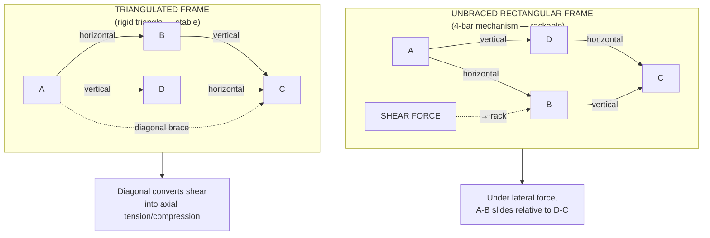

# Lesson 1: Mechanical Fundamentals

## 1. First-Principles Intuition & Invariants

Lego Technic is, at its core, a precision mechanical system masquerading as a toy. The parts are injection-molded in ABS to tolerances tighter than 0.01 mm, and the entire system's expressive power rests on a single geometric invariant: the **1.6 mm stud pitch**. Every beam hole, axle channel, connector socket, and pin bore in the Technic universe is derived from this fundamental unit. The standard hole-to-hole spacing on a Technic beam is 8 mm — five stud pitches — and that number propagates through every gear mesh, every structural frame, and every suspension pickup point in the system. Before you pick up a single beam, you must internalize this: Technic is not a loose, approximate construction system. It is a discrete lattice. Every connection either falls on the lattice or it fights it.

The practical consequence of this is that structural integrity in Technic is not primarily a materials problem; it is a *geometry problem*. ABS is a relatively compliant polymer with a tensile strength of roughly 40 MPa and a Young's modulus around 2.3 GPa, which means the plastic itself will flex before it fractures under ordinary loading. What actually fails in a Technic build is never the material in bulk — it is the connection geometry. A single pin in a single beam hole under a moment load acts as a lever fulcrum, prying the pin sideways against the bore wall and generating a bending moment in the beam that it was never designed to carry. This is the foundational failure mode from which all advanced structural reasoning in Technic flows: **point loads at single-pin connections translate directly into bending moments, which the system resists poorly in isolation and well only through triangulation.**

The taxonomy of connection elements is worth understanding precisely before optimizing anything. Technic **beams** are the primary structural members. They come in two families: studded bricks (the original Technic brick with side holes, now mostly legacy) and the modern **liftarm** — a flat, studless beam with a constant cross-section and uniform hole spacing. Liftarms are the preferred structural element for all advanced work because they are dimensionally predictable, they can be oriented in any plane, and they carry no vestigial stud geometry that creates offset complications. Liftarms come in straight and bent (angled) variants, with standard bend angles of 90°, 135°, and several fixed-angle "elbow" forms at non-orthogonal angles that map onto the 3-4-5 and 5-12-13 Pythagorean families the system was designed around.

**Pins** are the primary fasteners and constitute perhaps the most consequential design decision in any Technic build. The system ships three distinct friction classes and two length classes that must be deliberately selected rather than interchanged carelessly. The full-length **blue friction pin** (part 43093) has a knurled shank that creates intentional interference with the beam bore, generating enough static friction to resist rotation under moderate load — typically used as a structural fastener where you do not want the connection to rotate. The **black smooth pin** (part 6558 and relatives) has a reduced-diameter shank with a smooth surface, allowing free rotation and serving as the axle analog for beam-to-beam pivots, robot joints, or any connection where relative motion is desired. The **tan friction pin** (a later introduction) sits at an intermediate friction level, originally introduced to reduce stress whitening on stressed connections in flagship sets. Understanding which pin belongs in which joint is not a stylistic preference; it is a load-path engineering decision. A smooth pin in a structural node will rack under vibration; a friction pin in a rotating joint will generate heat, chew at the bore, and add parasitic drag to your drivetrain.

**Axles** are the system's rotational transmission elements, cross-shaped in section to prevent slip in the bore, available in odd and even stud-unit lengths from 2 to 32 (and beyond with extension joints). The cross-shaped section is a clever geometric choice: it provides four flat faces for torque transfer while maintaining a nearly circular outer envelope that fits standard beam holes and bush bores. Axle flex under torsion is a real and significant failure mode in longer spans. An unsupported 10-stud axle transmitting torque from an XL motor will visibly deflect under load, generating vibration, heat at the bush interface, and eventual fatigue whitening at stress concentrations near connectors. The mitigation is straightforward but must be executed deliberately: support every axle at a maximum of 4–5 stud intervals with **bushes** (smooth half-bush or full bush), and wherever possible route torque through short axle segments connected by **3L and 2L connector bushes** rather than single long spans.

The final class of primary elements is **connectors and cross-blocks**, which are the nodes that allow force paths to change direction without introducing a free pivot. A **cross-block** (3-hole right-angle connector, e.g., part 32184) constrains an axle perpendicular to a beam hole, translating the lattice from one plane to another with zero rotational freedom. These are the elements that allow you to build in three dimensions rather than extruding a flat plane. When you design a chassis frame, the cross-blocks at the corners are the nodes that tie the floor plane to the vertical side rails, and they must be treated with the same respect as a weld node in a metal spaceframe — the moment path runs directly through them.

---

## 2. Core Architecture & Mechanics

The spatial architecture of a Technic build lives on a **three-dimensional integer lattice** with 8 mm pitch in the X and Y axes (beam-hole spacing) and a vertical pitch that depends on whether you are working with beams or plates. For pure liftarm construction, the relevant vertical grid is simply multiples of the liftarm thickness (3.2 mm, equivalent to 2 plate heights), though in practice most structural Technic work orients liftarms horizontally and uses the 8 mm hole pitch as the universal constraint in all axes.

The critical geometric invariant for frame construction is the **right triangle rule**. Because the hole pitch is uniform at 8 mm, any two beam lengths $a$ and $b$ can form a rigid triangulated frame only if their diagonal $c$ satisfies $c = 8\sqrt{a^2 + b^2}$ mm — but more practically, $c$ must correspond to an integer number of holes. The two triangles that occur naturally within the system are:

- **3-4-5 triangle:** 3-hole, 4-hole, and 5-hole liftarms (24 mm, 32 mm, 40 mm sides). This is the workhorse of compact gusset triangulation and suspension geometry.
- **5-12-13 triangle:** 5-hole (40 mm), 12-hole (96 mm), and 13-hole (104 mm) liftarms. This is the geometry of large frame diagonals, roof structures, and long-travel suspension links.

When you use these triangles to brace a rectangular frame, the diagonal liftarm converts what would otherwise be a four-bar parallelogram mechanism — which racks freely under shear — into a rigid triangle that can only deform by stretching or compressing its members, something the ABS cannot do at any practical load level. This is not abstract structural theory; it is the difference between a chassis that handles motor reaction torque without flexing and one that twists visibly when you apply power.

The force-path diagram below illustrates the difference between an unbraced rectangular frame and a triangulated one:

**Pin connection mechanics** deserve a more granular treatment because they govern both structural behavior and mechanical efficiency. When a friction pin joins two liftarms at a single hole, the connection has one remaining degree of freedom: rotation about the pin axis. Under a bending moment — say, the weight of a motor cantilevered off the end of a 7-hole liftarm — the moment $M = F \cdot d$ is reacted at the pin as a couple. Because the pin diameter is 4.9 mm and the bore is 5.0 mm, the clearance is roughly 0.05–0.1 mm. Under moment loading, the pin contacts the bore on two diagonally opposite lines, and the contact stress concentrates at those lines. This is acceptable for static loads but explains why cantilevered single-pin connections develop visible bore elongation over time under repeated dynamic loading — the plastic at the contact lines undergoes creep and stress whitening.

The mitigation architecture is to always **double-pin critical nodes**. Two friction pins spaced even one hole apart convert a single-point moment connection into a two-force couple, distributing the bending load across two contact lines separated by 8 mm. The moment arm between pins carries the bending as shear through the liftarm cross-section rather than as concentrated contact stress at a single bore. In practice, every motor mount, every suspension pickup, and every load-bearing angle joint in a serious build should be double-pinned as a minimum.

**Axle system architecture** follows a parallel logic. The functional model for a Technic drivetrain is a series of short axle segments, each supported at both ends by bushes or beam bores, transmitting torque through interlocking cross-connectors and gearsets. The axle cross-section has a moment of inertia $I = \frac{\pi d^4}{64}$ modified by the cross-shaped cutaway; in practice, the effective torsional stiffness of a Technic axle is dominated by the material's shear modulus (~800 MPa for ABS) and the fourth power of the effective radius (~2.5 mm for a standard axle). A 4-stud axle segment has negligible torsional deflection under typical Power Functions loads; a 12-stud unsupported span will exhibit measurable angular lag under the full stall torque of an L-motor (~0.4 N·m). The design rule is accordingly simple: segment long transmission paths with cross-connectors and gearsets, treating each supported segment as a short, stiff shaft rather than allowing a single long shaft to span the full transmission distance.

The table below summarizes the primary element classes, their mechanical roles, and their critical tolerance parameters:

| Element | Primary Role | Bore/Shank Diameter | Friction Class | Key Failure Mode |
|---|---|---|---|---|
| Blue Friction Pin (43093) | Structural fastener | 4.9 mm shank / 5.0 mm bore | High (~0.3 N·m rotation) | Bore elongation under cyclic moment |
| Black Smooth Pin (6558) | Rotating pivot | 4.8 mm shank / 5.0 mm bore | Low (< 0.05 N·m rotation) | Rack/slop under bending |
| Tan Friction Pin | Low-stress structural | 4.9 mm / 5.0 mm bore | Medium | Stress whitening reduced vs. blue |
| Standard Axle | Torque transmission | Cross-section ~5 mm OD | N/A (keyed) | Torsional flex on long unsupported spans |
| Full Bush | Axle lateral retention | 5.0 mm bore / 8 mm OD | Low slip | Axial creep if not retained by collar |
| Cross-Block (32184) | Plane-change node | Dual bore (axle + pin) | N/A | Beam fracture at bore under high moment |

---

## 3. High-Performance Optimization & Failure Modes

The gap between a functional Technic build and a high-performance one is almost entirely a gap in structural discipline. The most experienced Technic engineers develop an almost reflexive practice of **triangulating every rectangular opening** in a frame and **supporting every axle at minimum two points**. These two rules alone eliminate the majority of field failures, but advanced work demands a more systematic approach to load path analysis and failure prediction.

**Chassis torsional rigidity** is the single most important property for any wheeled or legged mechanism. A torsionally soft chassis allows the front and rear axle planes to twist relative to each other under cornering or terrain inputs, which introduces unpredictable geometry changes in the steering and suspension linkages. The correct approach is to close the chassis into a **space frame** — a three-dimensional network of triangulated panels — rather than building a flat ladder frame and expecting it to resist torsion through material stiffness alone. In practice, this means adding diagonal liftarms in the floor plane (using the 3-4-5 or 5-12-13 geometries), adding vertical diagonal braces between the floor rails and the top rail, and ensuring that all four body corners are connected to at least two independent triangular load paths. A chassis built this way will feel dramatically more rigid under hand-twist testing before any motors or mechanisms are installed — which is exactly the right time to discover a compliance problem.

**Friction management in drivetrains** is a discipline that separates smooth-running mechanisms from sluggish ones. Every friction pin used as a pivot, every under-supported axle bearing against a beam hole, every mis-aligned gear mesh adds parasitic drag that robs the drivetrain of torque and heats the plastic. The diagnostic workflow is straightforward: build the drivetrain without its load (no wheels, no arms), power it from the lightest available motor, and observe back-EMF by spinning the output by hand. A well-built drivetrain will coast noticeably when you remove power; a friction-laden one will stop almost immediately. Isolate drag sources by disconnecting stages serially until the coasting behavior improves, then inspect the disconnected stage for mis-alignment, over-constrained axles, or accidental friction pins in pivot positions.

Gear mesh alignment warrants particular attention. Technic gears are designed to mesh correctly when their axle centers are separated by an integer number of beam holes (8 mm pitch), but the actual mesh quality depends on the **axle being centered precisely in the beam bore**. Any lateral flex in the supporting beams allows the axle to shift off-center, reducing the contact ratio and increasing noise and wear. The mitigation is to support gear-carrying axles in **double-beam sandwiches** — two parallel liftarms on either side of the gear, with the axle running through aligned holes in both. This constrains the axle in two planes and prevents the deflection that would otherwise allow the gear to walk off its mesh line.

**Stress whitening** is the primary visual diagnostic for overloaded connections in ABS Technic parts. When a pin bore or beam section is loaded beyond the material's yield point in bending, the ABS undergoes localized crazing — a microscopic voiding of the polymer matrix that scatters light and appears as a whitening or haziness around the loaded area. Stress whitening does not indicate imminent fracture, but it does indicate that the applied load exceeds the design intent and that fatigue cracking will follow with continued cycling. When you observe whitening at a pin bore, the correct response is to redesign the connection geometry: add a second pin, shorten the cantilever, add a triangulating brace that offloads the moment, or move the load-bearing function to a cross-block that distributes stress over a larger section. Applying more pins to the same connection without changing the geometry simply masks the symptom without addressing the moment that is causing it.

**Axle retention** is a failure mode that strikes during dynamic operation and is easy to prevent with correct practice. Axles can migrate axially under the vibration and thrust forces generated by gear meshes and motor outputs. The solution is systematic: every axle end that is not terminated by a gear, hub, or cross-connector must be retained with a **half bush or full bush** locked against a beam face. Do not rely on the cross-connector alone to prevent axial migration; add a bush collar as a positive stop on the face of the supporting beam. In high-load drivetrains under rapid direction reversal — as in a combat robot or a high-speed RC chassis — also use **axle joiners** at mid-span to prevent the axle from rotating through its bore under impulsive loads.

The highest-order optimization in complex Technic mechanisms is what experienced builders call **pre-loading the structure for assembly tolerance**. Because the lattice is discrete, there are configurations where the theoretical geometry of a linkage is geometrically correct but the physical assembly introduces a slight angular error due to pin-in-bore clearances accumulating across multiple connections. In a suspension linkage with four pivot points, four pin clearances of 0.05 mm each can produce an effective angular slop at the wheel spindle of 0.3–0.5°, which translates to measurable steering wander in a large model. The mitigation is to use **friction pins at suspension pickup points** rather than smooth pins, accepting a small but deliberate static friction that prevents the clearances from accumulating into visible slop. The penalty is a slight increase in suspension stiction; the benefit is a suspension geometry that behaves as designed rather than as a loose approximation of it. For builders working at the highest level of fidelity — replica vehicles, competition-class robots, automated machinery — this tradeoff is always worth making.

A final word on the tolerance system itself: Lego's manufacturing tolerances are not uniform across part age and production era. Parts produced before approximately 2000 exhibit slightly looser bore tolerances than current production, and mixing eras in a single assembly can introduce unexpected compliance at specific nodes. If you are building with mixed-vintage parts and encounter persistent alignment problems in a gear train or linkage that your geometry confirms should be correct, era-sorting the parts at the critical nodes — using only current-production parts for bearings and high-tolerance pivots — will often resolve the problem without any structural redesign.
