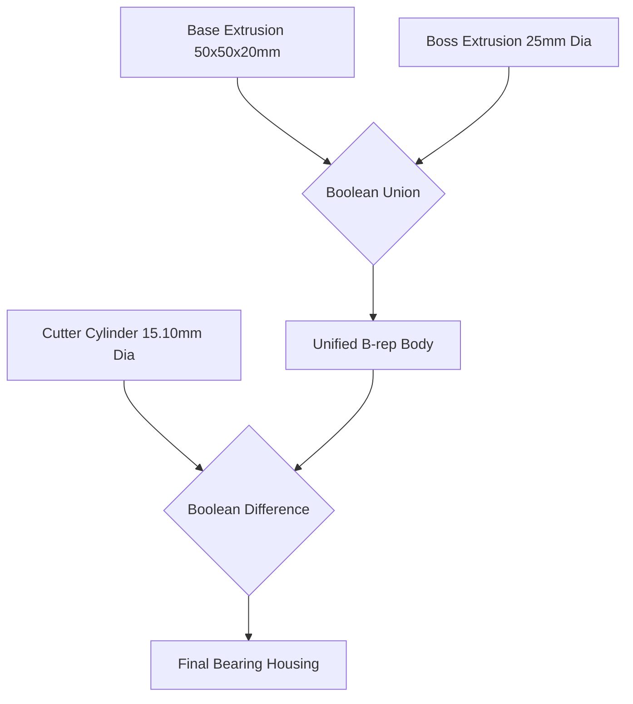

# Lesson 2: Solid Modeling Paradigms

## 1. First-Principles Intuition & Invariants

To manipulate digital matter with the same confidence as a machinist cutting aluminum, you must understand how the computer perceives volume. A digital solid is not merely a collection of surfaces; it is a topologically rigorous mathematical construct that knows definitively what is inside and what is outside. This distinction separates true solid modeling from surface modeling, the latter of which creates hollow shells that confuse 3D printing slicers and CAM toolpath generators. At the heart of modern parametric CAD systems like Fusion 360 and FreeCAD lie two distinct but interoperating mathematical paradigms: Constructive Solid Geometry (CSG) and Boundary Representation (B-rep).

Constructive Solid Geometry approaches volume the way a foundry worker approaches castings. You begin with primitive, fully defined solids like cubes, cylinders, and spheres, and you combine them using Boolean operations. The logic is purely set-theoretic. A union fuses two volumes into one. A difference subtracts the overlapping volume of one solid from another. An intersection retains only the overlapping volume, discarding everything else. CSG is conceptually elegant and computationally robust because the math only needs to evaluate the boundaries where volumes overlap, never worrying about the complex curves of arbitrary intersections. However, CSG is rigid. If you need a fillet on a sharp edge or a hole drilled at an angle, you cannot express that as a simple union of primitives.

Boundary Representation, conversely, defines a solid by its skin. A B-rep model is a complete description of the faces, edges, and vertices that encapsulate a volume. The fundamental invariant of B-rep is the Euler-Poincaré formula, $V - E + F = 2(S - H)$, where $V$ is vertices, $E$ is edges, $F$ is faces, $S$ is shells, and $H$ is holes. This topological constraint ensures the resulting geometry is a manifold. Manifold geometry dictates that every edge must be shared by exactly two faces, and the volume is completely watertight. When you create a complex organic shape, like an ergonomic drone canopy, the CAD engine evaluates the underlying mathematical surfaces (NURBS or B-splines), trims them against intersecting curves, and stitches the resulting faces into a closed solid. 

The true power of modern parametric CAD lies in the synthesis of these two paradigms. When you sketch a profile and extrude it, the software creates a B-rep solid. When you subsequently drill a hole through that solid, the software does not merely update a mesh; it casts a cylinder B-rep and performs a Boolean difference. The CAD engine tracks the intersection curves between the block and the cylinder, splits the faces of the block along those curves, discards the internal geometry, and re-stitches the topology. Understanding this underlying mechanism transforms how you build models, shifting your focus from drawing shapes to engineering a stable, modifiable topological history.

## 2. Core Architecture & Mechanics

When you execute a Boolean operation in a parametric environment, the software executes a highly structured sequence of topological splitting and stitching. Consider the practical task of modeling a bearing housing for a 2207 brushless FPV drone motor. You start with a 50x50x20 millimeter aluminum block, which you extrude as a base B-rep solid. Next, you add a 25-millimeter diameter cylindrical boss on the top face to house the bearing. The CAD engine treats this as a Boolean union. It calculates the intersection curves where the cylinder pierces the top face of the block, splits the top face along those curves, identifies the internal volume of the cylinder that overlaps the block, discards the redundant geometry, and stitches the outer faces of the cylinder to the modified faces of the block. The resulting solid shares a continuous topological boundary.

The workflow continues as you subtract a 15-millimeter bore through the center of the boss to seat the bearing. The engine applies a Boolean difference. It projects a cylinder through the boss, calculates the intersection curves on the top cylindrical face and the bottom flat face, and splits those faces. The internal volume of the cutter is removed from the target solid. At this point, the model represents a valid B-rep. The hole is physically accurate, the volume is mathematically continuous, and the topological graph satisfies the Euler-Poincaré invariant.

The parametric history tree captures this entire sequence as a CSG graph, executing the operations sequentially whenever a dimension changes. 

To achieve the correct physical fit for a press-fit bearing, you must apply precise dimensional tolerances to these Boolean operations. A standard 15-millimeter bearing has an outer race tolerance typically around -0.000 to -0.005 millimeters. If you are designing for Fused Deposition Modeling (FDM) 3D printing, a nominal 15.00-millimeter cut will result in an undersized hole due to polymer shrinkage and slicer arc interpolation. You must set the diameter of your Boolean cutter to 15.20 millimeters to achieve a functional slip fit, or 14.95 millimeters for a press fit requiring localized heating. In CNC milling, where spindle deflection and tool runout are non-zero, you might use a 15.05-millimeter cutter diameter to leave a precise 0.025-millimeter press fit interference. These parameters are driven directly into the CSG tree, forcing the B-rep engine to recalculate the intersection curves upon update.

## 3. High-Performance Optimization & Failure Modes

The most common point of failure in CAD modeling is the Boolean operation failing to generate a valid B-rep, resulting in a "bad geometry" error. This failure usually stems from non-manifold conditions or tangential intersections. If you attempt to subtract a cylinder from a block, and the cylinder radius is exactly the width of the block, the intersection curve becomes tangent to the block's edge. The CAD engine struggles to determine which volume belongs to the cut and which belongs to the target, often failing to split the faces cleanly. The resulting topology violates the B-rep invariants, leaving an open edge or a zero-thickness face. 

To prevent this, adopt the "slop and cut" workflow. Never align cutter boundaries perfectly with existing model faces. If you need a slot cut exactly to the edge of a part, extend the cutter profile 0.1 millimeters past the boundary. This ensures the intersection curves pierce the faces cleanly, guaranteeing a robust topological split. The CAM software will follow the actual edges of the solid, so the slight over-extension in the CAD geometry has no physical consequence during machining or printing.

Another frequent failure mode occurs when sketch profiles self-intersect during an extrude or revolve operation. If a sketch contains a line that doubles back on itself, the CAD engine cannot establish a closed loop, preventing the generation of a valid face. Always use the sketch doctor or sketch validation tools to detect open contours and self-intersecting curves before attempting to generate solid features. 

Finally, consider the downstream export to tessellated formats like STL for 3D printing. The CAD engine takes the continuous mathematical surfaces of the B-rep and approximates them with triangles. If the model contains non-manifold edges—perhaps from a poorly executed Boolean union where three faces meet at a single edge—the tessellation will fail. The slicer will report missing faces or inverted normals. Before exporting, verify the model's physical properties. If the CAD software reports a volume calculation, the B-rep is sound. If the mass properties calculation fails or returns zero, the topology is broken. Repair the parametric history rather than attempting to patch the exported mesh, ensuring the master model remains the single source of truth for your fabrication workflow.
