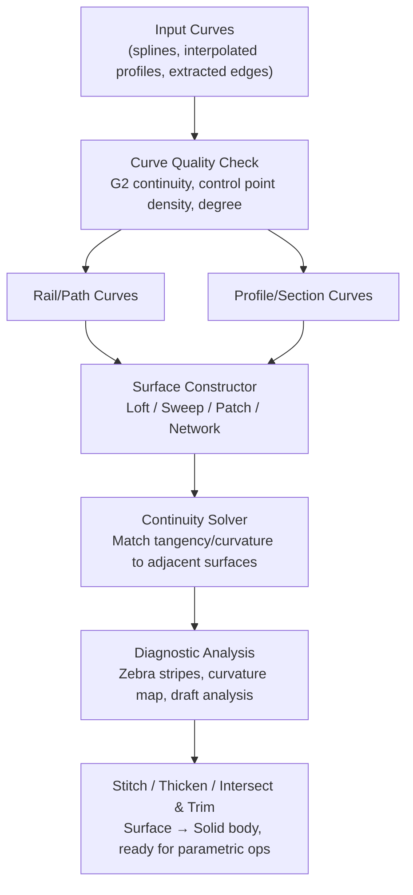

# Lesson 4: Surface Modeling Workflows

## 1. First-Principles Intuition & Invariants

There is a fundamental tension at the heart of 3D CAD that every maker eventually confronts: the geometry of the natural world is not made of extrusions and revolves. A human hand, a turbine shroud, a custom motorcycle fairing, a speaker enclosure designed for acoustic dispersion — these forms arise from curves that transition through space in ways that no collection of Boolean primitives can honestly describe. Parametric solid modeling, the workhorse of mechanical design, excels at prismatic geometry with well-defined dimensional intent. But the moment a designer needs a surface that *flows* — that feels aerodynamically inevitable, or ergonomically right, or simply alive — the extrude-cut-fillet paradigm reaches its limits. Surface modeling, and specifically NURBS-based surface modeling, exists to close that gap.

NURBS stands for Non-Uniform Rational B-Splines, and understanding what each word in that acronym actually means is the first step toward using the tools with real authority rather than mechanical imitation. A *B-spline* (basis spline) is a piecewise polynomial curve constructed from a set of control points and a knot vector. Unlike a simple Bézier curve, which is defined globally by all its control points simultaneously, a B-spline achieves *local control*: moving one control point influences only the neighboring span of the curve, not the entire shape. This property is not a mathematical nicety — it is the entire reason surface modeling is tractable. A designer can pull a highlight on the shoulder of a form without inadvertently disturbing the curvature at the door-panel crease three spans away. *Non-uniform* means the knot vector is not evenly spaced, which allows the curve to be parameterized with varying density: more control resolution where the form is complex, less where it is simple. *Rational* introduces a homogeneous weight coordinate for each control point, making it possible to represent conic sections — circles, ellipses, parabolas — exactly rather than as approximations. Without the rational component, a B-spline can only approximate a circle; with it, the circle is mathematically exact. That matters when a surface must mate with a machined cylindrical bore.

The control polygon — the connected mesh of control points surrounding a NURBS surface — is the designer's primary handle on the geometry, and learning to read it is as important as learning to read the surface itself. Control points do not lie on the surface; they float above or below it in a weighted field, and the surface is attracted toward them according to the blending functions. A regular, evenly distributed control polygon with minimal point clustering produces smooth, predictable surfaces. A control polygon with crowded, misaligned, or redundant points is a symptom of degenerate geometry that will cause downstream problems in toolpath generation, rendering, and fabrication. The invariant that experienced surface modelers internalize early: *the quality of the control polygon determines the quality of the surface*. If the polygon is a tangle, no amount of downstream refinement will produce a clean highlight.

Spline interpolation sits adjacent to but distinct from NURBS control-point definition. When a designer constructs a curve through a set of measured data points — the cross-sectional profile of a scanned object, the contour of a template, a series of coordinate measurements from a CMM — the system uses interpolation to find a NURBS curve that passes exactly through those points. The result is a curve whose control points are automatically positioned by the solver. Interpolated curves carry a subtle danger: they can produce undesirable inflections between data points when the input data is irregular or noisy, and the automatically computed control polygon is often far more complex than necessary. The professional workflow is to treat interpolated curves as a starting reference, then rebuild them with minimal, deliberately placed control points before using them as rails or profiles in a surface construction operation.

Surface continuity is perhaps the most consequential concept in this domain, and it is where makers without a formal industrial design background most often produce work that looks technically adequate but physically wrong. Continuity is described in terms of G-levels, where G stands for *geometric continuity*. G0 continuity means two surfaces share a common edge — they touch, but they may meet at a crease like a folded piece of paper. G1 continuity adds the constraint that the tangent direction at the boundary is identical across both surfaces: the crease is gone, the surfaces appear to blend, but a close examination under raking light will reveal a highlight that kinks at the boundary. G2 continuity goes further, requiring that the *rate of change of curvature* — the curvature radius — is matched at the boundary, which means the highlight flows across the junction with no perceptible acceleration or deceleration. This is the minimum standard for Class-A automotive surfacing and for any organic form where a smooth, uninterrupted reflection is functional or aesthetic criteria. G3 continuity matches the derivative of curvature itself and is used in the most demanding optical and aerodynamic applications. For makers building custom enclosures, ergonomic grips, or aesthetic components, G2 is the practical target. Understanding the difference experientially is best achieved by building a simple four-surface patch, achieving only G0, then G1, then G2 continuity at each junction, and evaluating each result with a Zebra stripe analysis — the analytical tool that makes continuity failures visible in a way that shaded display never does.

---

## 2. Core Architecture & Mechanics

The internal architecture of a NURBS surface in Fusion 360 or similar parametric surface modelers is best understood as a two-dimensional tensor-product grid of B-spline curves. Where a single NURBS curve is parameterized along one dimension *u*, a NURBS surface is parameterized along two dimensions *u* and *v*. Each row of control points defines a curve in the *u* direction; each column defines a curve in the *v* direction. The surface itself is computed at any point by evaluating both sets of basis functions simultaneously. This tensor-product structure has a critical geometric implication: an *m × n* control point net produces a surface whose degrees are independent in each direction, and adding detail in one direction requires adding a full row or column of control points across the entire surface — there is no local subdivision without introducing a knot or splitting the surface. This is the fundamental structural difference between NURBS surfaces and subdivision surfaces (SubD), which Fusion 360 introduced as a complementary modeling mode. NURBS give exact, algebraically clean geometry suitable for direct manufacturing; SubD gives freely sculpted organic forms that must be converted to NURBS for precision downstream use.

The following diagram illustrates how surface construction operations chain together from input curves through the surface kernel to the final solid body:

Each stage in this chain has its own mechanics worth dissecting in detail.

**Loft construction** is the most versatile surface operation: given two or more profile curves and optionally one or two rail curves, the lofter interpolates a surface that passes through or near the profiles. The quality of the result is dominated by the alignment of profile curve start points (misaligned start points introduce a twist in the surface isoparameters), the degree of the profiles (degree-3 splines give smooth lofts; degree-1 polylines give faceted approximations), and whether a "tangent" or "curvature" condition is applied at the first and last profile. In Fusion 360, the Loft dialog's "Tangent" and "Smooth (G2)" rail conditions apply continuity constraints to the boundary isoparametric curves. If the loft starts from an edge of an existing surface and G2 is selected, the solver attempts to match curvature across that boundary — but only if the input profile curve at that edge carries the appropriate tangent information from the adjacent surface. This is why extracting edge curves directly from existing geometry, rather than sketching new ones, is the professional workflow for multi-patch surfacing: the extracted curve inherits the parent surface's tangent frame, giving the continuity solver the information it needs.

**Sweep operations** differ from lofts in that the profile cross-section traverses a single path rather than interpolating between multiple profiles. The critical variable is how the profile orients itself relative to the path: Fusion 360 offers "perpendicular to path" and "parallel to original" orientation modes. For twisted or deeply curved rails, perpendicular orientation can cause the profile to roll unintuitively. The practitioner's response is to add a guide rail — a second curve that constrains the profile's rotational attitude along the path, giving independent control of both the path and the twist. A swept surface representing a compound-curved surfboard rail, for instance, needs both a longitudinal path along the board's edge and a guide rail along the deck rocker line to prevent the profile from rotating through the bottom of the board as it rounds the nose.

**Network surface patching** is the highest-precision single-surface tool in the workflow. It accepts a grid of four boundary curves and optionally interior cross curves, then fits a single NURBS surface that satisfies specified continuity conditions at every boundary. The constraint: the four boundary curves must form a closed loop with consistent parameterization and no gaps. Even a gap of 0.001 mm at a corner will cause the solver to fail or produce a degenerate patch. Building the boundary network before invoking the patch command — stitching the four curves together into a continuous loop, verifying endpoints coincide within tolerance — is the mechanical prerequisite that beginners skip and then spend hours debugging.

Fusion 360's Form environment uses T-Splines, a proprietary extension of SubD technology that allows local refinement (adding a crease or a T-junction in the control cage without propagating a full row of edges across the surface). The conversion from Form geometry (T-Splines) to NURBS happens automatically when the user finishes the form, but the resulting NURBS surface may have higher degree, more control points, and denser isoparameter lines than a manually constructed NURBS patch would. For manufacturing output — 3D printing, CNC toolpaths, injection mold cavity design — this is generally acceptable. For surfaces that must achieve true G2 continuity with other NURBS geometry, the converted T-Spline surface often needs manual continuity matching after conversion, using the Match or Patch tools in the Surface workspace.

---

## 3. High-Performance Optimization & Failure Modes

The most reliable optimization in surface modeling is one that happens before any surface command is invoked: *build the fewest control points necessary to describe the intended shape*. This principle, sometimes called degree reduction or curve simplification, runs counter to the instinct of modelers who reach for more control points whenever a surface refuses to match their intent. Additional control points never improve surface quality; they increase local variation opportunities and make the control polygon harder to reason about. A skilled modeler builds a conic rail with five control points and a degree-5 spline or three control points and a rational degree-2 conic, not a degree-3 spline with ten approximating points. The diagnostic is the curvature comb: a clean profile curve's curvature comb shows smooth, monotonically varying spines without inflections or reversals except where the design intent genuinely requires them.

Continuity failures are the most common class of surface modeling errors, and they manifest in several distinct patterns. A G0 failure — a gap at a surface boundary — appears as a visible edge or hole in the shaded model and will cause downstream Stitch operations to fail. The fix is to use Merge, Join, or Match Surface with a position constraint. A G1 failure — matching position but not tangent — appears in Zebra analysis as a stripe that kinks sharply at the boundary rather than flowing continuously across it. The fix is to apply a tangent match condition to the boundary edge, constraining the surface's first isoderivative to align with the adjacent surface's tangent plane at every point along the shared edge. A G2 failure — matching position and tangent but not curvature — is subtler and appears in Zebra analysis as a stripe that makes a smooth but detectable change in speed as it crosses the boundary. The analytical tool for diagnosing G2 failures is the curvature map (Inspect → Curvature Map in Fusion 360), which colors the surface by Gaussian or mean curvature: a G2 failure shows as a discontinuous color band at the boundary edge.

Degenerate surface poles are a persistent failure mode in surfaces constructed by lofting to a point, sweeping to a termination, or patching a triangular region. When a surface's isoparameter lines converge to a single point — a pole — curvature becomes geometrically undefined at that point, the NURBS evaluator produces a singularity, and downstream operations like offset, shell, and toolpath projection fail unpredictably. The professional mitigation is to never loft to a point directly. Instead, loft to a small, near-zero-radius edge, or construct a triangular patch region using a three-sided patch operation (which distributes the singularity more gracefully across the degenerate edge). Fusion 360's Form environment handles poles more gracefully than the NURBS Surface workspace because T-Splines allow true n-sided poles in the control cage; this is one practical reason to block out complex organic terminations in Form mode and then match to adjacent NURBS geometry afterward.

Multi-patch surface quality degrades badly when boundary curves are over-constrained from both sides. A common scenario: a designer builds two adjacent surface patches and applies a G2 curvature match condition to both patches at their shared edge. The two curvature-matching constraints compete, and the solver either over-stiffens both surfaces (producing flat, lifeless forms with no dynamic curvature variation) or fails to converge entirely. The correct approach is to designate one surface as the *master* and the other as the *slave*: the master surface is built first to its final curvature intent, and the slave surface applies a one-directional G2 match condition to the master's edge. The master's curvature profile is never modified in response to the slave — it is treated as a fixed reference. This asymmetric constraint strategy is how every professional surfacing workflow, from Class-A automotive panels to custom consumer electronics enclosures, maintains surface quality across complex multi-patch assemblies.

Tolerance management is a workflow-level discipline that must be established before the first surface is built. Fusion 360 operates at a default tolerance of 0.001 mm, but the system tolerance and the working tolerance are different things. When surface edges are stitched, Fusion uses the system tolerance to determine whether two endpoints are "coincident enough" to close. If the design is built with millimeter-scale thinking and the tolerance is left at the default, most surfaces stitch cleanly. If the design is built from imported geometry or translated NURBS data from another application (Rhino to Fusion via IGES or STEP), the translation may introduce small gaps or tangent mismatches at boundary edges that exceed the stitch tolerance. The diagnostic workflow is: import the geometry, immediately run Inspect → Interference and examine the edge list for open or mismatched boundaries, manually repair gaps using the Repair Body command or by rebuilding affected boundary curves, and then proceed with surface construction. Attempting to build new surfaces on top of unrepaired imported geometry is the primary source of hours-long debugging sessions that could have been avoided in ten minutes of initial inspection.

Performance in complex surface assemblies — defined here as models with more than thirty individual surface patches, complex swept guide rails, or Form-to-NURBS conversions of heavily subdivided T-Spline cages — degrades in Fusion 360 because the parametric timeline recomputes every dependent feature when any parent changes. The mitigation is to work in well-defined stages: build the primary surface patches and convert them to a Solid Base Feature at a stable checkpoint, then build secondary and tertiary surfaces on top of that base. The base feature breaks the parametric chain, which loses full history editability for the upstream surfaces but dramatically reduces recomputation overhead. For makers building one-off or limited-run parts where the design is substantially finalized before surface refinement begins, this is a worthwhile trade. For parametric designs where fundamental dimensions are still subject to change, maintain the full history and accept the recomputation cost, structuring the timeline so that the most expensive surface operations sit at the end of the dependency chain rather than in the middle.

The final, highest-leverage workflow optimization is analytical: use curvature analysis tools continuously throughout the modeling process, not only at the end for verification. Building a surface without watching the curvature comb is equivalent to machining without measuring. The curvature comb on a profile curve reveals inflections that will propagate into every surface constructed from that curve. The Zebra stripe analysis on a half-finished patch assembly reveals continuity failures while they are still cheap to fix, before eight additional surfaces have been built on top of a flawed foundation. Surface modeling rewards the practitioner who treats analysis as a first-class design activity — not a final quality check, but an ongoing feedback loop that shapes every construction decision.
