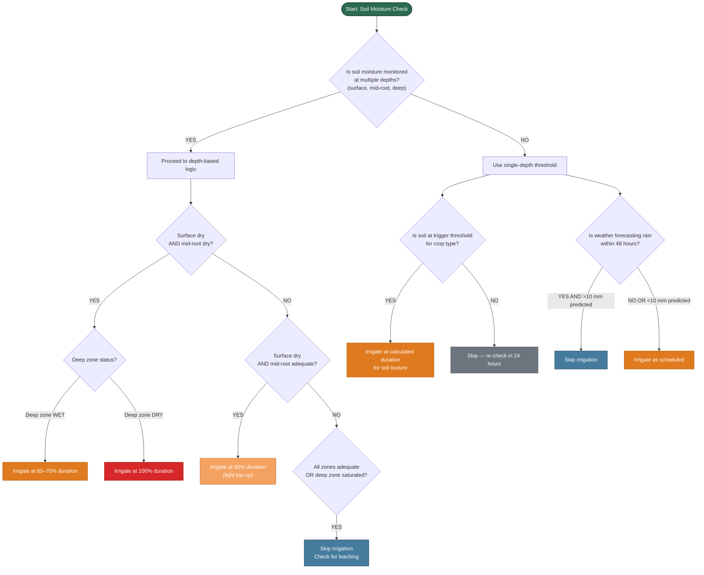
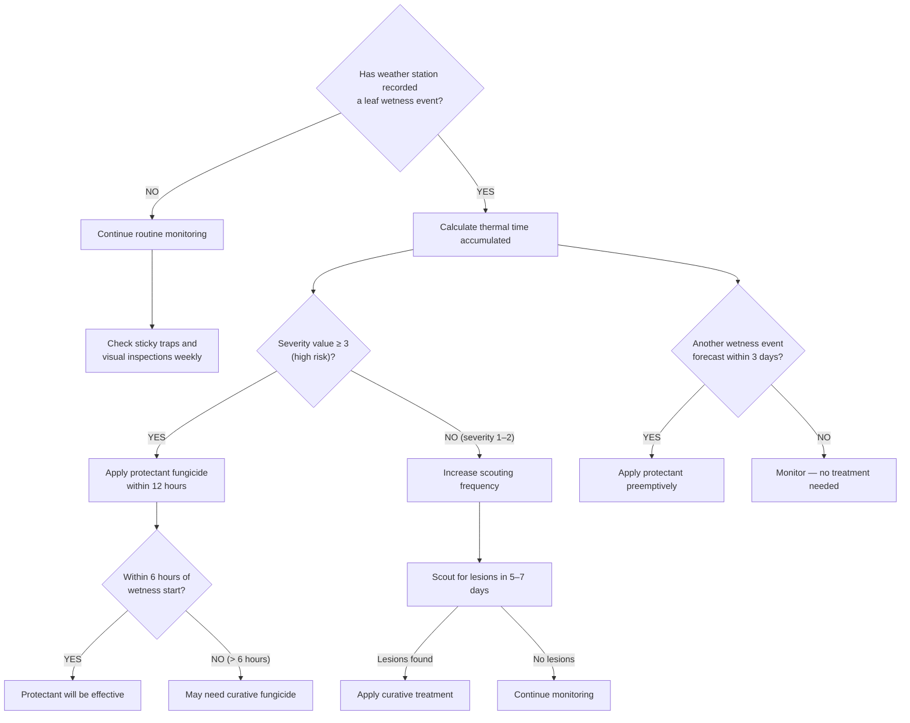
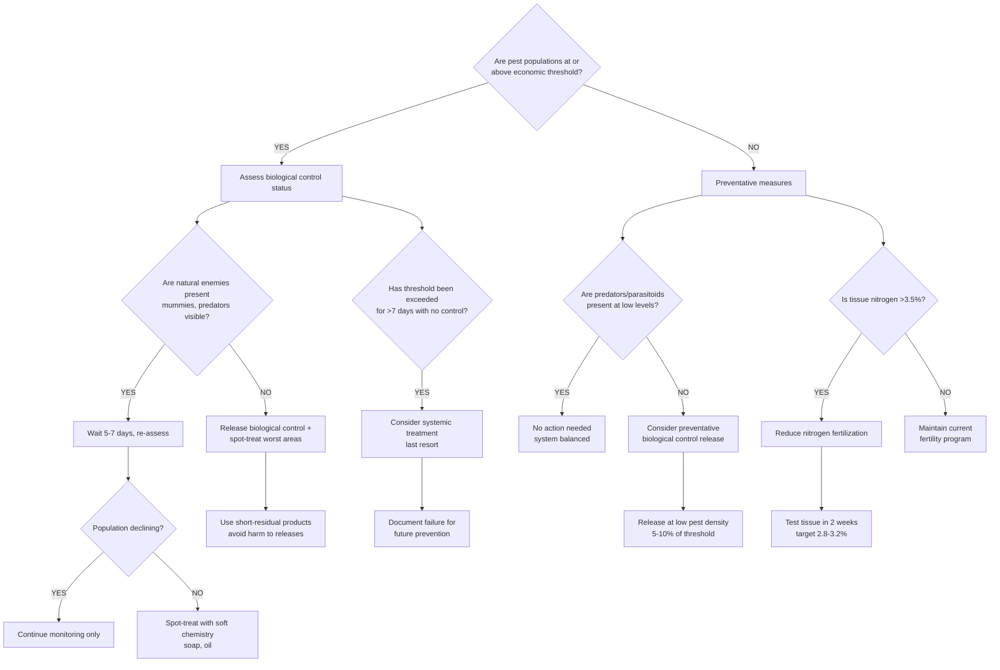

# Lesson 4: Water, Pest, and Disease Management Systems

## 1. First-Principles Intuition & Invariants

### 1.1 The Water-Energy-Pathogen Triangle

Plant health emerges from three coupled physical processes that cannot be optimized independently:

**Water transport** operates through negative pressure gradients. The cohesion-tension theory explains how water columns under tension (negative pressure of -0.5 to -3.0 MPa in typical garden plants) are pulled from roots to leaves through xylem vessels 20-500 μm in diameter. This tension is generated by evaporation at leaf stomata, creating a continuous water column held together by hydrogen bonding (cohesive forces ~0.1 MPa per meter of height).

The fundamental invariant: **Transpiration rate = (Vapor Pressure Deficit × Stomatal Conductance) / Boundary Layer Resistance**

Where vapor pressure deficit (VPD) is the difference between saturated and actual vapor pressure at leaf temperature. At 25°C and 50% relative humidity, VPD ≈ 1.6 kPa. Increasing VPD to 2.5 kPa (30% RH) increases transpiration demand by 56%, but only if soil water potential remains above the wilting point (-1.5 MPa for most crops).

**Pathogen establishment** follows the disease triangle: susceptible host + virulent pathogen + favorable environment. The critical physical parameter is **leaf wetness duration** (LWD), measured in hours of continuous free water on leaf surfaces. Most fungal pathogens require specific LWD thresholds:

- Powdery mildew: 0 hours (no free water needed, thrives in dry conditions)
- Early blight (Alternaria): 12-18 hours at 24-29°C
- Late blight (Phytophthora): 10-12 hours at 18-21°C
- Downy mildew: 6-8 hours at 15-20°C

The Mills Table for apple scab quantifies this relationship: 9 hours of wetness at 21°C equals one infection period, while 48 hours are required at 7°C. Temperature and wetness duration are interchangeable through a thermal time model.

**Pest population dynamics** follow exponential growth constrained by carrying capacity:

dN/dt = rN(1 - N/K)

Where N is population size, r is intrinsic rate of increase (0.1-0.4 per day for aphids, 0.05-0.15 for spider mites), and K is carrying capacity (limited by plant nitrogen availability and natural enemy pressure). The critical insight: pest populations double every 2-7 days under optimal conditions, but experience 50-90% mortality from natural enemies in balanced ecosystems.

### 1.2 Physical Constraints on Water Distribution

**Hydraulic conductivity** decreases exponentially as soil dries. In sandy loam, conductivity drops from 10⁻⁴ m/s at saturation to 10⁻⁹ m/s at -0.1 MPa, a 100,000-fold reduction. This creates a critical threshold: once soil water potential falls below -0.05 MPa, water movement to roots effectively stops unless roots grow into wetter zones.

The **water retention curve** defines plant-available water:

θ(ψ) = θr + (θs - θr) / [1 + (α|ψ|)ⁿ]^m

Where θ is volumetric water content, ψ is water potential (negative), θs is saturated content, θr is residual content, and α, n, m are soil-specific parameters. For a typical loam:
- Field capacity (-0.033 MPa): θ = 0.32
- Permanent wilting point (-1.5 MPa): θ = 0.15
- Available water = 0.17 (17% by volume)

In a root zone 30 cm deep, this provides 51 mm of available water. A tomato plant transpiring 5 mm/day depletes this reserve in 10 days, defining the maximum irrigation interval.

### 1.3 Thermodynamic Basis of Pathogen Control

**Relative humidity** at the leaf surface determines condensation:

RH_leaf = 100 × (P_actual / P_saturated(T_leaf))

When leaf temperature drops 2°C below air temperature (common at night due to radiative cooling), and air RH is 80%, leaf surface RH reaches 100%, causing dew formation. This explains why diseases are worse in dense plantings (reduced air movement, higher local humidity) and in low-lying areas (cold air drainage increases radiative cooling).

The **dew point depression** is the critical control parameter:

ΔT_dp = T_air - T_dewpoint

When ΔT_dp < 2°C, dew formation is likely. Increasing air movement by 1 m/s can increase ΔT_dp by 0.5-1°C, often preventing condensation entirely.

**Spore germination** requires both moisture and specific temperature ranges. The thermal time model:

DD = Σ(T - T_base) for T_base < T < T_optimum

Where DD is degree-days (thermal time units). Botrytis cinerea accumulates germination degree-days at base 5°C, requiring 20-30 DD for infection. A night at 15°C provides 10 DD; two consecutive nights enable infection if wetness persists.

### 1.4 The Nitrogen-Pest Feedback Loop

**Tissue nitrogen concentration** directly controls pest population growth. Aphids feeding on plants with 4.5% leaf nitrogen reproduce 3× faster than on plants with 2.5% nitrogen. This creates a positive feedback: nitrogen fertilization → increased tissue N → faster pest growth → more plant stress → compensatory regrowth with high N → accelerated pest growth.

The critical threshold for most vegetables is 3.5-4.0% total leaf nitrogen. Above this, pest pressure increases exponentially. Below 2.5%, growth becomes nitrogen-limited. The sweet spot for pest resistance is 2.8-3.2%, achieved through balanced fertilization and organic matter management.

**Silica deposition** in epidermal cells creates physical barriers (phytoliths) that reduce pest feeding efficiency by 20-40%. Grasses naturally accumulate 1-3% silica dry weight; other plants require silicon supplementation (potassium silicate at 50-100 ppm) to achieve protective levels.

## 2. Core Architecture & Mechanics

### 2.1 Irrigation System Design Principles

**Emitter selection** must match soil texture and root architecture:

For **sandy soils** (hydraulic conductivity 10⁻⁴ to 10⁻⁵ m/s):
- High flow rate emitters (2-4 L/h)
- Spacing: 30 cm on laterals, 60 cm between laterals
- Frequent, short applications (30-45 minutes, 2× daily in peak season)
- Wetted diameter: 30-40 cm
- Rationale: Water moves vertically in sand; wide spacing causes dry zones between emitters

For **clay loam** (hydraulic conductivity 10⁻⁶ to 10⁻⁷ m/s):
- Low flow rate emitters (0.5-1 L/h)
- Spacing: 60 cm on laterals, 90 cm between laterals
- Infrequent, long applications (2-4 hours, every 3-5 days)
- Wetted diameter: 60-90 cm
- Rationale: Lateral water movement in clay creates overlapping wetted zones

**Pressure compensation** is mandatory for slopes >2% or lateral runs >30 m. Uncompensated emitters exhibit flow variation:

Q = k√ΔP

A 10% pressure drop (from 100 kPa to 90 kPa) reduces flow by 5% in compensated emitters but 21% in non-compensated emitters. In a 50 m lateral, this creates 20% flow variation from start to end, causing drought stress at the far end.

**System capacity** calculation:

Required flow = (Area × Crop water use × 1.2) / (Irrigation efficiency × Operating hours)

For 100 m² of tomatoes using 6 mm/day, with drip efficiency 0.90, operating 8 hours/day:

Q = (100 × 0.006 × 1.2) / (0.90 × 8) = 0.10 m³/h = 100 L/h = 1.7 L/min

The 1.2 factor accounts for peak demand (15-20% above average) during fruit development.

### 2.2 Soil Moisture Monitoring Architecture

**Tensiometer placement** follows the 50-30-20 rule:
- 50% of sensors at primary root depth (15-30 cm for vegetables)
- 30% at maximum root depth (45-60 cm)
- 20% below root zone (60-90 cm) to detect leaching

Install sensors at 1/3 the distance from the plant to the midpoint between plants (the wetted zone edge). For plants spaced 60 cm apart with 40 cm diameter wetted zones, place sensors 20 cm from the plant center.

**Trigger thresholds** by crop type:

| Crop Type | Field Capacity | Trigger Point | MAD* | Critical Period |
|-----------|----------------|---------------|------|-----------------|
| Lettuce, greens | -10 kPa | -20 to -30 kPa | 40-50% | Head formation |
| Tomatoes, peppers | -10 kPa | -30 to -50 kPa | 50-60% | Flowering to fruit set |
| Cucurbits | -10 kPa | -25 to -40 kPa | 45-55% | Flowering, fruit sizing |
| Root crops | -10 kPa | -40 to -60 kPa | 55-65% | Root enlargement |
| Established trees | -10 kPa | -60 to -80 kPa | 60-70% | Fruit development |

*MAD = Management Allowed Depletion (percentage of available water)

**Interpretation algorithm**:

```
IF tension_15cm > trigger_threshold AND tension_45cm > 0.5 × trigger_threshold:
    Irrigate immediately (both zones depleted)
ELSE IF tension_15cm > trigger_threshold AND tension_45cm < 0.5 × trigger_threshold:
    Irrigate with 70% of normal duration (surface depletion only)
ELSE IF tension_15cm < trigger_threshold AND tension_90cm < -5 kPa:
    Skip irrigation, check for leaching (water moving below root zone)
ELSE IF tension_15cm < trigger_threshold AND rate_of_change > 10 kPa/day:
    Irrigate in 24 hours (rapid depletion trend)
```

### 2.3 Foliar Disease Suppression Systems

**Microclimate modification** hierarchy (listed by effectiveness):

1. **Plant spacing**: Increase from 45 cm to 60 cm → 30-40% reduction in LWD
   - Mechanism: Air movement increases from 0.2 m/s to 0.5 m/s, accelerating dew evaporation
   - Tradeoff: 25% reduction in yield per area (partially offset by reduced disease loss)

2. **Vertical trellising**: Reduce ground contact → 40-60% reduction in splash dispersal
   - Mechanism: Eliminates soil-to-plant spore transmission (Septoria, Phytophthora)
   - Implementation: Maintain 15-20 cm clearance between lowest leaves and soil/mulch

3. **Drip irrigation vs. overhead**: → 50-80% reduction in foliar disease incidence
   - Mechanism: Eliminates 100% of direct wetting; reduces canopy RH by 5-10%
   - Critical: Must be combined with mulching to prevent splash from irrigation or rain

4. **Pruning/defoliation**: Remove lower 30% of foliage → 20-35% reduction in disease severity
   - Mechanism: Increases air penetration, removes primary infection sites
   - Timing: After fruit set, when lower leaves become net carbon sinks

5. **Mulching**: 5-10 cm organic layer → 60-70% reduction in soil-borne spore dispersal
   - Mechanism: Physically blocks splash dispersal; reduces surface evaporation (lowers canopy RH)
   - Material: Straw, wood chips (avoid fine materials that compact and stay wet)

**Disease forecasting models** integrate weather data into action thresholds:

**TOM-CAST** (Tomato Late Blight Forecast):
- Accumulates Daily Severity Values (DSV) based on temperature and LWD
- 0 DSV: LWD < 6 hours or T >30°C
- 1 DSV: 6-15 hours LWD at 15-25°C
- 2 DSV: >15 hours LWD at 18-21°C
- Action: Apply protectant fungicide every 20-25 DSV accumulated
- Reset DSV counter to zero after treatment

**Modified Mill's Table** (Apple Scab, adaptable to other fungi):
- Calculate infection periods from continuous wetness hours at average temperature
- One infection period = treatment threshold for susceptible varieties
- Apply curative fungicide within 72 hours of infection period

### 2.4 Integrated Pest Management Architecture

**Monitoring trap placement density**:

Small garden (< 200 m²): 2-3 traps total
Medium garden (200-1000 m²): 1 trap per 100 m² of susceptible crops
Large garden (>1000 m²): 1 trap per 200 m² in checkerboard pattern

**Trap types and targets**:

- **Yellow sticky cards**: Aphids, whiteflies, thrips, leaf miners
  - Placement: Plant height, upwind side, 20-30 cm from foliage
  - Threshold: 10-15 aphids or 5-8 whiteflies per card per week

- **Blue sticky cards**: Thrips (more specific than yellow)
  - Placement: Just above flower level
  - Threshold: 5-10 thrips per card per week

- **Pheromone traps**: Codling moth, oriental fruit moth, corn earworm
  - Placement: Perimeter, upwind, at canopy height
  - Threshold: 5-10 moths per trap per week (population building)

**Action thresholds by pest category**:

| Pest | Economic Threshold | Biological Control | Chemical Control |
|------|-------------------|-------------------|------------------|
| Aphids | 10-20% of plants with colonies | Release *Aphidius* wasps at 1:10 ratio | Insecticidal soap when 40% infested |
| Spider mites | 30% of leaves with stippling | Release *Phytoseiulus* at 1:5 ratio | Avoid broad-spectrum pesticides |
| Hornworms | 0.5 per plant (tomatoes) | *Bacillus thuringiensis* (Bt) weekly | Hand-pick or Bt at 1st detection |
| Japanese beetles | 10 beetles per plant per day | Beneficial nematodes for grubs (soil) | Spinosad at 15+ beetles/plant |
| Squash bugs | 1 egg mass per plant | Row covers until flowering | Neem oil on eggs, nymphs |

**Biological control establishment**:

Release timing is critical. Introduce predators/parasitoids when pest populations are **low but detectible** (1-5% of threshold). Premature release (no prey) leads to dispersal; late release (above threshold) fails to prevent damage.

**Predator:prey ratios** for effective control:

- *Aphidius colemani* (parasitoid wasp): 1:10 for prevention, 1:5 for established infestations
- *Phytoseiulus persimilis* (predatory mite): 1:10 for prevention, 1:2 for outbreaks
- Lady beetles: 5-10 per 100 ft² (less effective than parasitoids; high dispersal)
- Lacewing larvae: 5-10 per plant for aphids, 10-20 per plant for whiteflies

### 2.5 Water Quality and Fertigation Integration

**Total dissolved solids (TDS)** and electrical conductivity (EC) govern fertilizer injection rates:

EC (dS/m) ≈ TDS (mg/L) / 640

Optimal root zone EC by crop sensitivity:

- Sensitive (lettuce, beans, strawberries): 1.0-1.5 dS/m
- Moderately tolerant (tomatoes, peppers, cucumbers): 1.5-2.5 dS/m
- Tolerant (melons, squash, asparagus): 2.5-3.5 dS/m

**Fertigation injection ratio** calculation:

Injection ratio = Stock concentration / Target concentration

For 20-20-20 fertilizer at 100 ppm nitrogen:
- Stock solution: 10 kg in 100 L → 100,000 mg/L NPK
- Target: 100 mg/L N → needs 5× dilution (20% of 100,000 = 20,000)
- Injection ratio: 1:200 (0.5% injection rate)

**pH management** prevents precipitation and nutrient lockout:

| pH Range | Nutrient Availability Impact |
|----------|------------------------------|
| < 5.5 | Manganese, aluminum toxicity; calcium, magnesium deficiency |
| 5.5-6.5 | **Optimal for most vegetables** |
| 6.5-7.5 | Iron, manganese, zinc availability reduced by 50% |
| >7.5 | Severe micronutrient deficiencies; phosphorus precipitation |

Adjust irrigation water pH to 5.8-6.2 using:
- Sulfuric acid (93%): 0.1-0.2 mL per L to drop pH by 1 unit (hard water)
- Phosphoric acid (85%): 0.15-0.25 mL per L (also provides phosphorus)
- Citric acid: 0.5-1.0 g per L (organic option, but expensive)

**Injection system sizing**:

Required injector capacity = (Irrigation flow rate × Injection ratio) / 60

For 1000 L/h system at 1:200 injection:
Injector flow = (1000 × 1/200) / 60 = 0.083 L/min = 83 mL/min

Use a 100-200 mL/min capacity injector for safety margin and viscosity variation.

## 3. High-Performance Implementation & Failure Modes

### 3.1 Precision Irrigation Scheduling

**Multi-depth soil moisture integration** prevents both drought and leaching:

**Case: Tomato production in sandy loam, 30 cm root depth**

Install tensiometers at 15, 30, and 60 cm depths. Measure daily at 6 AM (minimum transpiration, true soil state).

| Day | 15cm (kPa) | 30cm (kPa) | 60cm (kPa) | Decision | Rationale |
|-----|------------|------------|------------|----------|-----------|
| 1 | -15 | -20 | -35 | No irrigation | All zones within acceptable range |
| 2 | -25 | -30 | -35 | No irrigation | Approaching threshold, monitor |
| 3 | -40 | -45 | -35 | Irrigate 100% | Both active root zones depleted |
| 4 | -12 | -18 | -25 | No irrigation | Effective refill of root zone |
| 5 | -35 | -30 | -8 | Irrigate 60% | Surface dry, but deep zone wet (previous overirrigation) |

**Failure mode**: Irrigating based only on surface (15 cm) sensors. On Day 5, a surface-only strategy would trigger 100% irrigation, pushing the 60 cm zone into saturation (anaerobic conditions, root disease).

**Correction**: Reduce application by estimated excess water at depth:

Adjustment factor = 1 - [(θ_60cm - θ_FC) / (θ_FC - θ_WP)]

If 60 cm zone is at -8 kPa (near saturation) and FC is -33 kPa, reduction = 1 - [(30 - 15) / (32 - 15)] = 0.12 (reduce to 88% of normal duration).

### 3.2 Disease Early Warning and Intervention

**Integrated weather-based forecasting**:

**Example: Late blight risk in Pacific Northwest tomatoes**

Deploy wireless weather station measuring temperature, RH, and leaf wetness (resistance grid sensor). Log data hourly.

**Risk calculation protocol**:

```python
def calculate_blight_risk(hourly_data):
    """
    Accumulates blight risk based on Wallin model
    Returns risk level and recommended action
    """
    consecutive_wetness = 0
    severity_values = []
    
    for hour in hourly_data:
        temp = hour['temperature']
        rh = hour['relative_humidity']
        leaf_wet = hour['leaf_wetness']
        
        # Count consecutive wet hours
        if leaf_wet or rh > 90:
            consecutive_wetness += 1
        else:
            # Infection period ended
            if consecutive_wetness >= 6:
                # Calculate severity value
                if 15 <= temp <= 25 and consecutive_wetness >= 10:
                    severity_values.append(2)  # High risk period
                elif consecutive_wetness >= 6:
                    severity_values.append(1)  # Moderate risk
            consecutive_wetness = 0
    
    # Accumulate severity values
    total_sv = sum(severity_values)
    
    if total_sv >= 3:
        return "HIGH RISK - Apply protectant fungicide within 12 hours"
    elif total_sv >= 1:
        return "MODERATE RISK - Increase scouting, prepare for treatment"
    else:
        return "LOW RISK - Continue monitoring"
```

**Real-world application sequence**:

**Day 1-2**: Warm (22°C), dry (RH 60%). No wetness events. Risk = 0.

**Day 3**: Evening rain begins at 18:00. Temperature 19°C. Leaf wetness persists through night (14 hours continuous).
- By 08:00 Day 4: **Severity Value = 2** accumulated
- Action: Apply copper fungicide (protectant) or Bacillus subtilis (organic) within 12 hours

**Day 4**: Continued overcast, RH 85%, intermittent drizzle. Another 8 hours wetness overnight.
- By 08:00 Day 5: **Severity Value = 4** (cumulative)
- Action: If no protectant was applied Day 3, infection is now established. Apply curative fungicide (chlorothalonil, mancozeb) immediately. Scout for lesions in 5-7 days.

**Critical timing insight**: Protectant fungicides must be present on leaf surfaces **before** spore germination (first 3-6 hours of wetness). Curative fungicides can halt infection up to 72 hours post-infection but are 30-50% less effective.

### 3.3 Biological Control Integration with Chemical Management

**Case study: Aphid management in pepper production**

**Setup**: 50 m² pepper planting, 24 plants at 60 cm spacing.

**Monitoring**: Yellow sticky cards (n=3) + weekly visual inspection of 20% of plants (5 plants, checking 10 leaves per plant = 50 leaves total).

**Timeline**:

**Week 1**: 2 aphids detected on sticky cards, 0 found on plants.
- Action: **No action**. Below detection threshold.

**Week 2**: 8 aphids on cards, 5% of inspected leaves have 1-3 aphids (early colonies on 2 plants).
- Action: **Release *Aphidius colemani***. Purchase 100 wasps in "slow-release" sachets. Hang 2 sachets per infested plant + 1 sachet per adjacent plant (6 sachets total). Wasps emerge over 4-6 weeks.
- Rationale: Pest population is detectible but low (5-10% of threshold). Ideal window for biological control establishment.

**Week 3**: 15 aphids on cards, 15% of leaves with colonies (spreading).
- Action: **Spot-treat with insecticidal soap**. Spray only the 4 most heavily infested plants, avoiding plants with wasp sachets if possible. Use nozzle setting that targets aphid colonies directly (limit drift).
- Rationale: Population growth faster than wasp reproduction. Soap is short-residual (no activity after drying) and won't harm emerging wasps.

**Week 4**: 10 aphids on cards (declining), 8% of leaves with aphids. **Aphid mummies visible** (brown, swollen aphids = parasitized).
- Action: **No action**. Biological control is working.
- Key observation: Presence of mummies (parasitized aphids) confirms wasp activity. Each mummy will produce 1 new wasp.

**Week 5-8**: Aphid numbers stabilize at 2-5% of threshold. Mummies continuously present.
- Action: **Monitor only**. System is in equilibrium.

**Failure mode**: Applying broad-spectrum insecticide (pyrethrin, spinosad) at Week 3.
- Result: Kills 90% of aphids but also 80-100% of wasps. Aphid population rebounds in 7-10 days (doubling time 3-5 days) with no predator pressure, reaching outbreak levels (50%+ infestation) by Week 6.
- Recovery: Requires restart of biological control program + multiple chemical interventions (4-6 sprays over 4 weeks). Labor and material cost increases 300-400%.

### 3.4 Nutrient-Pest-Disease Interaction Management

**Nitrogen optimization for disease resistance**:

**High-value implementation**: Tissue testing to maintain 2.8-3.2% leaf nitrogen.

**Protocol**:
1. Sample youngest fully-expanded leaves (4th-5th leaf from growing tip)
2. Collect 20-30 leaves from multiple plants at same developmental stage
3. Dry at 60°C for 48 hours, grind, submit for total nitrogen analysis
4. Test every 2-3 weeks during vegetative growth, every 3-4 weeks during fruiting

**Interpretation and adjustment**:

| Tissue N% | Plant Status | Pest/Disease Risk | Fertility Adjustment |
|-----------|--------------|-------------------|----------------------|
| < 2.5 | Deficient, stunted | Low pest pressure, but reduced yield | Increase N by 30-50% |
| 2.5-2.8 | Slightly low | **Optimal pest resistance zone** | Increase N by 10-20% |
| 2.8-3.2 | **Optimal** | Balanced, minimal pest attraction | **Maintain current program** |
| 3.2-4.0 | High but non-toxic | Moderate pest attraction (2-3× baseline) | Reduce N by 20-30% |
| >4.0 | Excessive, luxury consumption | High pest pressure (4-6× baseline), fungal disease risk | Stop N fertilization for 2-3 weeks |

**Practical example**: Tomato tissue test returns 4.2% nitrogen at early fruit set. Plants show lush growth but aphid populations are building rapidly (15% infestation rate, above threshold).

**Action sequence**:
1. **Stop nitrogen fertigation immediately**. Continue irrigation with water only or balanced fertilizer (10-10-10) at 50% rate.
2. **Increase potassium:nitrogen ratio**. Switch to 10-5-20 (low N, high K) to improve tissue rigidity without adding nitrogen.
3. **Foliar apply potassium silicate** at 2-3 g/L (0.2-0.3% solution). Increases tissue toughness, reduces aphid feeding efficiency.
4. **Release biological controls** (*Aphidius* wasps) to exploit high prey density without chemical intervention (preserves wasps).
5. **Retest tissue in 2 weeks**. Target: 3.0-3.2% nitrogen. Resume balanced fertilization when level drops below 3.0%.

**Result**: Nitrogen levels decline to 3.4% by week 2, aphid population growth slows (from 10%/day to 3%/day). By week 4, nitrogen stabilizes at 3.1%, aphid infestation drops to 5% (below threshold) due to wasp parasitism. No chemical pesticide application needed.

### 3.5 System Resilience Design

**Redundancy in critical functions**:

**Water supply**:
- Primary: Automated drip with timer controller
- Backup: Manual zone valves (operate without electricity)
- Emergency: Stored water capacity for 3-5 days (200-500 L for small garden)

**Monitoring**:
- Primary: Soil moisture sensors + weather station (automated alerts)
- Backup: Weekly manual inspection protocol (soil feel method, crop appearance)
- Trigger: If sensor readings are inconsistent (malfunction suspected), revert to manual monitoring immediately

**Pest/disease management**:
- Primary: Biological control + cultural practices
- Backup: Organic chemical interventions (soaps, oils, Bt, copper)
- Emergency: Synthetic pesticides (only when economic threshold exceeded and other methods failed)

**Failure mode: Single-point dependency**

Example: Garden relies solely on automated irrigation controlled by soil moisture sensors. Sensor fails (corroded probe, wireless communication error, dead battery), reads constant "wet" signal. Controller never triggers irrigation. Plants wilt, fruit drop, permanent yield loss.

**Prevention**: Install parallel monitoring:
- Manual tensiometer at same depth as primary sensor
- Check tensiometer reading weekly, compare to sensor value
- If discrepancy >10 kPa, test sensor function (calibrate or replace)
- Override schedule to manual mode during sensor failure, use tensiometer for timing

**Recovery protocol**:
1. Detect failure within 48 hours (prevents permanent damage to most crops)
2. Switch to manual irrigation (daily at 60-80% of full requirement while assessing plant status)
3. Repair/replace sensor within 5-7 days
4. Increase irrigation to 100-120% for 2-3 days post-repair to restore plant water status
5. Resume normal schedule when crop shows no stress symptoms (no wilting at mid-day, new growth present)

### 3.6 High-Efficiency Water Application

**Pulse irrigation** for fine-textured soils (clay, clay loam):

Traditional drip: Apply full requirement in one 3-4 hour session → significant deep percolation losses (20-30%) due to exceeding infiltration rate.

**Pulse approach**:
- Divide application into 3-4 pulses (e.g., 4× 45-minute sessions)
- Allow 30-60 minute rest between pulses (water redistributes laterally)
- Net result: 40-60% wider wetted area, 15-25% reduction in deep percolation

**Quantitative example**: Clay loam with infiltration rate 5 mm/h. Emitter flow 1 L/h creates surface application rate 1000 mm/h / (π × 15² cm) = 14 mm/h on a 30 cm diameter wetted zone. Applied rate exceeds infiltration by 3×, causing runoff/pooling.

**Pulse solution**:
- Session 1 (7:00 AM): 45 min, apply 0.75 L per emitter
- Rest 30 min (water infiltrates, wetted zone expands to 40 cm)
- Session 2 (8:15 AM): 45 min, 0.75 L (now over larger area, effective rate = 8 mm/h)
- Rest 60 min
- Session 3 (10:00 AM): 45 min, 0.75 L (wetted zone now 50 cm, rate = 5 mm/h)
- Rest 60 min
- Session 4 (11:45 AM): 45 min, 0.75 L (final infiltration, minimal losses)

Total applied: 3 L per emitter over 6 hours. Wetted zone: 50 cm diameter vs. 30 cm with continuous application. Deep percolation: 5% vs. 25% (saves 0.6 L per emitter per irrigation).

**Implementation**: Use "multiple start times" feature on irrigation controller. Program 4 separate starts (7:00, 8:15, 10:00, 11:45) each with 45-minute run time.

## 4. Summary & Verification Matrix

### 4.1 Core Principles Recap

Water management, pest control, and disease prevention form an inseparable triad. Optimizing one dimension without considering interactions with the others creates system instability and failure.

**Key invariants**:

1. **Transpiration = f(VPD, Stomatal Conductance, Boundary Layer Resistance)** — water demand is environmentally driven, not plant-controlled. Management must match supply to demand.

2. **Leaf Wetness Duration × Temperature = Infection Potential** — pathogen establishment follows predictable thermal-time models. Prevention requires breaking the wetness-temperature combination.

3. **Tissue Nitrogen Concentration → Pest Population Growth Rate** — nitrogen levels above 3.5% exponentially increase pest pressure. Balance fertility for growth without creating pest attractants.

4. **Soil Hydraulic Conductivity = f(Water Potential)** — as soil dries, water movement slows exponentially. Irrigation timing must prevent the soil from reaching low-conductivity thresholds.

5. **Biological Control Effectiveness ∝ Timing of Introduction** — predators/parasitoids must establish before pest populations exceed thresholds. Late introduction fails.

### 4.2 Decision Trees for Critical Scenarios

**Scenario 1: Irrigation Scheduling**



**Scenario 2: Disease Risk Management**



**Scenario 3: Integrated Pest Management**



### 4.3 Performance Metrics and Targets

**Water use efficiency**:
- Target: 85-95% application efficiency (drip), 70-85% (overhead)
- Measurement: (Crop evapotranspiration × Area) / Total Water Applied
- Failure indicator: < 80% efficiency → check for leaks, over-irrigation, or poor distribution uniformity

**Disease incidence**:
- Target: < 5% of plants showing symptoms at any time
- Measurement: Weekly scouting, record percentage of plants with visible lesions/symptoms
- Failure indicator: >10% incidence OR rapid spread (doubling in < 7 days) → intervention needed

**Pest pressure**:
- Target: Pest populations remain below economic threshold 90% of time
- Measurement: Trap counts + visual inspection data, compared to established thresholds
- Failure indicator: Threshold exceeded 3+ consecutive weeks → IPM strategy revision needed

**Biological control establishment**:
- Target: Natural enemies detected within 2 weeks of release, present continuously thereafter
- Measurement: Presence of predators, parasitoids, or evidence (mummies, eggs) during inspections
- Failure indicator: No evidence 4 weeks post-release → re-evaluate release timing, rates, or pesticide interference

**Tissue nutrient status**:
- Target: Nitrogen 2.8-3.2%, phosphorus 0.3-0.5%, potassium 2.5-4.0% (dry weight basis)
- Measurement: Laboratory tissue analysis every 2-4 weeks during active growth
- Failure indicator: N >3.5% with increasing pest pressure OR N < 2.5% with reduced growth rate

### 4.4 Verification Checklist

**Daily (automated or visual)**:
- [ ] Irrigation system pressure normal (100-150 kPa for drip)
- [ ] All emitters flowing (spot-check 10% of system)
- [ ] No visible plant water stress (wilting, leaf curling)
- [ ] Weather station recording data (if present)

**Weekly**:
- [ ] Soil moisture readings recorded (manual or sensor download)
- [ ] Sticky trap counts recorded, compared to thresholds
- [ ] Visual pest/disease inspection (20% of plants, focus on indicator species)
- [ ] Irrigation duration adjusted if needed (based on weather, crop stage)

**Bi-weekly to monthly**:
- [ ] Tissue samples collected and submitted (if using tissue testing program)
- [ ] Fertilizer injection system calibrated (EC check of output)
- [ ] Biological control releases scheduled/executed (if in IPM program)
- [ ] Disease forecasting model reviewed, action thresholds checked

**Seasonal/annual**:
- [ ] Irrigation system maintenance (filter cleaning, emitter replacement, pressure test)
- [ ] Soil test for pH, macro/micronutrients (every 1-3 years)
- [ ] Pest and disease records reviewed, patterns identified for next season
- [ ] Biological control success rate evaluated, supplier/species adjusted if needed

**Red flags requiring immediate action**:
- Sudden wilting despite adequate soil moisture → check for root disease, vascular wilt pathogens
- Rapid pest population growth (doubling in < 5 days) → economic threshold will be exceeded soon
- Disease lesions appearing on >20% of plants → infection occurred 7-14 days ago (late detection)
- Irrigation system pressure drop >20% → major leak or clogged filter
- Tissue nitrogen >4.5% → excessive fertility, pest outbreak likely within 2-3 weeks

This completes the comprehensive technical treatment of water, pest, and disease management systems in gardening.
