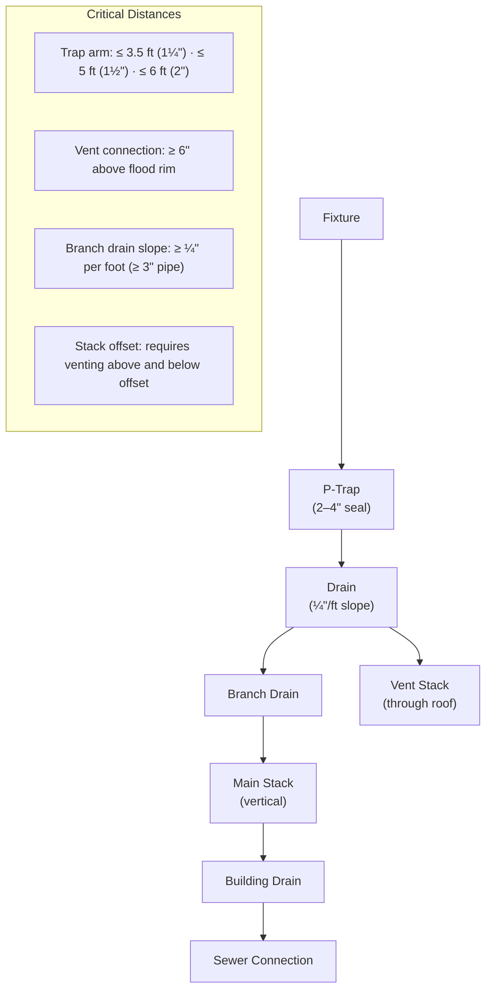

# Lesson 2: Water Systems Architecture

## 1. First-Principles Intuition & Invariants

Water distribution within a residential structure operates as a pressure-driven distributed system with three functionally decoupled but physically intertwined subsystems: supply, drainage, and venting. Understanding residential plumbing begins with recognizing that water's incompressibility and gravitational behavior dictate every design choice from pipe sizing to fixture placement. Unlike electrical systems where voltage remains nominally constant regardless of load, water pressure exhibits dynamic behavior under flow conditions, making the hydraulic network inherently more complex to diagnose and optimize.

The supply system delivers potable water under pressure, typically sourced from municipal mains at 40–80 psi or private wells equipped with pressure tanks maintaining 40–60 psi working range. This pressurized delivery allows water to reach fixtures on upper floors and overcome frictional losses through the piping network. The fundamental constraint here is conservation of energy expressed through Bernoulli's principle: total head (pressure energy plus elevation energy plus velocity energy) minus frictional losses remains constant along any flow path. In practical terms, this means that a shower on the second floor fed by ½-inch copper pipe over a 40-foot run will deliver lower flow than an identical fixture on the first floor with a 15-foot run, even when static pressure is identical, because friction loss scales linearly with pipe length and exponentially with flow velocity.

Drainage systems operate on an entirely different principle: gravity-driven flow through sloped pipes sized to maintain partial fill under design flow conditions. The critical invariant here is that wastewater must never fill the drainpipe completely, because complete filling would create a liquid seal that traps sewer gases and prevents atmospheric pressure equalization. This leads directly to the requirement for the third subsystem—venting—which provides atmospheric pressure access to the drainage network, allowing air to enter behind falling slugs of water and preventing siphonic action from pulling water out of fixture traps. The trap itself, that U-shaped section of pipe beneath every fixture holding 1.5 to 4 inches of standing water, forms the fundamental barrier between the habitable space and the sewer system's noxious and potentially hazardous gases.

The interaction between these three systems reveals itself most clearly during simultaneous fixture operation. When a toilet flushes while someone showers, inadequate venting manifests as a gurgling sound from the shower drain as the toilet's discharge momentarily reduces pressure in the shared drain stack, attempting to siphon water from the shower trap. Proper vent sizing ensures that atmospheric pressure equalizes faster than drainage flow can create significant negative pressure, maintaining trap seals and preventing cross-contamination between fixtures through the drainage network.

Material selection introduces another layer of invariants. Copper supply piping resists corrosion in most water chemistry conditions, maintains smooth internal surfaces that minimize friction losses, and tolerates high pressures and temperatures, but costs significantly more than PEX (cross-linked polyethylene) and requires brazing or soldering joints. PEX offers flexibility that reduces fitting count and installation labor, exhibits excellent freeze resistance due to expansion capacity, and resists mineral scaling, but cannot tolerate ultraviolet exposure and has slightly higher friction coefficients than copper. PVC and ABS dominate drainage applications because their smooth internal surfaces minimize friction and prevent root intrusion in buried sections, though cast iron remains superior for sound dampening in multi-story drain stacks where water's acceleration through vertical pipe creates substantial noise.

Water hammer—the pressure surge that creates that characteristic banging sound when a valve closes suddenly—demonstrates another fundamental invariant: momentum conservation. When flowing water abruptly stops, its kinetic energy converts to elastic energy in the piping system, creating pressure waves that propagate at the speed of sound in water (approximately 4,800 feet per second) until dissipated through pipe expansion and friction. The magnitude of this pressure spike follows the Joukowsky equation: ΔP = ρ × c × Δv, where ρ is water density, c is the speed of sound in the fluid, and Δv is the velocity change. For a typical residential system with water flowing at 6 feet per second through copper pipe, instantaneous closure generates pressure spikes exceeding 400 psi—far beyond the 150 psi rating of standard fixtures and enough to rupture joints or crack pipes over repeated cycles. This physical reality necessitates water hammer arrestors: sealed chambers containing compressed air or gas that absorb the pressure surge by compressing further as the pressure wave arrives, converting the sharp pressure spike into a gradual dissipation.

The pressure-flow relationship in residential systems follows well-established hydraulic principles but requires practical calibration. Flow rate through an orifice scales with the square root of pressure differential across it, meaning that doubling pressure increases flow by only 41%, not 100%. This sublinear relationship explains why simply increasing supply pressure rarely solves low-flow problems caused by undersized piping or excessive fitting friction. A properly sized system maintains 40–60 psi at the furthest fixture under full-load conditions, reserving excess pressure for overcoming friction losses rather than attempting to compensate for inadequate pipe diameter.

Thermal expansion presents a final invariant that distinguishes supply systems from drainage. Water expands approximately 2% over a temperature rise from 50°F to 140°F, and in a closed system—one with a backflow preventer or check valve isolating it from municipal supply—this expansion has nowhere to go. A 50-gallon water heater heating to 140°F generates roughly one gallon of expansion, which in a closed system creates pressures exceeding 150 psi unless accommodated by a thermal expansion tank. These tanks contain a rubber diaphragm separating a captive air charge from the water system; as heated water expands, it compresses the air charge, preventing dangerous pressure buildup while maintaining system operation within safe limits.

## 2. Core Architecture & Mechanics

The physical topology of a residential water system begins at the point of entry, where the main supply line penetrates the foundation. In municipal systems, this entry point contains a meter assembly that includes the water meter itself, a main shutoff valve on the house side, and frequently a backflow preventer or dual-check valve assembly preventing contaminated water from flowing backward into the municipal supply. The meter measures flow through a turbine mechanism or magnetic detection of impeller rotation, with each revolution corresponding to a fixed volume (typically 0.1 cubic feet or approximately 0.75 gallons). Beyond the meter, the main line branches into hot and cold distribution networks, with cold water splitting to both fixtures and the water heater inlet.

The distribution network architecture follows one of two topologies: trunk-and-branch or manifold. Trunk-and-branch represents the traditional approach where a main supply line (trunk) of ¾-inch or 1-inch pipe runs through the structure with ½-inch branch lines tapping off to individual fixtures or fixture groups. This topology minimizes piping material cost but introduces serial pressure drops—each operating fixture reduces pressure available to downstream fixtures because all fixtures share the common trunk flow path. The manifold topology, increasingly common with PEX installations, employs a central manifold near the water heater with dedicated home-run lines to each fixture. This parallel architecture ensures that operating one fixture does not affect pressure at others, though it requires significantly more piping material.

Pipe sizing follows velocity-limited design principles rather than pressure-drop minimization alone. Maintaining flow velocity below 8 feet per second prevents erosion of pipe materials and reduces noise, while velocities below 2 feet per second risk sediment accumulation. For typical residential flow rates (2.5 GPM per fixture unit), ¾-inch pipe provides adequate flow for trunk lines serving up to six fixtures, while ½-inch branch lines handle individual fixtures. The relationship between pipe diameter and flow capacity follows the continuity equation: Q = A × v, where flow rate Q equals cross-sectional area A times velocity v. Doubling pipe diameter quadruples cross-sectional area, allowing four times the flow at the same velocity—this explains why upgrading from ½-inch to ¾-inch piping so dramatically improves system performance.

```
Main Supply Entry (Municipal)
     │
     ├─── Meter Assembly
     │      ├─ Shutoff Valve
     │      ├─ Water Meter
     │      └─ Backflow Preventer
     │
     ├─── Main Distribution Line (¾" or 1")
     │      │
     │      ├─── Cold Water Trunk
     │      │      ├─ Kitchen Sink (½" branch)
     │      │      ├─ Bathroom Lavatory (½" branch)
     │      │      ├─ Toilet (½" branch)
     │      │      └─ Exterior Hose Bibs (½" branch)
     │      │
     │      └─── Water Heater Feed (¾")
     │             │
     │             └─── Hot Water Trunk
     │                    ├─ Kitchen Sink (½" branch)
     │                    ├─ Bathroom Lavatory (½" branch)
     │                    ├─ Shower/Tub (½" branch)
     │                    └─ Washing Machine (½" branch)
```

The drainage system mirrors supply architecture in reverse but operates under entirely different physics. The primary drain stack (typically 3-inch or 4-inch pipe) runs vertically from the building drain at or below ground level through the roof, where it terminates as the main vent stack. Branch drains connect fixtures to this vertical stack using sloped horizontal runs—minimum ¼ inch per foot slope for pipes 3 inches and larger, minimum ½ inch per foot for smaller branch drains. This slope ensures adequate velocity to carry solid waste without allowing water to outrun the solids, which would leave deposits that accumulate into blockages.

Fixture unit loading determines drain pipe sizing through established tables that correlate fixture types to drainage load. A toilet represents 3–4 fixture units (DFU), a shower 2 DFU, and a lavatory 1 DFU. A 3-inch drain stack can handle up to 20 DFU on a single story or 48 DFU total over multiple stories before requiring upsizing to 4-inch pipe. These seemingly arbitrary numbers emerge from decades of empirical observation of how quickly fixture discharge travels through pipes of various diameters under partial-fill conditions—the drain must clear each discharge before the next arrives to prevent backup.

Trap geometry implements a mechanical one-way valve using water as the sealing medium. The trap outlet elevation sits 2 to 4 inches below the inlet elevation (called the trap seal depth), creating a water column that blocks sewer gas passage while allowing discharge to overflow the internal weir and continue to the drain. The trap arm—the horizontal pipe connecting trap outlet to the vent or stack—critically determines trap reliability. If too long, friction losses as water flows through create enough pressure differential to siphon water from the trap. Code limits trap arm length based on pipe diameter: 3.5 feet for 1¼-inch pipe, 5 feet for 1½-inch pipe, 6 feet for 2-inch pipe. These limits assume proper venting; without venting, even shorter trap arms risk siphoning.

Vent routing follows a set of geometric requirements ensuring atmospheric pressure access. Every fixture requires either an individual vent rising directly from the trap arm to atmosphere, a common vent shared with another fixture, or a connection to the wet vent system where a drain pipe serves simultaneously as drain for one fixture and vent for another. The critical constraint is that the vent connection must occur above the flood level rim of the fixture—the highest point water can reach before overflowing—to prevent water from entering the vent under normal operation. For fixtures located far from the main stack, vents may run horizontally only after rising at least 6 inches above the flood level rim, ensuring that any water that does enter the vent cannot flow backward into the fixture.



Water heater architecture introduces thermal storage and heat transfer considerations. Tank-type heaters maintain 40–80 gallons of water at setpoint temperature (typically 120–140°F) using gas burners or electric resistance elements controlled by mechanical thermostats. The thermostatic control operates on a differential: heat activates when water temperature drops 10–15°F below setpoint and deactivates when reaching setpoint, creating continuous cycling during standby periods as jacket losses cool the stored water. Recovery rate—the time required to reheat a full tank after complete draw—depends on input power (40,000 BTU/hour for typical gas units, 4,500 watts for electric) and water temperature rise. A 40-gallon gas heater with 40,000 BTU/hour input recovers in approximately 30 minutes, while an equivalent electric heater with 4,500-watt elements requires 90 minutes.

Tankless heaters eliminate storage in favor of on-demand heating through high-power burners or electric elements activated by flow switches. Gas tankless units deliver 3–8 GPM at a 70°F temperature rise using 150,000–200,000 BTU/hour burners, requiring ½-inch gas lines and dedicated electrical circuits for ignition and control. Electric tankless units face power limitations—whole-house models require 100–150 amps at 240 volts, often exceeding available electrical service capacity—restricting them to point-of-use applications unless substantial electrical infrastructure upgrades occur. The flow rate limitation derives from the fundamental heat transfer equation: Q = (GPM × 8.33 × ΔT × 60) / 3,412, where Q represents required power in watts. Heating 5 GPM through a 70°F rise demands 86,000 BTU/hour or 25 kW, explaining why flow rate decreases as inlet water temperature drops seasonally.

Pressure regulation appears at multiple points in well-designed systems. A pressure-reducing valve (PRV) at the main entry protects the system from excessive municipal supply pressure, which commonly reaches 80–100 psi or higher. The PRV contains a spring-loaded diaphragm that closes progressively as outlet pressure rises, throttling flow to maintain a constant downstream pressure regardless of upstream variation. Setting the PRV to 50–60 psi balances adequate fixture performance against reduced stress on piping and fixtures. Individual fixtures may incorporate additional pressure regulation—thermostatic shower valves contain pressure-balancing cartridges that adjust hot and cold flow ratios to maintain constant temperature despite supply pressure fluctuations, preventing scalding when a toilet flushes and momentarily reduces cold water pressure.

## 3. High-Performance Optimization & Failure Modes

Leak diagnosis begins with systematic isolation, leveraging the hierarchical architecture of supply systems. Shutting off the main valve while observing the meter under no-flow conditions reveals whether any leak exists within the property boundaries—continued meter rotation indicates water loss between the meter and fixtures. If the meter stops, the leak lies between the municipal main and meter. Progressively isolating sections by closing intermediate valves narrows the leak location: close the water heater inlet valve and observe whether the meter stops to determine if the leak occurs on the hot or cold side. This binary search through the plumbing tree localizes even small leaks that produce no visible evidence.

Pressure testing quantifies leak severity and verifies repair quality. After isolating a section, connect a pressure gauge and pressurize to 100 psi using a hand pump or air compressor regulated through a water-safe valve. Monitor pressure over 15 minutes—drop exceeding 5 psi indicates a leak requiring investigation. For drainage systems, pressure testing is inappropriate due to low design pressure; instead, perform smoke testing or air testing per code requirements. Smoke testing introduces theatrical fog or smoke pellets into the drainage system with all traps filled and vents temporarily capped, then visually inspecting for smoke escape. Air testing pressurizes the drainage system to 5 psi for 15 minutes, verifying that pressure drop remains below code limits (typically 1 psi maximum).

Flow rate optimization addresses the most common performance complaint—low water pressure. This terminology reveals a fundamental misconception: residential water systems rarely suffer from low static pressure (measured with no flow), but frequently exhibit low dynamic pressure during flow due to friction losses. Measuring static pressure at a hose bib with the system at rest establishes baseline pressure; measuring again with multiple fixtures operating reveals the dynamic pressure drop. If static pressure exceeds 50 psi but dynamic pressure falls below 30 psi during typical usage, friction losses dominate the problem rather than inadequate supply.

Friction loss scales with the Darcy-Weisbach equation: ΔP = f × (L/D) × (ρv²/2), where f represents the friction factor dependent on pipe roughness and flow regime, L and D are pipe length and diameter, ρ is fluid density, and v is flow velocity. The practical implication: friction loss scales linearly with pipe length but inversely with the fifth power of diameter—halving diameter increases friction loss by a factor of 32, while doubling length merely doubles loss. This explains why replacing a 50-foot run of ½-inch pipe with ¾-inch pipe produces dramatic improvement despite marginal static pressure increase.

Eliminating unnecessary fittings reduces friction more than intuition suggests. Each 90-degree elbow introduces friction equivalent to 2–3 feet of straight pipe, while gate valves add less than 1 foot but globe valves add 15–20 feet of equivalent length. A supply line containing eight 90-degree elbows and two globe valves suffers friction equivalent to 60 feet of additional pipe—replacing globe valves with ball valves and using sweep elbows instead of sharp 90s recovers substantial pressure. When retrofitting PEX, the flexibility allows gentle curves replacing multiple fittings, dramatically reducing equivalent length.

Water hammer mitigation involves both preventing abrupt flow changes and providing pressure spike absorption. Slow-closing valves—especially quarter-turn ball valves that close in less than a second—create the most severe hammer. Replacing these with multi-turn valves that close over 3–5 seconds allows momentum dissipation without generating high-amplitude pressure waves. For fixtures with solenoid valves that close effectively instantaneously (washing machines, dishwashers, ice makers), water hammer arrestors become mandatory rather than optional. Installing arrestors as close as possible to the offending fixture maximizes effectiveness since pressure waves attenuate with distance.

Properly sizing arrestors requires matching to fixture flow rate and system pressure. Residential arrestors are rated in fixture units—a washing machine requires a 2-fixture unit arrestor, while a dishwasher needs 1 fixture unit. The arrestor's internal air chamber should be precharged to 5–10 psi below normal system pressure; if precharged too high, it won't compress under normal operation and fails to absorb surges effectively. Over time, air dissolves into water through the rubber diaphragm, waterlogging the arrestor and requiring replacement or recharging. Tapping the arrestor body reveals waterlogging—a hollow sound indicates proper air charge, while a dull thud indicates water intrusion requiring service.

Drainage blockages follow predictable patterns based on fixture type and waste composition. Kitchen drains accumulate grease deposits that coat pipe walls and trap food particles, progressively restricting flow. These blockages respond poorly to chemical drain cleaners because the grease coating insulates the blockage from chemical action. Instead, mechanical augering or hydro-jetting removes accumulated deposits. Lavatory drains accumulate hair and soap scum that form tenacious mats, particularly in the trap and trap arm where flow velocity is lowest. These respond well to enzymatic drain treatments that digest organic material over several hours of contact time.

Toilet blockages occur in the internal trap configuration formed by the fixture casting itself or in the 3-inch drain line immediately downstream. The toilet's integral trap, designed to clear solid waste, rarely clogs from normal use unless foreign objects enter—understanding this focuses diagnosis on whether the blockage sits in the fixture or the drain. Flush the toilet and observe: if water rises nearly to the rim then slowly drains, the blockage sits in the fixture trap; if water rises and remains at that level without draining, the blockage sits downstream in the 3-inch branch drain or stack. A closet auger—a specialized tool with a 3-foot flexible shaft specifically curved to navigate toilet trap geometry—clears fixture blockages, while a standard 25-foot drain snake addresses downstream blockages.

Vent system failures manifest as slow drainage, gurgling sounds, and trap seal loss, but diagnosing which vent path failed requires understanding the system topology. If multiple fixtures on different branch drains exhibit symptoms simultaneously, the main vent stack likely has a blockage—commonly a bird's nest in the roof termination or ice formation in northern climates where warm humid air from the drain system encounters freezing exterior temperatures. Single-fixture symptoms point to individual fixture venting problems: inadequate trap arm length, missing individual vent, or a blocked connection to the common vent.

Testing vent system integrity requires observing drainage performance under load conditions. Run fixtures at full flow and listen for gurgling at other fixtures, particularly those on the same branch drain. Gurgling indicates air being pulled through adjacent trap seals as drainage creates negative pressure—the vent system is failing to equalize pressure quickly enough. For new installations or major renovations, code requires air testing or smoke testing before inspection approval, but existing systems rarely receive such comprehensive validation. Instead, performance testing under realistic load reveals problems that manifest in daily use.

Fixture repair begins with understanding the valve cartridge architecture that controls flow and mixing. Compression faucets employ rubber washers pressed against brass seats, wearing and requiring replacement every 1–3 years depending on water quality and usage frequency. Ball-type, cartridge-type, and ceramic disc faucets use precision-machined metal or ceramic elements that rotate against each other, with seal elastomers preventing leakage. These designs last 10–20 years before requiring cartridge replacement. Diagnosing the valve type determines the repair approach: compression faucets have separate hot and cold handles requiring multiple turns to open, while single-handle faucets use cartridge mechanisms.

Replacing a cartridge begins with shutting off supply at the fixture shutoff valves or main supply if fixture valves are absent. Remove the handle by locating the set screw—often hidden under a decorative cap that pries off—then unscrew the retaining nut or bonnet holding the cartridge. Note the cartridge orientation before removal, as reversing it during installation will reverse hot and cold operation. Clean the valve body seat with a soft cloth, removing mineral deposits with white vinegar if necessary. Install the new cartridge matching the original orientation, replace the retaining components, and test operation before completing handle reinstallation.

Toilet repair focuses on three components: the fill valve, the flush valve, and the flapper. Continuous running indicates a leaking flapper allowing water to escape from the tank to the bowl, triggering the fill valve to run continuously maintaining tank level. A failing fill valve produces hissing or squealing sounds as water flows through restricted or damaged internal passages. Identifying which component failed guides repair: add food coloring to the tank water and observe if colored water appears in the bowl within 15 minutes without flushing—confirming flapper leakage. If the fill valve runs continuously but water level never reaches the overflow tube, the fill valve itself has failed.

Replacing the flapper requires draining the tank by shutting off the supply and flushing to empty, then unclipping the old flapper from the flush valve lugs and installing the new one. Ensure the flapper seats properly against the flush valve opening by visually confirming alignment and performing the dye test. If the new flapper still leaks, the flush valve seat likely has mineral deposits or damage requiring cleaning with fine abrasive or flush valve replacement. Replacing the fill valve involves shutting off supply, disconnecting the supply line, unscrewing the locknut beneath the tank, removing the old valve, and installing the new valve to the same height adjustment as the original.

Water quality issues affect both performance and longevity. Hard water—high in calcium and magnesium—precipitates mineral scale on heating elements, in pipe constrictions, and on aerator screens, progressively restricting flow and reducing heater efficiency. Soft water—naturally low in minerals or chemically treated—corrodes copper and brass components more aggressively, particularly in hot water systems where increased temperature accelerates electrochemical reactions. Understanding local water chemistry informs material selection and maintenance intervals: hard water benefits from periodic descaling and aerator cleaning, while soft water may require sacrificial anode replacement in water heaters at shorter intervals.

Installing a water softener introduces sodium chloride or potassium chloride into the ion exchange process, replacing calcium and magnesium with sodium or potassium ions. While this prevents scale formation, it increases water salinity and may corrode certain fixtures. The softener bypass valve allows selecting which fixtures receive softened water—exterior hose bibs and cold water drinking taps typically remain on hard water, while hot water and fixtures prone to scale formation receive softened water. Softener regeneration cycles consume salt and flush brine to drain, requiring 40–60 gallons per regeneration cycle—a consideration for septic systems where the additional salt load can disrupt bacterial digestion.

Freeze protection dominates cold-climate plumbing considerations. Water expands approximately 9% upon freezing, generating pressures exceeding 30,000 psi—far beyond the burst strength of any residential pipe material. Preventing freezing requires maintaining pipe temperature above 32°F through insulation, heat trace cables, or relocating pipes to conditioned spaces. Exterior hose bibs require frost-free designs where the valve seat sits 6–12 inches inside the wall within conditioned space, allowing water to drain from the exterior spout portion after closing. Without proper installation slope allowing drainage, frost-free hose bibs still freeze when water remains trapped in the spout section.

Pipe insulation R-values determine effectiveness against heat loss and freeze protection. Standard foam pipe insulation provides R-2 to R-4 per inch of thickness; for ½-inch copper pipe in an unconditioned crawlspace at 20°F ambient temperature, 1-inch foam insulation reduces heat loss by 70% but does not eliminate freeze risk during extended cold snaps. Combining insulation with heat trace cables—self-regulating electrical heating elements wrapped around the pipe—provides active freeze protection, with the cable output automatically increasing as pipe temperature drops. Thermostatically controlled heat trace maintains pipes above 40°F while consuming minimal power during above-freezing conditions.

Backflow prevention protects potable water supplies from contamination through reverse flow caused by back-pressure or back-siphonage. Back-pressure occurs when a downstream pressure source exceeds supply pressure—for example, a heating system's boiler pressure pushing water backward into the cold supply. Back-siphonage occurs when supply pressure drops below atmospheric pressure due to main breaks or heavy fire department usage, creating vacuum that pulls contaminated water from fixtures into the supply. Cross-connections—any physical arrangement allowing potable water contact with non-potable sources—require backflow prevention appropriate to the hazard level.

Atmospheric vacuum breakers provide simple back-siphonage prevention for hose bibs and irrigation systems, opening to atmosphere when supply pressure drops below atmospheric. These devices cannot protect against back-pressure and must be installed at least 6 inches above the highest downstream outlet. Pressure vacuum breakers add a spring-loaded check valve allowing back-pressure protection up to 25 psi, suitable for irrigation systems and some mechanical equipment. Reduced-pressure zone (RPZ) assemblies provide the highest level of protection through two independent check valves separated by a pressure-relief zone that opens to atmosphere if either check valve leaks, protecting against both back-pressure and back-siphonage with testable reliability for high-hazard installations like chemical injection systems or fire sprinkler connections to non-potable sources.

System commissioning and performance verification complete any major installation or renovation. Document static pressure at multiple fixtures with the system at rest, then measure dynamic pressure during simultaneous operation of typical fixture combinations—shower and toilet, kitchen sink and washing machine. Flow rate measurement requires collecting discharge from a fixture into a container of known volume over a timed interval; a 5-gallon bucket filled in 2 minutes indicates 2.5 GPM flow. Compare measured values against fixture design specifications: showerheads should deliver 2.0–2.5 GPM at 60 psi, kitchen sink faucets 2.2 GPM, lavatory faucets 1.5 GPM. Values falling 20% or more below specification indicate problems requiring investigation—undersized piping, excessive fitting friction, partially closed valves, or clogged aerators.
