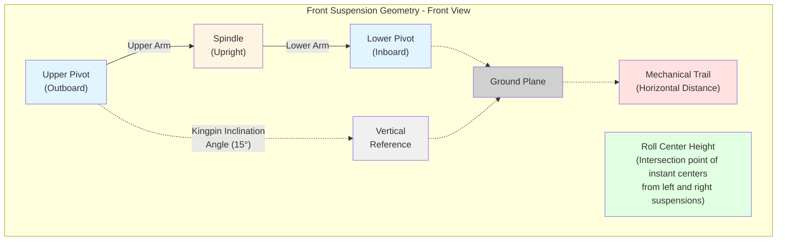

# Lesson 1: Chassis Architecture, Suspension Geometry, Weight Distribution

## 1. First-Principles Intuition & Invariants

The chassis of a radio-controlled car represents far more than a simple mounting platform for components. It functions as the primary structural element that must simultaneously satisfy contradictory demands: rigidity under torsional loads to maintain suspension geometry, flexibility in controlled directions to absorb impacts without fracture, and minimal mass to maximize acceleration and cornering response. Understanding chassis design begins with recognizing that an RC car operates in a dynamic environment where every gram of mass, every millimeter of flex, and every degree of suspension travel directly influences the contact patch between tire and surface. The contact patch remains the singular interface through which all forces—acceleration, braking, and cornering—must be transmitted, making chassis architecture the foundation upon which all performance characteristics are built.

The fundamental invariant governing chassis design stems from Newton's second law applied to rotational dynamics. When a chassis corners, lateral acceleration generates a moment arm proportional to the center of gravity height multiplied by the lateral force, creating a roll moment that transfers weight from inside to outside tires. This weight transfer phenomenon cannot be eliminated, only managed through suspension geometry and chassis stiffness distribution. A chassis with high center of gravity exhibits greater weight transfer magnitude for identical cornering force, reducing overall grip as the combined tire contact patch force follows a nonlinear relationship with normal load. The tire friction circle demonstrates this principle: as vertical load increases on the outside tire, the proportional gain in lateral grip does not fully compensate for the loss on the unloaded inside tire, resulting in net grip reduction. Consequently, lowering the center of gravity becomes a primary design objective, though practical constraints such as ground clearance, drivetrain packaging, and component accessibility impose lower bounds on achievable CG height.

Material selection for chassis construction directly influences the trade-off between rigidity, weight, and impact resistance. Carbon fiber composite plates, typically ranging from 2.0mm to 3.0mm thickness in 1/10 scale vehicles, provide exceptional stiffness-to-weight ratios with elastic modulus values approaching 150 GPa in the fiber direction, far exceeding the 70 GPa of aerospace-grade aluminum. However, carbon fiber exhibits brittle failure modes under point impact loading, catastrophically fracturing rather than plastically deforming. Aluminum chassis plates, machined from 6061-T6 or 7075-T6 alloys in 2.5mm to 3.0mm thickness, offer superior impact tolerance through ductile deformation, absorbing crash energy by permanently bending rather than shattering. The yield strength of 7075-T6 aluminum reaches 505 MPa, allowing thin sections to resist bending under suspension loads while maintaining repairability through localized straightening or replacement of bent sections. Injection-molded nylon and glass-filled polymer chassis, common in entry-level vehicles, sacrifice rigidity for cost and impact resistance, flexing under load in ways that alter suspension geometry dynamically and introduce unpredictable handling characteristics as the chassis twists during cornering.

The chassis must establish mounting points for suspension elements with geometric precision, as small deviations in pivot locations directly alter camber curves, roll center height, and anti-squat characteristics. A suspension tower positioned 0.5mm forward of specification changes toe angle by approximately 0.2 degrees across typical RC suspension arm lengths, introducing directional instability or excessive tire scrub. Manufacturing tolerances in injection-molded chassis components typically range from ±0.15mm to ±0.3mm, while CNC-machined aluminum maintains ±0.05mm precision, making machined chassis preferred for competitive applications where suspension geometry repeatability directly correlates with consistent handling balance. The chassis must also resist torsional flex about its longitudinal axis, as chassis twist allows suspension on opposite corners to work independently rather than maintaining the geometric relationship designed into the suspension. A torsionally flexible chassis effectively introduces a third spring element into the suspension system, one with unpredictable rate characteristics that vary with chassis fatigue and temperature-induced material property changes.

Weight distribution between front and rear axles establishes the baseline handling balance before suspension tuning begins. A rear-wheel-drive touring car with 45% front, 55% rear static weight distribution inherently exhibits mild understeer tendencies, as the rear tires must simultaneously transmit lateral cornering force and longitudinal drive force, while front tires operate primarily in lateral load. Shifting weight rearward to 40/60 distribution increases rear tire normal load, expanding the available friction circle radius for combined longitudinal and lateral force, but simultaneously reduces front tire normal load and lateral grip capacity. The optimal weight distribution depends on drivetrain layout, track surface characteristics, and driver preference, but the principle remains constant: weight distribution determines the proportion of total vehicle grip budget allocated to each axle, and that allocation must match the force demands placed on each end during representative cornering and acceleration events.

## 2. Core Architecture & Mechanics

The chassis architecture begins with the mainplate, a flat structural element typically measuring 2.5mm to 3.0mm thick in 1/10 scale vehicles, spanning the full wheelbase and establishing mounting points for suspension towers, drivetrain components, and electronics. The mainplate operates in combined loading, experiencing vertical bending loads from suspension forces, torsional loads from asymmetric cornering forces, and localized stress concentrations at fastener locations. Carbon fiber mainplates exhibit orthotropic mechanical properties, with strength and stiffness dramatically higher along the fiber weave direction than perpendicular to it. Manufacturers orient the primary fiber direction longitudinally along the wheelbase to resist bending under landing impacts, while secondary fiber layers at 45-degree angles provide torsional rigidity. The layup typically consists of 2-4 plies of 3K carbon fiber fabric in a twill or plain weave pattern, impregnated with epoxy resin and cured under vacuum pressure to achieve 60-65% fiber volume fraction and void content below 2%. This construction yields a mainplate mass of approximately 30-40 grams for a 325mm wheelbase touring car, with flexural rigidity sufficient to limit mid-span deflection to under 0.5mm under 20N point loading at wheelbase center.

Suspension towers mount vertically to the mainplate, establishing the upper pivot points for suspension arms and determining critical geometry parameters including kingpin inclination angle, camber gain rate, and roll center height. Independent front suspension geometry positions the upper pivot outboard and elevated relative to the lower pivot, creating a positive kingpin inclination angle typically ranging from 10 to 25 degrees measured from vertical. This inclination generates a steering axis that intersects the ground plane inboard of the tire contact patch, creating a mechanical trail dimension that produces self-centering torque during cornering. As the wheel deflects in bump, the angled kingpin axis forces the wheel to move through an arc, introducing camber change as a function of vertical displacement. The relationship between vertical travel and camber change, known as the camber curve, depends on the geometric arrangement of upper and lower arm lengths and their relative angles in side view and front view. A suspension with equal-length upper and lower arms positioned parallel in front view exhibits zero camber gain, maintaining constant camber through suspension travel. Shortening the upper arm relative to the lower arm introduces negative camber gain in compression, tilting the top of the tire inward as the suspension compresses, which compensates for body roll-induced positive camber change and maintains optimal tire contact patch alignment during cornering.

The suspension arms themselves, typically injection-molded from glass-filled nylon or CNC-machined from aluminum, must resist bending and deflection under cornering loads while maintaining dimensional stability across temperature extremes. A front suspension arm experiences combined loading: vertical force from road surface irregularities, lateral force from cornering acceleration, and longitudinal force from braking. The arm acts as a cantilever beam with the chassis mounting point as the fixed end and the wheel hub as the loaded end. For a 1/10 scale touring car cornering at 2G lateral acceleration, the outside front suspension arm experiences approximately 15N lateral load at the hub, generating a bending moment equal to the force multiplied by the arm length from pivot to ball cup, typically 40-50mm. Glass-filled nylon arms with rectangular cross-section 8mm wide by 3mm thick exhibit flexural rigidity sufficient to limit tip deflection to approximately 0.3-0.5mm under this loading, introducing minimal geometry change. Aluminum arms of similar dimensions reduce deflection to under 0.1mm but increase unsprung mass, raising the natural frequency of the suspension system and potentially reducing compliance over high-frequency surface irregularities.

The concept of roll center height emerges from instantaneous center analysis of the suspension linkage geometry. Each suspension arm pair creates an instant center, the theoretical point about which the wheel assembly rotates during infinitesimal vertical displacement. For the front suspension viewed from the front, extending lines through the upper and lower arm pivot axes until they intersect locates the instant center for that corner. The line connecting the left and right instant centers intersects the vehicle centerline at the front roll center. This geometric point represents the location through which lateral cornering force acts on the sprung mass, determining the moment arm for body roll. A roll center at ground level creates maximum roll moment and maximum body roll angle for a given lateral acceleration, while a roll center at the center of gravity height theoretically eliminates roll moment entirely, though this configuration proves impractical due to excessive camber change and geometric instability. Competition touring cars typically position the front roll center 5-15mm above ground level, balancing roll resistance against camber control and suspension travel efficiency.

Drivetrain layout fundamentally influences chassis architecture and weight distribution possibilities. Rear-wheel-drive configurations concentrate mass at the rear through motor, differential, and transmission placement, naturally creating rearward weight bias beneficial for acceleration traction but potentially limiting front-end grip during corner entry. The longitudinal placement of a 540-size brushless motor, spur gear, and ball differential typically adds 200-250 grams to the rear of the chassis, positioned 30-50mm forward of the rear axle centerline. This mass placement lowers the rear center of gravity relative to mid-motor configurations while creating a longer moment arm from the front axle, reducing the proportion of dynamic weight transfer that reaches the front tires during braking. Four-wheel-drive systems add a center driveshaft, front differential, and front drivetrain components, increasing total mass by approximately 80-120 grams while shifting weight distribution forward to approximately 48/52 front/rear. The 4WD configuration distributes drive force across four contact patches rather than two, reducing the longitudinal load demand on rear tires and allowing them to operate more efficiently in pure lateral slip during corner mid-phase.

The suspension mounting architecture must accommodate adjustable geometry parameters to enable tuning for different track surfaces and handling preferences. Front suspension towers incorporate multiple mounting holes for upper arm ball studs, typically arranged in a grid pattern with 2mm vertical spacing and 2mm horizontal spacing, allowing camber link angle and roll center height adjustment. Moving the upper ball stud outboard increases camber gain rate and raises roll center height, while moving it inboard reduces camber gain and lowers roll center. Similarly, adjustable lower arm mounting positions on the chassis allow modification of anti-dive geometry, the suspension's resistance to nose-dive under braking. Anti-dive angle, measured as the inclination of the lower arm in side view from horizontal, creates a force vector component that opposes suspension compression during braking, maintaining ride height and platform control. Typical anti-dive angles range from 0 to 10 degrees, with higher angles providing more aggressive anti-dive behavior at the cost of increased suspension binding during combined braking and steering inputs.

The rear suspension architecture for independent rear suspension follows similar geometric principles but must additionally accommodate drive axle universal joint or constant-velocity joint operation. The drive axle must articulate through suspension travel while transmitting torque, requiring careful attention to plunging distance in the outboard CV joint and angular deflection limits in universal joints. Excessive suspension droop combined with full steering lock can drive a universal joint beyond its 45-degree maximum operating angle, introducing binding, vibration, and accelerated wear. Competition chassis designs incorporate droop limiting screws on suspension arms, adjustable set screws that contact the arm at full extension and prevent over-droop conditions. These limiters typically restrict droop travel to 2-3mm beyond static ride height, sufficient for maintaining tire contact during corner exit weight transfer while protecting drivetrain components.

Solid rear axle configurations, common in off-road buggies and trucks, eliminate independent rear suspension in favor of a rigid axle beam connecting left and right wheels. This architecture forces both rear wheels to maintain identical camber angles regardless of surface irregularities, but provides inherent anti-squat characteristics through the four-link geometry or trailing arm mounting arrangement. A four-link rear suspension employs upper and lower links on each side, creating a virtual pivot axis about which the axle rotates during acceleration. The anti-squat percentage, calculated from the intersection of the instant center line with the center of gravity height and wheelbase dimensions, determines what proportion of weight transfer during acceleration is resisted by suspension geometry rather than spring compression. A 100% anti-squat configuration theoretically eliminates rear suspension compression during straight-line acceleration, directing all drive force into forward motion rather than suspension compression. In practice, 60-80% anti-squat provides optimal balance between acceleration platform stability and suspension compliance for steering responsiveness.

## 3. High-Performance Optimization & Failure Modes

Optimizing chassis performance begins with precise center of gravity measurement and strategic component placement to achieve target weight distribution and minimum CG height. Measuring the longitudinal center of gravity requires a two-point scale method: position the fully assembled vehicle on scales under the front and rear wheels with the chassis level, record individual axle weights, and calculate CG position using the moment balance equation. For a vehicle with 1000g total weight, 450g on the front axle, and 300mm wheelbase, the CG lies 135mm behind the front axle centerline, calculated as (550g × 300mm) / 1000g = 165mm from rear axle, or 300mm - 165mm = 135mm from front. Vertical CG height measurement employs the tilt method: measure vehicle weight on level scales, then elevate the front wheels by a known height (typically 100mm) and measure the change in rear scale reading. The trigonometric relationship between tilt angle, wheelbase, and weight change reveals CG height. For touring cars, achieving CG height below 20mm above ground level requires mounting the battery pack flat against the chassis floor, positioning the motor as low as possible within transmission constraints, and using low-profile servo and receiver cases.

Weight distribution adjustment provides the primary tool for balancing handling characteristics between understeer and oversteer. Adding ballast weight strategically shifts the CG location and changes the proportion of total vehicle grip allocated to each axle. A touring car exhibiting excessive understeer during corner entry benefits from forward weight bias, accomplished by mounting tungsten weights (18g/cm³ density) on the front chassis rail or inside the front bumper. Each 20 grams of weight added 150mm forward of the original CG shifts weight distribution approximately 1% forward, measurable as increased front axle weight on scales. However, added ballast increases total vehicle mass and reduces overall acceleration, making minimum weight with optimal distribution always preferable to heavy weight with adjusted distribution. Competition rules typically specify minimum vehicle weight limits (1300-1380g for 1/10 touring cars) and maximum ballast placement restrictions to prevent extreme forward or rearward bias that would create unrealistic handling characteristics.

Chassis flex tuning represents an advanced optimization technique exploiting controlled flexibility to influence handling balance without suspension geometry changes. A chassis exhibits finite torsional rigidity, twisting about its longitudinal axis when opposing vertical forces act on left and right suspension mounting points. This twist effectively adds a third spring element to the suspension system, with the spring rate determined by chassis material properties and cross-sectional geometry. Reducing chassis torsional rigidity by thinning the mainplate, removing material from front or rear sections, or cutting strategic flex slots allows the chassis to twist more freely, increasing diagonal weight transfer and effectively stiffening the suspension platform during steady-state cornering. A touring car with excessively stiff suspension causing bouncing over surface irregularities can benefit from reduced chassis rigidity, allowing the chassis to flex and maintain tire contact rather than bouncing the entire sprung mass. Conversely, a chassis exhibiting excessive twist introduces unpredictable handling as the suspension geometry relationship changes dynamically, making increased rigidity through thicker plates or aluminum stiffening braces beneficial for achieving consistent, repeatable handling characteristics.

Suspension geometry optimization requires systematic testing of camber curves, roll center height, and anti-geometry settings to match track surface characteristics and driving style. The camber curve, relating suspension travel to camber angle change, directly influences tire contact patch loading distribution during body roll. Measuring the camber curve experimentally requires a camber gauge and suspension displacement fixture: secure the chassis in a fixture allowing vertical suspension movement, measure static camber with the suspension at ride height, then compress the suspension in 2mm increments while recording camber angle at each position. A typical touring car front suspension exhibits approximately 1.5 degrees negative camber gain per 10mm compression, meaning the top of the tire tilts inward 1.5 degrees as the suspension compresses 10mm. This negative camber gain during compression compensates for the positive camber change induced by body roll, maintaining the outside tire contact patch flat against the road surface during cornering. Adjusting camber gain requires modifying suspension geometry: shortening upper arms relative to lower arms increases camber gain, while lengthening upper arms decreases gain. Upper arm length adjustment typically employs turnbuckles with 0.5mm threading, allowing length changes in 0.25mm increments and camber gain tuning in approximately 0.2 degree increments.

Roll center height adjustment dramatically influences handling balance and suspension platform stability. Raising the front roll center increases the proportion of lateral force reacted through suspension geometry rather than spring compression, reducing body roll angle but potentially introducing abrupt weight transfer characteristics. A front roll center positioned 2mm above ground level creates a roll moment arm equal to the CG height minus 2mm, typically 18-20mm for touring cars, generating body roll primarily through spring deflection. Raising the roll center to 10mm above ground reduces the roll moment arm to 10-12mm, cutting body roll magnitude approximately in half for identical lateral acceleration. However, excessively high roll centers create geometric instability as the instant centers approach the center of gravity height, introducing sudden camber changes and potentially violent weight transfer spikes that exceed tire grip limits and trigger snap oversteer. Competition setups typically maintain front roll centers between 3mm and 12mm above ground, adjusted through upper ball stud position changes in 2mm increments. Rear roll center adjustment follows similar principles but typically maintains 2-4mm higher rear roll center than front to create a roll axis tilted upward toward the rear, inducing slight understeer bias through geometric roll stiffness distribution.

Anti-dive and anti-squat geometry settings require careful balancing between platform control and suspension compliance. Anti-dive geometry resists front suspension compression during braking by inclining the lower suspension arm such that braking force components act parallel to the arm rather than perpendicular. The anti-dive percentage, calculated from the suspension geometry instant center location and center of gravity height, determines what fraction of weight transfer is resisted geometrically. A front suspension with 30% anti-dive maintains more level platform attitude during braking, reducing the sensation of nose-dive and maintaining consistent front ride height for predictable aerodynamic balance. However, excessive anti-dive (above 50%) introduces suspension binding during combined braking and cornering, as the suspension attempts to compress from cornering loads while anti-dive geometry resists compression from braking loads. This binding reduces overall compliance and can trigger understeer as the front suspension cannot fully absorb surface irregularities. Optimal anti-dive settings typically range from 20-40%, adjusted by modifying front lower arm mounting position in 2mm increments, with each 2mm forward movement increasing anti-dive percentage by approximately 8-10%.

Failure modes in chassis and suspension systems typically manifest through progressive degradation of handling characteristics rather than catastrophic structural failure. Carbon fiber chassis mainplates develop fatigue cracks at stress concentration points surrounding mounting holes, particularly the front suspension tower mounting screws that experience high-frequency loading from suspension impacts. These cracks propagate along fiber directions, delaminating layers and reducing local rigidity. Detecting incipient cracks requires visual inspection under bright light at shallow angles, revealing fiber disruption as subtle surface texture changes before complete fracture occurs. Aluminum chassis plates develop permanent plastic deformation at localized stress points, most commonly at the motor mount where drive torque and crash impacts concentrate loads. A bent aluminum chassis exhibits asymmetric suspension geometry, causing directional pulling and inconsistent camber angles left-to-right. Straightening bent aluminum requires careful application of counter-bending force slightly exceeding the yield strength to return the plate to flat without introducing reverse plastic deformation. Suspension arms develop fatigue at the ball cup mounting bosses where cyclic loading concentrates stress in the thin-walled cylindrical section. Cracked ball cups exhibit increased free play in the ball joint, introducing geometric imprecision and unpredictable handling response. Systematic inspection of ball cups after every 5-10 battery packs of racing identifies developing cracks before complete separation occurs.

Drivetrain-induced vibration represents a handling degradation mode requiring systematic diagnosis through frequency analysis and component inspection. A vibration occurring at wheel rotation frequency (approximately 20 Hz at racing speeds) indicates wheel imbalance, tire defects, or drive axle runout. Correcting wheel imbalance requires adding small tungsten weights to the inside wheel rim opposite the heavy side, identified by static balancing on a mandrel. Vibration at driveshaft rotation frequency (2-3× wheel frequency for typical gear ratios) indicates universal joint misalignment, worn CV joints, or driveshaft runout. CV joint inspection requires measuring the axial play in the plunging joint (should not exceed 0.2mm) and checking for damaged bearing elements within the joint housing. Replacing worn CV joints every 40-60 battery packs prevents catastrophic failure during racing and maintains smooth power delivery through suspension articulation. Motor-induced vibration at much higher frequencies (150-300 Hz at typical motor RPM) indicates rotor imbalance, damaged bearings, or motor timing issues, requiring motor disassembly, bearing replacement, and rotor balancing using a precision dynamic balancing fixture.

The ultimate optimization of chassis architecture, suspension geometry, and weight distribution emerges from iterative testing across representative track conditions combined with data acquisition and driver feedback analysis. Lap time telemetry reveals the gross effect of setup changes, but detailed analysis requires measuring mid-corner speeds at specific track locations, braking distances from reference points, and corner exit acceleration rates. A chassis configuration exhibiting improved entry speed but reduced exit speed indicates excessive front grip relative to rear, suggesting rearward weight transfer or suspension stiffness increase at the rear. Systematic testing methodology proceeds through single-variable changes: adjust only front camber gain, record performance change, return to baseline, adjust front roll center height, record performance, and build a response matrix correlating each parameter to lap time and handling balance. This disciplined approach builds understanding of parameter sensitivity and interaction effects, enabling rapid setup optimization for unfamiliar track surfaces and conditions. The chassis, as the foundation integrating all mechanical elements, ultimately determines the ceiling of achievable performance, making its architecture, material selection, and geometric precision the highest priority in any serious racing program.
