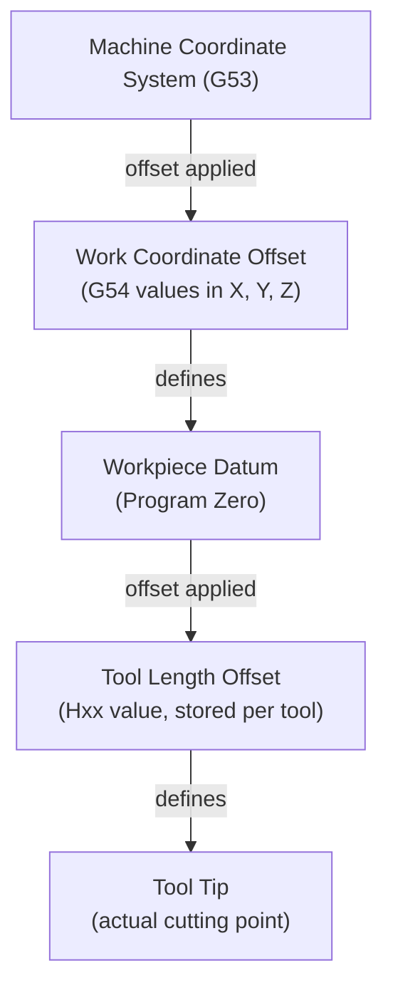

# Lesson 4: Workholding Systems, Precision Measurement, Process Control

## 1. First-Principles Intuition & Invariants

There is a truth that experienced machinists carry in their hands before they ever articulate it in words: the quality of a finished part is established not at the spindle, but at the vise jaw. Every subsequent operation, every tool path, every tolerance call on the print, inherits its fate from the moment the workpiece is located and clamped. Workholding is not a preparatory chore preceding the real work; it *is* the real work, and treating it as otherwise is the most common source of scrap in a precision machine shop.

To understand why, consider what a CNC machining center actually does from a physics standpoint. The machine's control system executes motion relative to a mathematical coordinate system that exists entirely in software. The cutting tool moves through a space defined by the machine's internal reference — the machine home, the ballscrew encoder positions, the axis limits. The workpiece, by contrast, exists in physical space, clamped to a table with its own geometry, its own surface imperfections, its own thermal state. The fundamental challenge of setup is bridging these two realities: mapping the mathematical world of G-code coordinates onto the physical world of metal, chips, and cutting forces. Every datum reference, every work coordinate offset, every edge-finding operation is an act of translation between these two domains. When that translation is imprecise or inconsistent, the machine cuts exactly where it was told to cut — just not where you intended.

The classical treatment of workholding is built on the **3-2-1 locating principle**, which is simultaneously one of the oldest ideas in manufacturing engineering and one of the most routinely violated on the shop floor. A free rigid body in three-dimensional space has six degrees of freedom: three translational (X, Y, Z) and three rotational (rotation about each axis). A complete workholding setup must constrain all six, using the minimum number of contact points necessary to do so without over-constraint. The principle dictates that a primary datum plane requires three contact points, eliminating one translational and two rotational degrees of freedom. A secondary datum surface, perpendicular to the primary, requires two contact points, eliminating one more translational and one more rotational degree. A tertiary datum, perpendicular to both, requires a single contact point, removing the final translational freedom. This is elegant not because it is mathematically convenient, but because it reflects how physical surfaces actually behave: three points define a plane uniquely; a fourth point on a real, imperfect workpiece will rock, creating a kinematically indeterminate contact that changes unpredictably under clamping force.

The practical consequence of over-constraint is part distortion. When a machined component is forced onto four or more datum contacts in the same plane, one of two things happens: either the highest contact point lifts the part off one of the others (meaning the part isn't actually sitting where you think it is), or the clamping force deforms the part to meet all contacts simultaneously, introducing elastic strain that springs back the moment the part is unclamped, causing dimensions that measured correctly at the machine to fail inspection on a surface plate. This is not a theoretical concern. It manifests routinely when fixture designers add "just one more" locating pin for security, when machinists tighten vise jaws unevenly, or when parallels of subtly different heights support both ends of a long workpiece.

The invariant that follows from this is uncompromising: **location before clamping, repeatability before accuracy**. A workholding system that places a part in exactly the same position every single time — even if that position is slightly off nominal — is infinitely more useful than one that theoretically places the part perfectly but shifts by a few tenths under different clamping sequences. Repeatability is what allows you to dial in a work coordinate offset once and use it for a production run of fifty parts. Accuracy, in this context, is established afterward through measurement and offset adjustment. Repeatability is structural; it comes from the fixture design itself.

Thermal behavior is a first-principles concern that demands the same respect as geometric constraint. A piece of 6061 aluminum expands at approximately 23.6 µm per meter per degree Celsius. A 300 mm workpiece will grow by roughly 7 µm per degree of temperature rise — a number that becomes significant when you are tolerancing a bore to ±0.013 mm. Steel at 11.7 µm/m·°C is more forgiving but not immune. In a production environment, this means that parts inspected cold at 18°C and machined at a table temperature of 24°C (from spindle heat and coolant friction) carry a systematic dimensional offset that the operator must account for. The ISO 1 standard mandates that precision measurement be conducted at 20°C for exactly this reason. At the bench level, the practical rule is to allow castings and rough stock to thermally equalize to the shop environment before setup and inspection, and to avoid handling precision surfaces bare-handed, since the heat from a palm can raise a micrometer anvil temperature enough to affect a tenth-sensitive measurement.

## 2. Core Architecture & Mechanics

### Fixturing Strategies: From Vise to Dedicated Fixture

The most common workholding device in a CNC mill environment is the **precision machine vise** — a Kurt-style double-lock design or equivalent, typically with a fixed jaw ground flat and square to within 0.005 mm across its width, and a movable jaw that travels on a precision-ground lead screw. The fixed jaw is the datum surface. When you install a machine vise on a mill table, your first act is tramming it: sweeping a dial test indicator across the fixed jaw face in Y while traveling the table in X, adjusting the vise body until the reading stays within 0.005 mm across the full jaw length. For precision work, 0.002 mm is achievable with patience and appropriate indicator resolution. This single step determines whether your Y-axis datum is truly perpendicular to the spindle centerline. A vise that is not trammed introduces a compound angular error into every feature machined parallel or perpendicular to that jaw.

Parallels — precision-ground steel bars of matched height — support the workpiece bottom, lifting it above the vise jaw line so the cutter can reach the full workpiece face. The selection of parallel height must account for the total axial reach of the longest tool in the operation, the minimum clamping engagement needed for the material and cutting forces (generally a minimum of 10 mm for aluminum, 15 mm for steel under roughing conditions), and clearance between the tool path and the parallel itself. After placing parallels and seating the workpiece, the operator taps the part down with a soft-faced mallet while applying light clamping pressure, ensuring the workpiece is fully seated against the parallels before final tightening. The standard verification is attempting to slide the parallel after full clamping: it should be held snugly by friction but extractable with moderate hand force. If a parallel slides freely, the part is bridging across a surface irregularity and is not fully seated.

Soft jaws represent a substantial upgrade in workholding capability for repeat production. Rather than relying on hardened stock jaws, the operator machines a pocket directly into aluminum or mild steel jaw blanks, creating a contoured seat that matches the workpiece geometry exactly. The critical procedure for cutting soft jaws is to machine them while they are clamped onto a sacrificial mandrel or shim stack of the same thickness as the eventual workpiece. This pre-loads the jaw to the same clamping force that will be applied during production, eliminating the small elastic deflection of the movable jaw mechanism from the datum. Soft jaws increase the contact area over the workpiece dramatically — distributing clamping forces over a pocket wall rather than two line contacts — and can achieve location repeatability within 0.010 mm part-to-part without any re-indicating.

For complex parts or high-volume runs, **dedicated tombstone fixtures and subplate systems** replace the vise entirely. A fixture plate — typically aluminum tooling plate (MIC-6 or ATP-5) or a steel subplate — is mounted on the table, bored for a grid of precision dowel holes, and tapped for fastening. Dowel pins establish the fixture's coordinate location; they provide the repeatable X-Y reference that allows the fixture to be unmounted, used on another machine, and remounted within a few tenths of its original position. The 3-2-1 principle is implemented explicitly through hardened rest buttons (ground spherical contacts, typically 12 mm diameter with a flat ground to 0.002 mm flatness) and precision locating pins. Rest buttons and pins are replaceable individually when worn, maintaining fixture accuracy over a production life measured in thousands of cycles.

Tombstone fixturing on 4-axis horizontal machining centers multiplies the utility of the same principle. By mounting workpieces on four faces of a vertical tombstone bolted to the rotary table, the spindle can access multiple faces of a part in a single setup. The workholding geometry on each face still observes the 3-2-1 principle — it simply does so four times over. The tradeoff is increased complexity in datum establishment: each face's work coordinate offset must be precisely established relative to the rotary axis centerline, and any runout in the rotary table itself compounds into all four workpiece positions.

### Datum Reference Establishment and Work Coordinate Offsets

The bridge between physical workpiece position and the machine's coordinate system is the **work coordinate offset**, stored as G54 through G59 (and their extended equivalents G54.1 P1 through P48 on modern Fanuc-compatible controls). Each offset stores a vector — an X, Y, and Z value — that the control subtracts from all subsequent programmed coordinates, translating the mathematical origin of the G-code program to the physical datum of the workpiece.

The process of establishing this offset is called **datum establishment** or **probing the datum**, and it proceeds through a hierarchy of measurements beginning with the most critical axis. On a vertical mill, Z is typically established first because tool length offset errors in Z cause crash risk; X and Y are established second and third through edge-finding or center-finding. The Z datum is almost always the top face of the workpiece or the top of a fixture surface, since the program's Z-zero is conventionally placed there in CAM software.

This chain of transformations means that an error in any link propagates to the cutting edge. If the G54 Z-offset is wrong by 0.1 mm, every Z-depth in the program is wrong by 0.1 mm. If the tool length offset is wrong by 0.5 mm and the program calls a 0.3 mm Z-depth, the tool will plunge 0.2 mm into the fixture.

### Edge Finding and Touch-Off Procedures

The **mechanical edge finder** — a 10 mm diameter tool shank with a 10 mm spring-loaded tip — remains a shop standard for X and Y datum location because it is reliable, inexpensive, and requires no power or calibration infrastructure. The procedure is tactile and straightforward: with the spindle rotating at 500–600 RPM, bring the edge finder tip gently into contact with a workpiece edge along the relevant axis. As contact is made, the tip self-centers by spinning concentrically. Continue feeding toward the edge in small increments of 0.025 mm until the tip abruptly kicks sideways by approximately 0.5 mm — the characteristic displacement that indicates the tip centerline has just crossed the workpiece edge. At this moment, the machine position in that axis equals the edge position plus or minus 5 mm (the half-diameter of the tip). Set the work offset for that axis to subtract this geometry, placing the program zero at the desired datum location.

The error sources in mechanical edge finding are worth cataloguing precisely because they are systematic and correctable. A worn edge finder tip with a diameter that has drifted from nominal will introduce a consistent half-diameter offset error; edge finders should be measured periodically with a micrometer. Spindle runout causes the tip to wobble rather than spin concentrically, adding uncertainty proportional to the runout magnitude. For high-precision work, this mandates using a precision test indicator sweeping a gauge pin in the spindle rather than a mechanical edge finder. Surface finish matters: an edge finder contacting a rough-milled face finds the high points of the surface texture, not the nominal edge, introducing an error on the order of the Ra value of the surface.

**Electronic tool setters and workpiece probing systems** replace the manual edge-finding ritual in a production environment. A touch-triggered spindle probe — a Renishaw OMP series or equivalent, transmitting via radio or optical link to a machine-mounted receiver — executes a programmed probing cycle (G37, or macro-driven sequences like O9810/O9811 on Fanuc systems) that contacts the workpiece surface, records the machine position at the moment of trigger, and writes the resulting offset directly to the G54 register. A four-point bore-centering cycle finds the center of a reference bore by probing four quadrants and computing the geometric center, achieving ±0.003 mm repeatability in a few seconds. The probe's trigger force, typically 0.07–0.15 N, is low enough to avoid workpiece movement even on lightly fixtured aluminum.

Tool length offsets are established through a **tool length setter** — a fixed contact device mounted to the machine table at a precisely known Z height. The setter's body houses a kinematic trigger mechanism with a contact repeatability below 0.001 mm. The machine executes a tool measurement macro that brings each tool down to contact the setter, records the Z position at trigger, and subtracts the setter's calibrated height to store the tool's length offset. When every tool in the magazine has a measured length offset, the machinist's only remaining task is to establish the workpiece Z datum with the same setter, and the entire Z chain is consistent across all tools without manual intervention.

### Metrology Instruments and Their Deployment

Precision measurement in a machine shop environment operates across a hierarchy of instrument types, each suited to different accuracy ranges, measurement environments, and geometric features.

The **outside micrometer** occupies the first position in this hierarchy for good reason. A well-calibrated 25 mm micrometer with a vernier thimble reads to 0.001 mm resolution, and an experienced hand can consistently interpret readings to within ±0.002 mm. The critical invariant of micrometer use is the ratchet or friction thimble: measurement force must be consistent, since a micrometer's reading changes by approximately 0.001 mm per 100 g of additional measuring force on a typical spindle due to frame deflection and anvil compression. The correct technique is to advance the thimble with two fingers until the ratchet slips exactly twice — not until resistance is felt by the thumb, which introduces operator-dependent variability. Zero the instrument against a calibrated gauge block before each measurement session and after any temperature change greater than 2°C.

**Dial test indicators** (also called test indicators or lever-type indicators) and **dial indicators** (plunger-type) serve different roles that are frequently confused. A dial indicator has a plunger that travels along a linear axis, measuring displacement in the direction of spindle travel. It is used for runout measurement, surface plate comparative work, and tramming operations where you need to quantify axial deflection. A dial test indicator has a pivoted contact arm, measuring the arc sweep of that arm — which approximates linear displacement only over a small range near perpendicular. The lever-type indicator's advantage is its compact head, which can reach into bores and around obstructions inaccessible to a plunger indicator. For tramming a vise jaw, a 0.001 mm resolution dial test indicator on a magnetic base provides the ideal combination of sensitivity and reach. For measuring runout on a chuck or fixture plate, a 0.001 mm plunger-type dial indicator contacting the face axially gives a direct reading of axial wobble in units of actual displacement.

The **coordinate measuring machine (CMM)** sits at the apex of metrology capability for prismatic parts. A CMM — whether a bridge-type Zeiss Contura, a horizontal arm system, or a portable Faro arm — uses a calibrated probe stylus to contact the workpiece surface at programmed or manual measurement points, recording the probe tip center position in X, Y, Z space. From these point clouds, the CMM software fits geometric primitives: planes, cylinders, cones, spheres, and tori. The geometric deviations between the fitted primitives and their nominal positions constitute the actual part measurements that appear on an inspection report.

The CMM's power lies in its ability to measure GD&T (Geometric Dimensioning and Tolerancing) callouts directly: cylindricity of a bore, perpendicularity of a face relative to a datum, true position of a hole pattern relative to its datum reference frame. These are measurements that cannot be made with a micrometer and gauge stand, no matter how carefully configured. The CMM's limitation is its throughput and cost per measurement. For the first article inspection of a complex part — where every critical feature must be verified before releasing the first production run — a CMM is indispensable. For in-process gauging of a single diameter during a production run, a bench micrometer or a plug gauge is faster and equally reliable.

**Gauge blocks (Jo blocks)** are the shop's reference standard, traceable through calibration labs back to the SI definition of the metre. A set of Mitutoyo or Starrett Grade 1 gauge blocks with a combined expanded uncertainty of ±0.00008 mm serves as the master reference for calibrating all working instruments. The technique of **wringing** gauge blocks — sliding two lapped surfaces together under light pressure until they adhere through molecular attraction and atmospheric pressure — creates a composite stack whose total height equals the sum of its constituent blocks, with a wringing film thickness between 7 and 25 nm per interface. Gauge blocks must be degreased with petroleum naphtha, not acetone (which attacks the lapped surface), and stored in their wooden case with individual blocks separated to prevent wear.

## 3. High-Performance Optimization & Failure Modes

### Tolerance Stack Analysis

The term "tolerance stack" describes the mathematical accumulation of individual dimensional tolerances through a chain of features, datums, and measurements that together determine whether an assembly will function. It is one of the most practically consequential analytical tools in precision manufacturing, and one of the most neglected on a shop floor where machinists work from prints one feature at a time without considering how individual uncertainties compound.

The simplest version — a **worst-case linear stack** — adds the absolute values of all tolerances in a chain to find the maximum possible deviation of the final closing dimension. If a shaft must fit through three sequential housings each bored independently, the total positional uncertainty at the third housing is the sum of the positional uncertainty at each. If each hole is located to ±0.025 mm, the final misalignment can reach ±0.075 mm. This is the conservative approach: it guarantees that any combination of parts that individually pass inspection will also assemble correctly. The penalty is that worst-case analysis often yields extremely tight individual tolerances that are expensive to hold, even when statistically such extreme combinations rarely occur.

**Statistical tolerance analysis** (specifically RSS — root sum of squares) addresses this by treating each tolerance as a statistical distribution rather than a hard bound, and computing the resultant tolerance as the square root of the sum of the squared individual tolerances. For the same three-housing example with ±0.025 mm each, the RSS result is ±0.025√3 ≈ ±0.043 mm. This assumes normal distributions and manufacturing processes centered at nominal — assumptions that must be verified through process capability data, not taken on faith. RSS stacking is appropriate for assemblies produced in quantity, where the probability of encountering the worst-case combination across all features simultaneously is statistically remote. It is inappropriate for single-unit or low-volume critical applications, where worst-case stacking is the only defensible approach.

The practical workflow for tolerance stack analysis in a CNC context begins with identifying the **critical closing dimension** — the dimension that most directly determines assembly function, typically a clearance, an interference, or a positional relationship between mating features. Working backward from that closing dimension, the analyst lists every individual tolerance that contributes to it, following the datum reference chain from the nominal design through each machining operation. Each tolerance source is quantified: machine positioning repeatability (typically 0.005–0.010 mm for a good VMC), fixturing repeatability (0.005–0.020 mm depending on fixture type), tool deflection (calculable from tool geometry and cutting force models), thermal expansion at operating temperature, and inspection measurement uncertainty. The result is a budget: a list of contributions that must sum within the allowable closing tolerance.

When the budget is exceeded, the response is not to arbitrarily tighten individual tolerances. It is to identify which contributors have the largest share of the budget — usually fixturing and thermal variation dominate over machine positioning — and to redesign those elements first. Replacing a soft-jaw vise setup with a dedicated fixture with dowel-pin location might reduce fixturing contribution from ±0.015 mm to ±0.004 mm, restoring budget compliance more economically than a machine upgrade.

### Statistical Process Control in a Machine Shop Context

**Statistical process control (SPC)** was developed in manufacturing well before its rediscovery in software quality management, and in a CNC machining context it provides the only defensible method for distinguishing random process variation from systematic drift that will produce out-of-tolerance parts if uncorrected. The core instrument is the **control chart** — specifically the X-bar and R chart for subgroup measurements, or the individuals-and-moving-range (I-MR) chart for one-piece-per-inspection-interval production.

The I-MR chart is the most common in job-shop CNC environments. The operator measures a critical dimension on each part at regular intervals — typically every fifth part for a 100-part run, or every tenth if the process is well-characterized and the tolerance is generous. The measured value is plotted in sequence on the X (individuals) chart. The moving range — the absolute difference between successive individual readings — is plotted on the MR chart. Control limits are calculated from the data itself: the upper and lower control limits on the X chart are set at ±3σ from the process mean, where σ is estimated from the average moving range divided by the statistical constant d2 (1.128 for a moving range of two consecutive values). These limits define the voice of the process — the natural variation the process produces when nothing has changed. Any point outside these limits signals an assignable cause: a tool that has broken, a coolant system that has run dry, a fixture that has shifted.

The critical operational discipline is acting on out-of-control signals immediately and distinguishing them from common-cause variation. A machinist who adjusts offsets after every part measurement — reacting to common-cause noise as though it were a signal — is engaged in **over-adjustment**, which paradoxically increases the variance of the output relative to leaving the process alone. SPC control charts make this distinction explicit and enforce a rational response rule: adjust only when a signal (a point outside control limits, or a run of seven consecutive points on one side of the centerline) is present.

**Process capability indices** Cp and Cpk formalize the relationship between the process spread and the tolerance band. Cp is the ratio of the tolerance width to the process natural spread (6σ): a Cp of 1.0 means the process spread exactly equals the tolerance, leaving no margin. Cpk adjusts for centering: it is the minimum of (mean − LSL) / 3σ and (USL − mean) / 3σ, capturing both spread and offset from center. For a production CNC operation, a Cpk of 1.33 is a generally accepted minimum target for non-critical features; safety-critical aerospace and medical features typically demand Cpk ≥ 1.67. Achieving these values requires both a capable machine and a process that is actively monitored and controlled, since tool wear will walk the mean toward one specification limit over the course of a production run, reducing Cpk even as Cp remains constant.

### Failure Modes and Diagnostic Workflows

The failure modes in workholding and measurement cluster into recognizable patterns, each with a specific diagnostic pathway that an experienced machinist learns to read from the evidence the parts themselves provide.

**Part lift during roughing** — where the workpiece pulls out of a vise or rises off parallels under axial cutting forces — manifests as a consistent Z-dimension that grows progressively shallower as the tool path advances. The root cause is almost always insufficient clamping force relative to the upward component of cutting force, combined with inadequate parallel height providing too little lateral surface for friction to act on. The diagnostic is to calculate the axial cutting force for the operation (from the material, tool diameter, depth of cut, and feed rate) and compare it to the friction force available from the clamping system. For a Kurt vise at 100 ft-lb of jaw torque, the clamping force is approximately 2000 lbf; the friction coefficient of steel on steel is 0.15, giving 300 lbf of axial resistance. If the axial cutting force exceeds this, the part will move. The mitigation is a step parallels to prevent upward motion, toe clamps in addition to the vise, or reduced axial depth of cut.

**Datum shift between operations** — where features machined in a second setup do not align with those from the first — typically traces to either inconsistent seating against the locating datum or a work offset that was re-established with a different probing methodology than the first setup. If the first operation found the edge of a rough-saw-cut face and the second operation found the edge of the now-machined face, the actual edges are in different physical locations, and the two G54 offsets will differ by the amount of material removed in the first operation. The solution is to establish a **primary machined datum** in operation 1 — a face or bore that is fully machined to its final dimension — and use that feature as the locating reference for all subsequent operations.

**Thermal creep in long-running operations** presents as a gradual drift in Z-depth over a machining cycle lasting 30 minutes or more. As the spindle bearing, ballscrew nut, and motor housings warm up, the machine's thermal center shifts, moving the actual tool tip position relative to the work coordinate origin even though no programmed change occurred. Modern machining centers compensate for this through thermal compensation algorithms using thermocouple arrays embedded in the machine structure. When this compensation is absent or insufficient, the best practical mitigation is to run a dry-cycle warm-up at production cutting speeds for 20–30 minutes before the first part of the day, allowing the machine to reach thermal equilibrium before datum-critical operations begin.

**Measurement instrument drift and human reading error** introduce a subtler but equally damaging failure mode: the false pass or false fail. A micrometer anvil contaminated with cutting fluid reads systematically low; a dial indicator whose contact tip has picked up a chip reads high. The industrial countermeasure is the **gauge R&R study** — repeatability and reproducibility — in which multiple operators measure the same set of parts multiple times in randomized order, allowing statistical decomposition of total measurement system variation into instrument repeatability (variation from the gauge alone), operator reproducibility (variation between operators), and actual part-to-part variation. A measurement system in which gauge variation exceeds 30% of the tolerance band is considered unacceptable; it means the inspection process cannot reliably distinguish good parts from bad. For high-tolerance features, gauge R&R studies are conducted before the production run begins, not after a quality problem has emerged.

The integration of fixturing, datum establishment, in-process measurement, and statistical monitoring into a coherent process control system is what separates production machining from one-off fabrication. Each element reinforces the others: a stable fixture makes SPC control charts interpretable because it removes fixturing variation as a confounding factor; SPC charts make thermal compensation visible because the drift appears as a progressive trend before any part goes out of tolerance; accurate gauge R&R studies ensure that the data driving offset adjustments reflects actual part geometry rather than measurement noise. The chain is only as strong as its weakest link, and the weakest link in most shops is not the machine — it is the discipline of treating workholding and measurement as the precision engineering they are.
