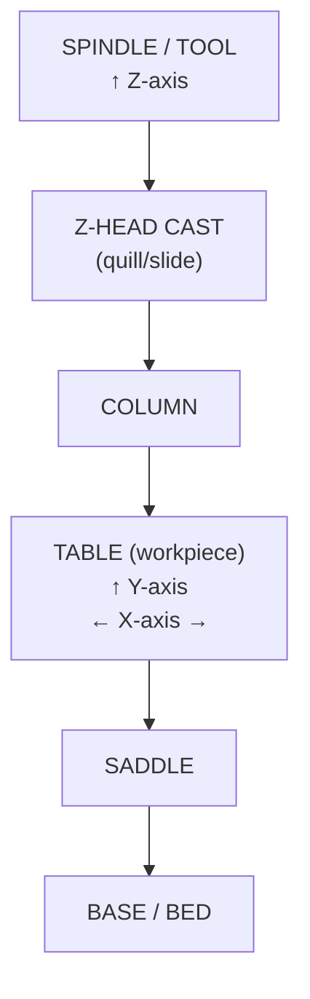

# Lesson 1: Machine Architecture, Coordinate Systems, Axis Configuration

## 1. First-Principles Intuition & Invariants

Every CNC machine tool is, at its most fundamental level, a device for translating abstract geometric descriptions of a part into physical removal of material from a workpiece. The bridge between the abstract and the physical is the coordinate system. Without a rigorous, unambiguous understanding of how the machine represents position in space, no amount of feeds-and-speeds knowledge or toolpath sophistication will produce an accurate part. The coordinate system is the load-bearing foundation of all CNC work, and every error in setup, every crashed tool, and every out-of-tolerance dimension can ultimately be traced back to a breakdown in the relationship between the numbers in the program and the physical position of the cutting tool relative to the workpiece.

The fundamental invariant of all CNC machining is that the controller must always know, at every instant, exactly where the tool tip is in a defined three-dimensional space. This requires three things working in tight, deterministic coordination: a physical system of linear and rotary guideways that constrains motion to known axes, a feedback system (typically glass-scale encoders or rotary resolvers on servo motors) that reports actual position to the controller with sub-thousandth precision, and a logical mapping that ties those position reports to a coordinate frame the programmer can reason about. When any one of these three breaks down — a way that has shifted, an encoder that has lost counts, a work offset loaded into the wrong register — the entire system loses its grip on reality, and the tool will cut air or carve steel where it should not.

The cartesian coordinate system, as applied to machine tools, is governed by the EIA-267-A standard (mirrored internationally by ISO 841), which establishes the axis letter conventions that every CNC controller in the world follows. The Z-axis is always the principal spindle axis — the axis along which the primary cutting motion occurs. On a vertical milling machine, Z is the quill or spindle up-and-down motion, positive upward, away from the workpiece. On a lathe, Z is the spindle centerline axis, positive away from the headstock toward the tailstock. The X-axis is always horizontal and perpendicular to Z, representing the primary radial or cross-feed direction. On a vertical mill, X is positive to the right when facing the machine. On a lathe, X is positive away from the spindle centerline, toward the operator. The Y-axis completes the right-handed cartesian system, perpendicular to both X and Z, positive away from the operator on a standard vertical mill. This right-hand-rule convention is not arbitrary; it ensures that the cross product of X and Y yields Z in the positive direction, which keeps rotation matrices, angular corrections, and five-axis compensation algorithms mathematically consistent across all post-processed toolpaths.

The critical conceptual distinction that every machinist must internalize is the separation between machine zero and work zero. Machine zero is a physical, fixed position on the machine determined by the manufacturer — it is the reference point to which the encoder system homes upon power-up, typically established by precision ground hard stops or homing switches. Machine zero never moves. It is the bedrock. Work zero, by contrast, is a logical point that the machinist defines on the workpiece or in the fixturing. It is the origin of the part program — the point from which all dimensions in the G-code are measured. The controller maintains the relationship between machine zero and work zero through a set of offset registers (G54 through G59 on most Fanuc-compatible controllers, and corresponding work coordinate systems on Siemens, Heidenhain, and LinuxCNC). When you edge-find the left corner of your vise jaw and enter that machine-coordinate position into the G54 X register, you have told the controller: "Subtract this offset from every machine coordinate so that the part program thinks this corner is X0 Y0 Z0." The controller performs this transformation continuously, in real time, for every commanded move.

The distinction matters because the part program is written in the coordinate frame of the part, not the coordinate frame of the machine. A program to mill a pocket with its origin at the center of the part will have all its coordinates computed relative to that center. If the part is shifted two inches to the right in the vise, the program does not change — only the G54 offset changes. This decoupling is what allows a single post-processed program to run on multiple machines, in multiple setups, with the workpiece clamped in different positions, without rewriting a single line of G-code. It is the separation of concerns that makes CNC machining scalable and repeatable.

Absolute and incremental positioning define two distinct modes of how the controller interprets the coordinate words in a G-code block. In absolute mode (G90), every commanded position is specified relative to the current active work offset origin. An X10.0 Y5.0 command in G90 means "move to the point that is 10 millimeters in X and 5 millimeters in Y from the G54 origin, regardless of where the tool currently sits." In incremental mode (G91), positions are specified relative to the tool's current position at the moment the block is read. The same X10.0 Y5.0 command in G91 means "move 10 millimeters in the positive X direction and 5 millimeters in the positive Y direction from wherever you are right now." Modern programming practice favors absolute positioning for the overwhelming majority of toolpaths because it is self-correcting: if a previous move was interrupted or executed with a slight error, the next absolute command snaps back to the correct position relative to the origin. Incremental moves accumulate error, because each move's endpoint depends on the previous move's endpoint, which depends on the one before that. Incremental positioning still has legitimate uses — peck-drilling retract depths, bolt circle patterns expressed from a center point, or sub-programmed repetitive features — but it must be used with the understanding that its error is cumulative.

## 2. Core Architecture & Mechanics

The physical architecture of a CNC machine tool is described by its kinematic chain — the sequence of rigid bodies and joints that transmit motion from the machine's ground frame (the bed or column) to the cutting tool. Every axis of motion is a link in this chain, and the order of the links determines how the machine behaves and how the controller must compensate for geometric relationships. Understanding the kinematic chain of your machine is essential for five-axis work, for understanding why certain geometries are easier to machine on certain machine configurations, and for diagnosing volumetric accuracy problems.

### Vertical Machining Center (VMC) Kinematics

The most common CNC machine tool in job shops worldwide is the 3-axis vertical machining center. Its kinematic chain is straightforward: the bed is the ground frame. The X-axis saddle rides on linear guideways bolted to the bed. The Y-axis saddle rides on the X-axis saddle. The column rises from the bed, and the Z-axis head — carrying the spindle — rides on the column. The workpiece is clamped to the table, which is the topmost moving element on the X and Y stack. The tool is held in the spindle, which is the topmost moving element on the Z stack. The kinematic chain from ground to workpiece is: bed → X saddle → Y saddle → table → workpiece. The kinematic chain from ground to tool is: bed → column → Z head → spindle → tool. The intersection point where the tool meets the workpiece is where the cutting happens, and the controller manages the relative position of these two stacks to achieve the commanded coordinates.



In this configuration, the tool only moves in Z and the workpiece moves in X and Y. This has practical consequences for cutting dynamics: during a heavy X-axis contouring cut, the table mass (which includes the workpiece, vise, and saddle) is in motion, and the inertia of that mass affects the servo loop's ability to maintain commanded position. On a machine with linear motors and lightweight composite tables, this is manageable. On an older machine with heavy cast-iron tables and ballscrew drives, the X-axis acceleration is limited by the servo motor's torque curve and the ballscrew's torsional stiffness. The programmer who understands this will avoid aggressive high-frequency direction changes in X on a heavy machine, because the table mass will overshoot, the servo will correct, and the surface finish will show visible chatter marks at every corner.

### Horizontal Machining Center (HMC) Kinematics

A horizontal machining center inverts the spindle orientation to horizontal, so the Z-axis now points horizontally toward the workpiece. The spindle typically moves in Z and Y, while the table moves in X. The advantage of the HMC is chip evacuation — gravity pulls chips away from the cutting zone rather than pooling in the pocket — and pallet pooling, where a rotary pallet changer allows one pallet to be loaded while the other is machined. The kinematic chain is: bed → X saddle → table (with optional rotary B-axis) → workpiece, and bed → column → Y saddle → Z spindle → tool. The B-axis rotary table, when present, rotates the workpiece around the Y-axis, making it a true 4th axis for indexing and, in some cases, full simultaneous 4-axis machining.

### Lathe / Turning Center Kinematics

On a CNC lathe, the kinematic chain is fundamentally different. The spindle carries the workpiece (through a chuck or collet), and the tool moves. The Z-axis is the spindle centerline, positive away from the chuck. The X-axis is the cross-slide, positive away from the spindle centerline (toward the operator on a slant-bed lathe). There is no Y-axis on a standard 2-axis lathe. The tool sits on a turret that indexes to present different tools to the workpiece. The kinematic chain from ground to workpiece is: bed → spindle → workpiece, and from ground to tool: bed → X saddle → Z saddle → turret → tool. The cutting intersection is where the tool meets the rotating workpiece surface. On a lathe with a driven tool (live tooling) and a C-axis (spindle positioning), the machine becomes a milling-turning hybrid, sometimes called a mill-turn or Swiss-type machine, and the kinematic complexity increases substantially.

### Axis Nomenclature: Primary and Rotary Axes

The EIA-267 standard defines the primary linear axes as X, Y, and Z. When rotary axes are added, they are named A, B, and C, corresponding to rotation about X, Y, and Z respectively. The rotation sense follows the right-hand rule: if the thumb of the right hand points in the positive direction of the linear axis, the fingers curl in the positive direction of the corresponding rotary axis.

| Axis | Type | Motion Direction | Positive Sense |
|------|------|-----------------|---------------|
| X    | Linear | Horizontal, ⊥ to Z | Right (mill), Radial out (lathe) |
| Y    | Linear | Perpendicular to X and Z | Away from operator |
| Z    | Linear | Along spindle centerline | Away from workpiece |
| A    | Rotary | Rotation about X | Right-hand rule about X |
| B    | Rotary | Rotation about Y | Right-hand rule about Y |
| C    | Rotary | Rotation about Z | Right-hand rule about Z |
| U    | Linear | Parallel to X (secondary) | Same as X |
| V    | Linear | Parallel to Y (secondary) | Same as Y |
| W    | Linear | Parallel to Z (secondary) | Same as Z |

The U, V, and W axes are used for secondary slides parallel to the primary axes — for example, on a lathe with a sub-spindle, the sub-spindle's Z-motion might be designated W to distinguish it from the main spindle's Z. On a 5-axis milling machine, the two rotary axes can be configured in several common kinematic arrangements, each of which changes how the post-processor must compute tool positions and how the machinist sets up parts.

The two most common 5-axis configurations are the trunnion table (tilting rotary table) and the swivel-head (articulating spindle). On a trunnion table machine, the rotary axes are on the workpiece side: a C-axis table rotates about Z, and an A-axis trunnion tilts about X. The kinematic chain is: bed → X → Y → Z → A (tilt) → C (rotate) → workpiece, and bed → column → spindle → tool. The tool position in machine coordinates is purely a function of X, Y, and Z. The workpiece is rotated and tilted to present the correct surface to the fixed-orientation tool. This configuration is excellent for large parts and deep pocket machining because the spindle remains rigid and full Z-travel is always available. Its weakness is that the table-tipping motion moves the workpiece through a large arc, which can cause Z-height collisions with the spindle housing when the table is tilted near 90 degrees.

On a swivel-head machine, the rotary axes are on the spindle side: a B-axis tilts the spindle about Y, and a C-axis rotates the spindle about Z. The kinematic chain is: bed → X → Y → Z → B (tilt) → C (rotate) → spindle → tool, and the workpiece sits on a fixed table. The advantage is that the workpiece remains stationary, so fixturing is simpler and the machine envelope is more usable. The disadvantage is that tilting the spindle changes the tool tip's position — the pivot point of the B-axis is typically not at the tool tip, so every B-rotation induces a translation in X, Y, and Z that the controller must compensate for through kinematic transformation. This is called the "pivot point offset" or "tool center point" management, and it is one of the most common sources of 5-axis setup errors.

### Machine Zero, Reference Points, and Homing

Machine zero is established by a homing routine executed at power-up. On most modern machines with absolute encoders, the homing routine is a verification step — the controller moves each axis to a known position and checks that the encoder reading matches a stored reference value. On machines with incremental encoders (older or budget machines), homing is a discovery process: the axis moves at a slow seek rate until it contacts a hard stop or triggers a homing switch, and the controller records that encoder count as the zero reference. The precision of the homing procedure directly determines the repeatability of the machine. A homing switch that has shifted by 0.0003 inches will shift every dimension cut on that machine by the same amount, because the machine zero reference has moved.

The home position is not necessarily the machine zero used for programming. Most machines define a "reference return point" (sometimes called the "zero position" or "home position" in the operator manual) that is at or near the travel limit of each axis, and the machine zero used for programming is offset from this by a known value stored in a machine parameter. On Fanuc controllers, parameter 1240 (X, Y, Z) defines the distance from the reference return point to the machine coordinate zero. On Siemens controllers, this is set in the machine data under the "machine zero" offset settings. The machinist does not normally adjust these parameters — they are set during machine installation and calibration — but knowing they exist is critical for understanding why a machine that has been moved, bumped, or had its encoders replaced may suddenly produce parts that are out of position.

### Work Offsets and Datum Establishment

The work offset system allows the machinist to define up to six (or more, on some controllers) distinct work coordinate systems, labeled G54 through G59. Each work coordinate system has its own X, Y, and Z offset values stored in a non-volatile register. When G54 is active, the controller subtracts the G54 offset values from the machine coordinates and presents the result as work coordinates to the part program. When G55 is active, a different set of offsets is used, and the same part program can cut identical features at a different physical location on the table. This is the mechanism that allows a machine to run multiple parts in a tombstone fixture or a multi-part vise: each part location gets its own work offset, and the program calls G54 for part 1, G55 for part 2, and so on.

Datum establishment is the process of finding the machine-coordinate position of the point you want to be work zero and entering that value into the appropriate work offset register. On a milling machine, the most common datum is the lower-left corner of the workpiece or the center of a bored hole. Finding the X and Y datum is done with an edge finder, a mechanical probe (such as a Renishaw or Haimer), or by touching off a known-diameter tool against the workpiece edge and compensating for half the tool diameter.

The edge finder procedure for establishing a left-edge datum in X is as follows:

1. Load the edge finder into a collet or end mill holder and secure it in the spindle.
2. Set the spindle to approximately 800–1000 RPM (mechanical edge finders require the spindle to be turning).
3. In handle jog mode, position the edge finder tip approximately 0.050 inches to the left of the workpiece edge, with the tip aligned vertically with the edge.
4. Jog the X-axis in the positive direction (toward the workpiece) at 0.010 inches per jog increment until the edge finder tip just begins to contact the workpiece. The visible half of the edge finder tip will "kick" sideways when contact is made.
5. Back off the X-axis by 0.010 inches, then re-approach at 0.001-inch increments until the tip kicks again. This eliminates backlash from the approach.
6. When the tip is in contact (kicked position), the spindle centerline is exactly 0.200 inches from the workpiece edge (half the 0.400-inch tip diameter of a standard edge finder).
7. Read the machine coordinate X value from the position display. Add 0.200 inches to this value (or subtract, if approaching from the opposite side). This is the machine-coordinate position of the workpiece's left edge.
8. Enter this value into the G54 X offset register. Set the X work coordinate display to zero.

For Z-axis datum, the procedure depends on whether the work zero is the top surface of the workpiece (common for milling from solid stock) or the bottom surface (common for castings where the mating face is already machined). To set Z-zero on the top surface using a known tool:

1. Load the tool that will be used for the first machining operation (or a dedicated setup tool of known length).
2. Jog the Z-axis down until the tool tip is approximately 0.050 inches above the workpiece surface.
3. Place a 0.001-inch feeler gauge or a precision shim of known thickness (e.g., a 0.100-inch gauge block) between the tool tip and the workpiece surface.
4. Jog the Z-axis down in 0.001-inch increments until the tool tip just contacts the gauge — you should feel light drag on the gauge when sliding it, but not be able to lift it.
5. Add the gauge thickness to the current Z machine-coordinate reading. This gives the machine-coordinate position of the workpiece top surface.
6. Enter this value into the G54 Z offset register. Set the Z work coordinate display to zero.

Alternatively, a tool length offset (G43 Hxx) approach can be used, where the Z-zero is set to the machine's Z-reference point and each tool's length is measured and stored in the tool length offset table (H-codes). The controller then subtracts the tool length from the Z-axis position so that the tool tip reaches the commanded Z. This is the standard approach in production environments because it allows tool changes without re-zeroing Z, as long as each tool's length is correctly entered in the offset table.

### Absolute vs Incremental Positioning in Practice

The G90 command activates absolute positioning. Once active, all subsequent coordinate words are interpreted as distances from the current work offset origin. This is the default state for most part programs. The G91 command switches to incremental mode, where coordinate words are interpreted as distances from the current tool position. The two modes can be switched mid-program and can even coexist on the same line for different axes using the `U`, `V`, `W` words on some controllers (Fanuc lathes use U and W for incremental X and Z on an otherwise absolute block).

Consider the following G-code sequence for milling a 20mm × 20mm square in the XY plane, starting from the lower-left corner at work origin:

```gcode
G90 G54 G00 X0 Y0        (Absolute: rapid to work origin)
G00 Z1.0                  (Rapid to 1mm above part)
G01 Z-2.0 F100            (Feed down 2mm at 100mm/min)
G01 X20.0 Y0  F200        (Cut right along bottom edge)
G01 X20.0 Y20.0           (Cut up along right edge)
G01 X0 Y20.0              (Cut left along top edge)
G01 X0 Y0                 (Cut down along left edge)
G00 Z10.0                 (Rapid retract)
```

The same square expressed incrementally:

```gcode
G91 G54 G00 X0 Y0         (Incremental mode — but this means "move 0", so no move)
G00 Z1.0                  (Rapid 1mm up from current Z)
G01 Z-3.0 F100            (Feed down 3mm from current Z position)
G01 X20.0 Y0 F200         (Move 20mm in +X from current position)
G01 X0 Y20.0              (Move 20mm in +Y)
G01 X-20.0 Y0             (Move 20mm in -X)
G01 X0 Y-20.0             (Move 20mm in -Y)
G00 Z13.0                 (Rapid retract 13mm from current Z)
```

Note the subtle danger in the incremental version: the Z-feed-down command is `G01 Z-3.0`, not `G01 Z-2.0`. The absolute version commands an absolute depth of -2.0mm, but the incremental version must account for the current Z position (1.0mm above part) and subtract 3.0mm to reach -2.0mm. If the operator manually jogged the Z-axis before the cycle start and the current Z was at 0.5mm instead of 1.0mm, the incremental Z-plunge would cut to -2.5mm — 0.5mm deeper than intended. The absolute version would cut to -2.0mm regardless of the starting Z position, because it targets an absolute coordinate. This is why absolute positioning is preferred for all critical depth and position moves, and incremental mode is reserved for cases where the offset is intentional and self-referential, such as a canned drilling cycle's peck retract (`Q` value) or a bolt-hole pattern called from a sub-program that is designed to run from any starting point.

## 3. High-Performance Optimization & Failure Modes

### Datum Strategy for Production Repeatability

The single most impactful decision in a CNC setup is where to put the work zero. A poorly chosen datum forces the operator to make multiple calculations per part, introduces compounding measurement error, and makes the setup unreproducible across shifts. A well-chosen datum is self-referencing, requires one measurement to establish, and produces parts that are identical across machines and operators.

For rectangular workpieces held in a vise, the conventional datum scheme is the lower-left corner of the top face in XY, with Z-zero on the top surface. This works, but it has a weakness: the left edge of the workpiece is not a precision surface. If the stock was cut on a bandsaw or sheared, the edge may vary by 0.020 inches or more from part to part, which means the G54 X-offset must be re-measured for every part. A better strategy is to datum from the fixed jaw of the vise. The fixed jaw is a precision-ground surface that does not move between parts, so if the G54 X-offset is set to the vise jaw's left face and the program accounts for the stock width as a variable, the operator only needs to verify that the stock is flush against the jaw — not re-measure the X-datum for every part.

For circular or irregular workpieces, the center of a bored or reamed hole is the strongest datum. A hole center can be found with a mechanical probe by taking touches on four sides (left, right, top, bottom) and averaging, or with an electronic edge finder in "center find" mode. The Renishaw OMP40 spindle probe, when used with a controller macro (such as Fanuc's G65 P9023 or the Renishaw-supplied probing cycles), can find a bore center to within 0.0002 inches in under 10 seconds with no operator intervention. The probe touches the bore wall at four points, the controller computes the center from the chord measurements, and the result is written directly to the G54 offset register. This is the standard approach in production environments where setup time must be minimized and repeatability must be better than ±0.0005 inches.

For Z-axis datums in production, the tool length offset (TLO) system is superior to re-zeroing Z for every part. Each tool's length is measured — either with a presetter, by touching off on a Z-axis reference gauge, or with an on-machine tool length probe — and stored in the H-offset register. The G54 Z-offset is set to the top of the part (or the machine table, for parts that reference from the table). When G43 Hxx is called in the program, the controller subtracts the tool length from the commanded Z position, so the tool tip reaches the correct depth without the operator manually touching off each tool. If a tool breaks and is replaced, only that tool's H-offset needs updating, not the G54 Z-offset. This decouples tool management from work management and eliminates a common error source.

### Common Failure Modes and Their Root Causes

**Wrong work offset loaded.** The operator sets up the part and zeros the G54 register, but the program calls G55 (or the previous operator left G55 active from the last job). The machine rapids to a position that is correct for G55 but wrong for the actual part location, and the tool plunges into the vise jaw or off the edge of the stock. This is the most common cause of crashes in job shops. Mitigation: the first line of every part program should explicitly call the work offset (`G54 G00 X0 Y0`), and the operator should verify the active work offset on the controller's position display before pressing cycle start. Some shops implement a policy where the program's first move is a rapid to a "safe zone" position (e.g., X2.0 Y2.0 Z2.0) that is inside the stock envelope but away from clamps, so if the wrong offset is loaded, the tool arrives at an obviously wrong position and the operator can stop before the cutting feed begins.

**Tool length offset not updated after tool change.** The operator replaces a broken end mill with a new one of the same nominal size but different actual length (carbide tools from different batches or manufacturers can vary by 0.020 inches or more in overall length). The H-offset for that tool is not updated. The tool plunges to the commanded Z-depth, but because the tool is shorter, it cuts 0.020 inches shallower than intended — or if longer, it over-cuts and gouges the part. Mitigation: every tool change must include a tool length measurement step, either with a tool presetter, a Z-axis touch-off gauge, or the machine's automatic tool measurement probe. The H-offset must be updated before that tool's first cutting move.

**Thermal drift of machine zero.** As the machine warms up from idle to operating temperature, the cast-iron column and bed expand. A typical VMC column will grow approximately 0.0004 inches per foot of height per 10°F of temperature rise. On a machine with a 30-inch column, going from a 68°F shop at startup to a 85°F operating temperature causes the Z-axis to shift by approximately 0.0017 inches — enough to scrap a tolerance-critical part. Mitigation: warm up the machine for 20–30 minutes before cutting critical parts, using a warm-up program that exercises all axes through their full travel range. For ultra-precision work, use a spindle-mounted probe to re-verify the Z-datum after warm-up, or use a machine with thermal compensation (the controller adjusts offsets based on temperature sensor readings from the column and ballscrew).

**Backlash in incremental moves on older machines.** Machines with ballscrew drives that have worn or loose ball nuts exhibit backlash — a small amount of free play when the direction of motion reverses. On a machine with 0.0008 inches of X-axis backlash, every time the X-direction reverses, the first 0.0008 inches of motion does not move the table — it only takes up the play. In absolute mode, the controller's position feedback (from the encoder) accounts for this, and the final position is correct. But if the machine uses open-loop stepper drives (no encoder feedback), or if the backlash compensation is not correctly set in the controller parameters, the actual position will be off by the backlash amount at every direction reversal. Mitigation: for machines with encoder feedback, ensure backlash compensation is enabled and correctly measured (Fanuc parameter 1851 for each axis). For open-loop machines, always approach critical dimensions from the same direction — for example, always finish-bore from the inside moving outward, never alternate inside-out and outside-in.

**5-axis pivot point offset errors.** On a swivel-head 5-axis machine, the B-axis rotation center is at a fixed point in the spindle housing, typically 80–150mm above the gauge line (the spindle face). When the head tilts, the tool tip moves in an arc around this pivot point, and the controller must compensate for the translation induced by the rotation. This compensation is only correct if the pivot point distance (stored in a machine kinematic parameter, such as Fanuc parameter 19700-series for 5-axis kinematics) is accurately calibrated. If the pivot point parameter is wrong by 0.010mm, every 5-axis move will be off by the sine of the tilt angle times the error. At 30 degrees of tilt, a 0.010mm pivot error produces 0.005mm of position error — small but significant for aerospace tolerance work. Mitigation: run the machine's 5-axis calibration routine (often called "kinematics calibration" or "RTCP calibration") after any spindle service, after a crash that involved the B or C axis, and at scheduled intervals (typically every 6 months). The calibration routine probes a precision sphere at multiple tilt and rotation angles and computes the actual pivot point from the measured deviations.

**Improper homing after encoder battery replacement.** When the battery that backs up the absolute encoder position fails and is replaced, the encoder loses its stored position reference. The machine must be re-homed, and on some machines, the homing procedure requires the axes to be manually cranked to specific positions before the encoder can be re-initialized. If this procedure is done incorrectly, machine zero is wrong, and every work offset, every tool length offset, and every part produced on that machine will be wrong by the error amount. This is a catastrophic failure mode because it is invisible — the controller does not know it is wrong, and the position display looks normal. Mitigation: after any encoder battery replacement, verify machine zero by indicating a known reference surface (such as the vise jaw or a reference pin on the table) and comparing the machine coordinate reading to the value recorded during the last machine calibration. If the values do not match, re-home according to the manufacturer's procedure and re-verify.

The discipline that ties all of these practices together is documentation. A setup sheet that records the work offset values, tool length offsets, tool numbers, datum method, and zero-position verification measurement for each job is the machinist's insurance against the most common and most expensive failures in CNC work. The machine is precise. The controller is precise. The human is the variable, and the setup sheet is how the human becomes precise too.
