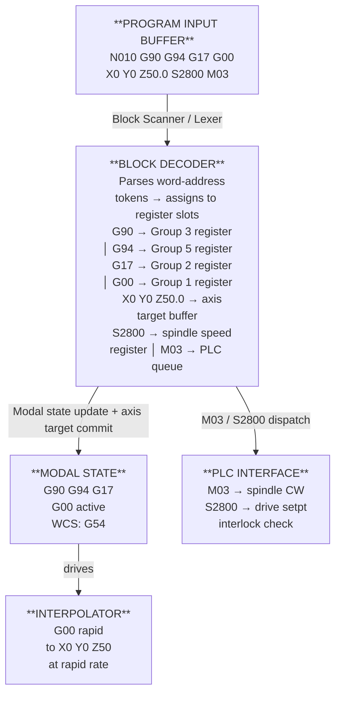

# Lesson 2: G-Code Programming Structure, Modal Commands, Execution Models

## 1. First-Principles Intuition & Invariants

There is a certain elegance in the fact that the same textual language used to cut aluminum brackets in a small job shop in Stuttgart is also used to machine turbine discs in an aerospace facility in Toulouse. G-code, formalized under ISO 6983 and its American cousin EIA RS-274D, is not merely a file format. It is the contractual interface between human intention and machine kinematics, a protocol that has remained remarkably stable for over six decades while the hardware around it has transformed beyond recognition. Understanding it at the level of first principles, rather than as a sequence of memorized mnemonics, is what separates a programmer who debugs by instinct from one who debugs by inference.

The original premise of numerical control, developed at MIT in the early 1950s under Air Force contract, was to encode tool paths as discrete coordinate data rather than relying on physical cams and templates. The key insight was that any contoured surface could be decomposed into a series of linear or circular approximations, each defined by endpoint coordinates and a motion type. The machine's control unit would interpolate between these endpoints in real time, commanding individual axis drives with the precision that analog templates never could. This interpolation architecture is still the conceptual core of every modern CNC controller, whether it runs on a 1980s Fanuc 6M or a contemporary Heidenhain TNC 640.

What ISO 6983 standardized was the encoding of that interpolation as a stream of blocks, each block representing a single unit of machine action. A block is a line of ASCII text terminated by a newline or a percent-sign header. Within each block, word-address format is used: every instruction is a letter followed by a numerical value, and the letter is the word address that tells the controller which parameter is being set. The address `X` communicates an X-axis target coordinate. The address `F` sets a feedrate. The address `S` commands a spindle speed. The address `G` selects a preparatory function, and the address `M` invokes a miscellaneous machine function. This taxonomy, preparatory versus miscellaneous, is not arbitrary. It reflects a physical division between motion and state control on one side and machine peripheral actuation on the other.

The invariant at the heart of G-code execution is *modality*. Most G-codes, once invoked, remain active until explicitly cancelled or superseded. A modal command does not need to be restated on every block; it persists across subsequent lines until the controller encounters a command from the same modal group. This is not simply a convenience for reducing program length. It is the mechanism by which the controller maintains a coherent internal state model of the machine at all times. Every axis position, every active offset, every motion mode is part of this state, and the controller's execution engine reads each incoming block as a *delta* applied to that state rather than as a fully self-contained instruction. When you write `G01 X50.0 F200`, you are telling the controller to update its motion mode to linear interpolation, move X to 50.0 mm, and set the feedrate to 200 mm/min. On the next block, writing only `Y75.0` is legal and unambiguous because the controller already knows the motion is still G01 at F200.

This modality introduces what practitioners must treat as an invariant of safe programming: *the machine's state at any point in a program is the cumulative result of every modal command that has executed before it*. This is why subroutines, restarts, and mid-program dry runs are genuinely dangerous without a proper state initialization block at the program's head. If the previous job left the controller in G91 incremental mode and your program assumes G90 absolute positioning without declaring it, the first motion command will produce a tool path that bears no geometric relationship to your intent. The standard defensive preamble, usually called a safe start block, exists specifically to collapse this history uncertainty to zero by explicitly declaring every modal group that matters for the job.

The distinction between G-codes and M-codes maps onto the physical architecture of the machine itself. G-codes govern the motion control system: interpolation mode, coordinate system selection, canned cycle activation, compensation algorithms. These commands interact with the axis drives, the interpolator, and the offset register files that live inside the CNC controller's memory. M-codes, by contrast, interface with the PLC layer that sits between the CNC controller and the machine's electrical subsystems. When you command `M03` to start the spindle clockwise, the CNC controller does not directly energize the spindle motor. It asserts a signal to the machine PLC, which evaluates the signal against its ladder logic, checks spindle-ready interlocks, and then enables the spindle drive. This two-layer architecture explains why M-code behavior can vary significantly between builders on ostensibly identical controllers: the PLC program is builder-specific, even when the CNC kernel is the same Fanuc or Mitsubishi unit.

The practical consequence is that G-code programs are not fully portable across machines even when both machines speak ISO 6983. A program that runs correctly on a Mazak Nexus 350 may require modification before running on a Doosan DNM 500, not because the motion codes differ, but because M-code assignments, macro variable conventions, and canned cycle parameter interpretations are builder-defined. This is a reality the advanced programmer internalizes early: G-code programs are tested and validated on specific machine-controller combinations, not in the abstract.

---

## 2. Core Architecture & Mechanics

### Modal Groups and the State Machine Model

The CNC controller's execution engine is most accurately understood as a finite state machine. At any moment, the controller holds a complete snapshot of the machining state across a set of independent registers, and each incoming block produces a state transition by updating one or more of those registers. Modal groups are the taxonomy of these registers. ISO 6983 defines them formally, though controller manufacturers may add proprietary extensions.

The most critical modal groups for a machinist programming at the floor level are the motion group, the feed mode group, the coordinate mode group, the plane selection group, and the work coordinate system group.

**Motion Group (Group 1):** This register holds the current interpolation mode. Its members are `G00` (rapid positioning), `G01` (linear interpolation at programmed feedrate), `G02` (circular interpolation clockwise), `G03` (circular interpolation counterclockwise), and the canned cycle codes `G73` through `G89` depending on builder implementation. Only one motion mode can be active at a time. `G00` is the default state on power-up for most controllers.

**Feed Mode Group (Group 5):** This governs whether the `F` word is interpreted as mm/min or mm/rev. `G94` selects per-minute feed, `G95` selects per-revolution feed. For milling operations you almost always work in `G94`. For turning and boring with a live tool where chip thickness control demands feed synchronized to spindle rotation, `G95` is the correct mode.

**Coordinate Mode Group (Group 3):** `G90` and `G91` control whether coordinate words are interpreted as absolute positions in the active work coordinate system or as incremental displacements from the current position. The two are not interchangeable in programming practice. Absolute mode `G90` is safer for most operations because a single erroneous coordinate value only mispositions one move. In incremental mode `G91`, an error accumulates: each subsequent move is displaced by the cumulative error of everything before it.

**Plane Selection Group (Group 2):** `G17`, `G18`, and `G19` select the XY, XZ, and YZ planes respectively. This selection governs the plane in which circular interpolation `G02`/`G03` arcs are executed and in which canned drilling cycles orient their depth axis. On a vertical machining center, `G17` is the default and correct selection for all face milling, pocket milling, and circular feature work. Failure to declare the correct plane before a circular arc is a source of geometry errors that can be difficult to diagnose if you don't understand the state machine model.

The following diagram illustrates the relationship between the block execution pipeline and the modal state registers:

The key architectural point this diagram communicates is that modal state updates and axis motion are concurrent operations within the same block execution. The controller does not first update all modal registers and then initiate motion on a subsequent clock cycle. Modal changes in a block take effect for the motion commanded *within the same block*. This is why you can legally write `G01 X100.0 F300` in a single block without a separate preceding block to establish G01 mode.

### Block Execution Sequence and Word Priority

Within a single block, ISO 6983 defines a priority order for word execution that most Fanuc-compatible controllers follow. Preparatory functions `G` are decoded before axis moves, which are computed before miscellaneous functions `M` are executed. This matters most for the interaction between coordinate system changes and motion. If you write `G54 X0 Y0` in a single block, the controller establishes the G54 work coordinate offset first, then executes the motion to X0 Y0 in that system. Writing `X0 Y0 G54` in the reverse word order produces the same result because the decoder processes `G` words regardless of their physical position in the text string.

The exception is the interaction between M-codes and motion. On most builders, `M-codes` with motion implications, specifically `M03` (spindle on CW), `M04` (spindle on CCW), `M05` (spindle stop), and `M08`/`M09` (coolant on/off), are processed before the axis motion in the same block when they appear as spindle-start commands. This allows you to write `S2800 M03 G00 X0 Y0 Z50.0` in a single block and expect the spindle to reach speed before or during the rapid approach. However, the precise synchronization behavior is builder-specific. On machines with an M03 completion dwell hardwired in the PLC, the axis motion will wait for the spindle ready signal. On machines without that interlock, the rapid move and spindle acceleration happen simultaneously. The safe practice for production programming is to issue `M03` and `S` words on a dedicated block, then execute a short `G04 P2.0` dwell (2 seconds) before the first cutting move, ensuring the spindle is at speed before the tool engages material.

### Preparatory Functions in Depth: G00, G01, G02, G03

`G00` rapid positioning commands the controller to move all specified axes simultaneously to their target coordinates at the machine's configured maximum traverse rate. The critical invariant here is that `G00` does *not* guarantee a straight-line path between start and end points on most controllers. Each axis accelerates independently to its maximum velocity and decelerates independently to zero. The actual tool path through space is a function of the relative distances and axis velocity limits, typically producing a kinked or staircased path. This means you must never use `G00` to position through a workpiece or over a fixture clamp, even if the start and end points are both safely clear. The intermediate path is undefined without explicit knowledge of your specific controller's rapid motion algorithm. Use `G00` only for open-air tool changes, approach moves to a safe Z height, and table traversals where the full work envelope is clear.

`G01` linear interpolation moves all specified axes simultaneously at the programmed `F` feedrate, maintaining true straight-line synchronization through real-time interpolation. The controller computes the vector from start to end point, determines the axis velocity components required to maintain constant combined feedrate along that vector, and commands each axis drive accordingly. This is genuine coordinated motion. A `G01` move from X0 Y0 to X100.0 Y100.0 at F200 mm/min will trace a 45-degree line at 200 mm/min along the hypotenuse, not 200 mm/min per axis.

`G02` and `G03` extend the interpolation to circular arcs. The controller requires, in addition to the endpoint coordinates, a definition of the arc's center. This can be provided two ways: as `I`, `J`, `K` incremental offsets from the arc start point to the center, or as a radius value `R`. The `R` word method is simpler to write and read, but it carries a geometric ambiguity that experienced programmers must respect. For any two points on a plane, two arcs with the same radius connect them: one takes the minor arc (less than 180 degrees), the other the major arc (greater than 180 degrees). Most controllers resolve this by using a positive `R` for the minor arc and a negative `R` for the major arc. A full 360-degree circle cannot be programmed with the `R` method at all because start and end points are coincident and the radius is undefined. For full circles, `I`/`J`/`K` offsets are mandatory.

The `I`, `J`, `K` method, though more verbose, is unambiguous for any arc geometry. For a `G17` XY-plane arc, `I` is the incremental X distance from arc start to arc center, and `J` is the incremental Y distance. These values can be positive or negative. Consider a clockwise `G02` arc starting at X30.0 Y0, centered at X0 Y0, ending at X0 Y30.0 (a quarter-circle). The `I` offset is `0 - 30.0 = -30.0` and the `J` offset is `0 - 0 = 0.0`. The block reads:

    G02 X0 Y30.0 I-30.0 J0.0 F150

This notation is completely unambiguous. The center is geometrically determined by adding the `I`/`J` offsets to the start point, and the direction (CW for `G02`, CCW for `G03`) is defined by the G-code itself. Developing the habit of calculating and writing `I`/`J`/`K` values explicitly rather than relying on `R` produces programs that are more transparent, easier to verify on paper, and immune to the full-arc ambiguity that trips up less experienced programmers.

### Feedrate Control, Spindle Commands, and Tool Offsets

Feedrate modality operates in two registers simultaneously: the `F` word stores the programmed feedrate, and the machine's feedrate override knob applies a percentage multiplier (typically 0–150%) to that value in real time. The CNC controller's velocity regulator always uses the product of these two. What this means for programmers is that `F` values should represent the theoretically correct feed for the tool, material, and operation, not an already-conservative value. If a programmer encodes a 50% safety margin into every `F` word, the operator's feedrate override becomes a tool for degrading performance rather than optimizing it, because the operator has no way to know the programmed value already contains that margin.

Tool length offsets (`G43`/`G44` with `H` word on milling, `G41`/`G42` for radius compensation) represent the second major class of register interaction that separates correct programs from dangerous ones. When you invoke `G43 H01`, you are instructing the controller to retrieve the value stored in tool offset register 1 and add it to all subsequent Z-axis positions. The physical meaning is that Z-coordinates in your program represent positions at the tool tip, and the controller compensates for the actual length of whichever tool is currently loaded by biasing all Z commands through that offset. This decouples the program's coordinate geometry from the physical tool dimensions, which is fundamental to both repeatability and tool changeability without program re-editing.

Cutter radius compensation `G41` (tool left of path) and `G42` (tool right of path) works analogously in the XY plane. The controller displaces the programmed tool path by the radius stored in the `D` offset register, allowing the programmer to write coordinates describing the actual part geometry rather than the tool center path. The controller re-calculates the actual tool center path in real time. Invoking and cancelling radius compensation requires a lead-in and lead-out move of at least the tool radius length in the compensation plane, as the compensation cannot be applied or removed at a stationary point. Attempting to activate `G41` or `G42` while the tool is in contact with a wall produces a local path overcorrection that can gouge the part or stall the spindle. The correct workflow is always to activate compensation during an air approach move, then lead into the part geometry.

Work coordinate systems, selected by `G54` through `G59` (and extended sub-registers on modern controllers), allow multiple part datums to be stored simultaneously in the controller's offset tables. `G54` is the standard first fixture datum. The controller adds the `G54` offset values to all programmed coordinates when computing machine positions, translating the program's workpiece-relative coordinates into absolute machine coordinates. This is the mechanism that makes the same program run on a part fixtured anywhere on the table: you re-touch off the new fixture location, write the offset into `G54`, and re-run the program without editing a single coordinate.

---

## 3. High-Performance Optimization & Failure Modes

### Safe Start Blocks and State Initialization

Every production program must begin with a block sequence that fully defines the modal state the program requires, regardless of whatever state the machine inherited from the previous job. A robust safe start block for a vertical machining center on a Fanuc 0i-MD controller reads as follows:

    %
    O1002 (PART: BRACKET_REV3 | MATERIAL: 6061-T6 | TOOL: 16MM 4-FL ENDMILL)
    N001 G90 G94 G17 G40 G49 G80
    N002 G21
    N003 G54
    N004 T01 M06
    N005 S3500 M03
    N006 G43 H01 Z100.0 M08
    N007 G00 X0 Y0

Block N001 declares absolute mode, per-minute feed, XY plane selection, cancels radius compensation `G40`, cancels tool length compensation `G49`, and cancels any active canned cycle `G80`. Each of these six states needs to be explicit because any one of them left in an unexpected condition from the previous program would corrupt the first motion. Block N002 declares metric mode `G21` explicitly, because a machine left in `G20` imperial mode will rapid to an X position 25.4 times further than intended. Block N003 activates the work coordinate system before any axis motion, so that subsequent coordinates are unambiguous. Block N004 calls the tool and executes the tool change with `M06`. Block N005 starts the spindle before the tool length compensation is applied, allowing spindle acceleration to occur during the approach move. Block N006 applies tool length offset H01 and simultaneously moves to a safe Z clearance height while enabling coolant.

### Circular Interpolation Errors and Arc Validation

One of the most common failure modes in circular interpolation is the arc tolerance error, in which the endpoint of the arc, as calculated from the `I`/`J`/`K` center definition and the `G02`/`G03` direction, does not match the specified `X`/`Y` endpoint within the controller's arc tolerance parameter (typically Fanuc parameter 3410, default 0.002 mm). This produces an immediate alarm during execution rather than a silent geometry error, which is the correct behavior, but it means the program halts mid-part. This error originates during CAM post-processing when floating-point rounding of the arc center and endpoint coordinates introduces sub-micron inconsistencies that exceed the tolerance. The fix is either to tighten the CAM post-processor's output decimal precision to four or five decimal places in metric, or to increase the controller's arc tolerance parameter slightly (to 0.01 mm) while verifying that the resulting geometric error is acceptable for the part tolerance. For precision bores and profiles with form tolerances tighter than 0.02 mm, the correct approach is to use `I`/`J`/`K` values computed from the same geometric center used to calculate the endpoint, rather than relying on the CAM system's arc-fitting algorithm.

### Modal State Contamination in Subroutines and Macros

Subroutines, invoked by `M98 P` on Fanuc systems, do not automatically save and restore modal state. If a subroutine contains a `G91` incremental move for a peck-drilling utility, and the main program assumes `G90` absolute on return from the subroutine, the first motion after the `M99` return will execute in `G91` and move by the absolute coordinate value as if it were an incremental offset. The result is typically a large, fast, unintended motion that either gouges the work or triggers an overtravel alarm. The professional solution is to program subroutines that explicitly declare their required modal state on entry and explicitly restore `G90` (or the caller's expected state) before the `M99` return. For macro programming using Fanuc custom macros or Heidenhain cycles, the same principle applies: treat modal state as a function call contract. Document what state the macro expects and what state it guarantees to leave behind.

### Feedrate Optimization and Chip Thinning Compensation

Feed-per-tooth calculations are the starting point for `F` word determination, but the programmed `F` value must account for cutter engagement geometry in ways that are not always intuitive. When milling at a radial depth of cut less than half the cutter diameter, the chip thinning effect means that the actual chip thickness at the cutter is less than the programmed feed-per-tooth. The geometric relationship is:

$$f_{z,\text{actual}} = f_z \cdot \frac{a_e}{D}$$

where $a_e$ is the radial width of cut, $D$ is the cutter diameter, and $f_z$ is the programmed feed per tooth. For a 16 mm endmill at a 4 mm radial step (25% of diameter), the actual chip thickness is only 50% of the programmed value. This means the tool is operating well below its efficient chip-load range, generating rubbing friction rather than clean shearing. The correct response is to increase the `F` word until the actual chip thickness matches the tool manufacturer's recommended value. For a four-flute endmill recommended at 0.04 mm/tooth at 3500 RPM running 25% step-over, the chip-thinned corrected feed is:

$$F = f_z \cdot \frac{D}{a_e} \cdot z \cdot S = 0.04 \cdot \frac{16}{4} \cdot 4 \cdot 3500 = 896 \; \text{mm/min}$$

Programming `F896` rather than `F224` (the uncorrected value) doubles the material removal rate on the roughing pass without increasing tool wear, because the chip is now being formed and evacuated correctly rather than rubbed. This is a first-principles optimization that G-code alone cannot implement without the programmer's understanding of the engagement geometry. Modern high-efficiency milling toolpaths in CAM systems like Mastercam Dynamic Motion and Fusion 360 Adaptive Clearing compute this compensation automatically, but programmers editing or writing manual G-code for specific operations need to carry the calculation explicitly.

### Program Flow Logic: Sequence Numbers, Conditional Branching, and Macro Variables

Sequence numbers, the `N` words, have no effect on execution order. A controller executes blocks in the order they appear in the file, not in numerical sequence order. `N` words exist for documentation, for block search targeting (the ability to begin execution at a specific sequence number), and for use as branch targets in macro programming. The misapprehension that `N` words control execution sequence produces programs with sequence numbers in non-sequential or unrelated order, which then fail mid-program block searches. The convention is to increment `N` values by 5 or 10 to allow insertion of additional blocks without renumbering, though modern CAM systems typically omit `N` words entirely on non-critical blocks.

Fanuc custom macro B variables and Heidenhain Q-parameters introduce conditional logic, loops, and arithmetic into the G-code language, transforming it from a fixed-path description into a parameterizable program. Macro variable `#1` through `#33` are local variables cleared on subroutine exit. Variables `#100` through `#199` are common variables persistent across subroutine calls but cleared on power cycle. Variables `#500` through `#999` are persistent variables that survive power cycle, used for storing calibration offsets and part counters. A bolt-hole pattern loop in macro B uses a `WHILE` construct:

    #1 = 0 (HOLE COUNTER)
    #2 = 6 (TOTAL HOLES)
    #3 = 50.0 (PCD RADIUS)
    WHILE [#1 LT #2] DO1
      #4 = #1 * 60.0 (ANGULAR STEP, 360/6 DEGREES)
      #5 = #3 * COS[#4] (X COORDINATE)
      #6 = #3 * SIN[#4] (Y COORDINATE)
      G81 X#5 Y#6 Z-15.0 R2.0 F120
      #1 = #1 + 1
    END1

This loop executes a `G81` drill cycle at six positions on a 100 mm pitch circle diameter, computing each position trigonometrically from the angle variable. The alternative, six explicit `G81` blocks with hard-coded coordinates, is functionally equivalent but entirely inflexible. If the PCD changes from 50 mm to 55 mm radius, the macro requires a single variable edit. The explicit-block program requires recalculating and re-entering six pairs of coordinates. For families of parts, jig drilling programs, and multi-instance features, macro programming is not an advanced luxury but a fundamental tool for maintaining program correctness under design variation.

The execution model of G-code, understood at this depth, reveals itself as a disciplined and internally consistent system. Its apparent simplicity, single-letter address words, decimal numbers, block-by-block execution, is not a limitation but a carefully designed interface that has proven robust across an enormous range of machine architectures and manufacturing scales. Mastery of it means mastering the state machine it drives: knowing at every line exactly what the controller knows, exactly what the machine is about to do, and exactly why.
