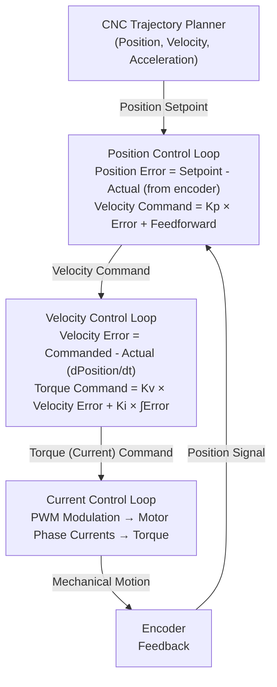

# Lesson 4: Precision Control, Error Sources, Compensation Strategies

## 1. First-Principles Intuition & Invariants

The pursuit of dimensional precision in CNC machining confronts an uncomfortable truth: every mechanical system accumulates error through layers of imperfection that compound geometrically from the machine's foundation upward through the spindle interface to the cutting edge. A five-axis machining center advertised with positioning accuracy of ±0.005 mm represents not a guarantee but an idealized endpoint achieved only when thermal equilibrium stabilizes, when backlash has been measured and compensated, when geometric errors across the work envelope have been mapped and corrected through software transformation matrices, and when the operator understands that accuracy and repeatability constitute fundamentally different specifications. Accuracy measures the deviation between commanded position and true position in absolute space, while repeatability quantifies the machine's ability to return to the same location consistently, regardless of where that location sits relative to the commanded coordinate. A machine may exhibit excellent repeatability—returning to within 0.002 mm of a reference point across hundreds of cycles—yet suffer from systematic position errors that place that repeatable point 0.050 mm away from the nominal coordinate. This distinction governs compensation strategy selection and sets realistic expectations for what software correction can achieve versus what requires mechanical intervention.

The physical architecture of motion control systems divides into two philosophical camps: open-loop and closed-loop topologies. Open-loop systems, typified by stepper motor drives without encoder feedback, assume that commanding a motor to rotate a specific number of steps produces a proportional linear displacement at the ballscrew-driven table. The controller sends a pulse train—each pulse representing one microstep increment—and trusts that the motor shaft rotates accordingly, converting angular motion through the ballscrew's lead (typically 5 mm, 10 mm, or 20 mm per revolution for precision machines) into linear travel. This trust-based model succeeds admirably under nominal conditions: light cutting forces, minimal acceleration demands, and thermal stability. The elegance lies in simplicity—no position feedback loop introduces latency, no encoder interpolation error corrupts position data, and tuning reduces to setting maximum velocity and acceleration limits within the motor's torque envelope. Yet open-loop control fails catastrophically when reality violates its assumptions. A sudden increase in cutting force during an interrupted cut can stall the motor momentarily, causing lost steps that accumulate as position error invisible to the controller. Rapid acceleration cycles in high-speed roughing paths may exceed the motor's pull-out torque threshold, again inducing step loss. Thermal expansion of the ballscrew changes the effective pitch, introducing systematic error that grows with temperature. The machine continues executing commands with perfect confidence while the actual tool position diverges increasingly from the programmed path.

Closed-loop systems address these failure modes by installing rotary encoders or linear scales that provide real-time position feedback, closing the control loop and enabling the servo drive to compute position error continuously as the difference between commanded location and measured location. The servo amplifier modulates motor current dynamically to null this error, generating corrective torque that compensates for disturbances, friction variation, and load changes in real time. Linear encoders, mounted directly to the machine table and reading an etched glass scale, measure position independent of ballscrew thermal expansion or mechanical transmission errors, providing the truest possible representation of actual table displacement. Rotary encoders attached to the motor shaft or ballscrew end offer lower cost and excellent resolution—modern resolvers and optical encoders achieve sub-micron interpolation—but remain subject to errors introduced by ballscrew pitch variation, nut preload changes, and thermal effects between the encoder mounting point and the tool center point. The closed-loop architecture transforms positioning from a trust-based model to a verification-based model, where the control system confirms achievement of the target position before declaring the move complete and issuing the in-position signal that gates subsequent operations.

The benefits of closed-loop control arrive with complexity costs. Servo tuning requires balancing three gain parameters—proportional, integral, and derivative (PID)—to achieve rapid settling without overshoot or oscillation. Proportional gain determines the strength of the corrective response to position error; too low and the axis responds sluggishly, lagging behind rapid feedrate changes, while excessive proportional gain induces oscillation as the control loop over-corrects and hunts around the target position. Integral gain accumulates position error over time, applying increasing corrective effort to eliminate steady-state errors caused by friction or gravitational loading, but excessive integral gain introduces windup effects where accumulated error during acceleration phases causes overshoot during deceleration. Derivative gain responds to the rate of change of position error, providing damping that suppresses oscillation and improves dynamic stiffness, yet amplifies high-frequency noise from encoder quantization and electrical interference. Tuning these parameters on a multi-axis machine requires methodical testing, often using the machine builder's autotune routines that command step inputs and analyze frequency response to compute stable gain values. Once tuned, the servo system achieves following error—the real-time deviation between commanded and actual position—measured in micrometers even during aggressive cutting, maintaining dimensional accuracy that open-loop systems cannot approach.

Backlash represents the mechanical error introduced by clearance between mating components in the drive train, most critically the gap between ballscrew thread flanks and the internal threads of the ballnut. This clearance, necessary to prevent binding and allow lubrication films to form, creates a dead zone during direction reversals where the motor must rotate through the clearance angle before re-engaging the load and producing table motion. On a machine with 0.025 mm of backlash and a 10 mm lead ballscrew, reversing direction requires the motor to rotate through 0.9 degrees before motion resumes. Contour paths requiring axis reversal—circular interpolation, for instance—accumulate position error at each reversal point, producing faceted arcs instead of smooth curves and introducing dimensional error in bore diameters and corner radii. Traditional backlash compensation applies a software offset that commands the controller to overshoot the target position by the measured backlash value when approaching from one direction, then approach the final position from the working direction where the drive train is preloaded. This compensation strategy succeeds for point-to-point positioning but fails during continuous contouring because the controller cannot predict when reversals will occur in arbitrary toolpaths. Advanced CNC controls implement dynamic backlash compensation that monitors axis direction changes in real time and injects corrective position offsets during motion, maintaining contouring accuracy even through reversals. Mechanical solutions—dual-preloaded ballnuts that eliminate clearance through spring tension or oversized ball bearings, or antibacklash split nuts that maintain constant engagement—address the root cause but increase cost and friction.

Thermal expansion introduces systematic position error that scales with temperature gradients across the machine structure and drive components. Steel exhibits a coefficient of thermal expansion near 11.7 micrometers per meter per degree Celsius, meaning a 500 mm ballscrew experiencing a 10°C temperature rise expands by 0.059 mm, introducing position error that grows linearly with distance from the fixed reference point. Machine structures heat unevenly: the spindle generates substantial thermal energy during high-speed machining, transferring heat to the Z-axis column; ballscrews heat from friction in the nut and ball recirculation; cutting fluids cool the work zone while the machine enclosure traps heat. These competing thermal sources create complex expansion patterns that shift the tool center point in three dimensions as the machine warms during production. Compensation strategies divide into passive and active approaches. Passive thermal management includes symmetrical structural design that balances thermal expansion, forced coolant circulation through hollow ballscrews to stabilize temperature, and generous warm-up periods that bring the machine to thermal equilibrium before critical operations. Active compensation employs temperature sensors throughout the machine structure—typically RTD probes or thermocouples monitoring ballscrew bearing blocks, column faces, and spindle housing—feeding real-time data to a thermal model that predicts expansion and applies position offsets through the control system. These models, empirically derived through measurement of thermal growth patterns under various operating conditions, achieve remarkable accuracy but require periodic validation as machine wear and environmental changes alter thermal behavior.

Geometric errors arise from imperfections in the machine's physical construction: ways that deviate from perfect straightness, axes that fail to achieve perpendicularity, rotary axes whose centers of rotation do not align with linear axis intersections. A horizontal machining center nominally features X, Y, and Z linear axes mutually perpendicular and intersecting at the spindle nose, with a rotary B-axis whose center line lies parallel to the Y-axis. Reality delivers squareness errors measured in arc-seconds, straightness deviations quantified in micrometers per meter of travel, and angular errors where rotary axis centerlines miss their nominal orientations. These geometric errors compound: a squareness error between X and Y causes rectangular features to become parallelograms; straightness error in Z causes bore diameters to vary with depth; angular misalignment of a rotary axis introduces helical path error during simultaneous four-axis contouring. Traditional acceptance testing employs laser interferometry, autocollimators, and ball bar testing to measure these errors at the machine commissioning stage, documenting deviations that remain largely constant throughout the machine's service life absent mechanical damage. Modern machine tools incorporate geometric error compensation through transformation matrices embedded in the CNC control, mathematically correcting commanded positions based on measured error maps to deliver true position at the tool center point despite underlying geometric imperfections.

## 2. Core Architecture & Mechanics

The positioning control loop in a closed-loop servo system follows a hierarchical cascade architecture where position commands flow from the CNC controller through the servo drive to the motor and encoder feedback closes the loop through multiple nested control layers. At the outermost layer, the CNC trajectory planner generates position setpoints at the interpolation cycle rate—typically 1 millisecond for ISO Standard controls, as fast as 250 microseconds for high-performance systems—defining the commanded position, velocity, and acceleration for each axis. The servo drive receives these setpoints via high-speed serial communication (EtherCAT, SERCOS III, or Powerlink protocols operating at 100 megabits per second or faster) and executes the position control algorithm. The position loop compares the commanded position against the actual position reported by the feedback device, computing position error that drives the velocity command input to the next control layer. The velocity loop compares commanded velocity against actual velocity—either measured directly from encoder pulse frequency or computed by differentiating position—generating a torque command that feeds the innermost current control loop. The current loop modulates power transistor switching in the servo amplifier to regulate motor phase currents at kilohertz update rates, producing electromagnetic torque that accelerates the rotor and connected ballscrew. This nested architecture achieves bandwidth separation: the current loop operates at 5-10 kHz, responding instantly to torque demands; the velocity loop updates at 1-5 kHz, regulating speed against load variations; the position loop closes at the interpolation rate, maintaining trajectory accuracy.

Encoder technology divides into incremental and absolute architectures, each offering distinct advantages for positioning accuracy and system initialization. Incremental encoders generate quadrature pulse trains—two square wave signals phase-shifted by 90 degrees—where pulse counting determines relative position from a reference point and the quadrature relationship indicates direction. A 10,000-count-per-revolution encoder on a 10 mm lead ballscrew provides theoretical resolution of 1 micrometer per count, though electronic interpolation typically multiplies this by four (quadrature decoding) to 100 (advanced subdivision), achieving sub-nanometer position granularity. The controller increments or decrements position counters based on pulse edges, maintaining position knowledge through power-on state and continuous operation. Incremental systems require homing sequences at machine startup—driving each axis to a reference switch or encoder index pulse—to establish the work coordinate origin. Absolute encoders encode position within each revolution (single-turn absolute) or across multiple revolutions (multi-turn absolute using battery-backed counters or Wiegand energy harvesting) as a unique digital code, eliminating the homing requirement and providing instant position knowledge at power-on. Linear absolute scales mounted directly to machine ways offer the ultimate positioning accuracy, measuring displacement independent of drive train mechanics, but cost substantially more than rotary encoders and require careful contamination protection.

Backlash compensation implementation varies by control sophistication and motion scenario. The simplest approach, unidirectional positioning compensation, applies a fixed offset whenever the axis approaches the target position from the non-working direction. Consider a machining operation requiring a bore to be positioned at X = 100.000 mm: if the machine exhibits 0.020 mm backlash and the previous position was X = 80.000 mm, the axis is approaching from the negative direction and enters the target from the working side; no compensation applies. If the previous position was X = 120.000 mm, the controller commands motion to X = 100.020 mm, overshooting the target, then reverses to approach X = 100.000 mm from the positive direction, preloading the ballscrew thread flanks against the working surface and eliminating the backlash gap from the final position. This strategy succeeds for drilling and discrete positioning operations but introduces discontinuities during contouring. Advanced controls implement continuous backlash compensation that modifies the position command in real time during direction reversals, computing the instantaneous velocity direction and injecting corrective offsets smoothly to maintain path accuracy. The compensation value itself requires empirical measurement: using a dial test indicator mounted to the spindle and reading against a reference surface, manually command small incremental moves in alternating directions, recording the indicator reading at each step. The transition point where the indicator begins moving after a direction reversal quantifies the backlash magnitude.

Tool length offset management governs Z-axis positioning accuracy and work coordinate system stability across tool changes. Every cutting tool presents a different length from the spindle taper reference surface to the cutting edge, and high-precision machining demands knowledge of these lengths to micron accuracy. Manual tool length measurement employs a height gauge or tool presetter: mount the tool in the spindle or holder, lower the cutting edge to contact a reference surface (often a gage block of known height or the presetter's anvil), record the Z-axis machine coordinate at contact, and compute the offset as the difference between this machine position and the programmed tool reference point. Electronic tool presetters automate this process using high-precision contact switches or non-contact laser measurement, achieving repeatability within 0.002 mm and storing offset data in tool libraries. On-machine probing provides the most accurate approach for critical dimensions: a 3D touch probe mounted in the spindle measures tool length by touching off against a fixed reference sphere or calibrated gage block installed on the machine table, eliminating errors from thermal growth between offline presetting and actual machining. The control stores tool length offsets in a dedicated register for each tool number (G43 H__ invokes the offset for tool __ ), adding the offset value to programmed Z coordinates to compute actual spindle position. When switching from Tool 1 (length offset +150.000 mm) to Tool 2 (length offset +175.000 mm), the control automatically adjusts Z-axis position by +25.000 mm to maintain the programmed cutting height, assuming the program references the part zero rather than absolute machine coordinates.

Work coordinate system management (WCS) establishes the mathematical transformation between the machine's fixed coordinate frame—referenced to home switches or absolute encoder zero—and the part coordinate frame defined by the programmer. ISO standard G-code reserves six work coordinate systems (G54 through G59) with extended offsets (G54.1 P1 through P99) available on modern controls, each storing X, Y, Z origin offsets and, for multi-axis machines, rotary axis origins. Setting a work coordinate system begins with physical edge finding: mount an edge finder or electronic probe in the spindle, touch off against machined surfaces of the workpiece or fixture, and record machine coordinates at each contact point. For a rectangular part where the program origin lies at the lower-left corner of the top surface, touch the X-minus edge, record the machine X coordinate, add half the probe or edge finder diameter to account for tool radius, and enter this value as the G54 X offset. Repeat for the Y-minus edge and the Z top surface (no radius compensation on Z). The control subtracts the G54 offsets from machine coordinates when executing program moves, creating the illusion that the machine coordinate origin coincides with the part datum. Rotary axis work offsets define the angular position of the A, B, or C axes where the part coordinate system achieves nominal orientation—critical for compound-angle machining and when the rotary table does not mechanically index to exact zero. Modern five-axis controls extend WCS to include Tool Center Point Management (TCPM or RTCP), where the control automatically recalculates X, Y, Z positions during rotary axis motion to maintain the tool tip at the programmed coordinate, compensating for the geometric offset between spindle centerline and rotary axis centers.

Probing cycles automate measurement and offset calculation, closing the loop between programmed dimensions and actual part geometry. Fixed cycles for probing (G65 in Fanuc dialect, various G-codes in Haas, Heidenhain, and Siemens controls) command the machine to move the probe toward an expected surface location at controlled feedrate, detect the contact signal (resistance change, optical beam interruption, or strain gauge threshold), record the contact coordinates, retract, and return results to control registers or directly update work offsets. A rectangular boss probing cycle, for example, measures four sides and the top surface, computing the center point and height, then updates the active work coordinate system so subsequent operations machine the boss at the correct position even if fixture placement varies from nominal. In-process probing validates critical dimensions during production runs: after rough milling a pocket, a probing cycle measures the actual wall locations and remaining stock, computing offset corrections that the control applies to the finish pass toolpath, eliminating cumulative error from tool deflection, thermal growth, and wear. Probing cycles also support adaptive machining strategies where the control measures actual stock distribution on a casting or forging, generates offset adjustments per programmed zones, and modifies feed and depth to balance material removal, achieving consistent tool life and surface finish despite input geometry variation.

Statistical process control (SPC) for tolerances translates manufacturing variation from anecdotal observation to quantitative decision-making, enabling predictive maintenance and process optimization. For a dimension with blueprint tolerance of 25.000 ± 0.025 mm, measuring 50 consecutive parts and computing the mean and standard deviation reveals whether the process operates centered within the tolerance band and whether variation remains controlled. The process capability index, Cp, quantifies the relationship between tolerance width and process spread: Cp = (Upper Spec Limit - Lower Spec Limit) / (6σ), where σ represents the standard deviation of the measured dimension. A Cp value of 1.0 indicates the process just fits within tolerance, consuming the full allowable range; Cp = 1.33 (the common industry minimum for critical features) provides margin against normal variation; Cp = 2.0 (Six Sigma level) ensures virtual immunity to out-of-tolerance parts barring special cause events. The process capability index adjusted for centering, Cpk, accounts for mean offset: Cpk = min[(USL - μ)/(3σ), (μ - LSL)/(3σ)], where μ is the process mean. A process centered at the nominal target achieves Cpk = Cp, while offset reduces Cpk, indicating higher reject risk. Tracking Cpk across production lots reveals tool wear trends, thermal drift patterns, and fixture repeatability issues before defects escape, triggering tool changes, offset adjustments, or machine warm-up protocol refinements.

## 3. High-Performance Optimization & Failure Modes

Achieving ultimate positioning accuracy requires addressing error sources in priority order based on their magnitude and coupling across the work envelope. Begin geometric error mapping using laser interferometry, measuring linear positioning error across the full travel of each axis in both forward and reverse directions at minimum 50 mm increments, capturing hysteresis from backlash and lost motion. Ball bar testing quantifies contouring performance by mounting a telescoping gauge between the spindle nose and a ball socket fixed to the table, commanding circular interpolation while the ball bar measures radial deviation from perfect circular motion. This single test reveals squareness error between axes, servo mismatch (where one axis lags the other during coordinated motion), stick-slip friction, and reversal spikes from backlash. Laser tracker measurement on five-axis machines maps rotary axis location error—deviations in A and C axis centers of rotation from nominal positions—and angular errors that cause the rotary axes to deviate from true perpendicularity with linear axes. Machine tool builders typically perform volumetric error mapping during commissioning, measuring positioning accuracy at a grid of points throughout the work envelope (e.g., 100 mm spacing in X, Y, Z) and fitting polynomial models that predict position error as a function of location. These error maps, loaded into the control's compensation tables, transform commanded positions into corrected machine coordinates that null geometric errors, improving absolute accuracy from tens of microns to single-digit micron performance across the full working volume.

Thermal error compensation achieves similar magnitude gains by modeling the relationship between temperature distributions and tool center point displacement. The modeling process requires instrumenting the machine with ten to twenty temperature sensors at strategic locations: ballscrew bearing housings (measuring heat generation from friction), column faces (capturing thermal gradients during spindle operation), ambient sensors (monitoring environmental temperature swings), and optionally cutting fluid temperature. During a characterization run, the machine executes a representative production cycle while logging temperature and position error (measured via laser interferometer or probing a calibrated reference artifact). Multiple cycle repetitions capture thermal transients as the machine warms from cold start, stabilizes, and cools. Statistical regression fits the measured displacement data against temperature inputs, deriving a compensation model: ΔX = a₁T₁ + a₂T₂ + ... + aₙTₙ, where ΔX represents position correction and T₁...Tₙ are temperature sensor readings. The control evaluates this model in real time, computing position offsets and applying them as modifications to work coordinate system origins. Sophisticated implementations extend to spindle growth modeling, predicting Z-axis elongation from spindle speed and cutting load history, compensating for thermal expansion that displaces the tool center point downward by 20-50 microns during aggressive milling. Validation involves repeatedly measuring a reference part across thermal cycles, confirming that dimensional variation decreases with compensation active.

High-speed contouring demands feedforward compensation to reduce tracking error during acceleration transients. Pure PID control inherently lags commanded motion because corrective action only generates after position error develops: the axis must fall behind the setpoint before the controller applies more torque. Feedforward control anticipates required torque based on commanded acceleration, preemptively adding current to the velocity command, reducing following error during motion and improving surface finish in high-acceleration toolpaths common in die and mold machining. Velocity feedforward computes required torque from Ff = (J × dv/dt + B × v) / Kt, where J represents the axis inertia (kg·m²), dv/dt is commanded acceleration (m/s²), B is viscous friction coefficient (N·m·s), v is velocity (m/s), and Kt is motor torque constant (N·m/A). Modern controls derive these parameters automatically during servo tuning or allow manual entry from measured data. Properly tuned feedforward reduces following error by 80-90%, tightening contour tolerance and eliminating witness marks at acceleration transitions—the small ridges visible on surfaces where the tool path changes from straight lines to arcs or between arc segments of differing radii.

Cross-axis compensation addresses coupling effects where motion in one axis induces position error in another, common in gantry machines where X-axis acceleration generates Y-axis disturbance through structural compliance and in five-axis machines where rotary axis motion shifts the tool center point location due to geometric offsets. The control measures these coupling effects using simultaneous data acquisition: command rapid motion in X while recording Y-axis following error; repeat for all axis pairs. The resulting coupling matrix defines feedforward corrections: when commanding X acceleration, preemptively adjust Y position to null the anticipated disturbance. This compensation proves critical in high-speed machining centers where table masses exceed 500 kg and acceleration rates reach 1G—forces that induce measurable structural deflection and axis cross-talk.

Failure mode analysis begins with recognizing that servo alarms—following error exceeded, position lag warning, encoder signal loss—represent symptoms rather than root causes. A following error alarm during roughing indicates insufficient torque margin: the commanded feedrate exceeds the servo's ability to maintain position under cutting load. Diagnosis requires examining servo current traces during the alarm event. If current saturates at the amplifier's continuous limit (typically 150-200% of motor rated current), the solution involves reducing feedrate, decreasing depth of cut to lower cutting forces, or confirming that programmed feeds align with machine capability. If current remains below saturation, mechanical binding—crashed tool holder, damaged way surfaces, or ballscrew nut preload failure—restricts motion despite adequate torque. Encoder signal loss triggers immediate axis disable and often indicates contamination in optical encoder discs, cable damage from excessive flexing through cable carriers, or electrical noise coupling from VFD motor drives or arc welding equipment. Diagnosis involves verifying encoder supply voltage at the feedback device (typically 5 VDC ± 5%), checking signal integrity with an oscilloscope for clean quadrature waveforms without glitches, and confirming cable shield ground connections that prevent RF interference.

Systematic position error appearing as dimensional bias—parts consistently 0.010 mm oversize in X, for example—points to work coordinate system offset error, tool length offset error, or uncompensated ballscrew pitch error. Isolate by machining a precision test artifact: a stepped block with multiple shoulders at known dimensions. Measure all features with calibrated micrometers or a CMM (coordinate measuring machine), comparing actual dimensions against programmed values. If all X dimensions read 0.010 mm high while Y and Z meet tolerance, suspect G54 X offset error or X-axis ballscrew pitch error. Validate the work offset by probing the setup datum and comparing the recorded position against the G54 stored value; errors here indicate probing error or incorrect offset entry. If offsets validate correctly, perform a laser interferometer test across the X-axis travel, confirming that actual displacement matches commanded distance. Pitch error manifests as position error proportional to distance traveled; laser data revealing 0.010 mm shortfall per 100 mm travel indicates the ballscrew effective lead is 9.990 mm rather than nominal 10.000 mm, correctable through pitch error compensation tables that scale commanded moves by the measured error factor.

Random variation in part dimensions despite constant tool paths indicates insufficient process capability, with variation sources including fixture repeatability, tool wear progression, thermal cycling between batches, and cutting fluid temperature variation. Implement designed experiments varying one factor at a time: lock fixture locators with torque wrench to controlled tightening torque and measure repeatability across twenty parts; graph dimensional data against cumulative cutting time to detect tool wear slopes; log ambient temperature and correlate against measured dimension to assess thermal sensitivity. Once dominant sources emerge, deploy appropriate countermeasures: fixture improvements (more positive locating features, hydraulic clamping for consistent forces), reduced tool life limits (changing tools at conservative cycle count before dimension trends out of tolerance), or extended warm-up protocols ensuring thermal stability. The goal transforms from firefighting individual out-of-tolerance parts to building a robust process where Cpk ≥ 1.67, delivering consistent dimensions with tolerance margin despite normal manufacturing variation.
