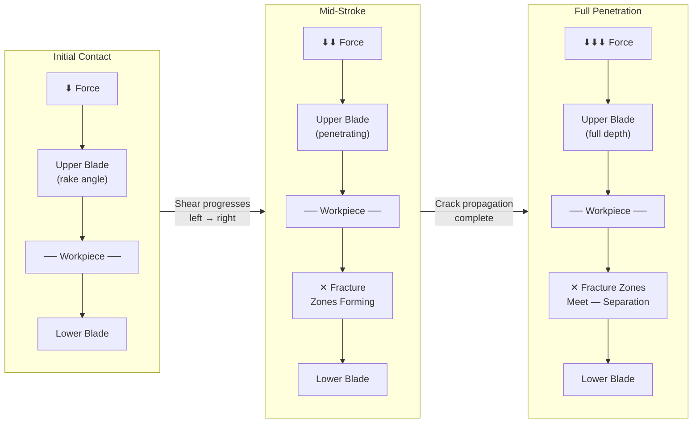
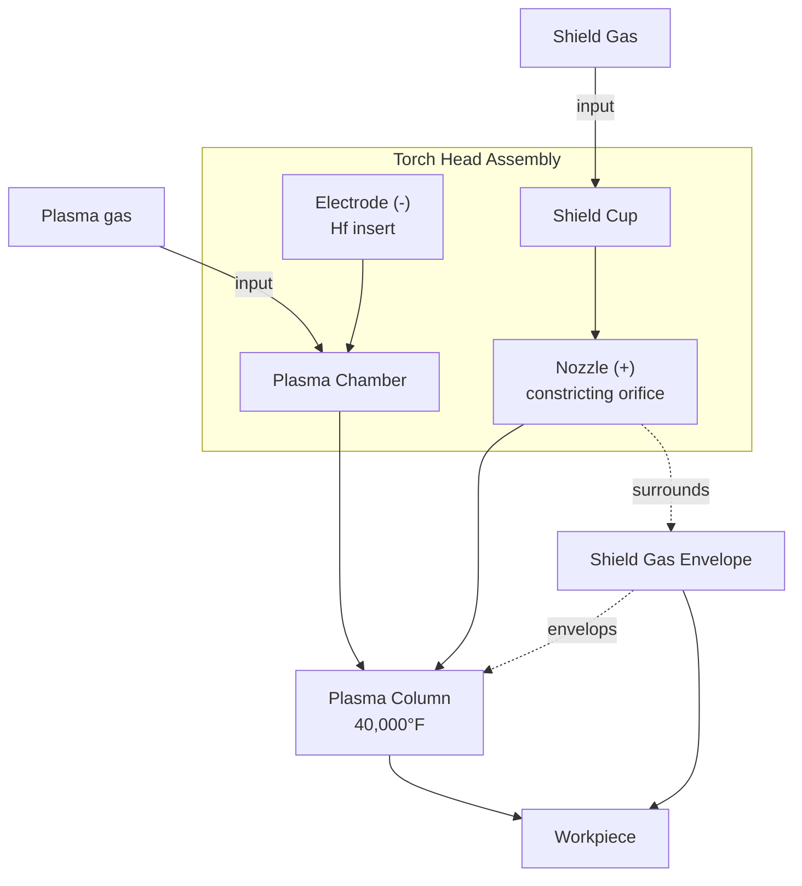

# Lesson 2: Cutting, Shearing, Thermal Separation Processes

## 1. First-Principles Intuition & Invariants

The separation of metal stock into defined geometries represents one of the most fundamental operations in fabrication, yet the underlying mechanics reveal a landscape of competing physical phenomena that demand both theoretical comprehension and empirical intuition. Whether we induce fracture through mechanical shearing forces, sublimate material through focused thermal energy, or employ abrasive erosion, each separation modality imposes distinct metallurgical consequences on the workpiece. The fabricator who understands the stress-strain relationships governing blade penetration, the thermodynamic profiles of plasma arc columns, and the optical physics of laser beam absorption will consistently produce superior edge quality while minimizing secondary operations.

At the heart of mechanical shearing lies the principle of concentrated shear stress exceeding the ultimate shear strength of the material. When a hardened cutting blade penetrates sheet metal, it does not slice cleanly through the entire thickness as a naive observer might assume. Instead, the process unfolds in four distinct zones: initial elastic deformation where the material attempts to spring back, plastic deformation where permanent yielding begins, fracture initiation at the point of maximum stress concentration, and finally fracture propagation through the remaining material thickness. The quality of the sheared edge depends critically on maintaining precise clearance between the upper and lower blades—typically expressed as a percentage of material thickness—such that the fracture zones from each cutting edge meet cleanly in the middle of the sheet.

This clearance parameter governs the stress field geometry within the material. Insufficient clearance causes the two fracture zones to overlap, resulting in a secondary shear plane that produces a rough, stepped edge with excessive work hardening. Excessive clearance allows too much material to undergo plastic bending before fracture initiates, creating a pronounced rollover on the top surface and an elongated fracture zone with ragged burrs on the bottom. For mild steel, optimal clearance typically falls between five and eight percent of material thickness, while harder materials such as tool steels demand tighter clearances in the three to five percent range to prevent catastrophic crack propagation away from the intended shear plane.

The rake angle of the cutting blade introduces a secondary geometric variable that profoundly influences both cutting forces and edge distortion. Positive rake angles reduce the normal force component by allowing the blade to enter the material at an acute angle, effectively slicing rather than pressing. This geometry proves advantageous for ductile materials where excessive compression induces unwanted work hardening and edge rollover. Conversely, negative rake angles increase the compressive stress field ahead of the cutting edge, which can be beneficial when shearing brittle materials or very thin sheets where controlled fracture propagation takes precedence over minimizing cutting force.

Thermal separation processes operate on an entirely different physical foundation, replacing mechanical stress concentration with localized energy deposition sufficient to raise material to its melting point, vaporization threshold, or combustion temperature. The fundamental energy balance equation governs all thermal cutting: the input power density must exceed the sum of melting enthalpy, vaporization losses, and conductive heat dissipation into the surrounding material. This relationship explains why thermal cutting becomes increasingly difficult as material thickness increases—the ratio of cut kerf surface area to surrounding material volume decreases, meaning conducted heat loss grows faster than the kerf area requiring melting.

Oxy-fuel cutting exploits an exothermic reaction between pure oxygen and iron to generate supplemental heat beyond that provided by the preheating flame. When steel reaches approximately 1600°F in the presence of a supersonic oxygen jet, the iron oxidizes rapidly in a self-sustaining reaction that releases 4000 BTU per pound of iron consumed. This liberated energy propagates the cut front forward, with the oxygen jet simultaneously blowing molten oxide slag from the kerf. The process possesses an elegant self-regulating character: if the operator advances the torch too quickly and the material cools below ignition temperature, the oxidation reaction ceases and cutting stops. If traverse speed drops too low, excessive heat accumulates in the workpiece, widening the kerf and degrading edge squareness.

The chemistry of the base material determines oxy-fuel cutting viability in ways that often surprise novice fabricators. Pure iron and low-carbon steels cut readily because iron oxide melts at a lower temperature than the parent metal, allowing slag to flow freely from the kerf. However, stainless steels containing significant chromium and nickel form refractory oxides that melt at temperatures exceeding the base metal, creating a viscous oxide layer that chokes the cutting reaction. Aluminum oxidizes to form aluminum oxide with a melting point of 3700°F—far above aluminum's 1220°F melting point—rendering conventional oxy-fuel cutting impossible. These thermochemical constraints explain why plasma and laser processes dominate when working with non-ferrous alloys and stainless grades.

Plasma arc cutting generates a constricted electric arc through a small orifice, ionizing a gas stream into a plasma state with temperatures exceeding 40,000°F. The arc column exhibits a characteristic pinched geometry due to electromagnetic self-compression, concentrating energy density to values approaching one million watts per square inch at the workpiece surface. This extreme power density melts any conductive material regardless of its oxide chemistry, while the supersonic gas jet mechanically ejects molten metal from the kerf. The constricting nozzle serves multiple critical functions: it accelerates the plasma gas to velocities approaching Mach 2, stabilizes the arc column against atmospheric turbulence, and increases the arc voltage which enhances energy transfer efficiency.

The relationship between plasma gas selection and cut quality reveals the nuanced interplay between thermal conductivity, ionization potential, and chemical reactivity. Air plasma offers the lowest operating cost and produces acceptable edges on mild steel, but nitrogen contamination at the cut face can embrittle the heat-affected zone. Pure oxygen plasma enhances cutting speed on ferrous materials through supplemental oxidation reactions similar to oxy-fuel processes, though at the cost of increased dross adhesion and surface oxidation. Argon-hydrogen mixtures provide the hottest plasma temperatures and cleanest cuts on stainless steel and aluminum, as the hydrogen acts as a reducing agent that prevents tenacious oxide formation, while argon's low thermal conductivity maximizes energy concentration at the workpiece.

Laser cutting represents the apex of thermal separation precision, focusing coherent electromagnetic radiation to power densities exceeding ten million watts per square inch—sufficient to vaporize any material in microseconds. The coherence and monochromaticity of laser light permits focusing to spot sizes smaller than the wavelength itself, enabling kerf widths as narrow as 0.010 inches with minimal heat-affected zones. Two laser architectures dominate industrial fabrication: CO₂ gas lasers emitting 10.6-micron infrared radiation, and fiber lasers producing 1.06-micron near-infrared light through rare-earth-doped optical fibers. The tenfold wavelength difference profoundly affects material absorption characteristics; copper and brass reflect over ninety percent of CO₂ laser energy but absorb fiber laser wavelengths readily, explaining the rapid industry migration toward fiber technology for sheet metal work.

The physics of laser-material interaction depends critically on whether the process operates in fusion cutting, vaporization cutting, or reactive cutting mode. Fusion cutting employs an inert assist gas—typically nitrogen—to blow molten metal from the kerf without oxidation, producing pristine edges suitable for welding or powder coating without secondary cleaning. The energy requirement equals the material's heat capacity times the temperature rise to melting point, plus the enthalpy of fusion. Vaporization cutting drives surface temperature above the boiling point, directly sublimating material in a process that demands three to five times more energy than fusion cutting but produces ultra-narrow kerfs with negligible heat-affected zones. Reactive cutting with oxygen assist gas mirrors oxy-fuel chemistry, using the exothermic oxidation reaction to supplement laser energy and increase cutting speed by thirty to fifty percent on mild steel, though at the cost of a heavily oxidized edge requiring removal before welding.

## 2. Core Architecture & Mechanics

Mechanical shearing machines manifest in three primary architectures, each optimized for distinct operational envelopes. The guillotine shear employs a straight blade that descends vertically through the full width of the workpiece in a single stroke, inducing a progressive shear front that travels from one edge to the other. The blade mounting angle—known as rake or shear angle—typically ranges from 0.5 to 2.5 degrees, creating a gradual engagement that distributes cutting forces over time rather than requiring simultaneous shearing of the entire cut line. This temporal distribution reduces peak tonnage requirements and minimizes frame deflection, but introduces a slight angular deviation in the cut edge that must be accounted for in precision work.



The swing beam shear pivots the upper blade through an arc rather than translating it vertically, producing a rocking cut that naturally incorporates shear angle without requiring blade skew. This architecture proves particularly advantageous for heavy-gauge materials where the mechanical advantage gained through the lever arm geometry reduces required hydraulic tonnage. However, the circular blade path introduces a variable clearance across the material thickness, with tighter clearance at the pivot-side edge and gradually increasing clearance toward the free end. Skilled operators compensate by positioning the workpiece such that the critical edge requiring highest quality aligns with the optimal clearance zone approximately one-third of the blade length from the pivot point.

Hydraulic ironworkers represent the most versatile mechanical cutting platform in the fabrication shop, integrating punch press, angle shearing, bar cutting, and flat bar shearing stations within a single frame. The flat bar shear station typically employs a horizontal cutting action where fixed and moving blades converge with clearances ranging from 0.004 to 0.015 inches depending on material thickness and hardness. The critical wear pattern on ironworker blades manifests as a concave depression in the center of the blade length where the majority of cutting occurs, degrading clearance geometry and producing progressively rougher edges. Rotating four-sided blade blocks exposes fresh cutting edges, but final blade reconditioning requires surface grinding to restore flatness within 0.001 inches across the full blade length.

The calculation of required shearing force must account for material shear strength, thickness, and blade geometry. For a guillotine shear with raked blade cutting mild steel with ultimate shear strength τ_u = 60,000 psi:

```text
F_max = τ_u × t × L × K

where:
    F_max = maximum shearing force (lbf)
    τ_u   = ultimate shear strength (psi)
    t     = material thickness (inches)
    L     = length of cut (inches)
    K     = coefficient accounting for blade rake (typically 0.6–0.8)

Example: Shearing 0.250" × 48" mild steel with 1.5° rake
    F_max = 60,000 × 0.250 × 48 × 0.7
    F_max = 504,000 lbf (252 tons)
```

The coefficient K reflects the force distribution benefit gained from progressive engagement; a larger rake angle reduces peak force but may increase angular distortion of the cut edge. Hydraulic shear selection must provide tonnage capacity with twenty to thirty percent margin above calculated maximum force to account for material hardness variation, blade wear, and peak transient loads during fracture initiation.

Plasma cutting system architecture centers on three interdependent subsystems: the power supply that generates and controls arc current, the torch assembly that shapes and directs the plasma column, and the gas delivery system that supplies precisely controlled flow rates of cutting and shield gases. Conventional plasma systems employ a non-transferred arc configuration where the electrode (cathode) resides within the torch body and the nozzle serves as the anode, with the workpiece remaining electrically isolated. When the pilot arc ionizes a path to the workpiece, the main cutting arc transfers to flow between the electrode and workpiece, dramatically increasing current density and thermal concentration.

High-definition plasma refines this architecture through several critical enhancements. The electrode features a sintered tungsten-hafnium insert that withstands the extreme thermal cycling and oxidation occurring at current densities exceeding 20,000 amperes per square inch. The nozzle incorporates a precisely machined orifice as small as 0.050 inches in diameter, constricting the plasma column to increase energy density while reducing kerf width. A secondary shield gas flowing through outer orifice ports surrounds the plasma jet with an inert or oxidizing envelope that protects the molten cut edge from atmospheric contamination and assists with dross removal.



The standoff distance between nozzle face and workpiece critically affects cut quality through its influence on plasma column stability and energy dissipation. Excessive standoff allows the plasma jet to diverge and interact with atmospheric oxygen, widening the kerf and increasing top edge bevel. Insufficient standoff causes molten spatter to adhere to the nozzle face, rapidly degrading the orifice and destabilizing the arc. Capacitive height control systems maintain optimal standoff—typically 0.060 to 0.150 inches depending on amperage and material thickness—by measuring electrical capacitance between torch and workpiece, servo-controlling the Z-axis to compensate for material warpage and table irregularities.

Kerf width in plasma cutting exhibits a characteristic taper with the narrowest dimension at the top surface where the plasma column enters the material. This angularity, quantified as bevel angle, results from the plasma jet's natural divergence as it penetrates through the material thickness and loses energy to conduction and radiation. The bevel angle θ can be estimated from cutting current, gas flow rate, and material thickness:

```text
θ ≈ arctan((k_b × I) / (v × t × √P_gas))

where:
    θ      = bevel angle from vertical (degrees)
    k_b    = system-specific coefficient (empirically determined)
    I      = cutting current (amperes)
    v      = traverse speed (inches/minute)
    t      = material thickness (inches)
    P_gas  = gas pressure (psi)
```

High-definition plasma systems minimize bevel through increased current density and precisely controlled gas dynamics, achieving bevel angles below one degree on materials up to 0.500 inches thick. This geometric precision eliminates the need for secondary machining on parts requiring tight fit-up for welding or assembly.

Laser cutting systems integrate four major subsystems: the resonator or fiber laser source generating coherent light, the beam delivery system routing and focusing the beam, the cutting head directing the beam and assist gas, and the motion system positioning the workpiece or cutting head with sub-thousandth precision. CO₂ laser resonators employ a mixture of carbon dioxide, nitrogen, and helium gases electrically excited to population inversion, emitting photons through stimulated emission. Copper mirrors with gold or molybdenum coatings reflect the 10.6-micron wavelength with 99.5 percent efficiency, routing the beam through evacuated or nitrogen-purged tubes to prevent atmospheric absorption.

Fiber lasers replace gas-filled resonator tubes with rare-earth-doped silica fibers pumped by semiconductor diode lasers. Ytterbium ions within the fiber core absorb 915-nanometer pump light and emit 1070-nanometer laser radiation that propagates through the fiber in a single transverse mode, delivering exceptional beam quality quantified by an M² value approaching 1.05. This near-perfect Gaussian beam profile permits focusing to spot diameters below 0.004 inches, concentrating kilowatts of power into areas smaller than a grain of salt. The solid-state architecture eliminates consumable optics and gas supplies while delivering electrical efficiencies exceeding thirty-five percent compared to CO₂ lasers' typical eight to twelve percent.

The focusing optics must achieve diffraction-limited performance across the full working range of material thicknesses and beam powers. A plano-convex zinc-selenide lens with 5.0-inch focal length represents the standard for CO₂ systems, providing a focused spot diameter of approximately 0.008 inches at the focal point. The depth of focus—the range over which spot size remains within tolerance—follows from Rayleigh range calculations:

```text
DOF = 2 × z_R = (π × w₀²) / λ

where:
    DOF = depth of focus (mm)
    z_R = Rayleigh range (mm)
    w₀  = beam waist radius at focus (mm)
    λ   = wavelength (mm)

Example: 10.6 μm CO₂ laser, 0.200 mm spot diameter
    DOF = (π × 0.100² × 10⁶) / 10.6
    DOF = 2.96 mm (0.117 inches)
```

This limited depth of focus demands precise focus position control relative to the material surface. For thin sheets, positioning the focal point slightly above the top surface maximizes power density for rapid piercing. Thicker materials benefit from focal point positioning at mid-thickness or deeper to maintain sufficient energy density throughout the full cut depth. Adaptive focus systems adjust lens position dynamically during cutting, optimizing focus depth as material thickness varies across nested parts.

Assist gas selection and delivery parameters exert profound influence on laser cut quality through multiple mechanisms. Gas pressure at the nozzle exit must be sufficient to overcome surface tension of molten metal and blow it from the kerf, yet excessive pressure creates turbulent flow that degrades edge quality and increases gas consumption. The supersonic gas jet exhibits a complex shock wave structure when exiting the nozzle, with an expansion fan followed by compression shocks that can reflect energy back toward the cutting zone if the standoff distance places the workpiece within the shock cell structure.

## 3. High-Performance Optimization & Failure Modes

The pursuit of optimal shearing performance begins with blade condition maintenance and clearance verification. New blades exhibit sharp, crisp cutting edges with corner radii typically below 0.001 inches, but even modest wear rounds the edge and increases the force required to initiate fracture. A simple field test quantifies blade sharpness: a properly conditioned blade drawn across a witness mark on mild steel will produce a visible burnished line with no perceptible drag, while a dull blade requires pressure and leaves an irregular scratch. Reconditioning through surface grinding must remove sufficient material to eliminate the wear concavity while maintaining the specified rake angle, typically requiring removal of 0.030 to 0.060 inches per reconditioning cycle.

Blade clearance verification requires feeler gauges or precision ground parallels inserted between upper and lower blades with the ram at bottom dead center. The measured gap should fall within the manufacturer's specified tolerance band, typically ±0.001 inches from nominal for material thicknesses below 0.250 inches, widening to ±0.002 inches for heavier gauges. Uneven clearance across the blade length—detectable by the feeler gauge binding at certain positions—indicates holddown misalignment, blade mounting surface non-parallelism, or frame deflection under load. Shimming the blade holders with precision ground shim stock corrects minor variations, but systematic clearance errors require frame inspection and potential replacement of worn gibs or ways.

The material itself introduces variables that defy theoretical force calculations and demand empirical adjustment. Cold-rolled steel with significant work hardening from mill processing may exhibit effective shear strengths twenty percent higher than published annealed values, necessitating reduced cut lengths or machine upgrades to prevent overload. Grain direction in rolled plate creates anisotropic mechanical properties; shearing perpendicular to the rolling direction typically requires ten to fifteen percent more force than parallel cuts due to the elongated grain structure resisting transverse separation. Painted or galvanized coatings introduce a lubrication effect that can actually reduce cutting forces while simultaneously accelerating blade wear through abrasive action.

Edge quality assessment in sheared parts reveals four distinct zones visible in cross-section: the rollover region at the top surface where material yields plastically before fracture initiates, the burnish zone where the blade creates a smooth, work-hardened surface through compressive contact, the fracture zone exhibiting rough crystalline texture where crack propagation occurs, and the burr at the bottom edge where final material separation creates a ragged protrusion. The relative proportions of these zones indicate cutting parameter optimization; an ideal shear exhibits minimal rollover (less than five percent of thickness), burnish extending thirty to fifty percent through the thickness, a clean fracture zone, and a burr height below 0.010 inches.

When edge quality degrades, systematic diagnosis proceeds through a decision tree. Excessive rollover paired with large burrs indicates insufficient clearance—the blades are too far apart, allowing excessive bending before fracture. Conversely, a stepped or secondary-shear appearance with minimal burnish zone reveals excessive clearance causing fracture zones to miss each other vertically. A rough, torn fracture surface suggests dull blades requiring reconditioning, while uneven edge quality across the cut length points to non-parallel blades or material thickness variation.

Plasma cutting optimization balances three competing objectives: maximum traverse speed, minimal edge bevel, and low dross adhesion. The fundamental constraint arises from the finite thermal energy available from the arc; this energy must heat material to melting temperature, provide the enthalpy of fusion, and overcome conductive losses into the surrounding material. These energy flows establish a maximum theoretical cutting speed:

```text
v_max = (η × P_arc) / (ρ × t × w_k × (C_p × ΔT + H_f))

where:
    v_max = maximum cutting speed (in/min)
    η     = process efficiency (typically 0.35–0.55)
    P_arc = arc power = voltage × current (watts)
    ρ     = material density (lb/in³)
    t     = material thickness (inches)
    w_k   = kerf width (inches)
    C_p   = specific heat capacity (BTU/lb·°F)
    ΔT    = temperature rise to melting (°F)
    H_f   = enthalpy of fusion (BTU/lb)
```

This relationship explains why doubling material thickness does not halve cutting speed—the kerf width simultaneously increases to maintain the same melt ejection dynamics, partially offsetting the volume increase. Practical cutting speeds run at seventy to eighty-five percent of theoretical maximum to ensure complete penetration through thickness variations and maintain stable kerf ejection.

The heat-affected zone in plasma cutting extends outward from the kerf edge in proportion to the thermal diffusivity of the material and the dwell time of the plasma arc. Aluminum's high thermal conductivity propagates heat rapidly, creating HAZ widths of 0.060 to 0.100 inches even with high-definition systems, while stainless steel's poor conductivity confines the HAZ to 0.020 to 0.040 inches. The metallurgical consequences within the HAZ vary dramatically by alloy: mild steel experiences grain growth and potential ferrite-to-austenite phase transformations that increase hardness, precipitation-hardened stainless steels may over-age and lose strength, and age-hardened aluminum alloys soften through dissolution of strengthening precipitates.

Dross formation—the adherence of solidified molten metal to the bottom edge of the kerf—represents the most common quality defect in plasma cutting. Low-speed dross manifests as a continuous bead along the cut edge when traverse speed falls below optimal, allowing excessive heat to accumulate and create a viscous melt pool that solidifies before gas flow can eject it. High-speed dross appears as periodic droplets when cutting speed exceeds the melt ejection capability, leaving islands of attached material. The transition between clean cutting and dross formation occurs within a narrow speed window, typically spanning only ten to twenty inches per minute.

Consumable life optimization in plasma cutting requires understanding the failure mechanisms affecting electrode and nozzle components. The hafnium insert in the electrode erodes through two primary pathways: evaporation from extreme thermal loading, and oxygen contamination when atmospheric air leaks into the torch during arc extinction. Maintaining adequate plasma gas flow during arc shutdown—a feature termed post-flow—purges the torch body with inert gas and prevents oxidation damage. Nozzle orifices enlarge gradually through electrical erosion and thermal cycling, degrading cut quality once orifice diameter grows beyond ten percent of the as-manufactured dimension. Tracking consumable usage hours and replacing components on a preventive schedule proves far more economical than running consumables to failure and scrapping parts with degraded edges.

Laser cutting parameter optimization follows a fundamentally different approach than plasma due to the non-contact, optically-dominated energy transfer mechanism. The absorbed power fraction depends strongly on surface condition and temperature; polished aluminum reflects ninety-five percent of CO₂ laser energy at room temperature, but absorption increases to forty percent once surface temperature exceeds 1000°F and the oxide layer thickens. This creates a self-limiting piercing challenge: initial low absorption requires high power and extended dwell time to raise surface temperature, but once melting begins, absorption jumps and energy couples efficiently.

Pierce strategy selection prevents damage to focusing optics from molten metal spatter and plasma plume backscatter. Pulsed piercing modulates laser power at frequencies of 100 to 500 Hz, allowing melt to solidify partially between pulses and reducing the volume of ejected material. The peak pulse power exceeds continuous-wave cutting power by factors of 1.5 to 2.5, accelerating initial penetration while the duty cycle limits average thermal loading. Ramped piercing gradually increases power from thirty to fifty percent of cutting power up to full power over a duration of 0.5 to 2.0 seconds, controlling melt pool dynamics and spatter trajectory. Thicker materials benefit from piercing at a dedicated pierce location followed by a lead-in move to the actual part geometry, sacrificing minor material waste to protect critical edges from pierce defects.

Focal position optimization for laser cutting must be empirically determined through cutting trials due to the complex interplay between power density, assist gas momentum, and kerf geometry. A systematic focal position test involves cutting a series of slots at identical parameters except for incrementally varied focus positions, then measuring kerf width, edge squareness, and dross level at each position. The resulting data typically reveals a narrow optimal zone—often within ±0.020 inches—where cut quality peaks. This position shifts as material thickness increases; thin materials below 0.125 inches favor focus above the surface, mid-range thicknesses from 0.125 to 0.375 inches cut best with focus at the top surface or slightly into the material, and heavy gauges above 0.500 inches demand focus at mid-thickness or deeper to maintain energy density through the full depth.

Nozzle selection and standoff distance control gas delivery efficiency and momentum transfer to the molten material. Conical nozzles with 1.0 to 2.0 mm diameter orifices suit thin materials where narrow kerf width and minimal gas consumption take priority. Thicker materials benefit from larger orifices up to 3.0 mm diameter that deliver higher volumetric flow rates necessary to expel the greater volume of molten metal. The standoff distance—typically 0.5 to 1.5 mm—determines whether the workpiece sits within the supersonic core of the gas jet or in the turbulent expansion region beyond the shock diamonds. Capacitive sensing heads maintain constant standoff automatically as material warpage and table irregularities would otherwise vary the gap and degrade cut quality.

Assist gas pressure optimization reveals a surprising non-linearity; increasing pressure improves dross removal and cutting speed only up to a threshold, beyond which further pressure increases degrade edge quality through turbulent flow entrainment of atmospheric oxygen and nitrogen into the cutting zone. For nitrogen assist cutting of stainless steel, pressures typically range from 150 to 300 psi depending on material thickness, while oxygen cutting of mild steel operates at lower pressures of 30 to 60 psi since excessive oxygen flow increases oxide dross formation. High-pressure cutting of thick aluminum may employ pressures exceeding 400 psi to achieve the gas momentum necessary to blow molten metal from deep kerfs.

The failure mode matrix for laser cutting encompasses optical contamination, focal shift from thermal lensing, resonator misalignment, and motion system mechanical errors. Contamination of the focusing lens bottom surface with smoke, oil vapor, or molten metal spatter attenuates beam transmission and creates local hot spots that induce thermal stress fractures. Protective windows positioned above the focusing lens intercept contamination, sacrificing an inexpensive window rather than costly focusing optics, but these windows require cleaning or replacement when transmission drops below ninety-five percent. Thermal lensing within high-power fiber delivery cables causes the focal point to shift toward the focusing lens as beam power increases, requiring either periodic refocusing during long cutting cycles or active focus tracking systems that compensate in real-time.

Cutting speed scheduling for nested parts presents an optimization challenge balancing productivity against thermal distortion. Cutting multiple small parts in rapid succession deposits heat into a localized area, raising base material temperature and increasing thermal expansion. Subsequent parts cut in the same region exhibit dimensional distortion from differential thermal expansion between hot cut edges and cooler parent material. Intelligent nesting software distributes cutting sequences to maximize spatial separation between consecutively cut features, allowing time for convective and radiative cooling to dissipate accumulated heat. Alternatively, pausing between parts permits active cooling through forced air or mist, though productivity suffers from non-cutting dwell time.

Edge quality specifications for thermal cutting must acknowledge the inherent surface roughness and metallurgical alterations differentiating these processes from precision machining. Plasma-cut edges typically exhibit Ra surface roughness values of 200 to 400 microinches with perpendicularity deviations of 0.5 to 2.0 degrees, suitable for welded structures where fit-up tolerances accommodate these variations but unacceptable for precision mechanical interfaces. High-definition plasma narrows these ranges to 125 to 250 microinches roughness and 0.5 to 1.0 degrees angularity. Laser cutting delivers superior edge quality with roughness values of 80 to 150 microinches and perpendicularity within 0.5 degrees, occasionally achieving edges requiring no secondary machining for mechanical assembly.

The economic decision framework for selecting separation processes weighs capital investment, operating costs, throughput, and edge quality requirements. Mechanical shearing dominates straight-line cutting of sheet stock due to near-zero consumable costs and high productivity, but lacks geometric flexibility. Plasma cutting offers moderate capital investment with reasonable operating costs on ferrous materials but struggles with thin-gauge aluminum and generates substantial post-cut cleanup requirements. Laser systems demand the highest capital expenditure and require skilled operators to maintain beam quality and optimize parameters, but deliver unmatched precision, minimal HAZ, and the geometric freedom to cut arbitrarily complex profiles without fixturing changes or tool modifications. The fabrication shop optimized for diverse work inevitably maintains all three capabilities, selecting the appropriate process based on material, thickness, quantity, and edge quality specifications unique to each job.
