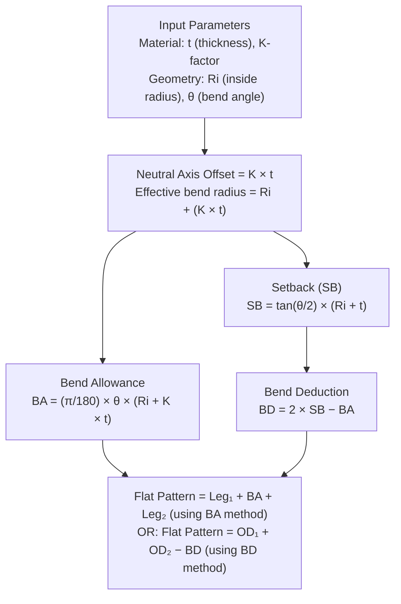

# Lesson 3: Forming, Bending, Controlled Plastic Deformation

## 1. First-Principles Intuition & Invariants

There is a moment, invisible to the naked eye but entirely predictable by physics, when metal stops behaving like a spring and starts behaving like clay. That moment — the elastic-to-plastic transition — is the entire foundation of forming work. Every press brake operator, every roll former, every stamping die designer is, in one way or another, negotiating with that transition: pushing the material just far enough past it to hold a shape, but not so far that it cracks, wrinkles, or work-hardens into brittleness. Understanding that negotiation at first principles is what separates a craftsman who can read a bend chart from one who can derive it.

When you load a metal sheet in bending, the outer surface is in tension and the inner surface is in compression. Between them lies a surface of zero strain called the neutral axis — a theoretical plane that neither stretches nor compresses. In pure elastic bending, this axis sits exactly at the geometric center of the thickness. The moment you exceed the yield strength in the outer fibers, plastic deformation begins there and migrates inward as load increases, until the entire cross-section yields. This is the plastic hinge condition, and it is the state the material must reach for a permanent bend to hold. The critical engineering implication is that the neutral axis migrates inward during plastic bending — typically settling between 0.33t and 0.45t from the inside surface, where t is material thickness. This shift is the physical origin of bend allowance error when fabricators naively assume the neutral axis remains centered.

The stress-strain curve of the material governs everything that follows. In a low-carbon mild steel (1018 or A36), the curve exhibits a well-defined yield plateau: stress climbs linearly through the elastic region, then at the upper yield point the material suddenly softens before work-hardening resumes at a lower yield stress. This discontinuous yielding, caused by carbon and nitrogen atoms pinning dislocation movement, means you get a brief softening before the material stiffens again. In 304 stainless steel, there is no yield plateau — the curve is continuously rising because austenitic stainless has very high dislocation mobility and work-hardens dramatically and continuously. This is why stainless demands tighter springback compensation and more aggressive overbend angles than mild steel of identical thickness. Aluminum 6061-T6 is anisotropic in its bending response: the T6 temper (solution heat-treated and artificially aged) dramatically increases tensile strength but reduces ductility, so minimum bend radii must be observed far more conservatively than for annealed 6061-O.

Strain hardening — the increase in yield strength caused by accumulated plastic deformation — is a double-edged invariant in forming work. In shallow stamping and roll-forming operations, controlled strain hardening is desirable: it increases the formed part's strength beyond that of the flat blank. But in multi-stage forming, each prior operation raises the material's yield strength, requiring more force in subsequent stages and reducing remaining ductility. The strain hardening exponent *n* (from the Hollomon power law σ = Kεⁿ) quantifies this directly. For 1008 mild steel, n ≈ 0.26, meaning the material work-hardens moderately and tolerates significant drawing. For 6061-T6 aluminum, n ≈ 0.07 — very little hardening capacity remains before fracture. When you are planning a multi-stage progressive die operation or a series of roll-forming passes, the cumulative true strain must be tracked against the material's fracture strain limit. Exceeding it means cracking at the outer fiber of the bend, which appears first as an orange-peel texture, then as fine surface cracks, then as a full-thickness fracture.

The concept of formability is best captured by the Forming Limit Diagram (FLD), a plot of major strain vs. minor strain at the onset of necking. For any given blank material and thickness, the FLD defines a failure envelope: strain combinations above the curve neck and tear, those below are safe. The FLD is generated empirically from Nakazima or Marciniak punch tests, and for precision stamping work it should be run on each material heat lot rather than relied upon generically. The key invariant the FLD reveals is that balanced biaxial tension (equal strain in both directions, as in dome-stretching) allows the highest major strain before necking, while plane-strain tension (one direction straining, the other constrained to zero) is the most dangerous condition — it is where most stamped part failures initiate along die radii and over punch shoulders.

---

## 2. Core Architecture & Mechanics

### The Bend Allowance System

The first computational problem every fabricator encounters is this: a finished part drawing calls for an inside bend angle of 90° with a 3 mm inside radius in 2 mm thick mild steel. What length of flat blank do you cut before forming? The answer is not simply the sum of the two flat legs, because metal is consumed along the bend arc. The length of material in the bend zone — the bend allowance (BA) — must be added to the leg dimensions to get the correct flat pattern.

The neutral axis during plastic bending sits at a fractional offset from the inside radius. That fraction is called the K-factor, and it is the master variable of the entire bend allowance system. The K-factor is defined as the ratio of the neutral axis offset from the inside surface to the total material thickness:

$$K = \frac{t_{neutral}}{t}$$

For air bending mild steel, K typically ranges from 0.38 to 0.42. For bottom bending and coining, where the material is fully compressed into the die, K shifts toward 0.50 as the section approaches full plasticity. For harder materials bent over tighter radii, K can drop below 0.35 as the neutral axis migrates more aggressively toward the compression side.

The bend allowance formula is:

$$BA = \frac{\pi}{180} \times \theta \times (R_i + K \cdot t)$$

where θ is the included bend angle (not the complementary angle), $R_i$ is the inside radius, t is material thickness, and K is the material and process-specific K-factor. For the example above — 90°, 3 mm inside radius, 2 mm mild steel, K = 0.42:

$$BA = \frac{\pi}{180} \times 90 \times (3 + 0.42 \times 2) = 1.5708 \times 3.84 = 6.03 \text{ mm}$$

If the two flat legs (measured to the inside mold lines) are 50 mm and 80 mm, the flat blank length is 50 + 6.03 + 80 = 136.03 mm.

The bend deduction (BD), which is the value most press brake DRO systems use, is derived from BA through the setback (SB). The setback is the distance from the bend tangent line to the theoretical mold line corner:

$$SB = \tan\left(\frac{\theta}{2}\right) \times (R_i + t)$$

$$BD = 2 \times SB - BA$$

These relationships form the closed system shown below:

Both methods are algebraically identical; the BD method simply operates on outside dimensions, which are easier to measure on a finished part during reverse engineering.

### Springback Mechanics and Compensation

Springback is the elastic recovery that occurs when forming pressure is released. After the punch retracts, the elastic portion of the total bend strain recovers, opening the bend angle by an amount that is entirely predictable from material properties. The springback ratio is:

$$\frac{\theta_f}{\theta_b} = 1 - \frac{3 \sigma_Y R}{E t}$$

where $\theta_f$ is the final angle after springback, $\theta_b$ is the bend angle under load, $\sigma_Y$ is the material yield strength, R is the bend radius, E is Young's modulus, and t is thickness. This equation reveals three important invariants for the shop floor.

First, springback increases with yield strength. 304 stainless steel ($\sigma_Y$ ≈ 310 MPa) springbacks far more aggressively than 1018 mild steel ($\sigma_Y$ ≈ 220 MPa) at the same geometry. For a 90° air bend on 2 mm material, mild steel might springback 2°–3°; 304 stainless will springback 5°–8°. High-strength low-alloy (HSLA) steels used in automotive structural applications can springback 10°–15° and require specific tool geometry changes, not merely angle correction.

Second, springback decreases as bend radius decreases relative to thickness. Tighter radii force more of the cross-section into full plastic deformation, leaving less elastic energy to recover. This is the mechanical basis for the coining process: by forcing the punch to contact the die bottom with very high tonnage, the material is compressed uniformly across its full thickness, eliminating the elastic core entirely and reducing springback to near zero at the cost of dramatically higher forming forces (typically 5–8× more tonnage than air bending).

Third, springback increases with Young's modulus reduction — but since most engineering metals (steel, aluminum, titanium) differ primarily in yield strength rather than modulus, the yield strength term dominates. Titanium (Grade 5, $\sigma_Y$ ≈ 880 MPa, E ≈ 114 GPa) is notorious for extreme springback and is often formed with 20°–30° of intentional overbend.

Compensation strategies fall into three mechanical categories. The first is overbending: program the press brake to bend past the target angle by the anticipated springback amount, then allow the part to spring back to the desired angle upon release. For air bending mild steel, a 90° target typically requires a programmed angle of 87°–88°. This is the standard method and is built into every press brake's angle correction library once the K-factor is calibrated for a material-and-tooling combination. The second strategy is bottoming or coining, where the punch fully contacts the die and the material is compressed between the tool surfaces. The springback reduction is dramatic but the tooling must be dedicated to a specific angle and thickness — there is no flexibility. The third strategy, used in production tooling for high-springback alloys, is the multi-stage overbend with stress-relief: the part is formed past the final angle, then a secondary tool closes around it to maintain the overbent position while a downstream stage returns it to the target. This is common in titanium aerospace bracket forming.

### Rolling, Stamping, and Hydroforming Mechanics

Three-roll plate rolling works on a fundamentally different deformation model than press brake bending. Rather than creating a discrete bend at a single punch point, roll forming distributes plastic deformation continuously across the material's length as it passes between rolls. The two lower rolls support the plate while the upper roll applies a bending moment that sets the radius of curvature. The relationship between roll separation and produced radius is not linear — it follows the elastic-plastic bending relationship, and the operator must account for springback in the gap setting. For a pyramid-style three-roll machine, the formula for initial roll gap is derived iteratively: start with the theoretical gap from the desired radius, form a test section, measure the actual radius with a radius gauge or trammel, and apply a correction factor to the roll position. Modern CNC roll benders with closed-loop feedback on roll position can hold radii to ±0.5% across full plate widths, but manual machines require the operator to tighten the gap progressively through multiple passes rather than attempting the full deformation in one pass, which risks cracking in the outer fiber of thick plate.

Stamping introduces biaxial and plane-strain deformation modes simultaneously across a single blank. As the punch descends and draws the blank over the die radius, material in the flange region is compressed circumferentially (causing wrinkling potential) while material under the punch is stretched biaxially (causing thinning and necking potential). These two failure modes — wrinkling and necking — are in direct tension with each other, and the blank holder force (BHF) is the control variable that walks between them. Too little BHF allows the flange to buckle into wrinkles. Too much BHF locks the flange and prevents metal flow into the die cavity, forcing all deformation onto the punch face where the section thins and eventually splits. The correct BHF is calculated from blank holder contact area, friction coefficient, and the material's FLD limits. For mild steel drawn to a draw ratio (blank diameter to punch diameter) of 2.0, BHF is typically set to 20–30% of the punch force. For aluminum, friction management is critical: aluminum's tendency to gall against tool steel requires high-viscosity drawing compound or polyethylene film lubricant to keep friction coefficients below 0.08.

Hydroforming replaces the rigid punch with a pressurized fluid, which applies perfectly uniform pressure across the blank surface and eliminates the localized thinning that occurs directly under a punch radius. Tube hydroforming — used to produce complex automotive chassis nodes — works by sealing a metal tube inside a split die, then simultaneously applying end-feed force (pushing material into the die from both ends) and internal hydraulic pressure. The end-feed prevents the tube from thinning under the circumferential expansion stress, while the pressure forces the tube wall against the die cavity contours. The process parameters form a coupled system: too much pressure with insufficient end-feed tears the tube wall at the expansion zone; too much end-feed with insufficient pressure causes the tube ends to buckle inward. The forming pressure for mild steel tube hydroforming is typically 60–300 MPa, requiring hydraulic intensifiers rated to 500 bar or higher. Sheet hydroforming uses a flexible rubber diaphragm as the "die" side, allowing a single hard punch to form complex non-developable surfaces with far less tooling investment than matched-die stamping.

### Minimum Bend Radius Constraints

The minimum bend radius is the tightest inside radius a material can sustain without cracking on its outer tensile fiber. It is fundamentally a ductility constraint: the outer fiber strain at the bend must not exceed the material's true fracture strain. The minimum bend radius is typically expressed as a multiple of material thickness (e.g., 1t, 2t, 3t) and varies with grain direction of the rolled sheet.

The outer fiber strain at a bend is:

$$\varepsilon = \frac{t}{2R_i + t}$$

For a bend at the minimum radius, this strain equals the material's limiting tensile elongation. The anisotropy of rolled sheet means the minimum bend radius is different for bends parallel to the rolling direction (transverse bends, across the grain) versus bends perpendicular to it (longitudinal bends, with the grain). Bending with the grain always requires a larger minimum radius — often 50–100% larger — because the grain boundaries are aligned with the tension direction, providing a path for crack propagation. Standard practice in layout and nesting is to orient critical tight-radius bends transverse to the rolling direction wherever possible.

The following table covers minimum bend radii for common materials in fabrication practice, expressed as multiples of sheet thickness, for 90° cold air bending:

| Material | Condition | Transverse to Grain | Parallel to Grain |
|---|---|---|---|
| 1018 Mild Steel | Hot rolled (normalized) | 0.5t | 1.0t |
| 1018 Mild Steel | Cold rolled | 0.5t | 1.0t |
| 304 Stainless | Annealed | 1.0t | 2.0t |
| 316 Stainless | Annealed | 1.0t | 2.0t |
| 6061 Aluminum | O (annealed) | 0t | 0.5t |
| 6061 Aluminum | T6 | 3.0t | 4.0t |
| 5052 Aluminum | H32 | 1.0t | 1.5t |
| Copper C110 | Half hard | 0.5t | 1.0t |
| Titanium Grade 2 | Annealed | 2.0t | 3.0t |
| Titanium Grade 5 | Annealed | 3.0t | 4.0t |

When a design calls for a radius tighter than the minimum listed, three paths are available. First, anneal the material locally at the bend line using a torch or induction heater, restoring ductility before forming. This is standard practice for 6061-T6 aluminum brackets, which can often be formed at 0.5t after solution annealing, then re-aged afterward. Second, increase the bend radius in the design to meet the minimum — which may require adjusting adjacent geometry. Third, use a wipe or rotary die that applies a restraining force on the outer fiber during bending, which delays fracture initiation by keeping the outer surface in slight compression.

---

## 3. High-Performance Optimization & Failure Modes

### Calibrating K-Factor for a Material-Tooling Pair

No K-factor table in a press brake handbook is a substitute for empirical calibration on your specific machine, tooling, and material lot. The calibration procedure is straightforward and should be run once per material specification and die set combination, then logged in a shop floor forming database.

Cut three test blanks of exactly 200 mm × 100 mm from the same coil or sheet lot you are qualifying. Bend each at 90° using the target tooling setup, leaving the bend parallel to the 100 mm dimension so the 200 mm dimension is split into two 100 mm legs before the deduction. After forming, measure the actual outside dimensions of both legs from the tangent line of each bend to the outer edge, using a vernier caliper to ±0.02 mm resolution. Calculate the actual bend deduction from those measurements, then back-calculate the K-factor:

$$K = \frac{\frac{BA \times 180}{\pi \times \theta} - R_i}{t}$$

where BA is derived from the measured flat pattern versus the actual formed geometry. Average the three test results. If they disagree by more than 0.01 in K, check for tooling deflection, inconsistent material thickness, or punch misalignment. Enter the calibrated K-factor into your CAM software's material library and lock it against the material specification number. Any change in die opening width, punch tip radius, or material supplier requires a re-calibration, because K is a property of the system, not the material alone.

### Press Brake Tonnage and Tooling Deflection

Press brake capacity is specified in tons per meter of bending length, and the required tonnage for air bending is approximately:

$$F = \frac{1.42 \times \sigma_{UTS} \times t^2 \times L}{V}$$

where $\sigma_{UTS}$ is the ultimate tensile strength in MPa, t is thickness in mm, L is bend length in mm, and V is die opening (vee width) in mm. The result is in kilonewtons; divide by 9.81 to convert to metric tons. For 3 mm mild steel ($\sigma_{UTS}$ = 420 MPa) over a 1000 mm length with a 24 mm die opening:

$$F = \frac{1.42 \times 420 \times 9 \times 1000}{24} = 224{,}100 \text{ N} = 22.8 \text{ tons}$$

This calculation gives the minimum ram force, but tooling deflection is the more critical concern at the shop level. A press brake bed deflects in a bow between the two side frames during bending, leaving the center of the bend slightly open and producing a part that is slightly under-bent at the center relative to the ends. All production press brakes use a crowning system — either a mechanical wedge array in the bed or CNC-controlled hydraulic crowning cylinders — to pre-compensate the beam with an upward crown matching the calculated deflection. For a 3 m press brake bending 3 mm steel at full capacity, bed deflection without crowning can reach 0.3–0.5 mm, which translates directly into a 1°–2° angle error at the center of the part. The crowning correction must be re-dialed for every change in tonnage, die setup, and bend length. Failing to adjust crowning is one of the most common causes of bow-shaped parts in sheet metal production.

Upper tool deflection is a separate phenomenon, particularly acute with goose-neck and narrow-throat punch holders. A tall punch deflects laterally under off-center loads, skewing the bend line. The rule of thumb is that punch deflection becomes significant when the punch height exceeds 150 mm for standard 40 mm × 40 mm tool holders — beyond that, stiffened punch holders or back-stop supports are required.

### Die Opening Selection and Its Effect on Radius and Springback

The die vee opening V is the single most consequential setup variable for air bending because it simultaneously controls the formed radius, the required tonnage, and the springback magnitude. The rule that air bending produces an inside radius of approximately 16% of the die opening comes from the contact mechanics of three-point bending:

$$R_i \approx 0.16 \times V$$

A 24 mm die opening produces approximately a 3.84 mm inside radius regardless of punch radius, as long as the punch radius is smaller than this value. This means you can use a sharp punch (0.3 mm radius) or a large-radius punch (3.0 mm) in the same 24 mm die and get nearly identical inside radii on the formed part — the die opening, not the punch geometry, governs the contact radius in air bending. The punch radius only matters when it exceeds the natural air bend radius, at which point the punch radius becomes the controlling dimension and you are transitioning toward coining.

Die opening selection follows the standard rule of 8t to maximize bend quality: select a vee width of approximately 8 times material thickness for steel, and 10–12t for aluminum (to avoid marking the inside surface). Going narrower than 6t increases risk of die marking and cracking; going wider than 12t requires excessive tonnage and produces inconsistent radii. The practical consequence is that for every change in material thickness, the die setup should change — a shop operating a single 24 mm die for all thicknesses from 1 mm to 4 mm is making a compromise that shows in part quality.

### Failure Mode Analysis and Diagnostic Trees

Understanding failure modes in forming requires connecting the visible symptom to the underlying mechanical cause, because the same surface defect can arise from multiple distinct root causes requiring different corrections.

**Cracking at the outer bend fiber** is the most common catastrophic failure. When a crack initiates at the outer tensile surface and propagates inward, the proximate cause is outer fiber strain exceeding fracture strain. The diagnostic tree branches on three variables: radius-to-thickness ratio (is the bend radius below minimum for this material?), grain orientation (is the bend parallel to rolling direction?), and material condition (has prior work hardening from forming, shearing, or rolling reduced remaining ductility?). The corrective action follows the branch: open the radius, re-orient the blank, or anneal before re-forming.

**Springback variation within a production run** — where parts are holding angle well for 50 pieces and then drifting — indicates a change in an input variable the operator hasn't tracked. The most common culprit is material thickness variation between coil lots. A shift from 2.00 mm to 1.95 mm nominal thickness in the same material specification changes BA by roughly 0.03 mm and springback by 0.3°–0.5°. The solution is to measure incoming material thickness with a micrometer at four points per blank and to establish a statistical process control chart for formed angle versus material thickness. The second most common cause is temperature-dependent material yield strength: in unheated shops in winter, mild steel from outdoor-stored coils can be 10–15°C colder than calibration temperature, which raises yield strength by 2–4% and increases springback correspondingly.

**Orange-peel texture** on the outer bend surface is caused by grain boundary stress concentration in coarse-grained material or in heavily work-hardened condition. It is the visual precursor to cracking. For mild steel, it appears when the average grain size is above ASTM 5 (approximately 65 μm) in combination with high outer fiber strain. For 5052 and 6061 aluminum, it appears almost universally when bending annealed thick plate, because the recrystallized grain size after annealing can exceed 100 μm. The mitigation is to use material with certified fine grain size (ASTM 7 or finer) for tight-radius work, and to test a bend specimen before committing an entire blank lot.

**Wrinkling in drawn flanges** indicates blank holder force below the critical buckling threshold for the flange geometry. The wrinkling criterion can be expressed through the Yoshida wrinkling index, but the practical diagnostic is simpler: wrinkles that form radially (pointing toward the punch center) indicate circumferential compressive stress from insufficient BHF; wrinkles that form tangentially indicate excessive material flow from blank holder geometry mismatch. Radial wrinkles are corrected by increasing BHF. Tangential wrinkles require redesigning the blank holder geometry or adding drawbeads at the flange perimeter to increase flow resistance locally.

**Galling and scoring on tool surfaces** in stamping operations is a tribological failure caused by adhesive wear between the blank surface and the tool steel. It occurs when the lubricant film breaks down under high interface pressure, allowing micro-welding between the blank and die. Galling is particularly severe in stainless steel and aluminum forming because both materials have high affinity for adhesive contact with tool steel. The countermeasures are tool surface hardening to 60–62 HRC (through nitriding or PVD TiN coating), surface finishing of forming radii to Ra ≤ 0.2 μm, and application of appropriate lubricant — EP (extreme pressure) chlorinated oil for stainless, synthetic polymer drawing compound for aluminum. If galling has already occurred, the tool must be polished out, re-coated if applicable, and the lubricant selection reviewed before resuming production. Running a galled tool deeper into production compounds the damage exponentially.

### Parametric CAD Integration for Forming Work

In Fusion 360 and SolidWorks Sheet Metal environments, the K-factor and bend radius are entered as global parameters in the sheet metal rules, and all flat patterns are computed parametrically from those values. The correct workflow is to define the sheet metal rule first, before any geometry is created, using the empirically calibrated K-factor from your press brake qualification run. Every bend feature then inherits these parameters, and changing the rule automatically updates the flat pattern. This breaks the common shop-floor error of a CAD operator using the software's default K = 0.44 (which assumes mid-thickness neutral axis in steel) on 304 stainless that springbacks with K = 0.38 behavior — the resulting flat blank will be systematically short, and the part will be over-bent on every piece.

Exporting the flat pattern to DXF for laser or plasma cutting requires verifying that the unfolding algorithm used by the CAD package matches your forming equations. Fusion 360's sheet metal unfold uses K-factor correctly, but it cannot model die opening effects on natural air bend radius — that remains the operator's calibration responsibility. The best practice is to export the DXF with bend line annotations, then use those bend lines on the press brake as reference marks during first-article verification rather than relying solely on back gauge position. A digital angle gauge placed on the formed flange during the first-article provides a closed-loop verification between the CAD-predicted angle and the actual pressed angle, confirming that the K-factor in the model matches the physics of the shop floor setup.

The integration of these calculated parameters with toolpath planning is what elevates a forming operation from reactive adjustment to predictive control. A press brake operator who can read a springback equation, trace a wrinkling failure to blank holder force, and calibrate a K-factor from three test bends is not performing artisan guesswork — they are running a physical simulation against a material model, closing the loop empirically, and operating the machine with the same rigor that a machinist brings to a feed-and-speed calculation. The metal, as always, tells the truth. The practitioner's job is to know exactly which question to ask it.
