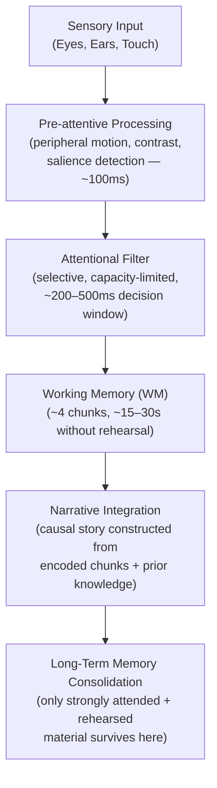
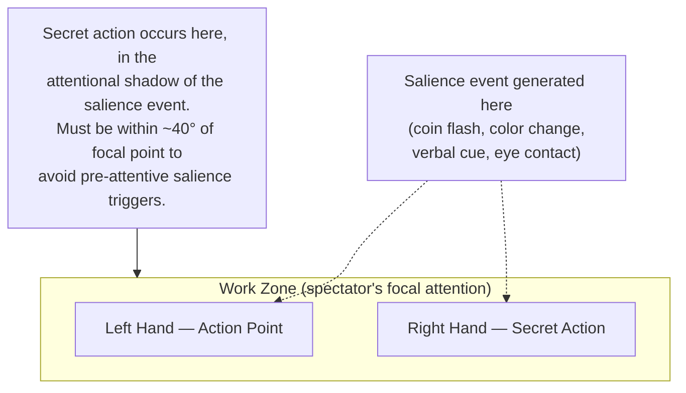

# Lesson 1: Principles of Deception

## 1. First-Principles Intuition & Invariants

There is a moment in every great conjuring performance when the audience's reality fractures. A coin vanishes. A signed card appears inside a sealed bottle. A spectator's freely chosen thought is named aloud. The gasp that follows is not merely surprise — it is the sound of a cognitive model collapsing. Understanding *why* that collapse happens, and engineering it deliberately, is the entire intellectual project of the working magician.

The novice practitioner reaches for mechanical skill first: the perfect Elmsley Count, the invisible pass, the flawless riffle control. These are necessary tools, and their mastery matters. But the advanced practitioner knows that method is only half the architecture. The other half is cognitive engineering — the deliberate construction of a false reality inside the spectator's mind, one that makes the method invisible not because it was hidden from their eyes, but because it was hidden from their *attention*. This is the distinction that separates a technician from a performing artist, and it is the governing invariant of this lesson.

Magic operates on a simple and brutal axiom: **the audience cannot reconstruct what they did not encode.** Human perception is not a camera. It is a selective, predictive, resource-constrained inference engine. The brain does not record everything it receives through sensory channels; it samples, compresses, and fills gaps with predictions drawn from prior experience. A spectator who does not encode the method in the first place has no basis for reconstruction, no matter how hard they think afterward. Misdirection, understood correctly, is not about moving the eyes to the wrong place. It is about preventing the formation of memory at the precise moment a secret action occurs.

This insight reframes the entire concept of misdirection. The term itself is somewhat misleading, which is perhaps fitting. The word implies direction — that the magician is steering the gaze. But John Ramsey's formulation, later refined by Juan Tamariz in his structural theory of magic, is more accurate: misdirection is the management of attention across time, space, and cognitive priority simultaneously. The eyes are only one channel. Emotion, social gaze, internal narrative, and working memory load are equally exploitable, and in many contexts more reliable.

The invariants that govern perceptual deception in performance magic reduce to four foundational principles. First, attention is a bottleneck resource. The human attentional system cannot simultaneously process high-load stimuli across independent channels; when one channel is saturated, others go effectively blind. Second, social cues override autonomous attention. Where a human face looks, another human face involuntarily follows — this is a deeply conserved social instinct, not a learned behavior, and it is among the most reliable levers the magician possesses. Third, expectation shapes perception. The brain perceives what it expects to perceive before it perceives what is actually there. A gesture that looks like a natural hand-to-pocket motion will be encoded as such even when it is not. Fourth, temporal encoding is sparse at the boundaries of emotional peaks. The moments immediately before and after a surprise event are poorly encoded because working memory is consumed by the emotional response itself — the magician who creates a minor spectacle before executing a secret action exploits this boundary effect directly.

These four invariants do not operate independently. The advanced practitioner must learn to layer them, constructing deceptions that reinforce each other so that even a skeptical, attentive spectator finds no purchase for analysis.

---

## 2. Core Architecture & Mechanics

### The Attention-Perception Pipeline

To engineer deception reliably, it helps to have a working model of the target system. The pipeline from sensory input to conscious memory encoding can be sketched at a functional level as follows:

The magician's leverage points are the **Attentional Filter** and the **Working Memory** stage. If the secret action occurs while the attentional filter is directed elsewhere, it is not encoded into working memory. If it *is* briefly encoded into working memory but is not rehearsed (because a competing stimulus immediately overwrites it), it will not consolidate into long-term memory. Both pathways are exploitable, and the most robust deceptions target both simultaneously.

The pre-attentive processing layer is worth understanding even though it cannot be directly controlled. Motion, high contrast, sudden appearance, and biological motion (faces, hands moving toward the observer) all trigger automatic salience that elevates attention capture probability. This means the magician's secret action must avoid generating these pre-attentive signals — it must look like nothing is happening, at the most fundamental pattern-detection level, while something important is happening.

### Spatial Misdirection: The Architecture of Visual Redirection

Spatial misdirection is the oldest and most discussed form of attention management, and it is also the most frequently misunderstood. The blunt version — point dramatically to the left, steal with the right — works on inattentive spectators and in theatrical contexts where the entire frame of performance signals "do not watch everything." It fails catastrophically against skeptical close-up audiences, because it telegraphs its own intent.

The sophisticated version operates through what Dai Vernon called "naturalness" and what contemporary cognitive science calls ecological validity. Every gesture in a performance has a prior probability assigned to it by the spectator's experience: a hand moving to a jacket pocket to retrieve a card is encoded as a retrieval gesture, not a concealment gesture, because retrieval gestures are vastly more frequent in daily life. The magician who moves their left hand into their pocket at the same moment a spectator's attention is captured by a visual event in the right hand is not performing an arbitrary redirect. They are exploiting the spectator's learned base rates to make an improbable event (concealment) appear as a probable one (retrieval).

The geometry of spatial misdirection in close-up performance follows a consistent structure. The magician establishes a "work zone" — a region of space where consequential actions have been occurring and the spectator therefore monitors. They then generate a salience event *within or near* the work zone (not far from it, which would be spatially jarring) that occupies the attentional filter for a minimum of 200–400 milliseconds. Within that window, the secret action occurs in a region that falls within peripheral vision but below the threshold of attentional encoding. The action must be mechanically clean enough to generate no sound, no abrupt motion profile, and no tactile tell that would transmit as a sensory signal through the spectator's social monitoring.

### Temporal Misdirection: The Gap Before and After

Temporal misdirection is less discussed in practitioner literature than spatial misdirection, but it is in many ways more powerful because it is harder for even analytically sophisticated spectators to defend against. It operates on the principle that the moment a stimulus triggers an emotional or cognitive response, the brain's encoding resources are redirected toward processing that response. The secret action, performed in this temporal shadow, is simply not encoded because there is no spare capacity to encode it.

The practical architecture of temporal misdirection involves three phases: the **setup beat**, the **shadow**, and the **reveal beat**. In the setup beat, the magician establishes narrative tension — asking a spectator to name a card, building anticipation toward a moment of revelation, or staging a question that demands cognitive engagement. During the shadow, as the spectator's mind is occupied with internal processing (choosing, remembering, anticipating), the secret action occurs. The reveal beat then floods the spectator's encoding system with an emotionally significant stimulus — the named card appears, the prediction is correct, the impossible object is produced — consuming whatever residual encoding capacity remained.

The boundary between the setup and shadow phases deserves careful calibration. If the magician inserts the secret action before the spectator has entered the high-load cognitive state, it may be encoded. If they wait too long into the shadow, the spectator's internal process may resolve before the action is complete. The experienced performer reads behavioral signals — the downward eye movement of internal rehearsal, the characteristic half-second pause before verbal output — to time the shadow precisely.

### Cognitive Biases as Structural Load-Bearing Elements

Beyond attention management, the advanced practitioner exploits several cognitive biases that function as structural guarantees in well-constructed effects.

**Continuity bias** (sometimes called the assumption of continuous action) causes spectators to assume that an unbroken-looking sequence of events represents a genuinely unbroken sequence. If the magician performs a French Drop and immediately proceeds with the apparent coin held aloft, the spectator's brain interpolates the coin's trajectory through the hand as a continuous physical event. The coin was here, then there — therefore it traveled through. No theft is registered because continuity was never interrupted at the perceptual level.

**Causality bias** causes observers to attribute causes to events in temporal proximity. When the magician waves a hand and a card changes, the spectator's brain assigns the hand wave as the cause even though the change occurred via a sleight completed three seconds earlier. This bias does not merely mislead; it actively constructs a false causal model that the spectator then defends as their personal explanation of the effect.

**Change blindness** — the now well-documented perceptual phenomenon in which subjects fail to notice substantial changes to a visual scene when those changes occur during a visual transient (a blink, a cut, a movement that disrupts the scene) — provides a reliable cover mechanism for object substitutions, color changes, and position swaps. The magician's job is simply to engineer the transient: a spectator blinking in response to a loud sound, a momentary occlusion by another hand, or a turn of the deck that briefly removes the critical object from view.

**Anchoring bias** in magical contexts causes spectators to retain their initial reading of an object's state or position and resist updating it. A coin held in a closed fist is assumed to remain there even when it has been displaced, because the initial "coin in hand" model was strongly encoded and no contradicting signal was delivered at encoding time. The skilled performer encodes the false model aggressively at the start of a sequence — handling the object, drawing attention to it, verbalizing its location — so that anchoring bias will work against the spectator throughout the remainder of the effect.

---

## 3. High-Performance Optimization & Failure Modes

### Building Layered Deception: The Defense-in-Depth Model

The practitioner who relies on a single misdirection mechanism is building a one-wall fortress. Against an unsophisticated audience, one wall may suffice. Against a skeptical spectator, a fellow magician, or a repeat viewer, a single mechanism will fail. The professional standard is defense-in-depth: constructing each moment of deception so that it is protected by at least three independent mechanisms, each of which would independently prevent exposure.

A coin vanish, for example, should ideally be constructed so that spatial misdirection prevents encoding of the method, continuity bias prevents recognition of the discontinuity, and temporal misdirection (via a question asked at the moment of the steal) consumes any residual attentional capacity. If one mechanism is penetrated — the spectator's eyes wander back too quickly, say — the other two should prevent reconstruction. This design principle is explicit in the work of Tamariz, who describes it as the "construction of the magical effect as a logical, psychological, and physical whole."

The practical workflow for auditing a routine's deception architecture involves running through each secret action and asking three diagnostic questions: What has the spectator's attention focused on at this moment, and why? What competing cognitive load is occupying their working memory? What causal model have I already installed, and does the execution of this action fit naturally within that model? If any of these questions yields a weak answer, the routine has an exposure risk at that beat.

### Calibrating to Audience Profile

One of the most consequential variables in performance is the cognitive profile of the specific audience. Close-up magic for a single spectator who is a professional puzzle-solver requires a different deception architecture than the same material performed for a group of eight. The group context provides natural cross-attention social dynamics: spectators watch each other, share attention socially, and distribute cognitive load across the group in ways that increase total coverage of the magician's actions. The solo spectator has 100% of their attentional resources available to monitor a single performer.

Against the solo analytical spectator, the most reliable optimization is to increase the working memory load through genuine social engagement. Asking a spectator to perform a mental calculation, to remember a freely named word, or to hold a complex visual in mind while simultaneously participating in a physical action saturates the working memory in a way that is not perceived as a misdirection attempt. It feels like participation. The deceptive value is identical to pointing across the room, but its naturalness is an order of magnitude higher.

Group performance introduces a different calibration challenge: the spectator who is not directly engaged will monitor the performer without social obligation, which increases peripheral coverage. The mitigation is performer presence — the capacity to hold the entire group's attention through vocal dynamics, eye contact rotation, and narrative pacing, ensuring that no member of the group slips into passive monitoring mode while the principal spectator is engaged.

### Critical Failure Modes

The most common failure mode among technically proficient but psychologically underdeveloped performers is **mechanical priority inversion**: spending 90% of practice time on the sleight and 10% on the misdirection architecture. Because the sleight is what feels risky, it receives disproportionate rehearsal. But in live performance, it is almost never the sleight that exposes a routine — it is a failure of timing, a misdirection beat that was not committed to fully, or a moment of hesitation that telegraphed cognitive priority to the spectator. The hands betray the mind's anxiety before they betray the method.

A second failure mode is **over-engineering the misdirection stimulus**: creating a salience event so large and dramatically obvious that it reads as artificial. A spectator who notices that the magician has introduced an apparently random piece of business at a specific moment will retroactively analyze that business as a cover. The misdirection stimulus must feel narratively motivated — it must arise from the story of the effect, not from the architecture of the secret. Vernon's injunction that everything in the performance should feel "like it had to happen that way" is a direct prescription against over-engineered misdirection.

**Timing rigidity** is the third major failure mode, and it afflicts performers who have rehearsed their misdirection timing in isolation rather than in response to live human behavioral signals. Human cognitive processing is not metronomic. Some spectators take longer to enter the high-load shadow state; some resolve faster. A performer who fires the secret action on a fixed beat, independent of whether the spectator has actually reached the target cognitive state, will sometimes hit correctly and sometimes miss badly. The professional standard is to treat the misdirection timing as a live-read decision, executed on behavioral cues rather than on a rehearsed count.

Finally, **context collapse** can destroy even a well-constructed deception architecture. The spectator who has just watched a YouTube tutorial on a specific sleight will have that method activated in working memory before the effect begins. The spectator who performed as an amateur magician twenty years ago has prior knowledge that may surface under conditions the performer did not anticipate. The mitigation is not to perform only methods the spectator has never encountered — that is impossible. It is to ensure that the deceptive architecture would prevent reconstruction even if the method were known. If a spectator who *knows* the French Drop still could not identify its use in the specific sequence because the temporal and cognitive architecture was sound, the routine is robust. That is the standard.

The practitioner who internalizes these principles does not approach performance as an exercise in hiding things. They approach it as an exercise in architecture — in building an experience whose structure makes secrets unnecessary to hide because they are impossible to find.
