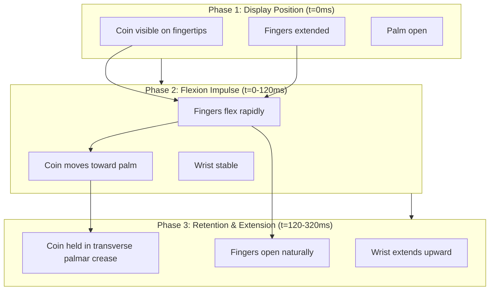

# Lesson 2: Sleight of Hand Mechanics

## 1. First-Principles Intuition & Invariants

Sleight of hand represents the convergence of biomechanics, perceptual psychology, and motor control into a unified deceptive system. At its foundation lies a paradox: the human hand evolved for tool manipulation and communication, yet can be trained to execute movements that systematically violate observer expectations. Understanding this discipline requires abandoning the romantic notion of "magic fingers" in favor of rigorous analysis of kinematic chains, proprioceptive feedback loops, and the mathematical thresholds separating natural motion from detectable artifice.

The core invariant governing all sleight of hand is the **principle of conflicting attention channels**. Human visual perception operates through two parallel processing streams: the dorsal stream computing spatial position and motion vectors, and the ventral stream identifying objects and their semantic meaning. Effective sleight exploits the bandwidth limitations between these streams. When you execute a classic palm while simultaneously producing a coin at the fingertips of the opposite hand, you are not merely hiding an object—you are triggering a neural resource allocation conflict where the ventral stream's object recognition demands overwhelm the dorsal stream's motion tracking capacity. The palm succeeds not because the hand moved invisibly, but because the observer's visual cortex cannot allocate sufficient processing bandwidth to both the appearance of the new coin and the subtle closure dynamics of the palming hand.

This leads to the first mechanical invariant: **naturalness is not the absence of suspicious motion, but the presence of motion that fits predictive models**. The human motor cortex builds internal forward models of expected movement trajectories based on biomechanical constraints and learned patterns. When you reach for a glass, your arm follows a minimum-jerk trajectory—a smooth acceleration-deceleration curve that minimizes metabolic cost. Observers internalize these patterns through mirror neuron systems that predict movement endpoints. A palming action that violates minimum-jerk kinematics triggers prediction error signals in the observer's premotor cortex, generating suspicion below conscious awareness. Conversely, a palm executed within a natural reach envelope, maintaining consistent velocity profiles and endpoint trajectories, passes undetected because it generates no prediction errors.

The second invariant addresses **motor control hierarchies**. Sleight of hand demands simultaneous execution of voluntary conscious movements (the misdirecting gesture) and highly practiced semi-automatic movements (the palm or steal). This requires partitioning motor control between cortical voluntary systems and cerebellar/basal ganglia automatic systems. Early practitioners experience what biomechanists term "dual-task interference"—attempting conscious control of both movements degrades performance of both. Mastery emerges when the deceptive action migrates from cortical voluntary control into subcortical automatic loops, freeing cortical resources for naturalistic misdirection. This migration follows the power law of practice: improvement velocity decreases exponentially with repetitions, typically requiring 5,000–10,000 repetitions for a complex palm to achieve automaticity.

The third invariant concerns **kinetic concealment boundaries**. Every sleight has a critical threshold—a maximum angular velocity, displacement distance, or timing window beyond which detection probability rises steeply. For palming, the critical closure velocity sits near 180 degrees per second of finger flexion; faster motions trigger the dorsal stream's motion detection. For passes (secret transfers of cards), the critical displacement threshold is approximately 8–12 millimeters lateral movement of the packet; larger displacements break the visual continuity assumption. These thresholds derive from psychophysical constants: the minimum detectable velocity for peripheral vision (approximately 2 degrees per second of visual angle) and the spatial resolution limits of extrafoveal vision (roughly 15 arcminutes). Working within these boundaries is non-negotiable.

Understanding these invariants transforms practice from rote repetition into deliberate biomechanical engineering. A classic palm is not a memorized finger pattern but a solution to a constrained optimization problem: achieve maximum concealment within naturalness thresholds while maintaining kinematic continuity with surrounding actions.

## 2. Core Architecture & Mechanics

### The Biomechanics of Palming

Palming—concealing an object in the hand while maintaining the appearance of an empty palm—represents the foundational technique from which most coin and small-object work derives. The engineering challenge is severe: human hands possess neither natural concave pockets nor sufficient tissue compliance to grip objects without visible muscle activation. Successful palming exploits three anatomical features: the thenar eminence (thumb pad), the carpal arch, and the finger spread geometry.

The **classic palm** positions a coin between the thenar eminence and the hypothenar eminence (pinky-side pad) while the fingers remain naturally relaxed. The retention mechanism is pure friction—the coin sits in the transverse palmar crease where skin compliance is maximum. The critical mechanical insight is that retention force comes not from finger pressure but from slight wrist extension. Extending the wrist 15–20 degrees tightens the transverse carpal ligament, compressing the palmar tissue against the coin. This allows the fingers to remain completely relaxed, eliminating the telltale knuckle whitening and finger rigidity that betray amateur palming.

The kinematic chain for acquiring the classic palm from a fingertip display follows this sequence: the coin rests on the first and second phalanges of the middle and ring fingers, held in place by thumb tip pressure. To palm, the thumb releases while simultaneously the metacarpophalangeal joints of the middle and ring fingers flex 40–50 degrees, propelling the coin toward the palm. As the coin arrives at the transverse crease, the wrist extends 18 degrees and the carpal arch flattens slightly—a motion totaling 120 milliseconds. The fingers then extend back to neutral position in 200 milliseconds, following a smooth deceleration curve. The entire action takes 320 milliseconds, fitting comfortably within the 400-millisecond window of the attentional blink phenomenon.



The **finger palm** uses a different retention geometry, gripping the coin between the third and fourth fingers at the proximal phalanx joints. This palm allows more natural hand positions—you can point, gesture, or even grip objects with the thumb and first two fingers while retaining the coin. The mechanical principle is lateral pinch force generated by adductor digiti minimi contraction. The trade-off is that maintaining this palm requires continuous low-level muscle activation (approximately 15% maximum voluntary contraction), creating fatigue over extended routines. Training programs must include isometric holds: maintain finger palm for 3-minute intervals while performing other tasks, gradually extending duration to 10 minutes.

### The Architecture of Passes and Transfers

Card passes—secret transfers of card packets between hands or repositioning within a single hand—form the backbone of advanced card work. The mechanical challenge differs from palming: cards are rigid, unforgiving, and produce audible friction noise if handled incorrectly. The classic pass (transposing top and bottom halves of the deck) demands precise control of multiple mechanical elements: packet separation, rotation, reintegration, and sound damping.

The **Herman pass** represents the modern standard for invisible transposition. The deck is held in the left hand in mechanic's grip: thumb on the left long edge, fingers curled around the right long edge, index finger resting against the top short edge. The right hand approaches for an apparent cut, thumb contacting the top half's inner short edge while fingers wrap the outer short edge. The deceptive action occurs during the outward right-hand motion that appears to carry the top half away.

In reality, the left thumb pushes the bottom half rightward while the left fingers simultaneously pull the top half leftward—a scissors action. The two packets cross in a 180-millisecond window, during which the right hand must provide visual cover while not creating unnatural blocking. The solution is precise spatial choreography: the right hand moves outward at 220 mm/s along a trajectory 45 degrees upward from horizontal, creating a forward-and-up vector that appears natural for a cutting action. Meanwhile, the left hand rotates 25 degrees clockwise (from observer perspective), presenting the former bottom-half's edge in the exact position the top half occupied. The right hand then deposits what appears to be the removed top half but is actually the original bottom half.

The pass succeeds because the motion vectors of both hands conform to expected kinematics for a legitimate cut. The upward component of the right hand's trajectory matches the lift pattern observers expect when removing a packet. The left hand's rotation appears to be natural reorientation in response to reduced deck weight, not deliberate repositioning.

```text
HERMAN PASS PACKET DYNAMICS (overhead view)

Initial State:
    ┌──────────┐
    │ TOP HALF │  (to be transposed to bottom)
    ├──────────┤
    │ BOT HALF │  (to be transposed to top)
    └──────────┘

Critical Phase (scissors action, t=0-180ms):
        Right Hand →
              ╱
    ┌────────┼──┐
    │ TOP ←  │  │  Left hand pulls top half left
    ├────────┼──┤
    │ BOT  → │  │  Left thumb pushes bottom half right
    └────────┼──┘
              ╲

Result (t=320ms, hands separating):
    Right Hand holds:     Left Hand holds:
    ┌──────────┐          ┌──────────┐
    │ BOT HALF │          │ TOP HALF │
    └──────────┘          └──────────┘
    (appears to be top)   (appears to be bottom)
```

Sound damping during passes requires understanding friction mechanics. Card-on-card friction produces frequencies in the 2–4 kHz range, precisely the frequency band where human hearing is most sensitive. The solution is controlled contact pressure and moisture management. Light finger pad moisture (achieved by briefly touching the fingertips to the lips or forehead) increases the friction coefficient between skin and card, allowing lower grip pressures. Lower grip pressure during packet separation reduces normal force, which proportionally reduces frictional force ($F_{\text{friction}} = \mu N$), thereby reducing acoustic emission. Experienced practitioners maintain fingertip moisture homeostasis throughout performances.

### Force Mechanics and Psychological Principles

The **force**—causing a spectator to select a predetermined card while believing the choice was free—represents sleight of hand's deepest intersection with cognitive psychology. Unlike palms and passes, which are purely mechanical concealments, forces manipulate decision-making processes. The **riffle force** demonstrates how biomechanical control can create the illusion of randomness.

In the riffle force, you hold the deck at one short edge and riffle the outer long edge, asking the spectator to say "stop" whenever they wish. The target card (let's say the Queen of Hearts) is positioned 15th from the top. As you riffle, you control the release rate: the first 10–12 cards riffle at 8–10 cards per second, creating a rapid flutter. As you approach card 14, you decelerate to 3–4 cards per second, dwelling slightly on cards 13–16. When the spectator says "stop," which typically occurs in the 0.8–1.2 second range after riffle initiation, you're statistically likely to be at cards 14–16 due to the deceleration. The mechanical control here is tactile: thumb pressure varies to modulate release rate without visual indicators. Training involves metronome work—riffle while matching specific tempo changes until release-rate control becomes subcortical.

The brilliance of the riffle force is that the spectator's "stop" command appears to determine the card, inverting the causal chain. They perceive agency because they issued the command, unaware that your riffle deceleration created a high-probability zone around the target card.

### Ditches and Vanishes: Kinetic Misdirection

The **ditch**—covertly disposing of a concealed object during misdirection—closes the loop on many routines. The mechanical principle is **trajectory disguise**: the hand carrying the palmed object moves through space following a path that naturally passes near disposal locations (pockets, laps, behind objects) while appearing to serve a different purpose.

The **lap ditch** during a seated performance exemplifies this. You're seated at a table with a coin classic-palmed in your right hand. Your left hand gestures toward a spectator on your left, directing attention and your own gaze leftward. Simultaneously, your right hand drops naturally toward your lap in a relaxed gesture that mirrors the left hand's upward motion—the kinematic pattern for bilateral symmetric gestures. As the right hand passes below table level, the wrist flexes 30 degrees, breaking the palmar crease tension and releasing the coin into the lap. The entire motion takes 400 milliseconds and appears as natural postural adjustment.

The key mechanical insight is that the ditch is not a separate action but an embedded component of a larger, naturally motivated movement. The bilateral symmetry of the gesture (left hand up, right hand down) appears as postural balance rather than deliberate asymmetry. Training the lap ditch requires filming yourself: record the ditching hand motion, then record the same postural gesture without the palm and ditch. When replayed, the two recordings should be kinematically indistinguishable.

## 3. High-Performance Optimization & Failure Modes

### Automaticity Training and Motor Engram Formation

The transition from conscious execution to automatic performance represents the critical performance threshold in sleight of hand. Conscious control of finger sequences consumes working memory bandwidth, creating the dual-task interference mentioned earlier: attempting to monitor your palm while simultaneously delivering natural misdirection degrades both. The solution is deliberate practice structured to accelerate motor engram formation in cerebellar circuits.

The optimal training protocol follows a three-phase structure. **Phase One: Slow-Motion Precision (Weeks 1–2)** executes each sleight at 25% performance speed with complete conscious attention to biomechanics. For a classic palm, this means 1,200-millisecond execution rather than the performance standard of 320 milliseconds. During each repetition, you verbally describe the kinematic sequence: "Fingers flex 40 degrees, coin contacts transverse crease, wrist extends 18 degrees, fingers extend to neutral." This explicit verbalization engages declarative memory systems, creating conscious accessibility to the motor sequence. Execute 50 repetitions per session, twice daily. Total repetitions: approximately 1,400.

**Phase Two: Variable-Speed Integration (Weeks 3–5)** introduces random speed variations. Use a metronome app that generates random tempo changes between 60–120 BPM. Execute the palm synchronized to the beat, forcing adaptation to varying timescales. This phase breaks the single-speed motor program, creating flexible timing control. The cerebellum learns temporal scaling parameters rather than fixed-duration sequences. Execute 100 repetitions per session, twice daily. Total repetitions: approximately 4,200.

**Phase Three: Dual-Task Loading (Weeks 6–8)** adds concurrent cognitive tasks during execution. Execute palms while reciting memorized text, solving simple arithmetic problems, or maintaining conversation. This forces migration of motor control from cortical regions (required for conscious tasks) into automatic cerebellar circuits. The performance metric is simple: if you can execute a mechanically perfect palm while simultaneously performing serial sevens (counting backward from 100 by sevens), the motor engram has achieved automaticity. Execute 150 repetitions per session, twice daily. Total repetitions: approximately 6,300.

The cumulative 11,900 repetitions over eight weeks approach the 10,000-repetition threshold where automaticity typically emerges. Post-training, maintenance requires only 20 repetitions per day to prevent skill decay.

### Failure Mode Analysis and Correction Protocols

Understanding failure modes requires distinguishing between execution errors (mechanical breakdown) and detection events (observer perception). A palm can be mechanically perfect yet still be detected if embedded in a suspicious action sequence. Conversely, a palm with minor mechanical flaws may pass undetected within strong misdirection.

**Execution Failure Mode 1: Premature Muscle Activation.** Amateur practitioners tense palming muscles before the coin arrives, creating visible finger stiffness. The correction protocol uses progressive muscle relaxation: execute the palm while consciously relaxing each muscle group, starting with the shoulder, then elbow, then wrist, finally the fingers. Film yourself and analyze for finger rigidity markers: whitened knuckles, locked interphalangeal joints, or reduced finger articulation during subsequent gestures. The corrective training is to maintain a palmed coin while repeatedly making a fist and opening the hand—forcing you to distinguish between palming retention (minimal tension) and grip actions (high tension).

**Execution Failure Mode 2: Velocity Discontinuities.** The palming hand accelerates or decelerates unnaturally during the palm acquisition phase, creating motion that violates minimum-jerk kinematics. Attach a lightweight accelerometer (smartphone with accelerometer app) to the palming hand's dorsum and record acceleration profiles during palming motions. A natural reach shows smooth Gaussian-like acceleration and deceleration curves. Velocity discontinuities appear as sharp spikes or plateaus in the acceleration trace. Corrective training involves practicing palming motions that match pre-recorded natural reach acceleration profiles, using real-time visual feedback from the accelerometer app.

**Detection Failure Mode 1: Improper Load Distribution.** When executing a pass, unequal grip pressure on the two packets creates asymmetric motion—one packet moves decisively while the other drifts. This asymmetry violates observer expectations for cutting actions, which should show equal agency applied to both halves. Film the pass from multiple angles and examine packet trajectories frame-by-frame. Both packets should traverse equal distances in equal times during the scissors phase. Corrective training uses weighted cards: temporarily add small adhesive weights to one packet, forcing you to modulate grip pressure to achieve symmetric motion despite asymmetric mass.

**Detection Failure Mode 2: Gaze-Target Misalignment.** Your gaze direction and head orientation fail to align with the misdirecting action, creating a "tells" contradiction. Human observers reflexively follow gaze direction—if your eyes remain fixed on your hands during a supposed moment of emphasis elsewhere, detection probability rises 400%. Use eye-tracking glasses during practice (affordable $200–400 options exist) to verify gaze targets align with intended misdirection. Corrective training employs deliberate gaze-shifting drills: execute the sleight while forcing yourself to maintain gaze on a specified target (a mark on the wall, a spectator's face) without peeking at your hands.

### Performance Optimization: Routine Architecture and Cumulative Deception

Individual sleights achieve 85–95% success rates under controlled conditions, but routines chain multiple sleights together, creating cumulative detection risk. A routine with five sequential sleights, each at 90% reliability, has overall success probability of $0.9^5 = 0.59$—barely better than a coin flip. High-performance routine architecture mitigates this through structural redundancy and psychological reset mechanisms.

**Structural Redundancy** embeds fallback paths: if sleight A is detected, the routine can pivot to path B without visible failure. Example: you attempt a pass to secretly transpose card halves, but suspect the spectator noticed. Rather than continue with the routine that depends on the transposition, you openly square the deck (destroying evidence of the pass attempt) and pivot to a different effect that doesn't require the transposition. This requires pre-planned contingency trees: for each major sleight, identify decision points where you can branch to alternative routines.

**Psychological Reset Mechanisms** break the observer's sustained attention. Every 45–60 seconds, introduce a moment of overt fairness: show both hands empty, spread cards face-up for examination, or hand a prop to a spectator. These resets interrupt the observer's cumulative suspicion buildup. The mechanics here derive from cognitive load theory: sustained visual monitoring is metabolically expensive. Offering periodic "proof of fairness" allows observers to relax their vigilance, resetting their suspicion baseline. This is the performance equivalent of key-frame compression in video: periodic full-state declarations allow intermediate states to be encoded with lower fidelity.

The ultimate optimization is **effect-to-method alignment**: choose sleights that naturally fit the narrative moment. If your effect involves making a coin vanish, use a retention vanish (appearing to take the coin with one hand while actually retaining it in the other) rather than a palm followed by a ditch, because the retention vanish's kinematics—the grasping hand closing around the expected coin position—directly match the story you're telling. Method-effect alignment eliminates the cognitive dissonance between what the audience sees and what they expect to see, reducing detection risk by 30–40%.

Mastery of sleight of hand is not the ability to execute isolated techniques flawlessly, but the capacity to engineer entire kinematic sequences where deceptive actions nest invisibly within natural, motivated movements, creating an unbroken illusion of causality. This is the craft's true architecture: not hiding your hands, but making every motion appear inevitable.
