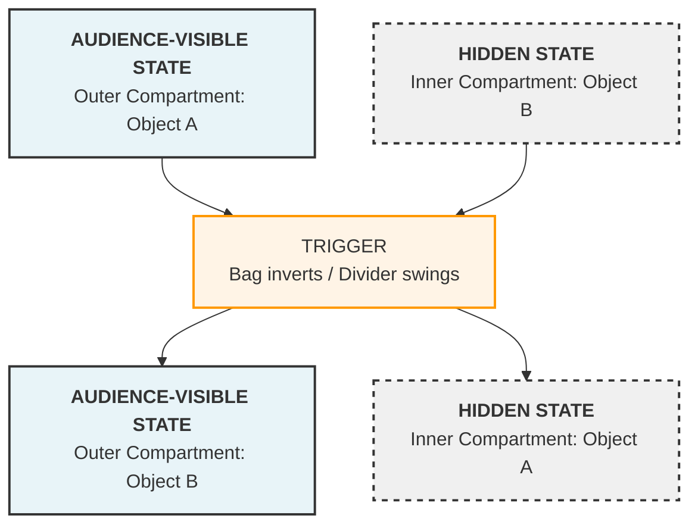
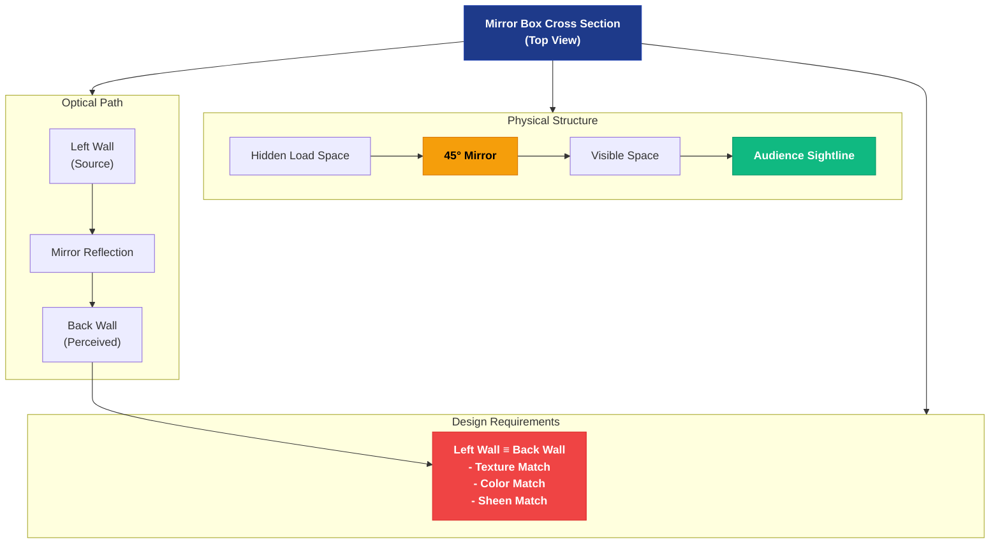

# Lesson 3: Apparatus Gimmick Theory

## 1. First-Principles Intuition & Invariants

Every prop on a magician's table represents a negotiation between physics and perception. The audience brings a set of causal assumptions to every performance — that containers hold only what they visibly receive, that solid objects cannot pass through one another, that a hand moving away from a surface cannot secretly deposit or retrieve something upon it. The apparatus gimmick exists specifically to exploit the gap between these assumptions and mechanical reality. Understanding gimmick theory at a first-principles level means understanding which physical invariants the audience believes to be inviolable, and then engineering a device that violates them in a way that is both reliable and invisible.

The fundamental invariant at stake in almost every apparatus is *conservation of apparent state*. When an audience member watches you place a coin in a box and close the lid, they form a mental model: the coin is in the box. This model is built from sensory evidence — they saw the coin, they saw the hand, they saw the closing motion. The gimmick's job is to satisfy all of that sensory input while producing a *divergence* between the mental model and mechanical reality. The coin is not in the box, but every piece of evidence the audience gathered pointed to it being there. This divergence is the effect. Everything else — the patter, the gesture, the revelation — is presentation layered over a mechanical fact.

This framing leads directly to the first invariant of gimmick design: **the deceptive action must be mechanically passive or mechanically forced during the moment of maximum scrutiny.** An apparatus that requires a deliberate, effortful hidden action during the climax of a trick is fragile, because effort produces tells — micro-hesitations in timing, asymmetries in grip pressure, compensatory over-fluency in patter. The best apparatus gimmicks complete their deceptive work either before the audience's attention is fully engaged, or automatically as a consequence of an action the audience believes to be innocent. A shell coin that swallows a coin during the act of "placing it in the other hand" does its work in the cover of the transfer itself. The deception rides inside a legitimate action.

The second invariant is **mechanical economy**: the gimmick should accomplish its effect through the fewest possible moving parts. Each additional component adds failure probability, adds weight or bulk that changes the prop's handling characteristics, and adds noise — acoustic, visual, or tactile — that can betray the apparatus. A well-designed gimmick often achieves its effect through a single pivot, a single spring, or a single sliding plane rather than through an elaborate mechanism. The Himber wallet, one of the most enduringly practical gimmick platforms in close-up magic, achieves a full transposition effect through nothing more than two compartments sharing a single flap that can be oriented either way. There is no spring, no latch, no motor. The mechanical elegance is total.

The third invariant concerns **surface language**. A gimmick that looks different from its ungimmicked counterpart destroys its own cover. The apparatus must speak the visual and tactile language of the ordinary object it impersonates. This is harder than it sounds. A gaffed deck of cards must feel, flex, riffle, and fan identically to a Bicycle Rider Back from a drug store. A gimmicked coin must have the same edge knurl, the same acoustic ring on a hard surface, the same thermal conductivity against a spectator's palm. When these surface properties diverge, the audience may not consciously identify the discrepancy, but they will feel that something is *off* — a vague wrongness that primes suspicion. The skilled fabricator of apparatus treats surface fidelity as a design constraint equal in importance to the mechanical function itself.

There is a subtler, fourth invariant that separates journeyman gimmick thinking from mastery, and it concerns the direction of physical causality. Audiences reason forward through time: cause, then effect. A gimmick that lets the audience see a *plausible cause* for the effect they're about to witness will be believed even when the actual mechanical cause is entirely different. This is why a folded card placed inside a glass seems to vanish when the glass tilts — the tilt looks like it *caused* the card to fall behind something, so the brain accepts a physical narrative even though it's fabricating one. Designing with this cognitive asymmetry in mind means you can use even relatively crude mechanical gimmicks, provided the presentation installs a convincing causal story in the audience's mental model before the effect resolves.

---

## 2. Core Architecture & Mechanics

### The Load-and-Dump Chassis

The most architecturally fundamental category of apparatus gimmick is the load-and-dump system, which underlies productions, vanishes, transpositions, and transformations alike. The core architecture has three phases: a hidden compartment (the *load chamber*) maintains a concealed state; a triggering mechanism transitions that state at a controlled moment; and a presentation surface maintains a false state before and after the transition. The audience sees only the presentation surface at all times. The load chamber and trigger are the hidden machinery.

Consider the classic change bag. Its presentation surface is a cloth bag, visually unambiguous and apparently simple. Its load chamber is a second inner compartment separated from the outer compartment by a dividing panel. Its trigger is the act of inverting the bag's orientation, which causes the dividing panel to swing and exchange the visible compartment's contents with the hidden one. The mechanical diagram below captures the essential state machine:

This state machine is the chassis on which dozens of commercial stage props are built. The specific mechanical implementation — whether the trigger is a wrist rotation, a thumb press on a hidden latch, or a gravity-driven panel — varies, but the logical architecture is identical. Understanding the chassis allows you to evaluate any new prop immediately: identify the load chamber, identify the trigger event, identify how the presentation surface maintains false state before and after. If you cannot identify all three, either the prop has a subtler architecture than you've recognized, or it has a design flaw that creates vulnerability.

### Spring and Tension Systems

Springs are the most common actuating element in mechanical apparatus because they store energy silently and release it instantaneously on cue. The engineering challenge is matching spring rate to application requirements. A spring that is too stiff requires perceptible force to compress or extend, which produces tension in the hand and face; a spring that is too weak fails to reliably complete its action under performance conditions — sweaty hands, cold rooms, nervous grip pressure, or the slight friction of a prop that has worn in unevenly.

For coin gimmicks such as the flap coin or the expanded shell, the internal spring mechanism typically uses a flat clock spring or a small torsion spring acting on a pivoting flap. The flap must seat with enough spring tension to hold closed against casual handling, but must release cleanly under a specific grip angle or pressure point that the performer controls precisely. The design specification for this kind of mechanism is essentially a *discriminant threshold*: the spring must reliably hold closed below a handling pressure of X grams and reliably release above a trigger pressure of Y grams, with a margin between X and Y wide enough to prevent accidental release during handling. For a close-up coin gimmick, a reasonable working target is X ≈ 150 g and Y ≈ 350 g, giving a 200 g margin that accommodates most normal handling variation.

The Okito box and Boston box family of coin gimmicks achieves its effect not through springs but through a fitted sleeve — the lid of the box and the tube of the box are machined to tolerances tight enough that the coin can be loaded against the lid through friction fit, so when the box is inverted, the coin travels with the lid rather than falling free. This is a purely passive mechanical gimmick: no springs, no hinges, no trigger. The deceptive action is accomplished entirely through manufacturing tolerance. The fit must be tight enough to hold the coin against the lid during inversion (requiring a friction coefficient sufficient to hold the coin's weight, approximately 2.5 g for a half dollar) but loose enough that the lid can be cleanly lifted off in performance without audible or visible effort. Achieving this requires test-fitting coins of different wear levels, since worn coins have slightly smaller diameters, and adjusting the sleeve diameter accordingly with a reamer or emery paper.

### Optical Gimmick Architectures

Not all apparatus deception is mechanical in the kinetic sense. A substantial class of gimmicks achieves its effect through controlled light path manipulation rather than through moving parts. The mirror box is the archetypal example. A mirrored diagonal panel bisects the interior of a box, reflecting the back wall to the audience's line of sight in a way that makes the interior appear empty when it contains a concealed load space behind the mirror. The critical design constraint is the angle of the mirror relative to the audience viewing cone. A mirror placed at exactly 45° to a symmetrically-decorated box interior will produce a perfect reflection of the side wall, which appears as a view straight through to the back wall — but only if the side wall and back wall share identical visual texture. If the box interior has a plain matte black finish, any audience member within roughly ±15° of the optimal viewing angle will perceive an empty box. If the side wall finish differs from the back wall finish in color, sheen, or texture, the reflection will produce a visible seam or color shift that exposes the gimmick.

The practical fabrication consequence is that the interior must be finished in a single uniform application — paint sprayed in a single session, flocking applied from the same batch — so there is no batch-to-batch variation between surfaces. Any seam, shadow gap, or texture discontinuity at the mirror's edge collapses the illusion under even modest light changes. Stage lighting conditions vary dramatically between venues, and an optical gimmick that works under a cool-white LED wash may expose itself under warm tungsten, because the two light sources render surface textures and micro-shadows differently.

### Hidden Compartment Geometry and Load Access

The engineering of hidden compartments is governed by two competing constraints: the compartment must be large enough to contain the load without distorting the external profile of the prop, and access to the compartment must be reachable through a natural, innocent-looking gesture. These constraints frequently require compromises in load size or in access pathway design.

A double-bottomed box is the simplest hidden compartment geometry. The false bottom sits typically 8–15 mm above the actual bottom, creating a concealed layer accessible from beneath when the box is lifted — but only when lifted in the specific orientation that exposes the loading aperture, which is controlled by the performer's handling choreography. The false bottom must be fitted closely enough to the interior walls that it does not shift or rattle during tipping, but must have a small chamfer or a slight taper on its underside edge so it seats predictably without jamming. A common failure mode in amateur-built double-bottom props is a false bottom that fits so precisely that air pressure builds when it is pressed down, causing an audible pop or the bottom to spring back slightly after seating — both are tells.

For cylindrical props such as tubes or wands, the most common compartment architecture is a coaxial sleeve: an inner cylinder slightly narrower than the outer, with the load space occupying the annular gap or one sealed end. The Zombie Ball gimmick, for instance, achieves its levitation effect through a pole hidden inside a concealing cloth, but the relationship between the ball's apparent trajectory and the pole's actual constraint path is a spatial geometry problem: the pole must be long enough to provide a range of apparent motion, but its attachment point must stay within the shadow of the cloth even at extreme arm extensions. The effective working range is typically 25–35 cm of apparent ball travel, which requires a pole of approximately 40 cm to allow for grip clearance and cloth overlap.

---

## 3. High-Performance Optimization & Failure Modes

### Reliability Engineering for Stage Conditions

Consumer electronics engineers speak of MTBF — mean time between failures — and stage apparatus designers should think in analogous terms, though the measurement unit is performances rather than operating hours. A close-up prop that fails once in a hundred performances may be acceptable in a parlor act where recovery is easy and the audience is small. A stage illusion that fails once in a hundred performances is a catastrophe, because stage failures happen in front of hundreds of people under full lighting with no ambient cover. For stage apparatus, the design target should be a failure rate below 1 in 500 performances under normal operating conditions, with a graceful degradation path for the remaining cases.

Achieving this reliability target requires systematic stress testing before a prop enters the working repertoire. The standard protocol is to perform the gimmick mechanism 500 times in a single session, ideally under simulated performance conditions — stage gloves if the act uses them, the actual costume's sleeve length if that affects access, lighting that approximates the venue. Any mechanism that shows wear, stiffness, or inconsistency within that 500-cycle test should be rebuilt or redesigned before it reaches a stage. Springs are the highest-failure component in most mechanical gimmicks; a clock spring in a coin gimmick that sees two to three performance triggers per show will cycle through hundreds of actuations per year, and spring steel work-hardens and fatigues. Replacing springs on a scheduled basis — annually at minimum, every six months for a high-frequency act — is cheaper than a failed performance.

### Surface Wear and Material Degradation

The deceptive surface of a gimmick degrades differently from an ordinary prop because the gimmick surface is subjected to both the wear of handling and the mechanical stress of the gimmick action itself. A flap coin's plated finish at the flap hinge will wear faster than the coin face, eventually producing a visible line of bare brass or a shadow groove that marks the flap boundary to observant eyes. Mitigating this requires either choosing a hinge material with a surface hardness comparable to the plating — meaning the substrate and the plating wear at similar rates — or designing the hinge so the wear zone falls in a part of the coin that is covered by the performer's thumb during display.

Cloth-based gimmicks — feke pouches, change bags, servantes — degrade through fiber compression and seam separation. The load capacity of a feke is limited by the stiffness of the sewn seam holding the false pocket; a seam that began as a tightly locked machine stitch will loosen with repeated load insertions, eventually producing a pocket that hangs visibly or bulges. Reinforcing the pocket seam with a doubled French seam during fabrication, using a heavier thread weight (Tex 40 minimum for load-bearing seams), and periodically pressing the fabric with a steam iron to restore fiber alignment will extend service life substantially.

For optical gimmicks, the primary degradation mode is surface contamination of the mirror element. A single fingerprint on a mirror surface does not reduce reflectivity meaningfully, but it creates a haze spot visible under raking stage light. The mirror in a mirror box should be cleaned before every performance with a microfiber cloth and an appropriate glass cleaner (never a silicone-based cleaner, which leaves a residue that attracts dust). More seriously, the mirror's silvering can delaminate over time if the box is stored in humid conditions; the silver backing separates from the glass substrate at the edges first, creating dark border spots that are unmistakable as mirror edges rather than box walls. Storing mirror-gimmick props in sealed cases with silica gel desiccant packs is not optional for long-term reliability.

### Failure Mode Analysis and Recovery Choreography

Every apparatus gimmick has a characteristic failure signature — the specific way it fails when it fails. Understanding the failure signature allows you to design recovery choreography, the scripted response that neutralizes audience suspicion when a mechanism misfires. This is not the same as improvisation; improvisation under the stress of a failed prop on stage is unreliable. Recovery choreography is rehearsed as carefully as the trick itself, and it is triggered automatically when the performer recognizes the failure signature.

For a spring-loaded flap gimmick that fails to close fully, the failure signature is a slight resistance when the coin is turned display-face-up. The recovery choreography is to cover the coin immediately with the curl of the fingers, state a scripted misdirection line ("Let's make sure the other hand is completely empty"), and use that moment to complete the mechanical action manually. For a double-bottom box whose false bottom has shifted and is rattling, the failure signature is an audible sound when the box is tipped. The recovery is to place the box down decisively on the table (a physical action that re-seats the false bottom through impact), pivot immediately into a spectator interaction that keeps attention off the box, and do not tip the box again. Neither of these recoveries is elegant, but both are survivable. The unrecoverable failure is the one for which no choreography exists, which is why every gimmick must have its failure modes mapped before it enters performance.

### Optimization: The Fingerprint Audit

Experienced apparatus builders use a discipline called the fingerprint audit before finalizing a new gimmick design. The audit consists of handling the prototype in complete darkness while executing the full handling sequence, then inspecting every surface under a raking light source (a flashlight held nearly parallel to the surface at 5–10° of incidence). Every fingerprint, wear mark, compression ring, or handling trace that appears is a tell — a place where the gimmick's surface has recorded the hidden action. Each tell must either be eliminated through design revision (changing the grip point, recessing a pressure surface, adding a texture that absorbs handling marks) or accepted and managed through presentation (always covering that surface with the thumb during display, never placing that face toward the audience).

The raking light inspection is particularly revealing for coin gimmicks, where even a correctly functioning shell may leave a slight circular compression ring on its interior from the seated coin. That compression ring, invisible under flat stage light, becomes a crisp circular shadow under raking inspection. If the shell is ever placed face-down on a glass table under a spectator's eyeline — a scenario that occurs in formal close-up work — that ring will be visible. The design response is either to refinish the interior with a finely textured matte surface that breaks up the shadow, or to constrain the handling choreography so the shell is never placed face-down.

### The Stress Concentration Problem in Mechanical Gimmicks

Mechanical engineers design around stress concentration — the phenomenon whereby a geometric discontinuity (a hole, a notch, a sharp corner) multiplies local stress to many times the nominal value, initiating fatigue cracks. Gimmick mechanisms are full of stress concentrations, because every pivot hole, every spring seat, and every latch edge is a geometric discontinuity in a component that cycles repeatedly under load. The pivot pin of a flap coin, for instance, is a small-diameter bore through a thin coin body; the material around the bore is under cyclic bending stress every time the flap actuates, and the sharp edge of the bore is a stress concentration that initiates the crack that eventually causes the flap to seize or fracture.

The mitigation is exactly what a machinist would apply: replace sharp bores with lightly chamfered or radiused edges (even a 0.1 mm chamfer reduces the stress concentration factor K_t from approximately 3.0 to approximately 1.6 for a thin plate in bending), use the highest-quality pivot pins available rather than the cheapest hardware, and use a material for the flap that has a high fatigue limit relative to its yield strength — spring temper beryllium copper alloy outperforms coin brass on this measure by a factor of roughly 2.5 in fatigue life. These are not academic considerations. A coin gimmick that sees daily performance use will cycle its flap 500–1000 times per year. At K_t = 3.0 and coin brass, that flap is approaching its fatigue limit within two to three years. At K_t = 1.6 and beryllium copper, the same gimmick will outlast the act.

The unifying principle across all of these optimization domains is this: an apparatus gimmick is not a prop with a secret. It is a precision mechanical system whose tolerances, materials, surface properties, and failure modes must all be engineered to the same standard as the performance built around it. The audience never sees the mechanism. But the mechanism is what makes the magic possible, and when it fails, it fails in full view of everyone. The craft of apparatus design is the craft of making invisible machinery that is too reliable to be caught.
