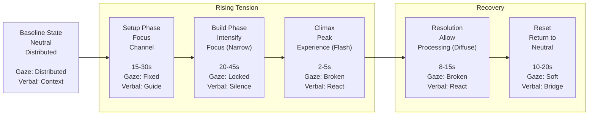

# Lesson 4: Performance Architecture

## 1. First-Principles Intuition & Invariants

The architecture of a magic performance is not merely the sum of its constituent tricks but rather a carefully engineered narrative structure that manipulates time, attention, and emotional investment to create an experience of impossibility. Where a single effect might astonish, a well-architected performance transforms astonishment into sustained wonder through the deliberate orchestration of peaks, valleys, and crescendos. This architectural thinking separates the competent technician from the masterful performer.

At its foundation, performance architecture operates on a fundamental principle borrowed from classical rhetoric and theatrical construction: the audience's psychological state is not constant but rather follows predictable trajectories that can be shaped, extended, or redirected through deliberate structural choices. The novice performer arranges effects chronologically or by thematic similarity, creating a flat landscape of equal-weighted moments. The master architect understands that each effect exists within a larger narrative economy where earlier moments establish baselines, midpoint effects develop complications, and climactic sequences resolve tensions while opening new impossibilities.

The core invariant governing all performance architecture is what might be termed the **conservation of impossibility principle**: the total magnitude of impossibility experienced by the audience is not additive but rather follows a dynamic curve where each subsequent effect is evaluated relative to what preceded it. A levitation performed after three card tricks carries different weight than the same levitation performed after an ambitious card routine and a coin assembly. The audience's threshold for astonishment rises with each effect, demanding either escalation in method complexity, emotional investment, or presentational framing. This creates the central architectural challenge: how to structure a performance so that each moment satisfies while simultaneously preparing the ground for what follows.

Time architecture in magic performance operates on multiple nested scales simultaneously. At the macro level, the overall performance duration must respect the psychological endurance limits of sustained attention—typically forty-five to ninety minutes for theatrical formats, twelve to twenty minutes for close-up sets, and three to seven minutes for viral video formats. Within this envelope, individual effects possess their own temporal structures: the setup phase establishing conditions, the working phase building anticipation, the climax delivering the impossible moment, and the denouement allowing the impossibility to settle into the audience's consciousness. Skilled architects compress or expand these internal phases to create rhythmic variation, understanding that three seven-minute effects feel dramatically different from seven three-minute effects despite occupying identical total duration.

The relationship between performer and audience creates a second foundational invariant: the **asymmetric information gradient**. The performer possesses complete knowledge of methods, outcomes, and structure while the audience operates in a state of strategic ignorance punctuated by moments of revelation. This gradient must be carefully managed—too steep and the audience feels manipulated or insulted; too shallow and the sense of impossibility evaporates. Performance architecture thus becomes an exercise in information flow management, determining what the audience knows, when they know it, and how that knowledge shapes their interpretation of subsequent events.

Failure modes in performance architecture typically manifest not as isolated technical errors but as structural collapses where the narrative logic breaks down. A forgotten prop becomes catastrophic not because the prop itself matters but because its absence invalidates the causal chain the audience has been led to construct. A poorly paced sequence causes attention drift not because individual effects fail but because the rhythmic contract between performer and audience has been violated. Understanding these failure modes requires thinking architecturally rather than atomically—the question is never whether a single effect succeeds but whether the performance as a whole maintains structural integrity.

The theatrical frame—the set of contextual assumptions and genre expectations the audience brings to the performance—operates as both constraint and resource. A stage illusion show establishes expectations of large-scale spectacle and technical impossibility, while a close-up parlor performance trades on intimacy and psychological impossibility. The architect must either satisfy these expectations or deliberately subvert them through meta-theatrical awareness. David Blaine's street magic performances revolutionized the field by transplanting stage illusion frameworks into documentary-style street settings, creating cognitive dissonance between the impossibility witnessed and the ostensibly uncontrolled environment.

## 2. Core Architecture & Mechanics

The fundamental unit of performance architecture is not the individual effect but rather the **effect sequence**: a deliberately ordered chain of two to five effects that function as a narrative paragraph. Within each sequence, effects are arranged according to specific structural patterns that have evolved through centuries of theatrical practice. The most robust pattern is the **escalation sequence**, where each effect increases either in scope, impossibility, or emotional stakes. A coin routine might progress from a single coin vanish, to a coin through table penetration, to a multi-coin assembly, to a finale where the coins transform into a different object entirely. Each step validates the previous impossibility while raising questions that demand further resolution.

The inverse structure, the **de-escalation or intimate sequence**, deliberately reduces scope while increasing personal connection. After a large-scale stage illusion, the performer might move into the audience for a borrowed ring routine, creating relief from spectacle while deepening emotional investment through personal object involvement. This structural pattern recognizes that sustained peak intensity creates fatigue rather than engagement; the architecture requires valleys to make peaks meaningful.

Transition mechanics between effects operate on three simultaneous channels: physical reset (returning to neutral prop and spatial configurations), psychological reset (clearing the previous effect from working memory), and narrative bridge (establishing continuity despite discontinuity). The weakest transition is the abrupt cut: "Now I'll show you something different." Stronger transitions use **causal bridging**, where the outcome of one effect motivates or enables the next: "The card you selected has now vanished completely—which means it must be somewhere. Let me check my wallet." The strongest transitions employ **thematic resonance**, where successive effects explore variations on a single impossible proposition from different angles, creating the sense of a deepening mystery rather than a variety show.

The architecture of attention management operates through deliberate **focus channeling**, where the performer's physical position, gaze direction, verbal emphasis, and prop handling create a narrow beam of audience attention that can be precisely directed or diffused. Close-up magic exploits this through table geometry: positioning critical props in the attention center while relegating prepared items to peripheral zones. Stage illusions use lighting, costume contrast, and movement vectors to create attention funnels. The architectural principle is that attention is a finite resource with specific reload times—attempting to direct attention to a new focus immediately after a climax moment results in attention lag, where the audience is still processing the previous impossibility rather than engaging with new information.

Pacing theory in performance architecture distinguishes between **beat pacing** (the internal rhythm of a single effect) and **macro pacing** (the overall tempo across the full performance). Beat pacing follows the principle of syncopation—moments of action punctuated by moments of stillness, creating rhythmic interest through variation rather than monotonous consistency. A coin vanish executed in steady, predictable motion carries less impact than the same vanish performed with deliberate hesitation before the critical move, creating anticipatory tension. Macro pacing typically follows a three-act structure borrowed from classical drama: the opening sequence establishes the performer's competence and the performance's tone (ten to fifteen percent of total duration), the developmental middle section explores variations and complications (sixty to seventy percent), and the climactic final sequence delivers the strongest impossibilities with minimal setup (fifteen to twenty-five percent).

Audience psychology management extends beyond attention control into emotional state engineering. The performer must continuously read and respond to aggregate audience state—energy level, skepticism versus credulity, engagement versus distraction—and adjust architectural choices accordingly. A cold or skeptical audience requires **credibility-building architecture** in the opening sequence: effects with minimal apparent setup, borrowed objects, or spectator agency to establish trust before attempting more elaborate deceptions. A warm, engaged audience permits **complexity escalation** where increasingly layered impossibilities can be stacked without triggering defensive skepticism.

The theatrical frame operates as a perceptual filter that determines which events are interpreted as impossible versus merely unexpected. In a traditional magic show frame, the audience expects deception and interprets all events through that lens. Mentalism performances employ an **ambiguous frame** where the performer might be demonstrating genuine psychological phenomena, creating a different interpretive context where the same methodologies generate different psychological responses. The architectural choice of frame determines not only how effects are presented but also which effects are viable—a stooge-based effect functions in a stage illusion frame where audience plants are expected but collapses in an intimate parlor setting where such methods violate the implicit social contract.

**Failure recovery protocols** must be architecturally integrated rather than treated as emergency measures. The robust performance architecture includes **breakaway points**—moments where the sequence can be gracefully exited or redirected if technical failure occurs. An ambitious card routine might be structured so that if the card fails to return to the top on the third phase, the performer can seamlessly transition into a different revelation method, maintaining the narrative of impossibility even if the specific planned method failed. This requires designing effects with multiple potential climaxes or endings, trading some efficiency for structural resilience.

The relationship between **preparation architecture** and **performance architecture** creates a critical but often overlooked dimension. Effects requiring extensive setup must be positioned in the performance sequence to allow for that setup to occur naturally—either during a previous effect's attention-intensive phase or during formal intermissions. The architectural constraint is that preparation time represents dead time in the audience's experience unless it is disguised as performance content. Skilled architects solve this through **nested preparation**, where the visible performance of one effect conceals the preparation for a later effect. A rope routine performed center stage might be entirely self-contained, while its execution provides cover for an assistant to prepare a later stage illusion in the wings.

## 3. High-Performance Optimization & Failure Modes

Performance optimization in magic architecture operates along several distinct axes that must be balanced rather than independently maximized. The first axis is **density optimization**: the number of impossible moments per unit time. Novice performers often over-optimize for density, creating a relentless barrage of effects that exhausts rather than engages. The optimal density varies by performance context—close-up magic tolerates higher density (one impossibility every forty-five to ninety seconds) because the intimate scale maintains engagement, while stage illusions require lower density (one major impossibility every four to eight minutes) to allow for the spectacle to register and the next illusion's apparatus to be positioned.

The second optimization axis addresses **method diversity**: varying the categories of deception employed across the performance. A performance relying exclusively on sleight-of-hand methods, even if technically flawless, creates a perceptible sameness in the quality of impossibility. Optimal architecture interleaves sleight-based effects with gimmick-based effects, psychological forcing with physical forcing, and mathematical principles with perceptual illusions. This diversity serves two functions: it prevents the audience from pattern-matching to identify method categories, and it creates varied textures of impossibility that maintain novelty across the performance duration.

**Cognitive load management** represents a third critical optimization dimension. Each effect imposes cognitive demands on the audience—tracking objects, remembering selections, following multi-step procedures, interpreting outcomes. Performances that consistently demand high cognitive engagement create fatigue and disengagement. The optimization principle is to alternate between high-load effects (ambitious card routines requiring sustained attention and memory) and low-load effects (visual productions or transformations requiring only passive observation). The architectural challenge is that high-load effects typically generate stronger emotional impact when successful, creating a temptation to over-use them.

The concept of **narrative economy** addresses how efficiently the performance architecture converts time and attention into emotional impact. Wasteful architectures include lengthy verbal justifications, redundant demonstrations of initial conditions, or excessive procedural steps that don't contribute to building impossibility. The optimization is not simply to minimize time but to ensure every moment serves a specific architectural function: establishing conditions, building anticipation, directing attention, or delivering impact. A thirty-second handling sequence is economical if it establishes essential conditions; a five-second throwaway gesture is wasteful if it serves no function.

Failure mode analysis in performance architecture identifies several catastrophic collapse patterns. The first is **rhythmic collapse**, where pacing becomes either monotonously consistent or chaotically random. Consistent pacing creates a predictable drone that enables attention drift; random pacing violates the implicit rhythmic contract with the audience, creating disorientation rather than engagement. Recovery from rhythmic collapse requires forcibly inserting a major tempo shift—either a long silent pause that resets expectations or a rapid-fire sequence that breaks the established pattern and establishes a new rhythm.

**Narrative discontinuity** failure occurs when the logical thread connecting effects breaks down, transforming a coherent performance into a disjointed collection of tricks. This typically manifests when transitional bridges fail—the performer completes an effect but cannot find a natural entry point into the next effect, resulting in awkward dead time or forced verbal pivots. Prevention requires architecting transitions into the original structure rather than attempting to improvise them during performance. Each effect should be designed with both an entry condition (what state must exist for this effect to make sense) and an exit condition (what state this effect establishes for the next sequence).

The **impossibility plateau** failure mode occurs when successive effects provide identical or decreasing magnitudes of impossibility, violating the audience's expectation of escalation. A card found in an impossible location, followed by another card found in a similar impossible location, followed by a third card in yet another impossible location creates diminishing returns—the impossibility mechanism has been demonstrated, and repetition confirms rather than expands it. The architectural solution is **cross-domain escalation**, where subsequent effects shift the impossibility category: from location impossibility to transformation impossibility to mentalism impossibility, maintaining novelty through variation.

**Technical failure cascade** represents a particularly dangerous mode where a single technical error compromises multiple downstream effects. This occurs when performance architecture creates brittle dependencies—later effects rely on specific states established by earlier effects. If the opening effect fails to secretly position a required object, all subsequent effects depending on that object become impossible to execute. Robust architecture employs **modular independence**, ensuring that most effects can be performed successfully regardless of prior effect outcomes, with only climactic finale sequences permitted to depend on earlier established conditions.

The phenomenon of **attention saturation** occurs when the performance architecture maintains peak intensity for too long, exhausting the audience's capacity for sustained amazement. The physiological reality is that the neurochemical response to impossibility—the release of surprise-triggered neurotransmitters—habituates with repeated exposure. A performance of unrelenting impossibilities paradoxically becomes less impressive than a performance with carefully designed valleys. The optimization principle is **strategic mediocrity**, deliberately including moments of lesser impossibility or even transparent method to provide contrast and recovery time.

**Frame violation failure** occurs when performer actions inadvertently contradict the established theatrical frame. In a mentalism performance, physically touching the spectator's hand while "reading their mind" might violate the non-contact frame established earlier, triggering suspicion about tactile signaling methods. In a close-up magic performance, suddenly producing a large apparatus contradicts the intimate, improvised frame. Frame management requires architectural foresight—determining which effects are frame-compatible and positioning frame-establishing effects early in the performance to define boundaries.

Recovery protocols for technical failures operate on two timescales: immediate improvisation for in-the-moment failures and architectural redundancy for anticipated failure modes. Immediate recovery requires cultivated improvisational capacity—the performer must be able to generate plausible alternative revelations or outcomes when the planned method fails. A force that fails can be covered by a reverse force or an equivocation; a vanish that fails can be reframed as a transformation or a spectator error. The critical principle is maintaining forward momentum—acknowledging failure creates reality where ambiguity might have been interpreted as intentional complexity.

Architectural redundancy involves building **failure branches** into the performance structure: predetermined alternative paths that can be taken when specific failure conditions occur. A stage illusion might include a backup revelation method that can be triggered if the primary mechanism jams. A card routine might be structured so that if the selection fails to control to the top, the performer can seamlessly shift to a different plot where the card's location becomes a mystery to be solved rather than a predetermined destination. This redundancy has costs—additional preparation, increased cognitive load during performance, potential timing complications—but provides structural resilience against the inevitable technical failures that occur in live performance.

The optimization of **spectator participation architecture** requires balancing agency against control. Spectators invited on stage or asked to make choices must feel genuinely empowered while remaining within boundaries that permit the effect to function. Over-controlling architecture (rigidly scripted participant actions, obvious forcing) satisfies the performer's need for certainty but alienates the participant and watching audience. Under-controlling architecture (genuinely free choices with no forcing) provides authentic agency but often results in technical failure when participants make unexpected choices. The optimum lies in **perceived agency engineering**, where participant choices are genuinely free within a carefully bounded option space, and where all permitted choices lead to viable effect outcomes through multiple method paths.

The final architectural optimization addresses **scalability across contexts**: designing performance structures that can be adapted to different venues, audience sizes, and time constraints without complete reconstruction. A modular architecture treats effects as interchangeable building blocks that can be rearranged, substituted, or omitted based on contextual demands. A forty-five-minute theater show becomes a twenty-minute corporate event by removing specific effect sequences while maintaining the opening-development-climax structure. A close-up parlor show scales to a stage format by substituting larger-scale effects that accomplish similar narrative functions. This scalability requires architectural abstraction—thinking in terms of narrative beats and emotional arcs rather than specific effects, allowing the underlying structure to persist across varied implementations.
