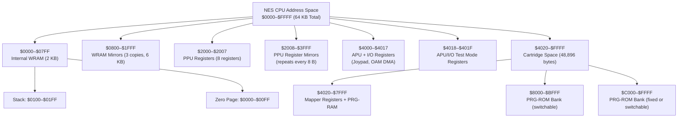
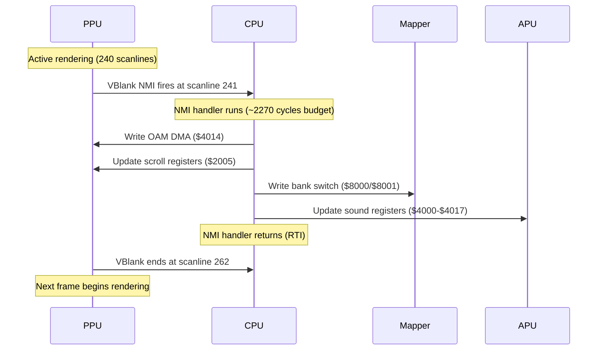

# Lesson 4: Cartridge Architecture and System Integration

## 1. First-Principles Intuition & Invariants

Every system architect in the golden age of arcade and cartridge gaming collided with the same physical wall: the address bus is finite. A MOS 6502 running at 1.79 MHz on the NTSC NES presents a 16-bit address bus, capable of addressing exactly 65,536 bytes of memory. The Ricoh 5A22 in the SNES, a modified 65816, offers a 24-bit bus with 16 megabytes of theoretical reach, but that space is heavily contested by I/O registers, video RAM, audio processors, and work RAM, leaving a shrinking window for program code and tile data. The Motorola 68000 in the Sega Genesis and the Neo-Geo MVS wields a full 24-bit address bus, but even 16 megabytes proved insufficient once arcade developers began packing multi-megabyte sample banks and animation frames onto cartridges that needed to survive the physical abuse of a public arcade environment.

The solution to this ceiling is bank switching, and bank switching is fundamentally an act of indirection. Instead of wiring ROM chips directly and permanently to the CPU's address lines, the system designer inserts a small piece of logic between the CPU and the ROM. This logic, called a mapper, watches the address bus for writes to specific trigger addresses. When it sees one, it latches the written value into an internal register and uses that register to reconfigure which physical ROM chip or which slice of a larger ROM chip the CPU sees at a given address range. The CPU never knows the switch happened. It simply reads from $8000 and gets whatever the mapper has routed there. This is structurally identical to how a modern operating system uses page tables to map virtual addresses to physical frames, except the mapper's "page table" is a handful of flip-flops reconfigured by the program itself through deliberate bus writes.

The cartridge, in this model, is not just a storage medium. It is an extension of the system bus, an active participant in memory arbitration. The cartridge PCB carries not only mask ROMs containing program and graphics data but also a custom集成电路 that performs address decoding, bank latching, scanline counting for split-screen effects, and in some cases even expansion audio synthesis. The cartridge is a coprocessor in all but name.

Arcade systems diverged from this path early on. Most arcade PCBs from the golden age, from the Atari 2600-derived cabinets of the late 1970s through the Capcom CPS-1 boards of the early 1990s, soldered their ROMs directly to the motherboard. There was no cartridge slot. Game swaps required physically desoldering ROM chips and replacing them. This made sense in an arcade context where the operator purchased a complete board, not a consumer cartridge, and where the board designer could tailor the memory map to the exact size of the game data without worrying about a standardized mapper interface. The trade-off was serviceability: swapping a Street Fighter II board for a Final Fight board meant pulling the entire PCB stack out of the cabinet, disconnecting the JAMMA harness, and replacing the whole assembly.

The Neo-Geo MVS, released in 1990 by SNK, is the critical bridge between these two worlds. It is a cartridge-based arcade system. The motherboard contains the 68000 main CPU, a Z80 sound CPU, the LSPC-A0 video chipset, and the JAMMA edge connector. The cartridge, a massive 142-pin board roughly the size of a VHS cassette, carries the game's program ROMs, graphics ROMs, and sound sample ROMs. The MVS motherboard performs bank switching on the cartridge's program ROM so that a 68000 with a finite address window can page through game code that may exceed the fixed mapping. The cartridge plugs into a slot on the motherboard, and the motherboard connects to the cabinet through JAMMA. This three-layer architecture, cartridge into motherboard into JAMMA harness, is the canonical model for understanding how cartridge banking principles scale up to full arcade cabinet integration.

Three invariants govern every system discussed in this lesson. First, the address bus width sets a hard ceiling on simultaneously addressable memory, and any game data exceeding that ceiling requires banking. Second, the mapper is a stateful intermediary: its bank registers persist until explicitly changed, meaning a program crash or a spurious write can leave the mapper pointing at the wrong ROM bank, producing garbage graphics or crashed execution. Third, every subsystem in an arcade cabinet, the CPU, the video processor, the sound chip, the coin mechanism, and the control inputs, must synchronize to a shared timing reference, typically derived from the video refresh rate, and any disruption to that timing produces visible glitches, audio dropout, or cabinet lockup.

## 2. Core Architecture & Mechanics

### 2.1 The Address Bus as Real Estate

To understand banking, one must first understand the address map: the complete layout of what the CPU sees at every address it can generate. The map is divided into regions, each permanently assigned to a specific device. On the NES, the 6502's 64-kilobyte address space breaks down as follows.



The critical observation is that the cartridge directly controls 48,896 bytes of the address space, from $4020 to $FFFF. On a cartridge with 32 kilobytes of PRG-ROM and no mapper, the ROM is hard-wired to $8000 through $FFFF. The CPU reads the same bytes every time. This is Mapper 0 in the iNES classification, used by launch titles like Super Mario Bros. and Donkey Kong. The game code cannot exceed 32 kilobytes because there is no mechanism to swap in new data.

The Sega Genesis, by contrast, maps its cartridge ROM to $000000 through $3FFFFF, a full 4 megabytes of linear address space on the 68000's bus. The vast majority of Genesis games never need bank switching at all. The 68000's 24-bit address bus provides 16 megabytes of total space, and the Genesis uses roughly 4 megabytes for ROM, 64 kilobytes for 68000 work RAM at $FF0000, 8 kilobyves for Z80 sound RAM at $A00000, and a few hundred bytes for VDP registers at $C00000. This abundance of address space is why Genesis cartridges rarely contain mapper chips, and why Genesis ROMs can be dumped as flat linear images without any banking metadata.

The SNES occupies a middle ground. Its 65816 CPU can address 16 megabytes through a 24-bit bus, but the memory map is banked by design at the 64-kilobyte boundary. The 65816 divides its address space into 256 banks of 64 kilobytes each. LoROM cartridges map their data into banks $00 through $7D, placing ROM in the lower half of each bank and RAM and I/O in the upper half. HiROM cartridges map data into banks $C0 through $FF, using the full 64 kilobytes per bank. This choice affects how the CPU accesses data and how the cartridge PCB routes address lines. Games exceeding 4 megabytes require mappers like the Super FX or SA-1, which add their own bank-switching logic and sometimes their own coprocessor running in parallel with the main CPU.

### 2.2 Mapper Mechanics: The MMC3 as Case Study

The Nintendo MMC3, mapper number 4 in the iNES standard, is the most widely deployed mapper in the NES library. It appears in over 140 commercially released titles, including Super Mario Bros. 3, Mega Man 3 through 6, and Kirby's Adventure. Understanding its register model teaches nearly every banking pattern that recurs across other mappers and platforms.

The MMC3 sits on the cartridge PCB between the CPU's address/data bus and the PRG and CHR ROMs. It decodes CPU writes to addresses in the $8000 through $FFFF range, using the lowest bit of the address to distinguish between even and odd register pairs. The chip maintains eight internal bank registers, a scanline counter for IRQ generation, and two mode bits that determine how the PRG and CHR banks are organized.

```text
MMC3 Register Map (Accessed via CPU Writes to $8000–$FFFF)
┌──────────┬──────────────────────────────────────────────────────────┐
│ Address  │ Function                                                  │
├──────────┼──────────────────────────────────────────────────────────┤
│ $8000    │ Bank Select + Mode                                        │
│ (even)   │   [7]   CHR Mode (0=A/B layout, 1=swapped)                │
│          │   [6]   PRG Mode (0=$8000 swappable, 1=$C000 swappable)  │
│          │   [2:0] Register index (0–7) to write at $8001            │
│ $8001    │ Bank Data                                                 │
│ (odd)    │   Writes the value into the register selected by $8000   │
│ $A000    │ Mirroring Control                                          │
│ (even)   │   [0] 0=Horizontal, 1=Vertical                             │
│ $A001    │ PRG-RAM Protect / Enable                                  │
│ (odd)    │   [7] 1=Enable PRG-RAM, [6] 1=Write-protect               │
│ $C000    │ IRQ Latch                                                  │
│ (even)   │   Sets the scanline counter reload value                  │
│ $C001    │ IRQ Reload                                                 │
│ (odd)    │   Forces immediate reload of counter from latch           │
│ $E000    │ IRQ Acknowledge / Disable                                  │
│ (even)   │   Disables MMC3 IRQ output, clears pending IRQ            │
│ $E001    │ IRQ Enable                                                 │
│ (odd)    │   Enables MMC3 IRQ output                                  │
└──────────┴──────────────────────────────────────────────────────────┘
```

The bank data registers at index 0 through 5 control CHR-ROM banking, while indices 6 and 7 control PRG-ROM banking. When the game writes to $8000, it selects which of these eight registers the next $8001 write will target. When it writes to $8001, the MMC3 latches the value into the selected register and immediately reconfigures the ROM chip select lines.

PRG-ROM on the MMC3 is organized into 8-kilobyte banks. A 512-kilobyte PRG-ROM contains 64 such banks, numbered $00 through $3F. The MMC3 exposes three 8-kilobyte windows to the CPU: $8000–$9FFF, $A000–$BFFF, and $C000–$DFFF. The window at $E000–$FFFF is hardwired to the last bank ($3F for a 512 KB ROM), ensuring the CPU always has access to the reset vector and interrupt handlers. Depending on the PRG mode bit, either the $8000 window or the $C000 window is the switchable one, while the other two maintain fixed or semi-fixed assignments.

The practical workflow for a developer writing code that runs on an MMC3 cartridge looks like this. To switch the PRG bank at $8000–$9FFF to bank $12 (the 18th 8 KB bank in the ROM), the code executes two sequential writes:

```asm
; Select PRG bank register (index 6) and set PRG mode 0
lda #$06        ; Index 6 = PRG bank at $8000, PRG mode bit = 0
sta $8000       ; Latch into MMC3

; Write the bank number
lda #$12        ; Bank $12 (18th 8KB bank)
sta $8001       ; MMC3 now routes $8000–$9FFF to PRG bank $12
```

The CPU continues executing from $8000, but the bytes it reads from that address range now come from a completely different 8-kilobyte slice of the ROM. The switch takes effect on the next bus cycle. No delay, no handshake, no wait states. The mapper responds within the same clock domain as the CPU.

CHR-ROM banking works identically but operates on 1-kilobyte and 2-kilobyte boundaries. The MMC3 maintains six CHR bank registers, two for 2-kilobyte banks and four for 1-kilobyte banks, allowing fine-grained control over which pattern tables the PPU reads during rendering. This is how Super Mario Bros. 3 swaps tile sets when the screen scrolls from one themed area to another. The game code detects the scroll position approaching a boundary, writes new CHR bank values to the MMC3, and the PPU reads the new tile data on the next frame without any visible transition glitch because the switch is timed to the vertical blanking interval.

The distinction between CHR-ROM and CHR-RAM is critical to understanding cartridge architecture. CHR-ROM is read-only pattern data stored on a separate ROM chip on the cartridge, directly connected to the PPU's address bus. The PPU reads it independently of the CPU, in parallel with CPU execution. CHR-RAM is writable memory, typically 8 kilobytes of SRAM, connected to the PPU bus but also accessible by the CPU through a register-mapped DMA port. Games using CHR-RAM, such as some late-period NES titles, copy tile data from PRG-ROM into CHR-RAM during vertical blank, allowing dynamic tile animation that CHR-ROM games cannot achieve without bank switching. The trade-off is that CHR-RAM writes consume CPU cycles during the precious VBlank window, leaving less time for other VBlank work like OAM sprite table updates or scroll register writes.

### 2.3 Mirroring and Nametable Layout

The NES PPU addresses four nametables, each 1024 bytes, at addresses $2000 through $2FFF on the PPU bus. The PPU has only 2 kilobytes of internal VRAM, enough for two nametables. The other two nametables are mirrors, and the mirroring configuration determines how the PPU's address lines route to the physical VRAM. Horizontal mirroring maps nametables 0 and 1 to the same VRAM bank, and nametables 2 and 3 to the other, producing a layout where the top and bottom of the screen share VRAM and left and right share VRAM. Vertical mirroring is the opposite: left and right share one bank, top and bottom share another. Some mappers, including the MMC3, allow the game to switch mirroring at runtime through a register write, which is how side-scrolling games that need vertical scrolling in some sections and horizontal scrolling in others reconfigure the VRAM layout on the fly. Four-screen VRAM, used by a small number of cartridges, adds an additional 2 kilobytes of cartridge VRAM to provide all four nametables without mirroring, eliminating scroll artifacts at the cost of a larger PCB and extra RAM chip.

### 2.4 The Neo-Geo MVS: Arcade Cartridge Banking

The Neo-Geo MVS applies the same banking principles to an arcade context. The 68000 main CPU sees a fixed window for the cartridge's primary program ROM (P1) at $100000 through $1FFFFF, a 1-megabyte linear mapping. Larger games exceed this window. The MVS motherboard implements a bank register at $2FFFF0. Writing a byte to this address latches a bank number into the system's address decoder, which then reconfigures which portion of the cartridge's P1 ROM appears in a secondary window at $200000 through $2FFFFF. The Z80 sound CPU has its own banking scheme, with a bank register at $8000 in the Z80's address space that selects which 16-kilobyte slice of the cartridge's sound ROM (M1) is visible.

The MVS cartridge itself is a massive PCB, approximately 14 centimeters by 20 centimeters, with up to 330 megabits of ROM across multiple chips. The program ROMs, graphics ROMs, and sound ROMs are organized by the cartridge's onboard address decoding logic, which routes the 68000's address lines and the LSPC video chipset's address lines to the correct chips. The cartridge has no active mapper IC in the NES sense. The banking logic lives on the motherboard, not the cartridge. The cartridge simply presents its ROMs on a wide parallel bus, and the motherboard's bank registers determine which slice of that bus the CPUs and video chip see.

```text
Neo-Geo MVS Three-Layer Architecture
┌─────────────────────────────────────────────────────────────┐
│                     Arcade Cabinet                           │
│  ┌────────────────────────────────────────────────────────┐ │
│  │  JAMMA Edge Connector (56-pin, 28 per side)              │ │
│  ├──────────┬────────────┬────────────┬───────────────────┤  │
│  │ Power    │ Video      │ Audio      │ Controls          │  │
│  │ +5V      │ R G B      │ Spkr +/−   │ 1P/2P Dir+Buttons │  │
│  │ +12V     │ C-Sync     │            │ Coin 1/2          │  │
│  │ −5V      │            │            │ Start 1/2         │  │
│  │ GND      │            │            │ Service/Test      │  │
│  └──────────┴────────────┴────────────┴───────────────────┘  │
│  ┌────────────────────────────────────────────────────────┐ │
│  │                  MVS Motherboard                        │ │
│  │  ┌──────────┐  ┌──────────┐  ┌───────────────────────┐ │ │
│  │  │ 68000    │  │ Z80      │  │ LSPC-A0 + VDP          │ │ │
│  │  │ Main CPU │  │ Sound CPU│  │ Video Processor        │ │ │
│  │  │ @ 12 MHz │  │ @ 4 MHz  │  │ @ 3.58 MHz (NTSC)     │ │ │
│  │  └────┬─────┘  └────┬─────┘  └───────────┬───────────┘ │ │
│  │       │             │                     │             │ │
│  │  Bank Reg        Bank Reg              Fixed Mapping    │ │
│  │  $2FFFF0         $8000 (Z80)          $400000–$7FFFFF   │ │
│  │       │             │                     │             │ │
│  │  ┌────┴─────────────┴─────────────────────┴───────────┐ │ │
│  │  │            Cartridge Slot (142-pin)                 │ │ │
│  └──┤                                                       │ │
│     │  ┌────────────────────────────────────────────────┐ │ │
│     │  │              MVS Cartridge PCB                   │ │ │
│     │  │  ┌──────┐ ┌──────┐ ┌──────┐ ┌──────┐ ┌──────┐  │ │ │
│     │  │  │ P1   │ │ P2   │ │ C1   │ │ C2   │ │ M1   │  │ │ │
│     │  │  │ PROG │ │ PROG │ │ GFX  │ │ GFX  │ │ SND  │  │ │ │
│     │  │  │ ROM  │ │ ROM  │ │ ROM  │ │ ROM  │ │ ROM  │  │ │ │
│     │  │  └──────┘ └──────┘ └──────┘ └──────┘ └──────┘  │ │ │
│     │  │       S1 (Fix Layer ROM) + V ROMs (Samples)      │ │ │
│     │  └────────────────────────────────────────────────┘ │ │
│     └──────────────────────────────────────────────────────┘ │
└─────────────────────────────────────────────────────────────┘
```

The graphics ROMs on the MVS cartridge, designated C1 through C2 (and sometimes C3 through C8 on larger games), are connected to the LSPC video chipset through a dedicated bus that operates independently of the 68000. The LSPC reads sprite and background tile data directly from the cartridge's graphics ROMs, DMA-ing pixel data into its internal line buffers during active display. The 68000 cannot directly access these ROMs. It communicates with the LSPC through a set of memory-mapped registers at $B00000 through $B0001F on the 68000's bus, writing VRAM addresses and data that the LSPC then uses to index into the cartridge's graphics ROMs. This separation is a fundamental architectural pattern in arcade hardware: the video processor has its own bus to its own ROM space, and the CPU programs the video processor indirectly through registers, not through direct memory access to the video ROMs.

### 2.5 Subsystem Synchronization

Every discrete subsystem in a retro gaming platform, the CPU, the video processor, the audio chip, and the input handler, operates on its own clock but must synchronize to produce coherent output. The master timing reference is the video signal. On an NTSC NES, the PPU generates a vertical blanking interrupt (NMI) 60 times per second, once per frame. This NMI signal interrupts the 6502 CPU, forcing it to jump to a handler routine at the address stored in the NMI vector ($FFFA). The handler routine typically performs time-critical operations: copying new sprite data from WRAM to the PPU's OAM via the OAM DMA register at $4014, updating scroll registers, swapping CHR banks through the mapper, and writing new nametable data to VRAM. All of these operations must complete before the PPU finishes the vertical blanking interval and begins rendering the next frame.



The VBlank budget is tight. The NTSC NES VBlank lasts approximately 20 scanlines, or about 2,270 CPU cycles. The OAM DMA alone, which copies 256 bytes of sprite data, consumes 512 cycles. A single bank switch write pair costs 12 cycles. Every cycle spent in the NMI handler is a cycle the CPU cannot use for game logic during active display. This is why well-optimized NES games carefully budget their VBlank operations and use double-buffering: they prepare sprite and scroll data in WRAM during active display, then blast it to the PPU during VBlank with minimal computation.

The Neo-Geo MVS faces a more complex synchronization problem because it has two CPUs running asynchronously. The 68000 main CPU handles game logic, collision detection, and AI. The Z80 sound CPU handles audio playback, driving the YM2610 FM synthesis chip and the ADPCM sample player. The two CPUs communicate through a shared bank of RAM and a set of command registers. The 68000 writes a command byte to a register at $320000, which the Z80 polls. When the Z80 sees a non-zero command, it reads the associated parameters, loads the appropriate instrument and sample data from the cartridge's M1 sound ROM, and triggers playback on the YM2610. The two CPUs do not share a common interrupt. They run at different clock speeds and synchronize through software polling, not hardware interrupts. This introduces latency: a sound effect triggered by a game event on the 68000 may not begin playing for several hundred microseconds, until the Z80's polling loop reaches the command register. Arcade sound designers compensated by triggering sounds slightly ahead of the visual event, or by accepting the latency as a characteristic of the platform.

At the cabinet level, the JAMMA harness provides the final layer of system integration. Every signal that crosses the boundary between the arcade PCB and the cabinet hardware passes through the JAMMA edge connector.

```text
JAMMA Standard Pinout (56-Pin Edge Connector)
┌─────┬──────────────────┬─────┬──────────────────────────┐
│ Pin │ Side A (Parts)   │ Pin │ Side B (Solder)          │
├─────┼──────────────────┼─────┼──────────────────────────┤
│ A1  │ GND              │ B1  │ GND                      │
│ A2  │ GND              │ B2  │ GND                      │
│ A3  │ GND              │ B3  │ GND                      │
│ A4  │ GND              │ B4  │ GND                      │
│ A5  │ GND              │ B5  │ GND                      │
│ A6  │ −5V (optional)   │ B6  │ −5V (optional)           │
│ A7  │ +12V             │ B7  │ +12V                     │
│ A8  │ Key (notch)      │ B8  │ Key (notch)              │
│ A9  │ +5V              │ B9  │ +5V                      │
│ A10 │ +5V              │ B10 │ +5V                      │
│ A11 │ GND              │ B11 │ GND                      │
│ A12 │ (open)           │ B12 │ Tilt                     │
│ A13 │ (open)           │ B13 │ Test                     │
│ A14 │ Speaker +        │ B14 │ 1P Up                    │
│ A15 │ Speaker −        │ B15 │ 1P Down                  │
│ A16 │ (open)           │ B16 │ 1P Left                  │
│ A17 │ Composite Sync   │ B17 │ 1P Right                 │
│ A18 │ (open)           │ B18 │ 1P Button 1              │
│ A19 │ (open)           │ B19 │ 1P Button 2              │
│ A20 │ (open)           │ B20 │ 1P Button 3              │
│ A21 │ Red              │ B21 │ 1P Button 4              │
│ A22 │ Green            │ B22 │ 2P Up                    │
│ A23 │ Blue             │ B23 │ 2P Down                  │
│ A24 │ 1P Start         │ B24 │ 2P Left                  │
│ A25 │ 2P Start         │ B25 │ 2P Right                 │
│ A26 │ Coin 1           │ B26 │ 2P Button 1              │
│ A27 │ Coin 2           │ B27 │ 2P Button 2              │
│ A28 │ Service          │ B28 │ 2P Button 3              │
└─────┴──────────────────┴─────┴──────────────────────────┘
```

The JAMMA standard, formalized in 1985, originally specified three action buttons per player. The fourth button on pins B21 and B28 became a de facto extension as fighting games proliferated. Six-button fighting games like Street Fighter II and The King of Fighters cannot fit all buttons within the JAMMA footprint and require an auxiliary kick harness, a separate ribbon cable that runs from the PCB to the control panel for buttons 4, 5, and 6. This kick harness is PCB-specific: a CPS-2 kick harness is not pin-compatible with a Neo-Geo MVS harness, even though both systems may sit in the same physical cabinet.

The video signal on JAMMA is analog RGB with composite sync on a single line (pin A17). The PCB generates separate red, green, and blue analog signals at approximately 0.7 to 1.0 volts peak-to-peak, plus a composite sync signal that combines horizontal and vertical synchronization pulses into a single waveform. This is fundamentally different from consumer composite video, which encodes color onto a chrominance subcarrier. Arcade monitors consume raw RGB directly, bypassing the encoding and decoding stages that degrade consumer video quality. The composite sync signal runs at TTL levels (0 to 5 volts) and must be properly terminated at the monitor input. A missing or miswired sync line produces a rolling or completely collapsed image, one of the most common cabinet integration failures.

## 3. High-Performance Optimization & Failure Modes

### 3.1 Emulation Architecture: Memory Maps and Bank Registers

Emulating a cartridge-based system requires faithfully reproducing the mapper's state and behavior. The dominant approach, used by MAME, Mesen, FCEUX, and every serious emulator, is the memory map handler. Rather than allocating a flat array and copying ROM data around when a bank switch occurs, the emulator maintains a fixed array of pointers to ROM data. Each addressable window on the CPU bus has an associated pointer. When the emulated game writes a bank switch command, the emulator updates the corresponding pointer to point at a different offset in the ROM image. CPU reads from that window then dereference the pointer plus the offset within the window.

This is the implementation pattern in MAME's address map system:

```cpp
void nes_state::nes_map(address_map &map)
{
    map(0x0000, 0x07ff).ram();
    map(0x2000, 0x2007).rw("ppu", FUNC(ppu2c0x_device::read),
                                 FUNC(ppu2c0x_device::write));
    map(0x4000, 0x4017).rw(FUNC(nes_state::nes_io_r),
                           FUNC(nes_state::nes_io_w));
    map(0x4020, 0xffff).rw(FUNC(nes_state::cart_r),
                           FUNC(nes_state::cart_w));
}
```

The cartridge space from $4020 to $FFFF is handled by `cart_r` and `cart_w`, which dispatch to the active mapper's read and write handlers. The mapper maintains its own bank register state and computes which ROM slice to serve:

```cpp
uint8_t mmc3_state::cart_r(offs_t addr)
{
    if (addr >= 0x8000) {
        // Determine which 8KB PRG bank is mapped to this address
        uint8_t window = (addr - 0x8000) / 0x2000;
        uint8_t bank = m_prg_banks[window];
        uint32_t rom_offset = bank * 0x2000 + (addr & 0x1FFF);
        return m_prg_rom[rom_offset];
    }
    // Handle mapper registers and PRG-RAM at $6000–$7FFF
    if (addr >= 0x6000 && m_prg_ram_present) {
        return m_prg_ram[addr - 0x6000];
    }
    return 0xFF; // Open bus
}

void mmc3_state::cart_w(offs_t addr, uint8_t data)
{
    switch (addr & 0xE001) {
    case 0x8000: // Bank select + mode
        m_bank_select = data & 0x07;
        m_prg_mode = BIT(data, 6);
        m_chr_mode = BIT(data, 7);
        mmc3_update_prg_banks();
        mmc3_update_chr_banks();
        break;
    case 0x8001: // Bank data
        m_bank_data[m_bank_select] = data;
        if (m_bank_select <= 5)
            mmc3_update_chr_banks();
        else
            mmc3_update_prg_banks();
        break;
    case 0xA000: // Mirroring
        m_mirroring = data & 0x01;
        break;
    case 0xA001: // PRG-RAM protect
        m_prg_ram_protect = data;
        break;
    case 0xC000: // IRQ latch
        m_irq_latch = data;
        break;
    case 0xC001: // IRQ reload
        m_irq_counter = 0;
        m_irq_reload = 1;
        break;
    case 0xE000: // IRQ disable
        m_irq_enable = 0;
        m_irq->in_w<0>(0);
        break;
    case 0xE001: // IRQ enable
        m_irq_enable = 1;
        break;
    }
}
```

The `mmc3_update_prg_banks` function rewrites the `m_prg_banks` array based on the current mode and bank data registers:

```cpp
void mmc3_state::mmc3_update_prg_banks()
{
    uint8_t r6 = m_bank_data[6]; // PRG bank register 6
    uint8_t r7 = m_bank_data[7]; // PRG bank register 7
    uint8_t last = m_prg_rom_size / 0x2000 - 1; // Last bank index

    if (m_prg_mode == 0) {
        // Mode 0: $8000 swappable, $C000 fixed to last bank
        m_prg_banks[0] = r6;          // $8000–$9FFF = bank r6
        m_prg_banks[1] = r6 + 1;      // $A000–$BFFF = bank r6+1
        m_prg_banks[2] = last - 1;    // $C000–$DFFF = second-to-last
        m_prg_banks[3] = last;        // $E000–$FFFF = last (fixed)
    } else {
        // Mode 1: $C000 swappable, $8000 fixed to last bank
        m_prg_banks[0] = last - 1;    // $8000–$9FFF = second-to-last
        m_prg_banks[1] = last;        // $A000–$BFFF = last (fixed)
        m_prg_banks[2] = r6;          // $C000–$DFFF = bank r6
        m_prg_banks[3] = r6 + 1;      // $E000–$FFFF = bank r6+1
    }
}
```

Save state serialization must capture every mapper register. A common bug in emulator save states is failing to serialize the bank select register or the mode bits, causing a loaded state to read from the wrong ROM bank. The complete MMC3 state that must be serialized includes the bank select latch, all eight bank data registers, both mode bits, the mirroring bit, the PRG-RAM protect byte, the IRQ latch, the IRQ counter, the IRQ enable flag, and the IRQ reload flag. Omitting any of these produces a save state that loads to a corrupted display or immediate crash.

ROM identification for mapper selection relies on the iNES header, a 16-byte prefix appended to every NES ROM image. The header's format is precise and must be parsed correctly to initialize the right mapper:

```text
iNES Header Format (16 Bytes, Offset from ROM Start)
┌────────┬──────┬──────────────────────────────────────────────┐
│ Offset │ Size │ Field                                        │
├────────┼──────┼──────────────────────────────────────────────┤
│ $00    │ 4    │ Magic: "NES\x1A" (bytes: 4E 45 53 1A)       │
│ $04    │ 1    │ PRG ROM size (× 16 KB)                        │
│ $05    │ 1    │ CHR ROM size (× 8 KB, 0 = CHR-RAM game)       │
│ $06    │ 1    │ Flags 6                                       │
│        │      │   [7:4] Mapper low nibble                    │
│        │      │   [3]    1 = 4-screen VRAM                    │
│        │      │   [2]    1 = 512 B trainer present            │
│        │      │   [1]    1 = Battery-backed PRG-RAM            │
│        │      │   [0]    0 = Horizontal, 1 = Vertical mirror  │
│ $07    │ 1    │ Flags 7                                       │
│        │      │   [7]    0 = iNES 1.0, 1 = iNES 2.0           │
│        │      │   [6:4]  Reserved (0)                          │
│        │      │   [3:0] Mapper high nibble                    │
│ $08    │ 1    │ PRG-RAM size (× 8 KB, 0 = assume 8 KB)      │
│ $09    │ 1    │ Flags 9                                       │
│        │      │   [0]    0 = NTSC, 1 = PAL                    │
│ $0A    │ 1    │ Flags 10 (iNES 2.0: mapper variant)           │
│ $0B    │ 1    │ Flags 11 (iNES 2.0: ROM size MSB)            │
│ $0C–   │ 4    │ Zero padding                                  │
│ $0F    │      │                                               │
└────────┴──────┴──────────────────────────────────────────────┘
```

The mapper number is assembled from the low nibble of Flags 6 and the high nibble of Flags 7, producing a 12-bit identifier. Mapper 4 is the MMC3. Mapper 0 is no banking. Mapper 1 is MMC1, used by games like The Legend of Zelda and Metroid. Mapper 2 is UxROM, a simple single-bank PRG switcher with no CHR banking. Mapper 3 is CNROM, which switches CHR banks only and leaves PRG fixed. Each mapper number requires a dedicated implementation in the emulator. A ROM with the wrong header mapper number will load with the wrong banking logic, producing an immediate crash or corrupted graphics on the first frame.

### 3.2 Physical Hardware Troubleshooting

On the workbench, cartridge diagnostics follow a systematic protocol. The first failure mode is contact oxidation. The copper edge contacts on a NES cartridge, or the gold-plated fingers on a Genesis cartridge, accumulate tarnish and microscopic debris over decades of insertion cycles. The standard restoration procedure is to power the cartridge with isopropyl alcohol at 99% concentration, applied with a lint-free cotton swab, rubbing each contact pad with moderate pressure until no discoloration transfers to the swab. For severe oxidation, a fiberglass pen or a pink rubber eraser can mechanically abrade the oxide layer, but this removes the protective gold plating and exposes the underlying copper, accelerating future corrosion. The preferred method for persistent oxidation is a cotton swab soaked in DeoxIT D5 contact cleaner, which chemically dissolves the oxide without abrasion.

After cleaning, a continuity test with a digital multimeter confirms each contact pad has a low-resistance path to the corresponding ROM chip leg. Set the multimeter to continuity mode (beep), place one probe on the cartridge edge contact and the other on the ROM chip's corresponding pin, and verify the beep. An open circuit indicates a broken trace on the PCB, which requires jumper wire repair with 30 AWG Kynar wire soldered between the contact pad and the ROM pin.

ROM verification requires reading the chip's contents with an EPROM programmer such as the XGecu T48 or the TL866II Plus. The procedure for a 27C020 (256 KB EPROM, common in arcade PCBs) is to remove the chip from its socket, insert it into the programmer's ZIF socket, select the correct chip profile, and perform a read operation. Compare the resulting binary against a known-good MAME ROM dump using a hex comparison tool like `hexdump` or a dedicated ROM verification utility. A single-bit discrepancy may indicate a decaying EPROM, where charge has leaked from a floating gate cell over decades of storage. EPROMs have a quartz window on the top face that allows UV light to erase them. Long-term exposure to ambient UV, even through the opaque sticker that typically covers this window, can cause bit rot. A failing EPROM must be replaced with a fresh chip, programmed from a verified MAME dump.

The mapper IC on a NES cartridge is typically a custom NEC or Ricoh chip, often marked with a part number like D211A0 (MMC3B) or D211A1 (MMC3C). Identifying the mapper requires cross-referencing the chip marking against known mapper IC databases. A cartridge that boots to a blank screen or garbage tiles may have a dead mapper IC. Diagnosing this requires a logic probe on the mapper's address and data lines during power-on. The probe should show activity on the address input pins when the CPU attempts to read the reset vector at $FFFC. If the data output pins remain stuck at a fixed value regardless of address input changes, the mapper is dead and the cartridge requires a donor mapper chip from a parts unit or a modern FPGA replacement board.

Bus conflicts are a subtle failure mode specific to Mapper 0 and certain other mappers that lack bus conflict detection circuitry. On these cartridges, the CPU address bus connects directly to the ROM data pins. When the CPU writes to an address in ROM space, the ROM chip attempts to drive the data bus with its stored byte while the CPU simultaneously drives it with the write value. The resulting bus contention can produce unpredictable values. Games designed for Mapper 0 avoid this by never writing to ROM addresses, but homebrew or incorrectly ported code that writes to $8000 and above on a Mapper 0 cartridge will produce corruption. The MMC3 and most later mappers include internal logic that prevents ROM output during CPU write cycles, eliminating bus conflicts.

SRAM failure is a common failure mode for battery-backed cartridges. The NES, SNES, and Genesis all use SRAM chips backed by a CR2032 or similar coin cell battery to maintain save data when the console is powered off. When the battery dies, the SRAM loses its contents on power-down, and the game reports corrupted or missing saves. Replacing the battery requires desoldering the old battery tab from the PCB (or carefully prying it from a battery holder if the cartridge uses a socketed battery), inserting a fresh cell with the correct polarity, and verifying that the SRAM retains data across a power cycle. The SRAM chip itself can also fail, typically表现为 data that reads correctly initially but corrupts randomly during gameplay, indicating a failing cell array. A multimeter current measurement on the SRAM's VCC pin while the cartridge is powered can reveal excessive current draw from a shorted cell array.

### 3.3 Arcade Cabinet Integration and Failure Modes

Integrating a PCB into a JAMMA cabinet requires verifying every signal path through the harness. The first measurement is the +5V rail. Connect a digital multimeter set to DC voltage between the +5V pin (A9 or A10) and any GND pin on the JAMMA edge connector, with the PCB powered on and the cabinet switch on. The reading should be between 4.90V and 5.05V. Arcade PCBs are remarkably tolerant of voltage variation compared to modern silicon, but anything below 4.85V can cause the CPU to brown out or the RAM to lose data, and anything above 5.25V risks permanent damage to TTL logic and RAM chips. If the voltage is out of spec, adjust the arcade power supply's potentiometer (typically a small trimpot on the PSU chassis, accessible through a hole in the case) until the reading stabilizes within range. Always measure at the JAMMA edge connector, not at the power supply terminals, because voltage drop across the harness wires can reduce the delivered voltage by 0.1 to 0.3V under load.

The +12V rail powers the audio amplifier and certain older TTL logic families. Measure between the +12V pin (A7) and GND. Acceptable range is 11.5V to 12.5V. The −5V rail, when present, powers certain sound chips like the Sega PSG or the Atari POKEY. Measure between A6 and GND. Not all cabinets or PCBs use −5V, and a missing −5V rail on a board that requires it produces silent or severely distorted audio.

Video signal verification requires an oscilloscope or a dedicated arcade test monitor. Probe the composite sync line (A17) with the scope set to 0.5V/div vertical and 10μs/div horizontal. A healthy NTSC sync signal shows a continuous stream of negative-going TTL pulses at 15.75 kHz horizontal frequency, with broader vertical sync pulses at 60 Hz. If the sync line reads a flat 0V or 5V, the PCB's sync generation circuit is dead or the sync line is disconnected from the JAMMA edge. Probe the RGB lines (A21, A22, A23) at 0.2V/div to confirm the analog video levels are present. A flat 0V on all three color lines indicates the video output buffer or the video DAC is dead. If individual colors are missing (e.g., blue reads 0V while red and green show activity), the corresponding video output transistor or coupling capacitor is failed.

A logic probe is the essential tool for diagnosing dead or partially functional arcade PCBs. Set the probe's power switch to TTL mode and connect its ground clip to any GND point on the PCB. Probe the CPU's address and data bus lines. On a functional board, the address bus should show pulsing activity as the CPU fetches instructions. A completely stuck address bus, reading permanently high or low, indicates the CPU is in a halt state, the clock oscillator is dead, or the reset circuit is holding the CPU in reset. Probe the clock input pin on the CPU. A 68000 running at 12 MHz should show a steady 12 MHz pulse on its clock input. A 6502 at 1.79 MHz should show its characteristic clock. A dead clock signal points to a failed crystal oscillator or clock generation circuit.

Cold solder joints on the JAMMA edge connector are a pervasive failure mode in cabinets that have seen heavy use. The edge connector fingers on the PCB are soldered to the PCB traces, and thermal cycling combined with mechanical stress from insertion and removal can crack these solder joints. Visually inspect every pin under a magnifier or jeweler's loupe, looking for hairline cracks in the solder fillet. A cracked joint may pass continuity testing at room temperature but fail when the board heats up during operation. Resolder any suspicious joints with a temperature-controlled iron at 370°C, using 0.8mm 63/37 rosin-core solder, applying a small amount of flux to the joint before reflowing.

The kick harness for six-button fighting games connects to a secondary header on the PCB, typically a 10-pin or 15-pin Molex or JST connector. Wire the harness to the control panel according to the specific PCB's pinout. A CPS-2 kick harness uses a 34-pin flat ribbon cable with a specific button assignment that differs from the Neo-Geo MVS, which uses a different connector entirely. Cross-wiring the kick harness to the wrong PCB pinout sends button inputs to the wrong CPU port bits, causing buttons to register as each other or to trigger coin inputs. Always verify the kick harness pinout against the PCB's official documentation before connecting, and test each button with the cabinet's input test screen, accessible through the JAMMA test switch on A28 or the service menu.

Multi-board systems, such as the Sega Naomi or the CPS-2, require additional inter-board cabling. The CPS-2 consists of an A board (the base, containing the 68000, Z80, and custom Capcom video chips) and a B board (the game-specific cartridge containing ROMs and the Q-Sound processor). The two boards connect through a set of board-to-board connectors at the top edge of the assembly. These connectors carry the full system bus: address lines, data lines, control signals, and power. A corroded or oxidized inter-board connector causes intermittent bus errors, producing random crashes, corrupted sprites, or audio glitches. Cleaning these connectors requires the same isopropyl alcohol treatment as cartridge contacts, but access is more difficult due to the connector's recessed location between the stacked boards. A cotton swab bent at 90 degrees can reach the recessed pins. For severe oxidation, DeoxIT D5 applied via the swab, allowed to sit for two minutes, then wiped clean, restores reliable contact.

The final integration test is a full burn-in. Power the cabinet on, enter the PCB's test menu, and run the built-in input test, sound test, and color bar test. Leave the board running for at least one hour. Check the +5V rail again at the edge connector after the hour has passed. Thermal drift can cause the voltage to creep out of spec as the power supply warms up. If the board passes all tests and the voltage remains stable, the integration is complete. If any test fails, the failure mode narrows the diagnostic focus to the specific subsystem, and the troubleshooting protocol for that subsystem, whether it is the ROM banking logic, the video output chain, or the JAMMA harness wiring, takes over from there.
