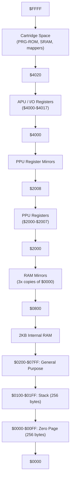
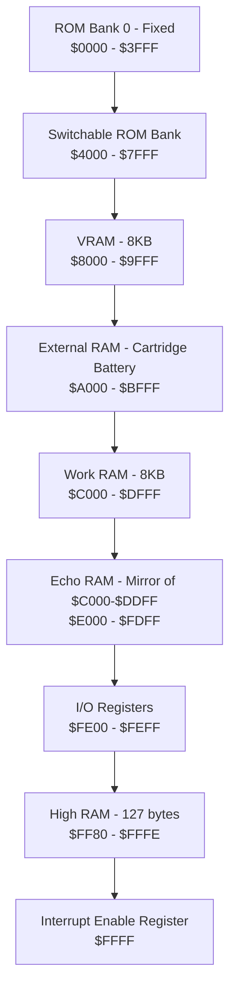
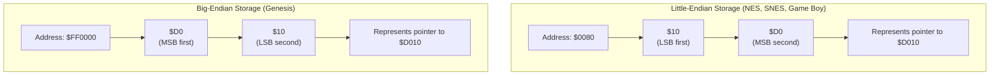

# Lesson 1: Memory Manipulation Fundamentals

## 1. First-Principles Intuition & Invariants

Every retro console produced before the fifth generation of gaming hardware shares a single defining architectural characteristic that distinguishes it fundamentally from any modern computing platform: the complete absence of a memory management unit. The Ricoh 2A03 in the NES, the 5A22 in the SNES, the Sharp LR35902 in the Game Boy, and the Motorola 68000 in the Genesis all operate with a flat, unprotected memory model where every addressable location is equally readable, equally writable, and equally executable. There is no concept of a page table, no hardware-enforced distinction between user space and kernel space, no stack canary inserted by a compiler to detect corruption, no address space layout randomization to shuffle the location of code and data on each boot. When a program running on a 6502 writes a value to address $0300, that value lands at the physical RAM location corresponding to $0300, and the CPU will happily execute whatever bytes it finds there if program flow ever reaches that address. This simplicity is not a deficiency that the hardware designers failed to overcome. It is a direct consequence of the cost and complexity constraints of the era, where the silicon budget for a console's CPU was measured in the low tens of thousands of transistors.

The practical consequence for anyone studying glitch mechanics is that the boundary between data and code is not enforced by anything other than the program's own logic. A game stores the player's score, the positions of enemies, the contents of the inventory, and the current execution pointer all in the same flat address space, often within the same 2KB of RAM on the NES or the same 8KB on the original Game Boy. When a bug in the game's logic causes a write operation to exceed the bounds of its intended data structure, the overflow lands directly on whatever adjacent data occupies the next memory addresses. If that adjacent data happens to include a return address on the stack, a function pointer in a jump table, or a variable that controls which screen loads next, the program's behavior changes in ways the original developers never anticipated. The hardware offers no safety net, no exception handler, no segmentation fault. It simply reads the corrupted value and acts on it.

This leads to the first core invariant of retro memory manipulation: memory addresses are fixed and deterministic across all instances of a given game running on a given console. The player's health counter in *The Legend of Zelda* for the NES resides at the same RAM address on every NES console in the world, because the game code initializes its variables to fixed absolute addresses with no loader relocation. There is no ASLR to defeat, no base address to leak, no module to fingerprint. If a speedrunner knows that writing a specific byte to $0573 on the NES version of *Super Mario Bros.* will corrupt the next level pointer, that knowledge transfers to every copy of that ROM on every NES. This determinism is what makes retro glitch mechanics a rigorous discipline rather than a probabilistic exercise.

The second invariant is that all RAM is executable. Modern operating systems enforce a write-XOR-execute policy on memory pages, meaning a region can be marked writable or executable but never both simultaneously. Retro CPUs have no such mechanism. On the NES, the 2KB of internal RAM at $0000-$07FF is always readable, always writable, and always executable. If a glitch can redirect the program counter to $0300, the CPU will fetch, decode, and execute whatever bytes happen to be sitting at $0300 through $0302 as though they were legitimate instructions. This is the mechanical basis for arbitrary code execution in retro games: the trick is not bypassing a protection that exists, but arranging the right bytes in the right RAM locations and then finding a way to make the program counter arrive there.

The third invariant is memory-mapped I/O. On the NES, reading from address $2002 returns the PPU status register, which tells the program whether the television's vertical blank interval has begun. Writing to $2000 sets PPU control flags. Reading from $4016 returns the current state of the controller buttons. There is no separate I/O instruction set, no IN or OUT opcodes as on the x86. The entire peripheral subsystem of the console, including graphics, audio, controller input, and cartridge save data, is accessible through the same load and store instructions used for ordinary RAM. This means that a buffer overflow which corrupts a value near a memory-mapped register address does not just alter game state in software. It can directly change what the hardware does, rewriting palette colors, triggering DMA transfers, or altering the memory bank configuration of the cartridge itself.

These three invariants, fixed addressing, universal executability, and memory-mapped peripherals, form the foundation upon which every retro gaming glitch technique is built. The discipline of glitch mechanics is fundamentally the study of how to use the game's own mechanics to write specific values to specific addresses, how to corrupt the right pointers to redirect execution, and how to construct payloads that the CPU will faithfully execute from RAM without any hardware objecting to the arrangement.

## 2. Core Architecture & Mechanics

### 2.1 RAM Address Space Models

The NES presents the most constrained and instructive memory model for studying glitch mechanics. Its 6502-derived CPU core addresses a 64KB space spanning $0000 to $FFFF, but only 2KB of actual static RAM exists within that space, mapped at $0000 through $07FF and mirrored three times across $0800 through $1FFF. Any write to $0800 is physically identical to a write to $0000, and the hardware simply duplicates the address lines. The first 256 bytes, $0000 through $00FF, constitute the zero page, which the 6502 can access with shorter, faster instructions using a single-byte address operand. The next 256 bytes, $0100 through $01FF, serve as the hardware stack, where the CPU pushes and pulls return addresses during subroutine calls and interrupts. The remaining 1.5KB from $0200 to $07FF is general-purpose working memory where games store the bulk of their runtime state: player position arrays, inventory tables, enemy attributes, tile map buffers, and temporary calculation variables.



The Game Boy's LR35902 CPU, a modified Z80 derivative, maps its 8KB of working RAM across $C000 through $DFFF, with an echo region at $E000 through $FDFF that mirrors the lower portion. The high RAM region at $FF80 through $FFFE provides 127 bytes of fast-access storage, and the entire I/O subsystem, including the serial transfer register, timer, and audio channels, occupies $FF00 through $FF7F. The Game Boy's relatively generous 8KB of RAM compared to the NES reflects its later design era, but the same flat, unprotected model applies.



The SNES introduces the most complex address space of the four major retro platforms. Its 65816 CPU extends the 6502's 16-bit address bus to 24 bits, creating a 16MB space divided into 256 banks of 64KB each. The system's 128KB of general-purpose WRAM spans banks $7E and $7F, with the lower 32KB of bank $7E also accessible through the traditional $0000-$7FFF range in banks $00 through $3F and $80 through $BF for backward compatibility with 6502-era addressing conventions. The 65816 can operate in 8-bit emulation mode, where it behaves exactly like a 6502, or in 16-bit native mode, where accumulator and index registers expand to 16 bits and new addressing modes become available. Games switch between these modes constantly using the REP and SEP instructions, which set and clear the M and X flags in the processor status register.

The Sega Genesis, running a Motorola 68000 at 7.6 MHz, offers a sharp contrast in both architecture and byte ordering. Its 64KB of main RAM sits at $FF0000 through $FFFFFF in a 24-bit address space, and its big-endian byte order reverses the storage convention of every other platform discussed here. A 16-bit value $1234 stored at address $FF0000 on the Genesis occupies $FF0000 with the high byte $12 and $FF0001 with the low byte $34, whereas on the NES, SNES, and Game Boy, the low byte $34 would come first.

| Platform | CPU | Endianness | Address Bus | System RAM | RAM Range | Executable RAM |
|---|---|---|---|---|---|---|
| NES | Ricoh 2A03 (6502) | Little | 16-bit (64KB) | 2KB | $0000-$07FF | Yes |
| SNES | Ricoh 5A22 (65816) | Little | 24-bit (16MB) | 128KB | $7E0000-$7FFFFF | Yes |
| Game Boy | Sharp LR35902 | Little | 16-bit (64KB) | 8-32KB | $C000-$DFFF | Yes |
| Genesis | Motorola 68000 | Big | 24-bit (16MB) | 64KB | $FF0000-$FFFFFF | Yes |

### 2.2 Buffer Overflow Mechanics

Retro games store runtime data in fixed-size arrays with no hardware or software bounds checking. When a game allocates space for, say, four enemy objects at consecutive memory addresses, it typically stores each enemy's attributes as a struct-like sequence of bytes: X position, Y position, health, type, and state flags, repeated for each slot. If a game mechanic allows the engine to reference an enemy slot index of 4 or higher in an array that only has slots 0 through 3, the resulting write operation does not fail with an out-of-bounds exception. The 6502 has no concept of an array boundary. The game's code calculates the target address by multiplying the slot index by the struct size and adding the base address, then stores the value at whatever address that calculation produces. If the base of the enemy array is $0300 and each enemy struct is 16 bytes, a write to slot 5 targets $0300 + (5 × 16) = $0350, which might land in the middle of the game's tile map buffer, the palette table, or a different game object entirely.

The *Pokémon Red* and *Blue* MissingNo glitch provides the most thoroughly documented example of a buffer overread in retro gaming. The wild Pokémon encounter system reads from an encounter table indexed by the current map ID. When the Old Man's catching tutorial temporarily overwrites the player's name in memory, then restores it, the game fails to properly reset the encounter table pointer in certain coastal tiles on Route 21 and Cinnabar Island. The result is that the encounter routine reads from an index derived from the player's name string, which can point outside the valid encounter table into adjacent RAM. The bytes at those addresses are interpreted as Pokémon species identifiers, producing the garbage hybrid MissingNo with its scrambled sprite data and inflated inventory side effects. This is not a write overflow but a read overflow: the game reads data from an out-of-bounds index and interprets it as game content, but the underlying mechanism is identical. There is no bounds check on the array index, and the hardware faithfully fetches whatever bytes live at the calculated address.

A true write overflow occurs when a game mechanic causes a store instruction to write past the end of its target array. Consider a game that stores the player's name as a sequence of character codes starting at address $0400, with a maximum length of 7 characters plus a terminator byte, and suppose that the game also stores the current level number at $0408. If a name-entry glitch allows the player to input 8 or more characters without the name-entry routine stopping at the buffer boundary, the 8th character overwrites $0408, and the game loads level "A" instead of level 1 on the next transition. This is the essential mechanism: a write that exceeds its intended boundary corrupts the adjacent variable, and the game interprets the corrupted value according to the semantics of the destination, not the source.

### 2.3 Endianness Handling

Every retro platform except the Genesis stores multi-byte values in little-endian order: the least significant byte occupies the lower address. On the NES, a 16-bit pointer to address $D010 stored at zero page locations $80 and $81 appears in memory as $10 at $0080 and $D0 at $0081. This byte-swapping convention is not a mere implementation detail. It is the single most common source of errors when constructing arbitrary code execution payloads, because the human reading a hex editor sees $10 before $D0 and must mentally reconstruct the actual address as $D010 rather than $10D0.



The SNES 65816 extends this to 24-bit addresses by appending a bank byte. A long pointer to $7E1234 stored at address $0000 occupies three bytes: $34 at $0000, $12 at $0001, and $7E at $0002. The bank byte comes last in memory, following the low and high bytes. When constructing payloads that the 65816 will interpret as addresses, this three-byte little-endian convention must be respected throughout.

The practical consequence for payload construction can be illustrated concretely. Suppose you are building an ACE setup for *Pokémon Red* where inventory items encode 6502 opcodes. You need the payload to include a `JMP $C000` instruction, which in 6502 machine code is the bytes `4C 00 C0`. The opcode `4C` comes first, followed by the low byte of the target address (`$00`), then the high byte (`$C0`). If you were to encode these as items in the order `4C, C0, 00`, the CPU would read the operand as `$00C0` rather than `$C000` and jump to the wrong location. The item arrangement must be `4C, 00, C0` to produce the correct little-endian address encoding.

On the Genesis, the same instruction on the 68000 would encode the address in big-endian order, and the opcode structure is entirely different due to the CISC architecture. A `JMP $00FF0000` on the 68000 assembles to `4C F9 00 FF 00 00`, with the address bytes in their natural most-significant-first order. Mixing up endianness conventions when working across platforms will produce payloads that jump to completely wrong addresses, typically causing a crash rather than useful execution.

### 2.4 Pointer Arithmetic in Constrained Systems

The 6502 provides several indirect addressing modes that are central to understanding how pointer corruption leads to code execution redirection. The most important for glitch mechanics is the indirect indexed mode, written as `LDA ($80),Y`. This instruction reads a 16-bit pointer from zero page addresses $0080 and $0081 in little-endian order, adds the Y register value to that pointer, and loads the accumulator from the resulting address. If $0080 contains $34 and $0081 contains $12, the base pointer is $1234. If Y contains $05, the final read address is $1239. This addressing mode is what allows a game to store a table base address in zero page and index into it with a runtime variable.

The indexed indirect mode, `LDA ($80,X)`, adds the X register to the zero page address first, then reads the pointer from the resulting location. If X is $02, the pointer is read from $0082 and $0083 rather than $0080 and $0081. This mode is less common in game code but can be exploited when a glitch corrupts the X register or the zero page values.

| Addressing Mode | Syntax | Bytes | Operation |
|---|---|---|---|
| Zero Page | `LDA $80` | 2 | Load from $0080 |
| Zero Page,X | `LDA $80,X` | 2 | Load from $0080+X |
| Absolute | `LDA $1234` | 3 | Load from $1234 |
| Absolute,X | `LDA $1234,X` | 3 | Load from $1234+X |
| Indexed Indirect | `LDA ($80,X)` | 2 | Load from pointer at $0080+X |
| Indirect Indexed | `LDA ($80),Y` | 2 | Load from (pointer at $0080)+Y |
| Indirect (JMP) | `JMP ($1234)` | 3 | Jump to pointer at $1234 |

The `JMP ($1234)` instruction deserves special attention because it is the primary mechanism for redirecting execution through pointer corruption. This instruction reads a 16-bit address from $1234 and $1235 in little-endian order, then sets the program counter to that address. If a buffer overflow or game mechanic can write controlled values to $1234 and $1235, the next time the game's code executes `JMP ($1234)`, the program counter flies to whatever address the attacker has constructed.

The 6502 contains a famous hardware bug in its indirect jump implementation that affects addresses where the low byte of the operand is $FF. When executing `JMP ($30FF)`, a correct implementation would read the low byte of the target from $30FF and the high byte from $3100. The 6502, however, does not carry the increment of the low byte across the page boundary. It reads the low byte from $30FF and the high byte from $3000, wrapping within the same page. This means `JMP ($30FF)` actually jumps to the address formed by the bytes at $30FF and $3000, not $30FF and $3100. This bug was fixed in the 65C02 and in the 65816 when operating in native mode, but it persists in every NES console because the 2A03 is based on the original NMOS 6502. For glitch mechanics on the NES, this bug can be both an obstacle and an exploit vector, depending on whether the target addresses straddle a page boundary.

The 65816 on the SNES adds long addressing modes that operate on 24-bit addresses. The `JML` (jump long) and `JSL` (jump to subroutine long) instructions take a full 24-bit operand, allowing direct jumps to any bank. The `JMP [$1234]` instruction performs an indirect long jump, reading three bytes from the target address: low, high, and bank, in that order. The direct page register, denoted D, replaces the 6502's fixed zero page, allowing the program to relocate the 256-byte fast-access region to any address in bank $00 by setting D with the `TDC` and `REP` instructions. This means that zero page indirect addressing on the SNES reads from `D + offset` rather than `$0000 + offset`, and corrupting the direct page register itself can cause indirect addressing modes to read pointers from unexpected locations.

### 2.5 Arbitrary Code Execution Primitives

The path from a simple memory corruption to full arbitrary code execution follows a consistent chain across retro platforms. First, the practitioner identifies a game mechanic that writes a controlled value to a controlled address. This is the arbitrary write primitive. Second, the practitioner identifies a code pointer, a function pointer in a jump table, a return address on the stack, or a dispatch table entry that the game's code reads and uses to determine the next instruction to execute. Third, the practitioner uses the arbitrary write to corrupt that code pointer so it points to a region of RAM where the practitioner has also arranged specific byte values. Fourth, when the game's natural execution flow reaches the corrupted pointer, the program counter redirects to the RAM region, and the CPU begins executing the arranged bytes as opcodes.

The *Pokémon Red* and *Blue* 8F item glitch is the canonical example of this chain in retro gaming. The glitch item 8F, when used from the inventory, triggers a jump to a RAM address determined by the contents of the third and fourth inventory slots. By placing specific items in specific quantities at those positions, the player controls the target address of this jump. The remaining inventory slots, each consisting of an item ID byte and a quantity byte, encode a sequence of 6502 opcodes and operands that the CPU executes directly from RAM. A minimal payload to write a byte to a specific address looks like this in 6502 assembly:

```text
Address   Bytes       Disassembly
$D158     A9 42       LDA #$42        ; Load value $42 into accumulator
$D15A     8D 00 02    STA $0200       ; Store at RAM address $0200
$D15D     4C 15 D1    JMP $D115       ; Jump to game's normal return
```

Translated to *Pokémon Red* inventory encoding, the item IDs and quantities at specific slot positions produce these exact bytes in RAM. The item with ID $A9 goes in one slot with quantity corresponding to the payload byte, the item with ID $8D goes in the next, and so on. The precise mapping depends on the game's inventory memory layout, which can be determined by examining the RAM in a debugging emulator.

The *Super Mario World* credits warp, executed by speedrunner SethBling in 2015 and refined extensively by the TAS community, demonstrates a different entry vector. The glitch uses a combination of sprite overflow and manipulation of the Y-position of spinning blocks to corrupt the game's OAM (Object Attribute Memory) transfer buffer. The corrupted values include a return address that, when the game's NMI interrupt handler returns, sends the program counter to a RAM region where controller input bytes, buffered from the SNES controller data registers at $4218-$421B, are interpreted as 65816 opcodes. The speedrunner then inputs a specific sequence of button presses that encode a short payload in native mode 65816 assembly, which writes a value to the game's level pointer and jumps to the credits sequence. The controller data buffer becomes the code, and the button presses become the program.

This technique, using controller input as an opcode payload, is powerful because it separates the setup from the payload. The setup, which requires precise in-game manipulation to corrupt the return address, needs to be performed only once. The payload itself is delivered through real-time button input, allowing different payloads to be executed from the same setup by pressing different button combinations. Each button on the SNES controller maps to a bit in the controller data register: B is bit $80, Y is $40, Select is $20, Start is $10, Up is $08, Down is $04, Left is $02, and Right is $01. The second byte of the two-byte controller word uses A as $80, X as $40, L as $20, and R as $10. By pressing specific combinations of buttons, the player writes specific byte values to $4218 and $4219, which the 65816 interprets as opcodes when execution reaches that address.

## 3. High-Performance Optimization & Failure Modes

### 3.1 The Practitioner's Workflow

The practical process of discovering and exploiting memory manipulation in a retro game begins with RAM search, the technique of scanning system memory for values that correspond to observable game state. In FCEUX, the dominant NES debugging emulator, the RAM Search tool opens under Tools and presents a live view of all 1,536 bytes of usable NES RAM. The practitioner searches for a known value, such as the player's current health, by entering the number and filtering for exact matches. The practitioner then changes the value in-game by taking damage, searches again for the new value among the previous results, and repeats until the list narrows to one or two candidate addresses. On Mesen, which offers the most accurate NES debugging available, the memory viewer and search tools operate similarly but with the added precision of cycle-accurate emulation, ensuring that any glitch behavior observed in the emulator will match real hardware.

Once a target address is identified, write watchpoints confirm which code path modifies that value. Setting a write watchpoint on the address in FCEUX or Mesen pauses emulation at the exact instruction that performs the store operation, revealing the surrounding code context. The practitioner can then examine the disassembly to understand the logic that produces the write, identify whether the write can be made to exceed its intended bounds, and trace what adjacent data would be corrupted by an overflow. Execution breakpoints on the code path leading to the vulnerable write confirm the conditions under which the bug triggers.

Trace logging provides the final piece of the discovery workflow. When a glitch produces an unexpected game state and the practitioner needs to understand the execution path that led there, enabling the trace logger in FCEUX, Mesen, or BizHawk captures every instruction the CPU executes, along with register states, in a text log. Searching the trace log for the corrupted address reveals the exact instruction that wrote the unexpected value, the instruction that preceded it, and the full chain of subroutine calls that led to the vulnerable code. For the Game Boy, BGB's debugger offers comparable trace functionality, and SameBoy provides a modern, highly accurate alternative.

| Tool | Platform | Key Debugging Features |
|---|---|---|
| FCEUX | NES | Hex editor, RAM search, trace logger, debugger with breakpoints |
| Mesen | NES | Cycle-accurate, memory viewer, event viewer, instruction logger |
| BizHawk | Multi-system | RAM search, memory viewer, watch list, TAStudio for input editing |
| BGB | Game Boy | Debugger, disassembly, memory viewer, access breakpoints |
| lsnes | SNES | TAS-optimized, memory watch, debugger |
| Mesen-S | SNES | Cycle-accurate, memory viewer, event viewer, trace logger |

### 3.2 Optimization

Frame minimization is the primary metric of optimization in tool-assisted speedrunning, where every input frame spent on a glitch setup is a frame added to the total run time. A well-optimized ACE setup uses the minimum number of in-game actions to arrange the necessary bytes in RAM. For the *Pokémon Red* 8F glitch, this means using the smallest number of item acquisitions and tosses to place the required item IDs and quantities in the correct inventory slots. Each unnecessary item manipulation costs frames both in the menu navigation and in the text box dismissal, and a payload that can be compressed from 15 inventory slots to 10 can save hundreds of frames over the course of a setup.

Payload compaction follows from the constraint that fewer bytes in RAM means fewer game actions to arrange them. A skilled practitioner can often replace a multi-instruction sequence with a single opcode that leverages an existing register state. For example, if the accumulator already contains $00 from a previous operation, omitting the `LDA #$00` instruction saves two bytes. If a `STA` instruction's target address can be reached through a zero page indirect pointer that is already set up by the game's normal code, using `STA ($XX),Y` instead of `STA $HHLL` saves one byte. These single-byte savings compound across a payload, and a payload that fits in 8 inventory slots instead of 12 can be the difference between a practical setup and an impossible one.

Setup reliability is the second axis of optimization. A setup that depends on frame-perfect inputs to a specific RNG state is fragile; a setup that works regardless of RNG is robust. The practitioner should examine whether the glitch requires a specific random number to be generated at a specific time, and if so, whether the RNG can be manipulated to a known state through deterministic actions. Most retro games use a linear congruential generator or a simple frame counter for randomness, and the seed can often be predicted or controlled by counting frames from a known starting point. When RNG cannot be controlled, the setup should be designed to function across all possible RNG outcomes, or the practitioner should identify the specific frame window where the correct RNG value appears and document it precisely.

### 3.3 Failure Modes and Mitigation

The most insidious failure mode in retro glitch mechanics is emulator inaccuracy. A glitch that works reliably in FCEUX may fail on real NES hardware because FCEUX does not perfectly emulate the timing of the 2A03's dummy reads, the PPU's rendering pipeline, or the precise behavior of memory-mapped registers during specific hardware states. Mesen, particularly in its latest versions, is the most accurate NES emulator available and should be used for final verification of any NES glitch setup. For the SNES, Mesen-S provides the highest accuracy, and for the Game Boy, SameBoy and Gambatte offer the most faithful hardware reproduction. BizHawk, while excellent for TAS production across multiple platforms, uses different accuracy profiles depending on the core selected, and the practitioner should verify which core provides the most accurate emulation for the target platform.

| Failure Mode | Cause | Mitigation |
|---|---|---|
| Emulator inaccuracy | Emulator does not perfectly reproduce hardware timing or bus behavior | Test on most accurate emulator available; verify on real hardware with flash cart |
| Hardware revision | Different CPU or PPU revisions have different behaviors | Test on multiple console revisions; document revision-specific quirks |
| Region difference | NTSC vs PAL timing changes frame windows and some memory layouts | Separate setups for each region; never assume PAL compatibility |
| Startup RAM state | Real hardware RAM contains undefined values on power-up | Use deterministic initialization; avoid depending on clean RAM |
| RNG dependency | Glitch requires specific random number at specific time | Manipulate RNG to known state or design setup independent of RNG |
| Timing sensitivity | Glitch requires frame-perfect or sub-frame precision | Use frame advance in emulator; document exact frame windows |

Hardware revision differences present a subtler challenge. The NES went through multiple hardware revisions, including the front-loader, top-loader, and the AV Famicom in Japan. The 2A03 CPU itself had silicon revisions that changed the behavior of undocumented opcodes, the so-called "illegal instructions" that are not part of the official 6502 instruction set but that execute deterministically on real hardware. A payload that uses undocumented opcodes may behave differently on different CPU revisions, and some emulators do not implement these opcodes at all, causing the payload to execute differently or fail entirely. The practitioner should either avoid undocumented opcodes in payloads or test them across all relevant hardware revisions.

Startup RAM state is a frequently overlooked failure mode. On real hardware, the contents of RAM when the console powers on are not guaranteed to be zero. Different NES consoles produce different patterns of uninitialized RAM values, typically influenced by the specific SRAM chip's behavior at power-up. Emulators almost universally initialize RAM to $00 or $FF, which can mask bugs that depend on the actual startup values. If a payload relies on specific RAM locations containing zero, and those locations happen to contain garbage on a particular console, the payload may fail. The mitigation is to ensure that the game's normal initialization code zeroes out the relevant RAM regions before the glitch setup begins, or to include explicit zeroing instructions in the payload itself.

The 6502 page boundary bug in `JMP ($XXFF)` is a failure mode that can also be an opportunity. If a setup inadvertently uses an indirect jump where the operand address's low byte is $FF, the high byte of the target will be read from the wrong address, sending execution to an unintended location. The practitioner should always check whether any indirect jump in the corruption path has an operand ending in $FF, and if so, either adjust the setup to avoid the page boundary or deliberately exploit the bug to reach an address that would otherwise be inaccessible.

Cross-platform portability of glitch techniques is limited by the fundamental architectural differences between platforms. A setup designed for the NES cannot be directly translated to the Game Boy or SNES, because the instruction sets, memory maps, and addressing conventions differ entirely. However, the methodology transfers directly: the process of finding an arbitrary write, identifying a corruptible code pointer, constructing a payload, and redirecting execution is the same on every platform. The specific opcodes, addresses, and game mechanics change, but the intellectual framework remains invariant. A practitioner who has mastered glitch mechanics on the NES can apply the same analytical approach to the Game Boy or SNES, adapting to the local architecture while following the same chain from memory corruption to arbitrary execution.
