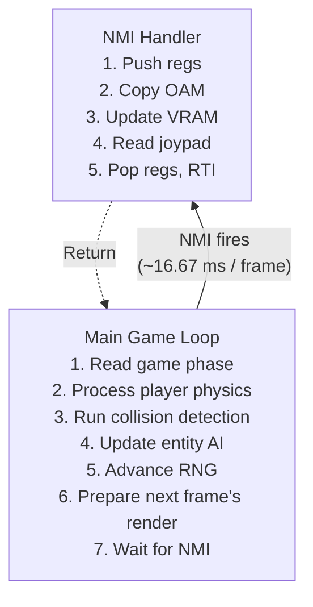
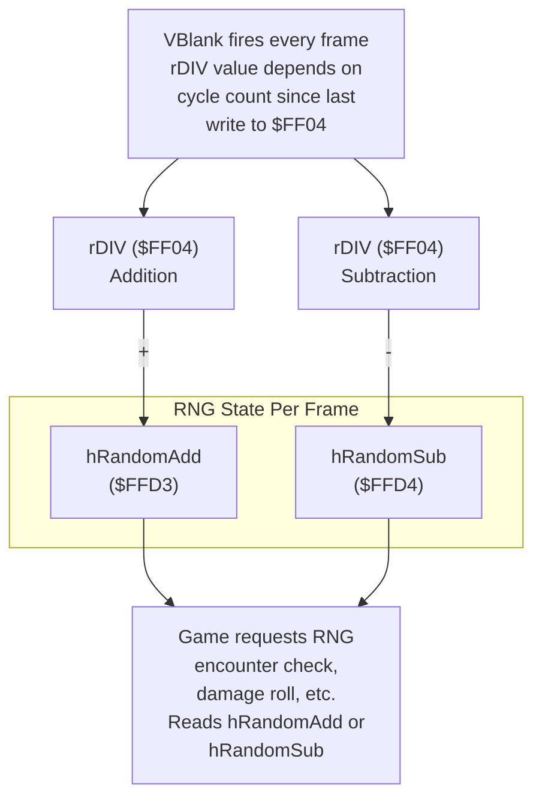
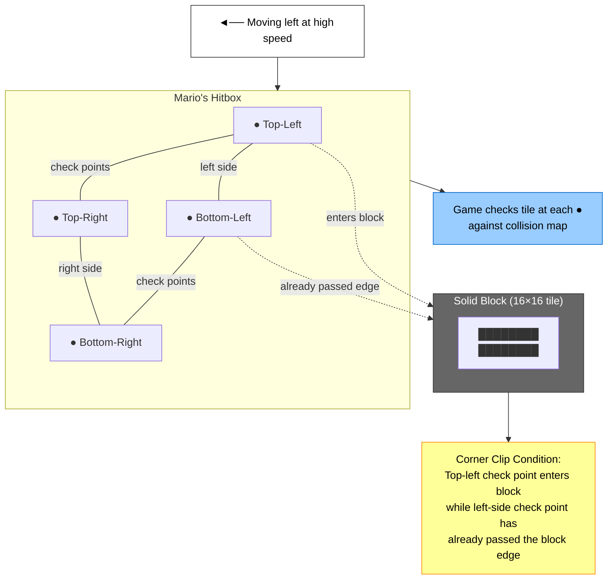
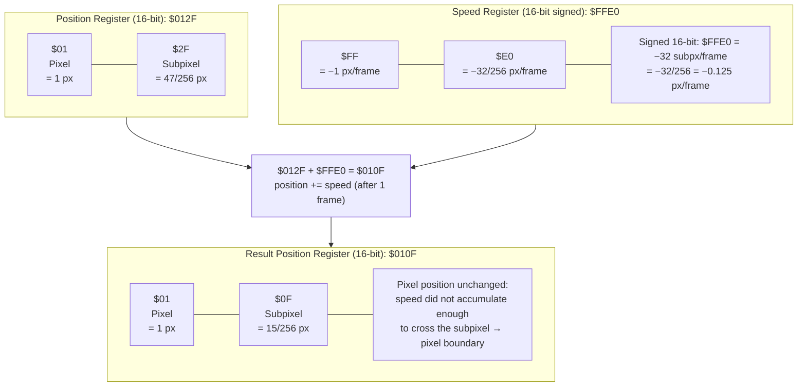

# Lesson 3: Execution Techniques for State Manipulation

## 1. First-Principles Intuition & Invariants

Every retro game executing on fixed, deterministic hardware is a finite state machine whose transitions are governed entirely by two inputs: the current contents of memory and the current controller state sampled at a precise moment in the frame loop. There is no ambient randomness, no external entropy source beyond a handful of hardware registers whose values are themselves deterministic given a known cycle count. This property—that identical state plus identical input at identical frame boundaries yields identical subsequent state—is the single invariant from which every technique in this lesson derives. When we speak of manipulating state, we are not breaking the machine. We are feeding it inputs that steer its internal data structures toward configurations the designers never anticipated, then letting the game's own code execute faithfully on those configurations to produce effects that look like magic but are, in reality, the most rigidly lawful behavior imaginable.

The distinction between a bug and a glitch is worth establishing precisely, because it governs how we search for exploitable behavior. A bug is a flaw in the code's logic—an off-by-one in a bounds check, a missing collision flag, an uninitialized variable. A glitch is the observable manifestation of that bug when triggered under specific game-state conditions. Not all bugs produce useful glitches, and not all glitches require a bug in the classical sense. Some of the most powerful glitch techniques—RNG manipulation, subpixel positioning abuse, frame-perfect input windows—exploit code that is functioning exactly as written. The code was written for a general case; the practitioner simply arranges conditions so that a specific edge case falls outside the developer's mental model of how the system would be used.

Three invariants anchor all state manipulation work. The first is **determinism**: given the same ROM, the same hardware (or a sufficiently accurate emulator), and the same input sequence, the game will always produce the same output. This is what makes tool-assisted speedruns reproducible and what makes savestate-based exploration valid. The second is **observability**: the complete game state is accessible through memory inspection. Every variable that affects game logic—player position, speed, RNG seed, collision flags, entity spawn tables—resides in a known, addressable location in RAM, VRAM, or a hardware register. The third is **discreteness**: time in a retro game is not continuous but quantized into frames, and within each frame, the game performs a fixed sequence of operations in a fixed order. Understanding that order—the game loop's execution sequence—is the key to predicting which state changes will occur and in what sequence, which in turn determines whether a given manipulation technique will succeed or fail.

These invariants have a practical consequence that defines the entire workflow of glitch mechanics: because state is deterministic, observable, and discrete, any desired game-state configuration is reachable from the current configuration if and only if there exists a finite sequence of frame-precise inputs that transforms the current state into the target state. The practitioner's job is to find that sequence. Some sequences are short and obvious; others require navigating through thousands of frames with subpixel-precise movement to set up a single collision-bypass frame. The techniques in this lesson are the tools for finding, verifying, and executing those sequences.

## 2. Core Architecture & Mechanics

### 2.1 The Game Loop and Frame-Atomic Input

The NES and SNES execute a game loop synchronized to the video hardware's vertical blanking interval. On NTSC hardware, this loop runs at approximately 60 frames per second (59.94 for the NES, 60.10 for the SNES), meaning each frame occupies roughly 16.67 milliseconds. The frame begins when the Picture Processing Unit (PPU) raises a Non-Maskable Interrupt (NMI) at the start of VBlank. The NMI handler performs time-critical operations that can only occur while the PPU is not actively rendering: copying shadow OAM (sprite attribute data) to the OAM registers, updating VRAM with scroll positions and tilemap changes, and, in most games, reading the controller state. Control then returns to the main game loop, which executes the actual game logic: physics integration, collision detection, entity AI, sound engine updates, and rendering preparation for the next frame.



The critical detail for frame-perfect execution is the controller read sequence. On the NES, the controller's internal shift register is latched by writing a 1 then a 0 to bit 0 of the joypad register at `$4016` (player 1) or `$4017` (player 2). This strobe tells the controller to freeze its current button state into the shift register. Each subsequent read of the register shifts out one bit, representing one button in a fixed hardware-determined order:

| Read Index | Button |
|:---:|:---:|
| 1 | A |
| 2 | B |
| 3 | Select |
| 4 | Start |
| 5 | Up |
| 6 | Down |
| 7 | Left |
| 8 | Right |

A typical NES controller read routine stores the result in a single byte using a shift-and-roll loop:

```asm
ReadJoypad1:
    LDA #$01          ; Strobe high — latch button state
    STA $4016
    LDA #$00          ; Strobe low — ready for shifting
    STA $4016
    LDX #$08          ; Read 8 buttons
.loop:
    LDA $4016         ; Bit 0 = current button (1=pressed)
    LSR A             ; Move bit 0 into carry flag
    ROL joypad1       ; Rotate carry into bit 0 of storage
    DEX
    BNE .loop
    RTS
```

After this routine completes, the `joypad1` byte contains the button states with A in bit 7, B in bit 6, Select in bit 5, Start in bit 4, Up in bit 3, Down in bit 2, Left in bit 1, and Right in bit 0. The game logic then reads this byte to determine player actions for the current frame. The essential point is that the controller is sampled at one specific instant—the strobe—and any button change that occurs between one frame's strobe and the next frame's strobe is invisible to the game. Frame-perfect input means ensuring a button is held (or released) at the exact frame the strobe occurs, not merely "around that time."

Lag frames complicate this picture. When the main game loop takes too long to complete—due to excessive entity count, complex physics calculations, or heavy background processing—it may not finish before the next NMI fires. The result is a lag frame: the game logic runs, but the display does not update (the PPU outputs the same frame buffer twice). Input is still read during the NMI, so the game still processes controller changes, but the frame count advances without a corresponding visual update. This matters because the practitioner cannot rely on visual cues alone to count frames; a technique that appears to require pressing a button "on frame 1,234" by visual counting may actually need to account for lag frames that shifted the effective frame index. Accurate emulators like BizHawk and Mesen display the lag frame count in their status bars, and FCEUX flags lag frames in its input editor, making them visible during TAS development.

### 2.2 Random Number Generation

Retro games generate pseudo-random numbers through algorithms that are fully deterministic given a known seed. The three most common implementations are the Linear Feedback Shift Register (LFSR), the Linear Congruential Generator (LCG), and hybrid approaches that mix a software PRNG with a hardware timing register.

An LFSR maintains a shift register of *n* bits and produces each new random bit by shifting the register one position and computing the incoming bit as the XOR of specific tap positions. For example, a Galois LFSR with an 8-bit state register and taps at bits 7, 5, 4, 3 has a maximal period of 2⁸ − 1 = 255 (all non-zero states form a single cycle before repeating). The tap positions are chosen based on an irreducible polynomial over GF(2). The SNES game *EarthBound* uses a 16-bit LFSR for its main PRNG, as does *The Legend of Zelda: A Link to the Past*. The key property for manipulation is that the LFSR advances by exactly one step per call, and the sequence of states is a closed cycle. If you know the current state, you know the next state, and you know what state will produce your desired random outcome.

An LCG computes each new state as `state = (a × state + c) mod m`, where *a*, *c*, and *m* are constants. The *Pokémon* series from Generation 3 onward uses a 32-bit LCG with multiplier 0x41C64E6D, increment 0x6073, and modulus 2³². Generation 1 and 2 *Pokémon* games use a different, simpler mechanism that is particularly instructive for understanding RNG manipulation.

The Generation 1 *Pokémon* RNG maintains two bytes in the CPU's high RAM (HRAM) region: `hRandomAdd` at address `$FFD3` and `hRandomSub` at `$FFD4`. During each VBlank, the game reads the hardware divider register `rDIV` at `$FF04`, which increments at approximately 16,384 Hz (incrementing once every 256 CPU cycles on the Game Boy's ~4.19 MHz clock), and updates the two bytes:

```
hRandomAdd = (hRandomAdd + rDIV) mod 256
hRandomSub = (hRandomSub - rDIV) mod 256
```

Because `rDIV` is a free-running hardware counter, its value at any given VBlank depends on the exact number of CPU cycles that elapsed since the last write to `rDIV` (which resets it to zero). In normal play, the cycle count varies based on game state, entity count, and player input, producing effective randomness. But in a controlled environment—a TAS or a savestate-assisted manipulation—the cycle count is deterministic. If you perform the same sequence of inputs on the same frames, `rDIV` will have the same value at each VBlank, and the RNG will advance through the same sequence of states. This means that by controlling the number of frames that pass before triggering a random event (a wild encounter, a critical hit, a slot machine spin), you control the RNG state at the moment the event is evaluated, and therefore the outcome.



The practical workflow for RNG manipulation follows directly from this structure. First, identify the RNG state address in RAM using memory scanning (described in section 2.5). Second, identify the game event that calls the RNG—the encounter check, the damage calculation, the item drop roll—and determine which RNG byte or bytes it reads. Third, create a savestate at a point before the event. Fourth, advance frames one at a time, monitoring the RNG state in the emulator's hex editor or RAM watch, until the RNG reaches a value that produces the desired outcome when the event fires. Fifth, note the exact frame count from the savestate to the target frame, and execute the sequence with frame-perfect timing. This works because the RNG advances predictably every frame, so the number of frames of waiting between the savestate and the event trigger directly selects which RNG value the event sees.

### 2.3 Collision Detection Systems

Most NES and SNES platformers implement collision detection through tile-based point sampling rather than continuous swept-volume intersection. The game maintains a collision map—a two-dimensional array where each entry classifies a tile as solid, empty, liquid, hazardous, or some combination. The player entity has a bounding box defined by offsets from its position register, and the collision routine samples a small number of points along the edges of this bounding box, checking each sampled point against the collision map.

Super Mario World (SNES) illustrates this architecture precisely. Mario's interaction hitbox is defined relative to his position at addresses `$7E0094`–`$7E0097` (X and Y position, each 16 bits). The collision routine checks specific offsets: the left edge at a configurable offset from center, the right edge at another offset, the top at one or two points, and the bottom at one or two points. The game processes horizontal collision first—applying the player's X speed to the position register, then checking side collision points—followed by vertical collision—applying Y speed and checking top and bottom points.



The corner clip exploit in Super Mario World exploits a gap in this sampling scheme. When Mario moves left at high speed (X speed of −48 subpixels per frame or greater, corresponding to approximately −0.1875 pixels per frame in the game's fixed-point representation), the horizontal collision check samples the tile at Mario's left edge after applying his speed. If Mario's Y position is precisely aligned so that the left-side collision check point has moved past the block's left edge but the top-left collision check point is inside the block's bottom row, the horizontal check finds no collision (the check point is in an empty tile) while the subsequent vertical check detects Mario's head inside a solid block. The game's correction logic then snaps Mario upward to the top of the detected block, effectively teleporting him through the solid tile. This is not a bug in the collision code—the code correctly checks the designated sample points and correctly applies the correction for the detected collision. The glitch arises because the sample points do not form a continuous boundary, so there exists a geometric configuration where the point set straddles a block corner in a way the developers did not anticipate.

The exact conditions for a left corner clip in SMW are: Mario's X speed must be negative with a magnitude of at least 48 subpixels per frame; Mario's Y position must place the top of his hitbox at a specific subpixel offset relative to the block's bottom edge (the block must be at a position where its bottom Y-coordinate, minus Mario's hitbox top offset, yields a specific low-byte value—commonly requiring the Y position low byte to be within a 1-pixel window); and the block must be on a 16-pixel grid boundary. These conditions are tight enough that visual execution alone is unreliable; the practitioner must use the emulator's memory viewer to verify the subpixel Y position before attempting the clip, or use savestate verification to confirm the setup state.

### 2.4 Physics and Subpixel Arithmetic

Retro game physics engines use fixed-point arithmetic rather than floating-point, because the CPUs lack hardware floating-point units and fixed-point operations are faster and more deterministic. In Super Mario World, player position is stored as a 16-bit value per axis, where the high byte represents the pixel coordinate and the low byte represents the subpixel fraction (1/256 of a pixel). Speed is likewise stored as a 16-bit signed value in subpixels per frame.



This subpixel precision has profound implications for glitch execution. The visible pixel position of the player is the high byte of the position register, but collision detection and movement physics operate on the full 16-bit value. Two game states that look identical on screen—same pixel position, same animation frame, same apparent speed—can have different subpixel values, leading to different collision outcomes, different distances traveled, and different RNG advancement paths. A corner clip that works when the subpixel Y position is `$2F` may fail when it is `$30`, because the 1-pixel difference in the fractional position shifts the collision check points relative to the block boundary.

The practical consequence is that subpixel state must be tracked or measured, not inferred from visual observation. Every movement input—pressing left, releasing left, jumping, landing—modifies the subpixel value through the game's acceleration and friction model. Running left from a standstill, the game applies a negative acceleration each frame until terminal velocity is reached; releasing left applies friction (a deceleration toward zero speed). The resulting subpixel trajectory depends on the exact number of frames each input was held, which means that the path taken to reach a corner clip position matters as much as the final position itself. Two routes that end at the same pixel coordinate can arrive with different subpixel values, and only one may satisfy the clip condition.

Integer overflow in position or speed registers produces another class of boundary-condition exploit. If a position is stored as an 8-bit unsigned value and reaches 255, adding 1 wraps to 0, potentially placing the player at the opposite edge of the screen or in an uninitialized region of the level data. The famous Minus World in *Super Mario Bros.* (NES) exploits a related mechanism: the warp zone at the end of World 1-2 normally loads destination pointers into a specific memory region before Mario enters a pipe. If Mario enters the pipe before the screen scroll reaches the position where the warp zone setup routine executes, the pipe-destination table contains leftover values from previous processing, pointing to level index `$24`—the Minus World, an underwater level that loops infinitely because its exit pipe points back to itself. The glitch requires Mario to be at a specific X position (far enough right to enter the pipe) while the screen has not scrolled far enough to trigger the warp zone initialization, which is achievable by breaking a set of bricks at the right edge and ducking through a one-tile gap while moving leftward through the wall.

### 2.5 Savestate Architecture and Memory Scanning

A savestate is a complete snapshot of the emulated machine's state: CPU registers (accumulator, X, Y, stack pointer, status flags, program counter), all RAM contents, VRAM contents, OAM (sprite attribute memory), audio registers, mapper state (bank switching configuration), and hardware register values. When you load a savestate, the emulator restores all of these to their snapshot values, producing a machine state that is bit-for-bit identical to the moment the savestate was created. This is what enables deterministic reproduction: loading the same savestate and providing the same inputs will always produce the same subsequent execution.

The memory scanning technique exploits savestates to identify unknown memory addresses by differential analysis. The workflow operates as follows. Create a savestate at a moment when the target value is known—for example, when the player has exactly 3 lives. Open the emulator's memory search tool (in FCEUX: Tools → Memory Search; in BizHawk: Tools > Memory Scanner; in Mesen: the Memory Search window) and perform an "equals" search for the value 3. This returns all addresses currently holding the value 3, which may be dozens or hundreds depending on the game. Now change the target value in-game—die once, reducing lives to 2—without resetting or loading a savestate. Run a "changed to" or "equals 2" filter on the previous search results. The candidate set shrinks to addresses that were 3 and are now 2. Repeat this process—gain a life back to 3, filter for "equals 3" on the remaining candidates—until the set converges to one or a few addresses. Those addresses are the lives counter.

This same technique applies to any observable game value: health, position coordinates, speed, inventory counts, RNG seeds, enemy state, tilemap data. The key is to make controlled changes to one variable at a time while filtering, so the candidate set converges unambiguously. Once the address is identified, it can be added to the emulator's RAM Watch list for real-time monitoring, which is essential for verifying the setup conditions for frame-perfect glitches.

| Emulator | Memory Search Tool | RAM Watch | Hex Editor | Debugger |
|:---|:---|:---|:---|:---|
| FCEUX (NES) | Tools → Memory Search | Tools → RAM Watch | Tools → Hex Editor | Tools → Debugger |
| BizHawk (multi) | Tools → Memory Scanner | Tools → RAM Watch | Tools → Hex Editor | Per-core debugger |
| Mesen (NES) | Window → Memory Search | Window → Memory Watch | Window → Hex Editor | Window → Debugger |
| bsnes-plus (SNES) | — | Window → Memory Watch | Window → Memory Editor | Window → Debugger |

Savestate branching extends this from analysis to exploration. The technique is to create a savestate at a decision point, then execute one possible action sequence from that state, observe the outcome, and load the savestate to try a different sequence. This is the brute-force search method for frame-perfect windows: if you suspect a glitch triggers on a 3-frame input window, you create a savestate at the frame before the window, attempt the input on frame N, load the savestate, attempt on frame N+1, load again, attempt on frame N+2. Each attempt is a branch from the same root state, and the outcomes can be compared without replaying the game from the beginning. For complex glitches with multiple interacting conditions (subpixel position, speed, RNG state, entity position), this branching search is the only practical way to find a valid configuration, because the search space is too large for exhaustive enumeration but too constrained for random discovery.

## 3. High-Performance Optimization & Failure Modes

### 3.1 Frame-Perfect Input Workflow

The professional workflow for developing frame-perfect input sequences uses the emulator's input editor as the primary instrument. In BizHawk, TAStudio (Tools → TAStudio) provides a frame-by-frame input grid where each row is a frame and each column is a button. Inputs can be toggled by clicking cells, and the project saves as a .tasproj file that embeds the full input sequence and savestate history. In FCEUX, the movie editor (Movie → Edit Movie) provides similar functionality, saving to .fcm format. The workflow proceeds in phases: recording, verification, and rerecording.

In the recording phase, the practitioner plays through the game while the emulator records every input with frame precision. The resulting input file is then replayed to verify that it reproduces the desired game state. In the rerecording phase, the practitioner loads a savestate from within the movie, which truncates the input file at that frame and allows new inputs to be recorded from that point forward. This rerecording capability is what makes frame-perfect execution tractable: instead of replaying the entire game when a single input is wrong, the practitioner loads a savestate from a few frames before the error and re-records from that point.

The key optimization is to place savestates at decision boundaries—frames where the game state is known and the subsequent inputs are uncertain. For a corner clip setup, place a savestate at the frame before Mario reaches the clip position, once the subpixel values have been verified. For RNG manipulation, place a savestate at the frame before the RNG-dependent event, after confirming the RNG byte is one or two advancements away from the target value. This minimizes the replay distance when rerecording, because each rerecord only needs to re-execute from the nearest savestate, not from the beginning of the movie.

Lag frame compensation requires explicit accounting. When a technique depends on a specific frame count from a reference point, lag frames shift the effective frame index. The practitioner must identify lag frames by monitoring the emulator's frame counter (which distinguishes rendered frames from lag frames) and adjust the input timing accordingly. In BizHawk, the frame counter in TAStudio shows lag frames in a distinct color. In FCEUX, the input editor marks lag frames with a green indicator. A technique that requires pressing A on "frame 1,000 from the start" must account for all lag frames that occurred in that interval: if 7 lag frames occurred, the actual input frame is 1,007 from start, or equivalently, the 1,000th non-lag frame.

Region differences between NTSC and PAL versions introduce timing incompatibilities that are a frequent source of failure. PAL hardware runs at 50 FPS (20 milliseconds per frame) rather than 60 FPS, and the game code may be adjusted to compensate—or may not be, leading to different physics behavior. A corner clip that works on the NTSC version of SMW may fail on PAL because the speed cap, acceleration, or collision check order differs. The practitioner must verify which region the glitch was discovered on and test on the same region. This information is typically documented in the glitch's community entry (on sites like SMW Central, TASVideos, or the speedrun.com game pages), but when porting a technique to a new region, every assumption about frame timing, speed thresholds, and subpixel accumulation must be re-verified.

### 3.2 RNG Manipulation Strategy

The search space for RNG manipulation is the set of reachable RNG states from a given savestate, indexed by frame count. For a per-frame RNG that advances once per frame, the search space from any savestate is a linear sequence: savestate frame is state S₀, frame +1 is S₁, and so on, where Sₙ = f(S₀, n) and f is the deterministic RNG update function. The target is the frame index k such that Sₖ produces the desired outcome when the game event evaluates the RNG.

For Pokémon Generation 1, the practical workflow for encounter manipulation is as follows. First, locate the RNG bytes in HRAM using the memory scanner. The addresses `$FFD3` and `$FFD4` are in the Game Boy's high RAM region, which may not appear in a standard WRAM memory search; ensure the scanner is configured to search the full address space including HRAM (`$FF00`–`$FF7F`) and the RAM mirror at `$DF00`–`$DFFF`. Add both addresses to RAM Watch. Create a savestate at a position where you can control frame advancement without triggering an encounter—for example, standing in grass with no movement, or in a position where the encounter check only fires on a step. Advance frames one at a time (using frame-step, typically bound to a hotkey), noting the RNG byte values at each frame. When the encounter check fires (on a step), note which RNG byte the game reads and what value threshold determines whether an encounter occurs and which Pokémon species appears.

The optimization is to narrow the search by computing the RNG cycle length. For the Gen 1 system, the RNG state is determined by `hRandomAdd` and `hRandomSub`, but the effective state space is further constrained by the fact that both bytes are updated using the same `rDIV` value. The practical state space is bounded by the number of distinct `rDIV` values that can occur at VBlank, which depends on the game's cycle count variability. In practice, for a given game location and game state, the reachable RNG values over a reasonable frame window (say, 60 frames) are enumerable, and the practitioner can find the target value by scanning.

A more powerful technique is reverse RNG calculation. If the RNG update function is invertible (an LFSR is always invertible; an LCG is invertible if the multiplier is coprime to the modulus), the practitioner can compute backward from a target RNG state to determine how many frames of waiting are needed from the current state. For a simple LFSR, the inverse operation is to reverse the shift direction and compute the outgoing bit from the same tap positions. For the Gen 1 Pokémon RNG, the update is `hRandomAdd += rDIV; hRandomSub -= rDIV`, which is invertible only if you know the `rDIV` value at each frame—which you do, because `rDIV` is deterministic given the cycle count. In a TAS context, where the cycle count is fully controlled, the entire RNG trajectory is predictable from the start of the movie, and the practitioner can compute a frame-delay lookup table in advance using a script that simulates the Game Boy's cycle counting.

The card game in *Super Mario Bros. 3* (NES) provides a concrete example of RNG manipulation with a well-understood PRNG. The card game (N-Mark Spade Panel) determines card positions based on a frame counter and a PRNG that advances once per frame. The PRNG is an LFSR with state stored in a known RAM address. By creating a savestate before entering the card house and advancing frames while monitoring the LFSR state, the practitioner can find the frame at which the LFSR produces a state that arranges the desired card layout. Entering the door on that exact frame produces the target card arrangement every time, deterministically.

### 3.3 Collision Bypass Execution and Verification

Executing a collision bypass reliably requires verifying every precondition in the moments before the glitch frame. For the Super Mario World corner clip, the preconditions are: X speed magnitude ≥ 48 subpixels per frame (negative direction for left clip), Y position low byte within a specific 1-pixel window (the exact window depends on Mario's power-up state, which determines the hitbox offsets), and the target block aligned to the 16-pixel grid. The verification workflow uses RAM Watch to monitor all relevant addresses simultaneously in the frames leading up to the clip.

| SMW Address | Label | Role in Corner Clip |
|:---|:---|:---|
| `$7E007B` | Player X Speed (low) | Must be ≤ −48 (i.e., value ≤ $D0 as signed byte) |
| `$7E007C` | Player X Speed (high) | Sign extension of low byte |
| `$7E0096` | Player Y Position (low) | Must be within target window (power-up dependent) |
| `$7E0097` | Player Y Position (high) | Block grid alignment |
| `$7E0019` | Power-up Status | Determines hitbox dimensions and check-point offsets |
| `$7E0094` | Player X Position (low) | Verify approaching block corner |
| `$7E0095` | Player X Position (high) | Screen/page tracking |

The failure mode troubleshooting tree for a corner clip that does not trigger proceeds as follows. First, verify the X speed at the moment of contact: if the magnitude is less than 48, the horizontal check point does not move fast enough to skip the block, and the game's standard collision rejection prevents the clip. The remedy is to build more speed before the approach, which may require a longer runway or a different approach angle. Second, verify the Y position low byte: if it is outside the target window, the top collision check point is either too high (above the block, so no collision is detected) or too low (fully inside the block, so the standard upward rejection applies). The remedy is to adjust the approach path—different jump timing, different number of frames of falling before contact—which shifts the subpixel Y value. Third, verify the block alignment: SMW's collision map uses a 16-pixel grid, and the block must be at a grid-aligned position. If the block is placed at a non-grid-aligned offset (as some custom levels do), the clip geometry changes entirely. Fourth, check for lag frames in the approach: a lag frame during the approach changes the frame count and may shift the subpixel accumulation, altering the Y position at the moment of contact. Fifth, verify the ROM revision: the corner clip geometry depends on the specific hitbox offsets coded in the ROM, which can differ between the US, Japanese, and PAL revisions.

### 3.4 Savestate Abuse Patterns for Discovery and Verification

Beyond the memory scanning workflow described in section 2.5, several higher-order savestate patterns accelerate glitch discovery and verification.

**Differential state analysis** identifies which memory values changed as a result of a specific game action, which is useful when the relevant memory address is unknown. Create a savestate at state A. Take a RAM dump (in FCEUX: File → Save RAM dump; in BizHawk: the hex editor's save function). Perform the game action. Take a second RAM dump. Perform a binary comparison of the two dumps (using a tool like `cmp`, `diff`, or a hex comparison utility). The addresses that changed are candidates for the action's effect. This is particularly useful for identifying the RNG address: dump RAM before and after a known RNG-consuming action (like taking a step in Pokémon), and the changed addresses include the RNG bytes alongside the expected game-state changes (position, step counter). Narrowing down which changed address is the RNG (versus a side-effect update) requires the scanning technique: verify which of the changed addresses continues to change on subsequent RNG-advancing actions.

**State branching for path exploration** creates a tree of savestates at decision points, allowing the practitioner to explore multiple game paths without replaying. The practical implementation uses the emulator's savestate slots strategically: save the root state to slot 1, execute path A, save the result to slot 2, load slot 1, execute path B, save the result to slot 3, and so on. For deeper trees, the savestate files can be saved to disk with descriptive names. This is the method used to enumerate the outcomes of RNG manipulation: from a root state, advance N frames (where N varies) and save each outcome, then compare the outcomes to identify which frame delay produces the target result.

**Verification loops** confirm that a glitch is reproducible and that the setup conditions are correctly identified. The practitioner creates a savestate at the setup frame (the frame at which all preconditions are verified via RAM Watch), executes the glitch input sequence, and observes the result. If the glitch triggers, the savestate is loaded and the sequence is re-executed to confirm determinism. If the glitch fails on re-execution, either the setup conditions are incompletely specified (an unmonitored variable changed) or the emulator has non-deterministic behavior (which indicates an emulator bug or an unmodeled hardware register). If the glitch succeeds consistently from the savestate but fails when played from an earlier point in the game, the setup path matters: some intermediate state (subpixel accumulation, RNG advancement, entity spawn position) is different when arriving via the earlier path versus the savestate. The practitioner must then add monitoring for the untracked variable and adjust the setup path.

### 3.5 Failure Modes and Mitigation

The most common failure mode in glitch mechanics is **emulator inaccuracy**. Not all emulators model the hardware with sufficient precision to reproduce console-accurate behavior, and glitches often depend on exact cycle timing, PPU behavior, or hardware register edge cases that a less accurate emulator gets wrong. The hierarchy of NES emulator accuracy places Mesen and puNES at the top for cycle-accurate CPU and PPU emulation, with FCEUX below them (its PPU emulation has known inaccuracies that can affect lag-frame-dependent glitches). For SNES, bsnes (and its forks, bsnes-plus and bsnes-hd) provides the highest accuracy, with Mesen-S as a strong alternative. When a glitch is discovered on one emulator, it should be verified on a second, independent emulator before being claimed as console-valid. The gold standard is verification on real hardware via a flash cart (EverDrive N8 for NES, SD2SNES/FXPAK for SNES), which eliminates emulator-specific behavior entirely.

**Region and revision mismatches** produce silent failures where the glitch appears to be set up correctly but does not trigger because the code path or data layout differs. *The Legend of Zelda* (NES) has two major revisions (Famicom Disk System and NES cartridge), with differences in enemy placement and item behavior. *Super Mario Bros. 3* has NES and Famicom versions with different collision properties in some levels. The practitioner must identify the exact ROM hash (SHA-1 or CRC32) being used and verify that the glitch documentation matches that revision. Community resources like TASVideos and ROMhacking.net typically specify the ROM hash alongside glitch documentation.

**Desync** occurs when a movie file (recorded input sequence) plays back differently than expected, producing a different game state than the one the movie was recorded against. Desyncs are caused by emulator version differences (a movie recorded on FCEUX 2.2 may desync on 2.6 due to changed emulation behavior), core differences (a movie recorded on BizHawk's QuickNes core will desync on its NesHawk core), or input parsing errors. The mitigation is to specify the exact emulator version and core when distributing a movie file, and to verify playback on the same configuration. BizHask movie files (.tasproj) embed the emulator version, but portability across versions is never guaranteed.

A subtler desync cause is **initial state uncertainty**: if the movie begins from power-on rather than from a savestate, the hardware's initial RAM contents may vary. On real NES hardware, RAM contents at power-on are indeterminate (the values depend on capacitance, temperature, and power supply timing), though in practice they tend to be mostly `$00` or `$FF` depending on the system. Emulators initialize RAM to a fixed pattern (usually all zeros), which may differ from hardware. If a game reads uninitialized RAM as part of its game logic (a bug that some games exhibit), the emulator's deterministic initialization can produce a different state than hardware. The mitigation is to verify glitch reproducibility from a savestate with known RAM contents, rather than from power-on, when uninitialized RAM is a factor.

The final failure mode is **over- specification of conditions**. A practitioner who identifies a corner clip's Y-position window as "exactly `$2F`" may find it fails on re-verification because the actual window is `$2F`–`$31` and a different approach path lands at `$30`. The remedy is to treat identified conditions as necessary, not sufficient: verify that the conditions hold, but also verify the glitch triggers, and if it does not, broaden the search to include nearby values of the monitored variables. The savestate branching technique makes this efficient: from the setup frame, try the glitch; if it fails, load the savestate, adjust one variable by one unit (advance one frame to shift the RNG, change one input to shift the subpixel), and try again. Systematic single-variable adjustment from a known savestate is the fastest way to map the exact condition window.
