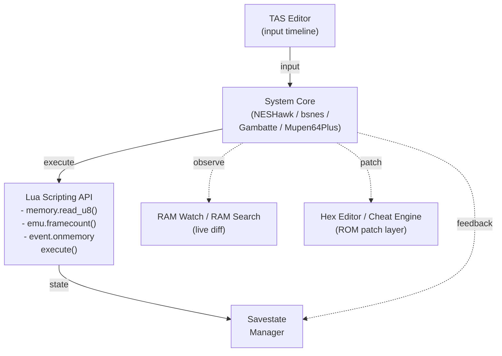
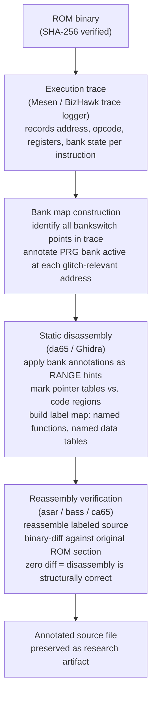

# Lesson 4: Tooling for Verification, Documentation, Preservation

## 1. First-Principles Intuition & Invariants

There is a peculiar epistemological challenge at the heart of retro game glitch research: the phenomena you study are real, deterministic, and reproducible, yet the machines that produce them are aging, increasingly variable, and gradually disappearing. A cartridge that triggers a specific ACE payload on a 1989 Game Boy may behave differently on a revision-B board than on revision-H hardware. A speed run that exploits a specific RNG state on the NES depends on a power-on RAM initialization pattern that differs between NTSC and PAL CPU revisions. The TAS that documents a wrong warp on Super Mario Bros. 3 is not merely a video file — it is a computational argument, and like any argument it must be verifiable and its premises must be stated. This is the domain Lesson 4 occupies: not the discovery of glitches, but the rigorous instrumentation, verification, and institutional preservation of everything you find.

The foundational invariant of this discipline is that **a glitch claim is only as strong as its reproducibility proof**. Informal assertions — "it happened on stream once" — carry no evidentiary weight in a research context because they cannot be audited. A properly documented glitch is one for which you can state: the emulator version, the ROM hash, the precise input sequence (or the hardware seed conditions), the memory addresses involved, the frame at which each state transition occurs, and the observable output that constitutes the glitch behavior. Everything else is anecdote.

This may sound like academic pedantry, but it is load-bearing. The retro gaming preservation community discovered its own reproducibility crisis roughly a decade ago, when runs submitted to platforms like TASVideos were found to rely on emulator bugs rather than hardware-accurate behaviors. The runs were technically impressive but argued for the wrong machine. The separation of "emulator console class" submissions from "hardware-verified" submissions was not a political compromise — it was an acknowledgment that emulator accuracy is a variable with real magnitude, and that magnitude must be measured, stated, and controlled.

Understanding this requires grasping what emulator accuracy actually means mechanically. A cycle-accurate emulator, such as higan (now known as ares) or the SNES component bsnes, models every clock edge of the original hardware's CPU, PPU, and APU in lockstep. When the SNES CPU performs a 16-bit write that straddles an open-bus cycle boundary during a DMA transfer, a cycle-accurate emulator reproduces the precise memory bus contention that results. A less accurate emulator may approximate this by executing one complete instruction per logical timestep, which introduces timing error at sub-scanline resolution. For most gameplay purposes this error is invisible. For glitch research, where exploit chains often depend on a single-cycle timing difference between a CPU write and a PPU latch, this error invalidates the entire analysis.

The practical invariants that follow from this are:

The emulator used for primary research and tool-assisted scripting must be declared, versioned, and checksummed. The ROM under study must be identified by its No-Intro or Redump SHA-256 hash, not by filename. Any TAS file must carry a header that records both. Memory addresses referenced in analysis must be annotated as either CPU-bus addresses or ROM offsets, because the mapping between them is non-trivial on bankswitched architectures like the NES MMC3 or the SNES LoROM/HiROM schemes. And every claim of hardware reproduction must distinguish between console revisions, since SRAM, PPU silicon revisions, and even PCB trace capacitances have documented behavioral differences.

These are not bureaucratic constraints. They are the minimum metadata required to let another researcher — working independently, possibly years later — reconstruct your exact experimental conditions. That reconstruction is the definition of reproducibility.

---

## 2. Core Architecture & Mechanics

The tooling ecosystem for retro glitch analysis is best understood as a pipeline with four functional stages: **input scripting**, **state observation**, **behavioral documentation**, and **long-term preservation**. Each stage has its own instruments, its own failure modes, and its own standards. Understanding how data flows through the pipeline prevents the most common class of research error, which is conflating evidence from different stages and treating emulator behavior as hardware proof without an explicit bridging experiment.

### The Emulator Layer: BizHawk as the Research Platform

BizHawk is the dominant platform for tool-assisted speedrunning and glitch analysis across NES, SNES, GB/GBC/GBA, Genesis, N64, and several dozen other systems. What makes it appropriate for research rather than merely for play is its architecture: each system core is a libretro-style component that can be swapped independently, and the entire emulator exposes a Lua scripting API that provides frame-granular access to memory, CPU registers, and input state. The TASEditor module records and replays input at the per-frame level, allowing an analyst to hold a specific game state indefinitely while exploring branch conditions.

The core selection decision is the most consequential one you will make when beginning a research session. For NES work, the difference between the NTSC Nestopia-UE core and the cycle-accurate NESHawk core is not cosmetic. NESHawk implements CPU-PPU interaction at the cycle level, which matters for any glitch that involves sprite 0 hit timing, VBLANK NMI delivery latency, or mid-frame PPU register writes. For SNES, bsnes-mercury Accuracy is the cycle-accurate core of choice, though it carries a significant performance cost relative to Snes9x. For Game Boy, the Gambatte core achieves near-perfect emulation of original DMG behavior, with documented and measured accuracy against hardware test ROMs. Choosing the wrong core for a behavior that depends on sub-frame timing is equivalent to running a chemistry experiment with contaminated reagents.



### TAS Scripting Frameworks

A TAS (tool-assisted superplay) file is a structured binary format that encodes the exact controller state for every frame of a playthrough. For NES work, the dominant format is FM2, which records per-frame button bitmasks for up to two controllers and optionally the Zapper light gun. For SNES, BK2 is BizHawk's internal format, encoding input as a header block followed by a pipe-delimited frame log where each row represents one frame and each field represents one controller button. The header is where research metadata lives.

A BK2 header for a research session should minimally contain:

```text
[Input Record]
SHA1Hash        9AA9762819E1E9D0DADA6F27B2B2C4A91DF1A02D
Platform        NES
GameName        Super Mario Bros.
FirmwareHash    (none)
BranchName      wrong_warp_world1-2
Author          analyst_handle
rerecordCount   4821
Core            NESHawk
```

The `SHA1Hash` ties the recording irrevocably to a specific ROM binary. If someone runs this TAS against a different ROM revision — even one that differs only in the header bytes — desync is likely and the result is meaningless. The `Core` field documents which emulator component was used, because the same frame input may produce different memory states in NESHawk versus QuickNES due to the accuracy differential described above. The `rerecordCount` is a secondary metric of research effort; it tells reviewers approximately how many branch explorations were required to arrive at the final input sequence.

TAS input construction is performed in TASEditor's piano-roll interface, where each row is a frame and each column is a button. The critical workflow discipline is **savestate branching**: before testing a hypothesis about what input at frame N will do, you create a savestate at frame N-1, attempt the input, observe the result, then revert and try alternatives. This branching structure is non-destructive and allows exhaustive exploration of a narrow decision window. For RNG manipulation specifically, analysts often scan hundreds of branches at a single frame to identify which of the 256 possible NES PPU cycle offsets (determined by the exact power-on timing) produces a favorable seed — a technique called power-on RNG control.

### Memory Watch Tooling

The RAM Watch and RAM Search subsystems in BizHawk are the primary instruments for observing game state during glitch analysis. RAM Search is used for the initial discovery phase: you specify a comparison condition (value equals a known quantity, or value changed since last frame, or value is less than it was) and the tool narrows the full address space to the set of addresses satisfying that condition across repeated frame samples. Within thirty to fifty iterations of this binary search process, a single address representing a game variable — health, position, timer, inventory count — is typically isolated.

RAM Watch is used once you have identified your addresses of interest. It maintains a persistent display of named watch items, each bound to an address, a data type (unsigned byte, signed byte, 16-bit little-endian, 32-bit big-endian depending on the target CPU architecture), and an optional freeze value. For glitch analysis, the freeze function is instrumentally important: it allows you to hold a memory location at a fixed value while exploring what other system behavior changes as a result. If you freeze the game's collision detection flag and walk Mario through a wall, you are performing a controlled variable isolation experiment. The behavior of the scroll engine, the room transition logic, or the camera clamp in the absence of normal collision response tells you exactly which code paths are gated by that flag and which operate independently.

For more complex multi-address relationships, the Lua scripting API supersedes the GUI tools. A Lua script running within BizHawk's execution context has access to the full 64KB (or bankswitched equivalent) address space of the emulated system, can register callbacks on memory read, write, or execute events at specific addresses, and can write annotated output to the HUD or to an external log file. The following pattern is representative of a memory watch script used to track NES sprite zero hit timing during a glitch investigation:

```lua
local sprite0_x = 0
local sprite0_y = 0
local hit_frame = 0

event.onmemoryexecute(function()
    -- PPU status register read at $2002 triggers sprite 0 hit clear
    -- Log current scanline approximation and frame count
    local frame = emu.framecount()
    local ppu_status = memory.read_u8(0x2002, "PPU Bus")
    if bit.band(ppu_status, 0x40) ~= 0 then
        hit_frame = frame
        gui.addmessage(string.format("S0 HIT frame=%d y=%d x=%d",
            frame,
            memory.read_u8(0x0200),  -- OAM sprite 0 Y byte
            memory.read_u8(0x0203))) -- OAM sprite 0 X byte
    end
end, 0x2002, "PPU Bus")
```

This script does not merely observe — it annotates the execution trace with the precise frame and OAM coordinates at which sprite zero hit is detected, creating a machine-readable record that can be correlated against the TAS input timeline to identify the exact frame window in which a timing-dependent glitch must be triggered.

### Disassembly and Static Analysis Workflows

Dynamic memory observation tells you what values exist at runtime. Static disassembly tells you why those values exist — what code paths produce them. The standard tool for 6502 disassembly (NES, Atari 2600, Apple II) is **da65**, the disassembler component of the cc65 toolchain, though for interactive exploration **Mesen**'s integrated debugger provides a superior workflow because it correlates live execution with the static disassembly view.

The workflow begins with bank identification. On an NES cartridge using an MMC3 mapper, the 32KB CPU address space at any moment contains two switchable 8KB banks at $8000–$BFFF, two fixed banks at $C000–$FFFF, and the standard zero page, stack, and work RAM at $0000–$07FF. Before disassembling code that handles a glitch, you must determine which bank configuration was active when that code executed. Mesen's trace logger records executed instructions with their current bank register state, so you can scroll back through the trace to find the bankswitch instruction ($8000 MMC3 register write) that preceded the glitch-triggering code path.

With the correct bank isolated, meaningful disassembly proceeds. The key analytical step is distinguishing between pointer tables and code, because 6502 binaries contain both interleaved, and a disassembler fed raw bytes will interpret data as instructions and produce nonsense. When you identify a JSR to a table of addresses followed by an RTS — the classic NES action dispatch pattern — the bytes at the table offsets are 16-bit pointers, not opcodes. Mark them as such. The disassembler's configuration file (for da65, this is the `.info` file containing `RANGE` directives) encodes this structural knowledge and must be built up incrementally as you trace execution paths.

For SNES work, the architecture shifts to 65816, a 24-bit address space with mode-switching between 8-bit and 16-bit register widths. The M and X flags in the processor status register determine whether accumulator and index operations are 8-bit or 16-bit at any given instruction, which means that the same opcode (`LDA`) assembles differently depending on context. A disassembler that does not track the M/X flag state through the execution trace will misinterpret instruction boundaries. **asar** and **bass** are the assembler counterparts used to verify disassembled code by reassembling it and comparing the binary output against the original ROM sections.

For Game Boy (SM83 CPU), **Ghidra** with the GhidraBoy plugin has become the standard for large-scale disassembly projects, and it integrates with BizHawk's debug export to import execution traces as function-discovery hints. The key advantage over manual disassembly is Ghidra's cross-reference tracking: when you identify the address of a glitch-triggering function, Ghidra immediately shows you every location in the ROM that calls or jumps to that function, which is essential for understanding whether a glitch is a targeted exploit of a specific code path or an emergent property of a shared routine called from many sites.



---

## 3. High-Performance Optimization & Failure Modes

### Reproducibility Validation Protocols

The single most common failure mode in glitch research documentation is **emulator-specific irreproducibility**: a glitch demonstrated on one emulator core that cannot be reproduced on a more accurate core or on hardware. The failure is not always obvious, because the glitch may still visually occur on hardware — just at a different frame, with a different input sequence, or only under a narrower set of conditions than the emulator suggested. The documentation then misleads practitioners who attempt to follow it.

The standard mitigation is a three-tier validation ladder. The first tier is emulator reproducibility: the TAS or input sequence reproduces the glitch deterministically in the declared emulator and core, verified by independent re-run from the same ROM hash and savestate. The second tier is cross-emulator consistency: the glitch reproduces on at least one other cycle-accurate core for the same platform, ideally with a different codebase lineage (e.g., Gambatte and SameBoy for Game Boy work). If the glitch only manifests in one emulator, the probability that it is an emulator bug rather than a hardware behavior rises sharply. The third tier is hardware verification, which requires either physical testing on a real console of a documented revision, or a reference to an existing hardware-verified video recording with a synchronization proof — typically a TAS sync test where the hardware playback device (e.g., a Raspberry Pi running a custom USB HID injector, or the TASBot hardware platform) replays the exact input file on console and produces an identical output.

TASBot-class hardware verification uses a microcontroller (originally an Arduino Mega, later replaced by custom FPGA-based controllers for sub-millisecond precision) to inject controller inputs at the electrical level into the console's controller port. The timing precision matters enormously: the NES polls controller state via a latch pulse on the $4016 strobe line at the beginning of each frame's vblank window, and the controller data must be stable before that latch. A microcontroller injecting inputs with a USB-class jitter of ±1ms will occasionally miss frame boundaries on a 60Hz NES, introducing a one-frame desync that cascades into divergent RNG state within seconds. The transition to FPGA-based injectors with deterministic 100ns timing precision was driven specifically by this failure mode in long-run TAS verification attempts.

### Documentation Standards for Glitch Archives

The preservation of glitch research is not served by video alone. A video demonstrates that a glitch occurred; it does not prove why, nor does it allow another researcher to reproduce it programmatically. The documentation standard for a research-grade glitch entry combines several artifacts into a coherent package.

The TAS input file (BK2, FM2, or equivalent) is the primary executable artifact. It is the computational equivalent of a proof: given the declared ROM and emulator, it produces the documented behavior deterministically. It must be stored with its full header metadata intact and committed to a versioned repository (Git is appropriate; the binary is small and the history of revisions is itself informative). The RAM Watch file, a plain-text export from BizHawk listing all addresses monitored during the session with their names and data types, constitutes the observational instrument manifest. The Lua scripts used for annotation and event logging are source-code artifacts and must be preserved with their dependencies noted (BizHawk API version, Lua 5.1 compatibility notes).

The written analysis document, ideally in Markdown for longevity and plain-text portability, should contain a formal narrative with the following structure. First, a hardware model section describing the target platform, board revision if known, the ROM identifier including its No-Intro catalog name and SHA-256 hash, and the CPU/PPU architecture features relevant to the glitch. Second, a glitch taxonomy entry classifying the behavior — out-of-bounds, ACE, wrong warp, credit warp, zipping, storage glitch, or the platform-specific vocabulary appropriate to the game — with a plain-language description of the observable effect. Third, a mechanistic explanation tracing the memory state transitions, beginning from normal game operation and ending at the corrupted or exploited state, with addresses named and values given in both hexadecimal and decimal where readability demands it. Fourth, a reproduction section providing the exact conditions required: frame number, prior game state, input sequence described both in human terms and by reference to the TAS file timeline. Finally, a validation section stating which tier of the reproducibility ladder the claim has reached and what evidence supports that tier.

### Handling the Preservation of Aging Physical Media

The documentation pipeline described above ultimately depends on ROM images extracted from physical cartridges, and those images must themselves be verified against the canonical No-Intro or Redump databases before any research begins. ROM dumping introduces its own failure modes that cascade into false research results if not controlled. A partial dump of a battery-backed SRAM save area that overwrites part of the PRG data, an EPROM read at an incorrect voltage that produces bit errors, or a faulty flashcart reproduction that remaps addresses differently from the original ASIC mapper — any of these produces a ROM binary that may play seemingly correctly for most of a game while producing entirely different glitch behaviors than the original hardware, because the corrupted or remapped bytes may fall exactly in the code paths that implement the glitch.

The standard protocol for ROM validation before a research session is straightforward: compute the SHA-256 (or SHA-1 for legacy databases) of the ROM file and compare it against the No-Intro database entry for the target game and region. No-Intro maintains a continuously updated XML catalog of verified clean dumps for every major platform, and **ClrMamePro** or **RomVault** can automate the matching process against a local collection. If your ROM does not match any No-Intro entry, it may be a bad dump, an overdump, an underdump, or a regional variant not yet in the catalog. Research performed against an unverified ROM is not reproducible by others who do not have the same binary, and that is an irrecoverable documentation failure.

For documentation of hardware-specific behaviors that differ between console revisions — the PPU 2C02 versus 2C07, the CPU 6507 versus 6502, the Game Boy DMG-CPU versus MGB-CPU — the physical console used for hardware verification must be identified by its board revision. This is determined by opening the cartridge slot and reading the board markings (NES-CPU-07, SNS-CPU-RGB-01, and so on), or by consulting the established hardware revision databases maintained by researchers such as those in the NESDEV Wiki. The revision identifier is as important as the ROM hash, because documented timing differences between PPU revisions affect which frame window a glitch is achievable within on hardware.

### Workflow Optimization: Reducing Friction Without Sacrificing Rigor

The practical tension in this discipline is that rigorous documentation is time-consuming, and time spent on documentation is time not spent discovering new glitches. The resolution is to build documentation into the research workflow rather than treating it as a post-hoc deliverable. BizHawk's Lua API supports automated log generation that runs continuously during a session, writing address values and frame counts to a structured log file that can be parsed later. If you write your memory watch scripts with logging enabled from the beginning rather than adding it after the fact, the observational record accumulates automatically.

Similarly, TASEditor's savestate system should be used not just for branch exploration but as a session journal. Each named savestate represents a hypothesis checkpoint: "SMB3-wrongwarp-attempt-7-preflight" is a recoverable research state, while an unnamed savestate slot overwritten twelve times is not. The discipline of naming savestates costs five seconds and prevents the loss of hours of work when you accidentally verify a negative result too aggressively and need to return to a prior premise.

The final optimization principle is parallelism between static and dynamic analysis. Disassembly work and live memory observation inform each other bidirectionally: a suspicious address discovered via RAM Search becomes a cross-reference target in Ghidra, and a suspicious code path found in disassembly becomes a new address to watch in RAM Watch. Practitioners who work both sides simultaneously, keeping Mesen's debugger open alongside the disassembly while the TAS replay runs, converge on the mechanistic explanation of a glitch far faster than those who complete one phase entirely before beginning the other. The emulator is simultaneously your laboratory bench and your dissection table — the same session that produces the input sequence also produces the structural understanding, and both artifacts belong in the final preservation package.
