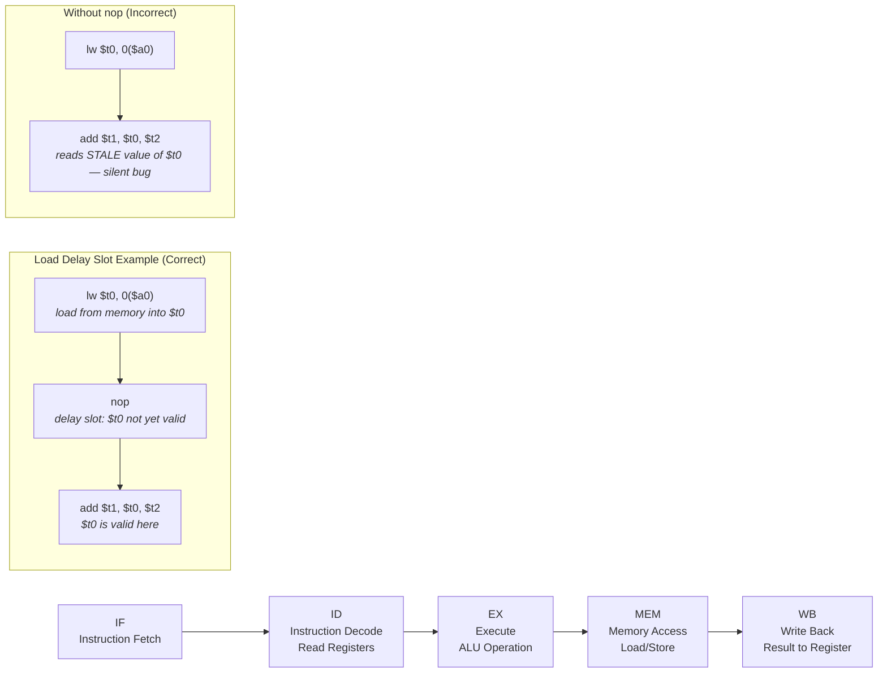

# Lesson 1: Processor Architectures in Retro Consoles

## 1. First-Principles Intuition & Invariants

To understand why games on the NES look and behave so differently from those on the SNES, or why a Sega Genesis title carries a distinct aesthetic gravity that no Game Boy game ever could, you have to begin not with graphics or sound but with the processor sitting at the heart of each machine. The CPU is the architect of everything downstream. Its register width determines how much data the machine can reason about in a single step. Its instruction set determines the vocabulary a programmer has to express intent. Its clock speed and pipeline structure determine the rhythm at which that intent becomes action on screen. Every creative constraint that defined an era of game design — the reason Pac-Man ghosts behave as they do, the reason Street Fighter II's sprite scaling feels the way it does, the reason early 3D on the PlayStation looks both crude and technically astonishing — traces back to decisions made in processor architecture.

The two dominant 8-bit families of the late 1970s and 1980s were MOS Technology's 6502 and Zilog's Z80, and they represent genuinely different philosophies about what a cheap, mass-producible processor should do well. The 6502 was designed by Chuck Peddle and a team of engineers who had grown frustrated at Motorola, and it hit the market in 1975 at a price point — roughly $25 — that made Motorola engineers publicly question whether it could possibly work. It did work. Its genius was radical simplicity: a small, orthogonal instruction set, a tightly constrained register model, and a memory addressing philosophy that pushed complexity onto the programmer rather than the silicon. The Z80, designed by Federico Faggin's team at Zilog and released in 1976, took the opposite posture. It extended Intel's 8080 architecture with a richer instruction set, additional register banks, and a built-in memory refresh circuit for DRAM, making it more self-sufficient but heavier in silicon terms. These two chips became the bedrock of an industry. The 6502 powered the Atari 2600 (in a cut-down variant called the 6507), the Apple II, the Commodore 64, and most critically the NES through its near-identical clone, the Ricoh 2A03. The Z80 drove the Sega Master System, the Game Boy (through a custom variant called the Sharp LR35902), the MSX standard, and the entire CP/M ecosystem of business computing.

Moving forward in time and register width, the 16-bit generation brought two architectures that felt almost luxurious by comparison. Motorola's 68000, introduced in 1979, was a machine designed with no compromise on programmer ergonomics. It offered eight 32-bit data registers and eight 32-bit address registers, a fully symmetric instruction set, and addressing modes sophisticated enough that one could write code on it that read almost like pseudocode. The SNES relied on its younger relative, the 65C816, a 16-bit extension of the original 6502. The Sega Genesis used the 68000 directly, running at 7.67 MHz. Meanwhile, the first PlayStation broke from the CISC lineage entirely, adopting a 33.87 MHz MIPS R3000A — a Reduced Instruction Set Computer that traded instruction richness for execution speed, completing most operations in a single clock cycle with a five-stage pipeline. Each of these choices encoded a set of invariants that every developer working on the platform had to either exploit or work around.

The fundamental invariant common to all these processors is the relationship between register width, addressable memory space, and per-frame computational budget. An 8-bit CPU with a 16-bit address bus can directly address 65,536 bytes — 64 KB. This is not a suggestion or a soft limit; it is the total universe of memory that a 6502 or Z80 can speak to without bank-switching trickery. A 16-bit CPU with a 24-bit address bus, like the 68000, addresses 16 megabytes directly, which in the mid-1980s was an almost incomprehensible luxury. The MIPS R3000A's 32-bit registers and bus give a flat 4 GB address space, though physical RAM on the original PlayStation was 2 MB of DRAM plus 1 MB of video RAM. Understanding these ceilings is not a historical footnote — it is the prerequisite for understanding every optimization technique, every hardware co-processor decision, and every game design tradeoff covered in the rest of this curriculum.

---

## 2. Core Architecture & Mechanics

### The 6502: Minimal Registers, Maximum Addressing Cleverness

The 6502's register file is small enough to describe in a single breath: an 8-bit accumulator (A), two 8-bit index registers (X and Y), an 8-bit stack pointer (SP) hardwired to page one of RAM (addresses $0100–$01FF), a 16-bit program counter (PC), and an 8-bit processor status register (P) carrying the carry, zero, overflow, negative, decimal, interrupt, and break flags. That is the entire programmer-visible state. No general-purpose register file, no second bank of registers, no index register with arithmetic capabilities beyond simple increment and decrement.

What the 6502 lacks in registers it compensates for with an unusually rich set of addressing modes, and understanding these modes is the key to writing efficient 6502 code. Zero page addressing deserves special emphasis: by restricting an address operand to the first 256 bytes of RAM (the "zero page"), an instruction can be encoded in two bytes rather than three and executes in fewer clock cycles. The 6502 treats the zero page as an extended register file. Skilled NES programmers filled zero page with their most frequently accessed variables — enemy position arrays, controller state, physics accumulators — not because it was tidy but because every zero-page access shaved a cycle, and at 1.79 MHz on the NTSC NES, cycles were a currency traded at considerable cost.

Indexed indirect addressing (often written `(zp,X)`) and indirect indexed addressing (`(zp),Y`) are the two modes that give the 6502 its pointer capability. In `(zp,X)`, the processor takes the zero-page address, adds X, reads a 16-bit pointer from that location, and uses the pointer as the effective address — powerful for table lookups. In `(zp),Y`, it reads a 16-bit base pointer from zero page, then adds Y to form the effective address — ideal for walking through data structures sequentially. The difference matters enormously in practice: `(zp),Y` is the workhorse of NES sprite data writes and nametable streaming because it allows linear traversal with minimal register manipulation. A developer porting rendering code between these two modes without understanding their mechanical difference would produce code that is either correct and slow or fast and broken.

```text
6502 Register Model
┌─────────────────────────────────────────────┐
│  A  │ 8-bit Accumulator (all ALU ops here)  │
├─────────────────────────────────────────────┤
│  X  │ 8-bit Index Register X                │
├─────────────────────────────────────────────┤
│  Y  │ 8-bit Index Register Y                │
├─────────────────────────────────────────────┤
│  SP │ 8-bit Stack Pointer (page $01 only)   │
├─────────────────────────────────────────────┤
│  PC │ 16-bit Program Counter                │
├─────────────────────────────────────────────┤
│  P  │ N V - B D I Z C  (status flags)       │
└─────────────────────────────────────────────┘

Addressing Mode Cycle Cost (NTSC NES, 1.789 MHz)
┌───────────────────────────┬───────────┬────────┐
│ Mode                      │ Bytes     │ Cycles │
├───────────────────────────┼───────────┼────────┤
│ Immediate                 │ 2         │ 2      │
│ Zero Page                 │ 2         │ 3      │
│ Zero Page,X               │ 2         │ 4      │
│ Absolute                  │ 3         │ 4      │
│ Absolute,X (no page cross)│ 3         │ 4      │
│ Absolute,X (page cross)   │ 3         │ 5      │
│ (Indirect,X)              │ 2         │ 6      │
│ (Indirect),Y (no cross)   │ 2         │ 5      │
│ (Indirect),Y (page cross) │ 2         │ 6      │
└───────────────────────────┴───────────┴────────┘
```

The page-crossing penalty is a critical performance trap. When an indexed address calculation crosses a 256-byte page boundary, the 6502 must perform an additional internal cycle to propagate the carry from the low byte of the address into the high byte. Code that iterates through a data buffer aligned to a page boundary never pays this penalty; code that starts mid-page and crosses into the next page incurs a one-cycle tax on every access that crosses. NES developers who understood this organized their sprite and tile data carefully in ROM, aligning tables to page boundaries to eliminate the overhead in tight rendering loops.

### The Z80: Register Richness and the Alternate Bank

The Z80 presents a different personality entirely. Its register model includes A, B, C, D, E, H, and L as the primary general-purpose 8-bit registers, along with a shadow set — A′, B′, C′, D′, E′, H′, and L′ — that can be swapped in with a single `EX AF,AF′` or `EXX` instruction. This shadow bank is not general-purpose in the way modern multithreading contexts might suggest; it exists to give interrupt service routines a clean register file without the overhead of pushing and popping the main registers onto the stack. For Game Boy developers targeting the LR35902 variant (which omitted the shadow registers and index registers IX/IY but retained the core 8080-compatible architecture), this meant ISR optimization worked differently than on a standard Z80.

The Z80's 16-bit register pairs (BC, DE, HL) are particularly significant. HL acts as the primary memory pointer register, and many memory-to-register and register-to-memory operations are only available through HL. The `LDIR` block transfer instruction — load, increment, repeat — moved a contiguous block of memory at approximately one byte per 21 clock cycles, making it the standard tool for DMA-less bulk memory copies on the Master System. At 3.58 MHz on the Master System's Z80, an `LDIR` transferring 1 KB of tile data to VRAM took roughly 21,000 / 3,580,000 seconds ≈ 5.86 ms, which consumed a significant fraction of the 16.7 ms PAL frame budget. This was not a theoretical observation; it directly shaped how Master System games structured their asset streaming and determined which graphical tricks were feasible mid-frame.

```text
Z80 Register Model
┌──────────┬──────────┐  ┌──────────┬──────────┐
│    A     │    F     │  │    A′    │    F′    │  ← Shadow (EX AF,AF')
├──────────┼──────────┤  ├──────────┼──────────┤
│    B     │    C     │  │    B′    │    C′    │  ← Shadow (EXX)
├──────────┼──────────┤  ├──────────┼──────────┤
│    D     │    E     │  │    D′    │    E′    │
├──────────┼──────────┤  ├──────────┼──────────┤
│    H     │    L     │  │    H′    │    L′    │
└──────────┴──────────┘  └──────────┴──────────┘
     ↑ Primary                ↑ Alternate bank

Special-purpose 16-bit:
  IX, IY  — Index registers (displacement addressing)
  SP      — Stack Pointer
  PC      — Program Counter
  IR      — Interrupt vector / DRAM refresh (hardware-managed)
```

### The 68000: Programmer's Luxury, Hardware Cost

The Motorola 68000 represents the high-water mark of CISC ergonomics at the edge of what 1980s semiconductor processes could integrate affordably. Its sixteen 32-bit registers split cleanly into eight data registers (D0–D7) and eight address registers (A0–A6, with A7 serving as the stack pointer). The design enforces a conceptual separation: data registers participate in arithmetic and logical operations, while address registers participate in memory reference calculations. This orthogonality means a programmer can maintain eight active working values in data registers while simultaneously managing eight independent memory pointers in address registers, without any contention. For game programmers dealing with multiple simultaneous entities — enemies with position, velocity, state, and animation frame, all being updated in parallel loops — this was transformative.

The 68000's instruction set includes operations that would require multi-instruction sequences on the 6502 or Z80: `DBRA` (decrement and branch until a counter reaches negative one) replaces the classic load-compare-branch decrement loop. The `MOVEM` instruction pushes or pops multiple registers to and from the stack in a single instruction, making context switches in interrupt handlers both fast and readable. The addressing modes include pre-decrement and post-increment on any address register, which maps naturally onto stack operations, string processing, and array traversal. The result was assembly language that experienced programmers found genuinely pleasant to write — not a common descriptor for the craft — and high-level language compilers could target efficiently.

For the Genesis at 7.67 MHz, the 68000 delivered approximately 2 million simple instructions per second after accounting for the mix of 4-cycle and 10-cycle instructions in real code. The machine also ran a secondary Z80 at 3.58 MHz for sound management, and the two processors shared a 68K address space region through a hardware bus arbiter — a source of both capability and latency that sophisticated Genesis developers exploited by offloading audio-driven gameplay events to the Z80, eliminating the main CPU polling overhead entirely.

### The MIPS R3000A: Pipeline Discipline and the Load Delay Slot

The PlayStation's MIPS R3000A is philosophically alien to everything that came before it on consumer hardware. Where the 68000 has 100+ distinct instruction encodings and an assembler that reads like structured prose, the MIPS ISA has 32 instruction formats, all fixed at 32 bits wide, all designed to execute in a single clock cycle on a five-stage pipeline: Instruction Fetch, Instruction Decode, Execute, Memory Access, and Write-Back.

The fixed 32-bit instruction width is not merely an aesthetic choice; it is what makes the pipeline possible. When every instruction is the same size, the fetch stage always knows exactly how far to advance the program counter. Variable-length instruction sets like the x86 or the 68000 require a pre-decode stage to determine instruction boundaries, which complicates pipelining considerably. The MIPS designers chose to push that complexity onto the programmer and compiler instead.

The pipeline creates a consequence that every PSX developer had to internalize: the load delay slot. When a `lw` (load word) instruction reads from memory into a register, the data is not available until two cycles later because memory access occupies stage four of the five-stage pipe. The instruction immediately following the load executes before the loaded value is ready. Early MIPS implementations (including the R3000A) did not stall the pipeline automatically on a load-use hazard — they expected the programmer or compiler to place a useful instruction in that "delay slot" or insert an explicit `nop`. Code that read a value and immediately used it in the next instruction would silently read a stale value. This was a frequent source of bugs in early PSX development and a key reason Sony's official SDK included a compiler (a GCC-derived toolchain targeting the MIPS ABI) rather than expecting hand-written assembly for most code.



The MIPS register file comprises 32 general-purpose 32-bit registers (R0–R31), with R0 hardwired to zero. This zero register is not wasted silicon — it enables common operations to be encoded without special instruction variants. A `move` between registers is a add with R0: `add $t1, $t0, $zero`. A branch-if-zero needs no special instruction because comparison against the zero register is implicit. The calling convention assigns specific semantic roles to registers: R4–R7 carry function arguments, R2–R3 carry return values, R8–R15 and R24–R25 are caller-saved temporaries, and R16–R23 are callee-saved variables. PSX developers who hand-tuned inner loops had to respect this ABI carefully when mixing assembly with C, or accept the overhead of pure assembly functions with no stack frame.

The GTE (Geometry Transformation Engine), the PSX's hardware co-processor, operated as an extension of the MIPS pipeline and deserves recognition as the architectural feature that made the PlayStation viable for 3D gaming. It accepted vertex data through MIPS coprocessor instructions (`mtc2`, `ctc2`, `cop2`), performed fixed-point matrix multiplications and perspective divisions in roughly 15–64 clock cycles depending on the operation, and deposited results back into registers the CPU could read. Without the GTE, the R3000A's floating-point-free integer pipeline would have been laughably inadequate for real-time 3D. With it, developers could transform and project approximately 360,000 flat-shaded triangles per second — enough for the polygon counts of early 3D games, though the per-vertex calculation budget governed world complexity as tightly as the 6502's cycle count had governed NES sprite counts a decade earlier.

---

## 3. High-Performance Optimization & Failure Modes

### Cycle-Counting on the NES 6502: Working Within the Scanline Budget

The NES PPU (Picture Processing Unit) draws the screen one scanline at a time, spending 341 pixel-clock cycles per line and refreshing at 60 Hz on NTSC hardware. The CPU shares this clock through a fixed divider: the CPU runs at one-third of the PPU master clock, meaning each CPU cycle corresponds to exactly three PPU pixel clocks. A single visible scanline therefore gives the CPU 341 / 3 ≈ 113.67 CPU cycles. Per frame across 240 visible scanlines, that is about 27,280 CPU cycles for all visible-line work, plus the vertical blank period of 2273 cycles where VRAM writes are safe.

This budget is not generous. A single call to a subroutine that pushes the program counter to the stack and returns costs 12 cycles in overhead alone. An indirect indexed load through a zero-page pointer with a page cross costs 6 cycles. Reading and writing a full 64-byte sprite OAM buffer via CPU requires 64 × (zero-page read + OAMDATA write) = 64 × (3 + 4) = 448 cycles — over 15% of the entire vblank window, which is exactly why the NES provides the OAMDMA register: writing the high byte of the source page address to $4014 triggers a 513-cycle DMA that copies 256 bytes automatically, freeing the CPU for other vblank tasks. Using OAMDMA instead of manual sprite writes is not a micro-optimization; it is the difference between vblank completion and vblank overflow.

The practical workflow for NES performance analysis begins with the cc65 toolchain's cycle annotation feature. When disassembling a critical rendering loop, annotate each instruction with its cycle cost from the addressing mode table, sum them, and compare against the 113-cycle scanline budget. If a mid-screen palette trick relies on hitting a specific PPU cycle within a scanline — the technique used in games like Battletoads to show more than the 4-color-per-attribute-block limit — the tolerance is often ±1 CPU cycle. Achieving this requires either counting cycles by hand or using FCEUX's cycle-accurate debugger with a cycle counter breakpoint. The debugger workflow is as follows:

1. Load the ROM in FCEUX and open the debugger (`Debug → Debugger`).
2. Set a breakpoint on the CPU address of the loop entry point.
3. Enable the cycle counter display in the debugger toolbar.
4. Run one frame, halt at the breakpoint, and record the cycle counter value at loop entry.
5. Step instruction-by-instruction through the critical path, recording the counter at each step.
6. Compare cumulative cycles against the theoretical scanline budget.
7. Identify instructions contributing disproportionate cycle cost and evaluate substitution: an absolute indexed load that crosses a page boundary can be eliminated by realigning the target array to a page boundary in the linker script.

The linker script alignment fix is worth examining concretely. In a ca65 / cc65 project, suppose a tile data table called `MetaTileAttr` is placed at a default address that lands at $02D0. A loop iterating through 128 entries starting at index 0 will cross into page $03 at entry 48, paying one extra cycle per access from that point. Forcing alignment in the linker configuration file — `.segment "BSS" : start = $0300, size = $100, align = $100` — guarantees the table starts at a page boundary. The savings of 80 × 1 cycle = 80 cycles across a full scan of the table is the difference between a smooth 60 Hz loop and one that occasionally drops a frame.

### Zero-Bank Optimization on the Game Boy Z80

The Game Boy's LR35902 runs at 4.194304 MHz, but the actual machine cycles that matter for instruction timing run at 1.048576 MHz — the hardware executes at 4 "T-cycles" per "M-cycle," and instruction costs are measured in M-cycles. The LR35902 lacks the Z80's shadow registers and index registers but adds a unique instruction: `LD (HL+), A` (load A into the address in HL, then increment HL) and `LD (HL-), A` (load and decrement). These single-byte, 2-M-cycle instructions are the fastest way to sequentially write data to VRAM or OAM, and replacing a generic load-store-increment sequence with them reduces the inner loop of a tile blit from 5 M-cycles to 2 M-cycles per byte — a 2.5× throughput improvement in the most performance-sensitive code path in any Game Boy title.

VRAM on the Game Boy is inaccessible during PPU rendering modes 2 and 3 (OAM scan and pixel transfer), which together consume approximately 80 + 172 T-cycles per scanline. This window shrinks further when sprites are present on a line, because mode 3 extends by 10 T-cycles per sprite. Code that attempts to write VRAM during the inaccessible window produces visual corruption — pixels are written to incorrect tile locations or silently discarded depending on when in the write cycle the access occurs. The correct workflow is to gate all VRAM writes on the PPU status register at $FF41 bit 1 (the mode flag), polling until mode 0 or mode 1 is active, then writing as many bytes as possible before the next mode transition. Developers targeting the Game Boy Color's double-speed mode (8.388608 MHz base, effectively doubling the available window per scanline) must recalibrate all timing assumptions, since the VRAM accessible window in T-cycles does not change — it represents the same physical drawing time — but the number of CPU instructions that can execute during it doubles.

### 68000 Optimization on the Genesis: Bus Contention and the VDP FIFO

The Sega Genesis's most significant performance hazard is the VDP (Video Display Processor) FIFO, a 4-word buffer that serializes all CPU-initiated VRAM writes. The VDP consumes VRAM bandwidth to render, and when the CPU writes faster than the VDP can drain the FIFO, the CPU is inserted into wait states automatically. In the worst case — writing large amounts of tile data to VRAM via the CPU during active display — the effective CPU throughput drops to roughly 40% of its rated speed. This is not a bug but a physical constraint: the VRAM bus cannot serve both the VDP renderer and the CPU simultaneously, and the hardware arbitrates in favor of the display.

The standard mitigation is DMA transfer. The VDP's DMA engine can copy from 68000 ROM or RAM to VRAM, CRAM (color RAM), or VSRAM (vertical scroll RAM) at the VRAM bus rate, without stalling the CPU for most of the transfer duration. A DMA copy of 128 bytes to VRAM costs roughly 83 68K clock cycles to initiate and runs autonomously, while the CPU continues executing other logic. The practical constraint is that DMA must be initiated during the vertical blank or horizontal blank periods, and the DMA length register is 16-bit, limiting a single transfer to 65,535 words (131,070 bytes) — far more than any single-frame update would require. The professional Genesis development workflow processes asset updates as a DMA queue: during gameplay logic execution, all VRAM writes are appended to a ring buffer in RAM rather than sent directly to the VDP. During vblank, the DMA engine drains the queue in sequential transfers. This decoupling of asset update from VRAM write is the single most important architectural pattern in Genesis programming and separates amateur-quality code (which writes VRAM directly during gameplay, causing tearing and slowdown) from professional-quality code.

### MIPS Load Hazards and GTE Latency on the PlayStation

The load delay slot described in the pipeline discussion manifests as a systematic failure mode in hand-written PSX assembly and in C code compiled with insufficient optimization. The Sony GCC toolchain at optimization level `-O0` inserts `nop` instructions after every load, correctly but wastefully. At `-O2`, the compiler's scheduling pass attempts to fill delay slots with the next logically independent instruction. The failure mode occurs when the programmer overrides compiler scheduling with inline assembly and incorrectly assumes the register is valid one instruction after the load. Verifying correct scheduling requires examining the disassembly output with `mips-linux-gnu-objdump -d` and checking each `lw` instruction to confirm that the instruction immediately following does not use the destination register. Any violation is a silent correctness bug — not a crash, not an assertion failure, but subtly wrong physics, rendering, or game logic that surfaces as intermittent, unreproducible errors.

GTE latency introduces an analogous hazard. After issuing a GTE computation instruction (`cop2 0x...`), the result registers are not valid for 1 to 3 cycles depending on the specific operation. The GTE instruction reference documentation (Sony's official Developer Technical Reference, available through preservation archives) specifies the latency for each opcode. The correct pattern inserts independent CPU work — incrementing a vertex pointer, loading the next input vector, updating a loop counter — between the GTE instruction and the `mfc2`/`ctc2` read of its output. A transformation loop that issues a GTE RTPT (perspective transform of three vertices), immediately reads the output with no intervening work, then issues the next RTPT will read stale data on the first read and waste cycles on the second. The optimized loop structure interleaves GTE issue, independent CPU work, and GTE result read across two iterations simultaneously — a software-pipelined design that extracts close to the GTE's theoretical throughput of 15–20 transformed vertices per millisecond.

```text
Naive GTE Loop (incorrect / suboptimal):
  cop2 RTPT              ; transform vertices 0,1,2
  nop
  nop
  mfc2 $t0, SXY0        ; read projected X,Y of vertex 0
  mfc2 $t1, SXY1
  mfc2 $t2, SXY2
  ; ... clip, cull, enqueue polygon
  ; advance pointer
  cop2 RTPT              ; transform vertices 3,4,5
  ...

Software-pipelined GTE Loop (correct / fast):
  lw   $a0, 0($v0)       ; load vertex 0 (delay slot fills next)
  cop2 RTPT              ; issue transform for first triple
  addiu $v0, $v0, 24    ; advance vertex pointer (fills GTE latency)
  lw   $a1, 0($v0)       ; load next triple while GTE runs
  mfc2 $t0, SXY0        ; now read previous result (latency satisfied)
  mfc2 $t1, SXY1
  mfc2 $t2, SXY2
  cop2 RTPT              ; issue transform for second triple
  ...
```

### How Architecture Shaped Game Design: The Invisible Constraints

The constraints detailed above were not invisible to game designers — they were the medium. When Shigeru Miyamoto designed Super Mario Bros., the choice to scroll the screen horizontally rather than vertically was not purely aesthetic. Vertical scrolling on the NES PPU requires rewriting the nametable in the direction of travel faster than horizontal scrolling does, because the PPU nametable layout stores tiles in row-major order. Horizontal scrolling only requires writing a single column of 30 tiles per frame (at most 30 × 4 = 120 bytes), well within vblank budget. Vertical scrolling requires writing a full row of 32 tiles, which is comparable in raw bytes but arrives at a different PPU write timing, interacting less gracefully with the hardware's mid-frame scroll split capability. The 6502's cycle budget and the PPU's write timing together exerted a gravitational pull toward horizontal-scrolling platformers — not by mandate, but by making them easier to implement correctly and efficiently.

Similarly, the Genesis's 68000 register model influenced combat game development in the 16-bit era. A fighting game character requires position (X, Y), velocity (dX, dY), facing, state machine index, animation frame, and hitbox offset to be tracked simultaneously during collision detection. On the NES 6502 with its single accumulator, maintaining even four of these values simultaneously required constant zero-page load/store cycling. On the 68000 with eight data registers and eight address registers, all eight values fit in registers simultaneously, and the collision detection inner loop becomes a pure register operation with zero memory traffic. This was not an accident of the Genesis's fighting game library — Street Fighter II, Mortal Kombat, Samurai Shodown — it was the 68000's register model expressing itself through game genre and design.

The PlayStation's GTE determined the polygon budget of its 3D games, and the polygon budget determined aesthetic style. With roughly 180,000 affine-textured triangles per second available from the GTE and GPU together, developers faced a continuous trade-off between polygon count per object and number of objects on screen. Early PSX games chose low polygon counts with large, flat-shaded surfaces — the aesthetic that now reads as "classic PSX" — not because designers found it beautiful but because the GTE's throughput made higher fidelity impossible within the 33 ms frame budget. Games that pushed polygon count higher, like Ridge Racer or Gran Turismo, did so by accepting fewer simultaneous objects, shorter draw distances, or reduced dynamic geometry. The machine's arithmetic budget dictated the visual language, and in retrospect that budget produced an aesthetic coherent enough to be recognizable and beloved.

Understanding these processors at the instruction level is not an exercise in nostalgia. It is the foundation for every subsequent lesson in this curriculum: the memory mapping schemes that broke the 64 KB address ceiling, the graphics co-processors that offloaded pixel work from starved CPUs, the sound chips whose register models shaped chiptune composition, and the cartridge hardware that extended platform capabilities in ways the original CPU designers never anticipated. Every one of those topics begins at the same place — a register file, an instruction set, and a clock that never stopped counting.
