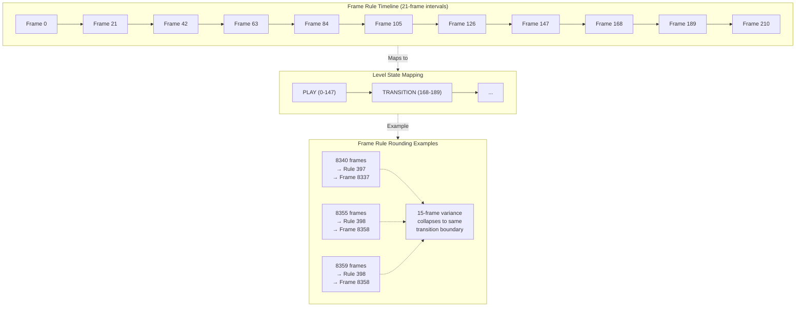

# Lesson 1: Fundamentals of Game Mechanics, Physics Exploitation, Timing Systems

## 1. First-Principles Intuition & Invariants

Speedrunning transforms video games from authored experiences into athletic disciplines where the margin between world records often compresses to single frames—intervals of sixteen or thirty-three milliseconds where precise controller inputs either shave off seconds or collapse entire strategies. At the foundation of this discipline lies a deceptively simple principle: every game is a deterministic state machine executing on fixed-frequency hardware, and understanding the precise mechanics of that machine converts apparent randomness into predictable advantage.

The retro gaming era, spanning roughly from the NES through the PlayStation, presents a particularly rich substrate for speedrunning precisely because the hardware constraints of these systems forced developers to implement game logic with crystalline clarity. Unlike modern engines with floating-point physics and multi-threaded rendering pipelines, an NES game executes in strict lock-step: one frame equals exactly 29,780.5 CPU cycles on NTSC hardware, and every sprite, collision check, and input poll happens in a defined sequence within that window. This determinism means that seemingly random behaviors—enemy spawn patterns, damage calculations, item drops—often emerge from predictable pseudorandom number generator states that runners can manipulate with frame-perfect timing.

The conceptual shift required to master speedrunning mechanics involves rejecting the game's authored reality in favor of its computational reality. When a player perceives smooth diagonal movement, the underlying truth is discrete eight-pixel-per-frame velocity updates applied to fixed-point position values. When a platform appears solid, the actual boundary consists of hitbox coordinates checked against player position once per frame, with edge cases where velocity magnitude can phase the player through geometry entirely. The game designer intended a particular experience; the speedrunner excavates the machine state beneath that intention.

Three fundamental invariants govern nearly all speedrun optimization across retro titles. First, frame rules impose quantized time boundaries where actions can only produce effects at fixed intervals, making certain optimizations worthless below threshold values while others compound dramatically. Second, subpixel precision exists in nearly every game with positional tracking, creating invisible gradients where hundredths of a pixel accumulate into measurable timesaves. Third, collision detection operates as discrete geometric checks rather than continuous physical simulation, yielding exploitable edge cases where velocity, angle, and timing intersect to permit impossible trajectories. Mastering these invariants requires building physical intuition about discrete state machines—an understanding that the game world updates in atomic steps, not continuous flows.

The practice of speedrunning also bifurcates into distinct timing methodologies that fundamentally alter strategy selection. In-game timers (IGT) measure progress using the game's internal frame counter, rewarding lag reduction and menu manipulation while ignoring real-world execution delays. Real-time attack (RTA) timing runs from power-on to final input, treating console lag and loading screens as optimization targets rather than externalities. This seemingly minor distinction cascades into dramatically different route choices: an IGT-optimal strategy might pause frequently to manipulate RNG while a player waits, behavior that would be catastrophic under RTA rules where every real-world second counts. Understanding which timing system governs a given speedrun category is not merely procedural housekeeping—it determines whether entire classes of techniques remain viable.

The computational substrate of retro games also exposes another exploitable dimension: many systems implement pseudorandom number generation through linear feedback shift registers or simple seed-increment algorithms that runners can predict and manipulate. A game that appears to spawn enemies randomly might actually derive spawn decisions from a sixteen-bit RNG state that advances one step per frame, meaning that delaying an action by precisely N frames causes a predictable outcome shift. Some games seed their RNG from controller input timings or power-on delays, allowing runners to manipulate outcomes through frame-perfect inputs or even console reset timing. This transforms luck-based mechanics into execution challenges where "getting good RNG" means executing a precise sequence of inputs to force the desired state rather than hoping for favorable outcomes.

## 2. Core Architecture & Mechanics

The architecture of retro game timing systems begins with the master clock that drives all game logic. NTSC NES hardware operates at 1.789773 MHz, divided by three to produce a 596.591 kHz pixel clock that generates exactly 262 scanlines per frame at 60.0988 Hz. The CPU executes game code in synchronization with these video timing constraints, processing player input, updating game state, and preparing sprite data within the vertical blanking interval where the electron gun returns from bottom to top of the CRT display. This tight coupling between rendering and logic creates frame rules—discrete time quanta where the game can only transition between specific states at fixed intervals.

Super Mario Bros. exemplifies frame rules through its level transition logic. The game implements a 21-frame rule where level completion times get rounded to the nearest multiple of twenty-one frames before the transition occurs. If a player finishes a level at frame 8340 or frame 8359, both times round to the same frame rule boundary, meaning the nineteen-frame difference produces zero actual timesave. This quantization emerges from the game's logic loop structure: every twenty-one frames, the level transition routine checks whether Mario has touched the flagpole, and if so, initiates the transition on that specific frame boundary. Consequently, speedrunners optimize routes to just barely reach the next frame rule threshold rather than maximizing raw speed throughout every section—an unintuitive strategy where slowing down can paradoxically improve final time.



Subpixel positioning represents another layer of hidden state that profoundly affects speedrun execution. Most retro games implement positional tracking using fixed-point arithmetic rather than floating-point numbers to avoid expensive division operations on integer-only CPUs. A typical implementation stores position as a sixteen-bit value where the upper eight bits represent whole pixels and the lower eight bits represent fractional subpixels. When Mario moves at "3.5 pixels per frame," the actual implementation adds 896 to his position value each frame (3 × 256 + 128 = 896), and the display routine renders him at the position formed by the upper eight bits while the accumulating lower eight bits remain invisible.

This subpixel precision creates optimization opportunities invisible to the naked eye. Consider a speedrun segment requiring a running jump across a gap. If Mario's starting position sits at pixel 128, subpixel 0 versus pixel 128, subpixel 255, that quarter-pixel difference affects his airborne trajectory. Velocity adds to position every frame, so beginning with subpixel 255 provides an almost-full-pixel head start that compounds throughout the jump arc. Advanced runners manipulate subpixel state by performing specific movement sequences that leave their character at optimal subpixel positions before critical jumps or clips. The game itself provides no feedback about subpixel state—runners must either count frames and calculate positions mentally or use emulator Lua scripts to visualize the hidden byte.

Collision detection in retro games operates through discrete rectangular hitbox comparisons rather than continuous intersection testing, yielding exploitable edge cases where velocity and geometry interact unexpectedly. The standard collision algorithm checks whether the player's hitbox overlaps an obstacle's hitbox after position updates each frame, but crucially, it does not verify that the path between old and new positions remained clear. A player moving at eight pixels per frame can phase through a four-pixel-thick wall if their position jumps from two pixels before the wall to six pixels beyond it within a single frame—the discrete position check never detects the intersection because the player was never precisely inside the wall geometry.

This discrete collision model enables corner clips, where runners exploit sub-pixel positioning to wedge their hitbox into wall geometry such that the next frame's position update ejects them through to the other side rather than blocking movement. The technique requires precise setup: approach the corner at a specific angle and speed such that one frame places the hitbox partially overlapping the wall, then on the subsequent frame, the game's collision resolution routine makes an incorrect choice about which direction to push the player. Some games always eject upward, others rightward, and understanding these resolution priorities determines whether a given corner permits clipping. The execution window often spans a single frame—arrive too early and the collision blocks you; arrive too late and you miss the geometry entirely.

Random number generation in retro games typically implements lightweight pseudorandom algorithms that advance through deterministic sequences. The NES Tetris RNG demonstrates a common pattern: the game stores an eight-bit RNG value that updates each frame by reading controller input on controller port 2, XORing it with the current RNG state, rotating the bits, and XORing again with a constant. This produces a sequence of piece spawns that appears random but actually derives from a deterministic calculation. Crucially, leaving controller port 2 empty causes the XOR to read zero every frame, reducing the RNG to a simple bit rotation that cycles through a predictable sequence. Speedrunners exploit this by ensuring port 2 remains empty, then counting frames to predict which piece will spawn next, planning their stack arrangements accordingly.

More complex manipulation schemes emerge in games where RNG state updates based on player actions rather than just frame counts. The Legend of Zelda increments its RNG value whenever Link swings his sword, opens a menu, or kills an enemy, and this same RNG state governs enemy movement patterns, item drops, and combat damage. Runners manipulate outcomes by performing extra sword swings or menu opens to advance the RNG to states that yield favorable results. For example, if the runner needs a specific enemy to move left rather than right, they might open and close the inventory menu six times to advance the RNG precisely six steps to the state where that enemy's movement decision yields the desired behavior. This transforms randomness into execution: "good RNG" means performing the correct manipulation sequence, not getting lucky.

```text
RNG Manipulation Example (Simplified):

Initial RNG State: 0xA3
Desired Outcome:   Enemy moves left (requires RNG values 0x00-0x7F)

Frame-by-frame RNG progression:
Frame N:   0xA3 → Enemy would move right (0xA3 > 0x7F)
[Sword swing] → advances RNG
Frame N+1: 0x51 → Enemy would move left (0x51 < 0x7F)

Execution: Press B button exactly one frame before enemy decision point
Result: Deterministic control over "random" behavior
```

Timing systems bifurcate speedrun strategy along the IGT versus RTA dimension in ways that cascade through every optimization decision. In-game timers typically increment based on the game's internal frame counter, ignoring lag frames where the game fails to complete its logic loop within one vblank interval. Games like Super Metroid count only non-lag frames, meaning that runners can pause the game to manipulate RNG states or wait for sprite memory to flush without penalty—the IGT timer stops during pauses while the runner plans their next sequence. Under RTA timing, every real-world second counts, making pause manipulation strategies worthless because the wall clock continues advancing regardless of game state.

The divergence becomes most pronounced in games with significant loading times or cutscenes. Final Fantasy VII loads battle encounters from disc, introducing multi-second delays that vary based on disc read speed and mechanical condition of the PlayStation hardware. Under IGT rules, these loading intervals contribute nothing to the timed result, making consistent execution the sole optimization target. Under RTA rules, hardware selection becomes critical—runners use PlayStation 2 consoles reading the disc faster than PS1 hardware, or they play on emulator with instantaneous loads, strategies that would be irrelevant under IGT measurement. The timing system is not just a measurement methodology; it defines which dimensions of optimization matter.

## 3. High-Performance Optimization & Failure Modes

Optimizing speedrun execution around frame rules requires abandoning intuitive time minimization in favor of threshold-oriented routing. When a twenty-one frame rule governs level transitions, a segment that saves nineteen frames produces zero improvement if it fails to cross the frame rule boundary, while a segment saving only two frames that pushes the completion into an earlier frame rule yields a full twenty-one frame improvement. This creates discrete optimization spaces where continuous improvement strategies fail. Runners must calculate frame rule boundaries for each segment, then route movements to reach the next-earlier frame rule with minimal safety margin rather than simply moving as fast as possible.

The practical workflow for frame rule optimization begins with establishing baseline completion times for each segment, typically measured using emulator frame counters or external capture analysis. For Super Mario Bros., runners time when they touch the flagpole in each level and record the frame count modulo twenty-one to determine their current frame rule position. If World 1-1 completes at frame rule 18 (meaning eighteen frames into a twenty-one frame cycle), the runner needs to find three or more frames of savings to reach frame rule 17—any optimization yielding only one or two frames accomplishes nothing. This discrete structure means that speedrunners often intentionally slow down after reaching a frame rule threshold, performing safety inputs or waiting for enemy patterns to stabilize rather than risking mistakes chasing time that yields no measurement benefit.

Subpixel optimization demands a completely different execution model focused on precision rather than raw speed. Since subpixel state remains invisible during normal gameplay, runners must either calculate position states mentally or develop muscle memory for input sequences that produce optimal subpixel positions. The standard approach involves identifying critical movement sections—typically running jumps or corner clips—then working backward to determine what prior inputs create the necessary subpixel setup. If a jump requires beginning at subpixel 240, and walking right adds forty-eight to the position value each frame, the runner can walk for a calculated number of frames to manipulate their subpixel position precisely.

Advanced practitioners employ Lua scripting on emulators to visualize subpixel state during practice sessions, overlaying the screen with memory values showing position, velocity, and subpixel components in real time. This allows iterative refinement: attempt a movement sequence, observe the resulting subpixel position, adjust inputs, and repeat until finding a consistent setup. Once the setup is mastered, the runner transitions to console hardware where no such debugging overlay exists, relying entirely on learned muscle memory and environmental cues—often counting animation frames or using specific visual landmarks to know when they have achieved the correct subpixel state. The development workflow uses tools that cannot exist during actual speedrun attempts, requiring a translation step from analyzed understanding to internalized execution.

Corner clipping and collision exploitation strategies demand pixel-perfect positioning combined with frame-perfect inputs, creating failure modes where small execution errors cascade into run-ending consequences. The typical clip setup requires approaching a corner at a precise angle and speed, then pressing the directional input on a specific frame to wedge the hitbox into the wall geometry. Miss the angle by one pixel and the collision detector blocks you normally; arrive one frame early or late and you overshoot the geometry entirely. These tight tolerances mean that even expert runners fail clips regularly—top-tier execution percentages for difficult clips often sit around fifty to seventy percent success rate.

The mitigation strategy for low-probability clips involves building buffer time into the overall route, accepting that several attempts might be necessary. Runners develop quick setup cues and bail-out plans: if the first attempt fails, immediately reposition and attempt again rather than continuing with poor positioning. For absolutely critical clips where failure ends the run, runners sometimes insert backup strategies—alternative routes that lose time but guarantee progress. The decision to commit to a difficult clip versus playing safe depends on how far into the run the clip occurs, what the current pace looks like relative to personal best, and the runner's confidence level that particular session. This transforms speedrunning from pure execution into dynamic risk management.

RNG manipulation optimization requires building mental models of how player actions advance the RNG state, then inserting manipulation inputs at strategic points to force favorable outcomes. The workflow begins with reverse-engineering the RNG algorithm, typically through memory watching on emulators to observe how the RNG value changes in response to various inputs. Once the algorithm is understood, runners map out which RNG states yield desired outcomes—for instance, in The Legend of Zelda, mapping which RNG values cause enemies to drop bombs versus rupees versus nothing. With this map, runners can calculate: "If I'm currently at RNG state 0x2F and I need state 0x45 to get a bomb drop, I need to advance the RNG by twenty-two steps, so I'll perform eleven sword swings."

The execution challenge comes from performing RNG manipulation while maintaining other optimization targets. Opening menus to advance the RNG wastes real-time, so runners often manipulate during unavoidable pauses—during screen transitions, while waiting for doors to open, or while an enemy attack animation plays out. Advanced manipulation sequences involve minimal-frame inputs: pressing and releasing the menu button on consecutive frames advances the RNG twice while losing only two frames of IGT. Some games even permit zero-cost manipulation through actions that advance RNG without consuming time, like holding specific button combinations during lag frames where the game would not update anyway.

Multi-frame-rule optimization across entire speedruns requires maintaining a running frame count and constantly evaluating whether the current pace permits reaching earlier frame rules in subsequent segments. Top-tier runners develop internalized pace knowledge: they know that completing World 1-1 at frame rule 17 while also executing the subpixel-optimized flagpole glitch gives them enough frame bank to reach the fast frame rule in World 1-2 even with a minor mistake. This ongoing calculation happens in parallel with execution, demanding both physical precision and real-time strategic adjustment—if a mistake costs frames, the runner immediately recalculates whether previous backup strategies now become necessary to salvage the run's viability.

The failure mode here involves tunnel vision on local optimization at the expense of global route coherence. A runner might execute a perfect frame-rule-optimal clip in one section, then fail to recognize that the time saved allows a riskier strategy in the next section that would yield compounding benefits. Conversely, runners sometimes over-commit to difficult strategies after losing time to mistakes, chasing frame rules that are no longer reachable and taking unnecessary risks that end the run entirely. The expert mindset maintains dynamic pace awareness, constantly evaluating which optimization layers remain relevant given current time loss and which strategies to abandon or escalate based on real-time performance.

Tool-assisted speedruns (TAS) represent the theoretical performance ceiling, using emulator frame-advance and save-state features to execute perfect inputs with complete RNG manipulation. Studying TAS routes reveals optimization opportunities human runners might never discover—corner clips requiring pixel-perfect positioning combined with frame-perfect inputs across thirty consecutive frames, RNG manipulation sequences requiring fifteen specific inputs on fifteen consecutive frames, subpixel optimizations saving individual frames through compound velocity adjustments. While human runners cannot execute TAS-level precision, TAS runs serve as existence proofs: they demonstrate that a particular strategy is possible within the game's mechanics, even if the execution demands exceed human capability.

The workflow integration between TAS research and RTA execution involves identifying TAS strategies with execution tolerances wide enough for human performance. A TAS might achieve a three-frame window for a particular jump by manipulating subpixel position to exactly 0xF0, but human runners can achieve a one-frame window with subpixel position anywhere between 0xE0 and 0xFF—a significantly larger target. Runners adopt the TAS strategy but modify the setup to prioritize consistency over theoretical perfection, accepting one or two frames of time loss in exchange for a ten-fold increase in success probability. This creates a feedback loop where TAS experimentation pushes boundaries, human runners adapt strategies to their execution capabilities, and occasionally human creativity discovers routes that even TAS creators overlooked.

The ultimate speedrunning optimization mindset synthesizes these mechanical layers into dynamic real-time decision-making. Frame rules govern segment timing targets. Subpixel precision enables tighter movement corridors. Collision quirks permit geometry skips and sequence breaks. RNG manipulation transforms randomness into execution challenges. Timing systems determine which optimization dimensions matter. Every input carries weight across multiple state dimensions simultaneously: a single jump might target a frame rule, manipulate subpixel position for the next clip, and advance the RNG to improve an upcoming enemy pattern. Mastering speedrunning mechanics means building physical intuition about these intersecting state machines until optimization occurs not through conscious calculation but through embodied understanding of how discrete systems respond to precise timing.
