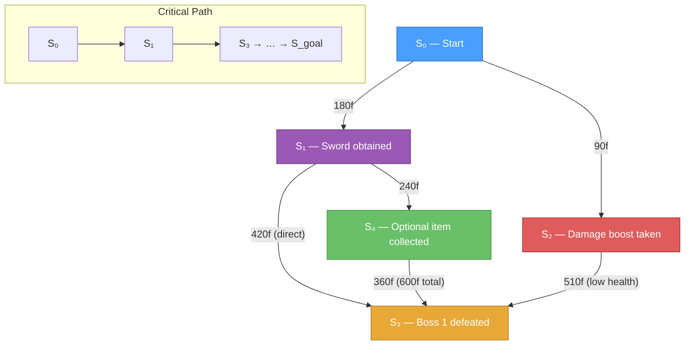

# Lesson 2: Routing Optimization Theory, Resource Management, Risk-Reward Calculus

## 1. First-Principles Intuition & Invariants

The speedrunner's fundamental problem is a constrained optimization task operating over a discrete, deterministic state space where every frame of execution carries irreversible time cost. Unlike traditional pathfinding in abstract graph theory, speedrun routing optimization must simultaneously account for resource acquisition timing, random number generator manipulation, damage boost exploitation, and the stochastic nature of execution risk across thousands of consecutive inputs. The solution space is not merely a shortest path through a level graph but a multidimensional optimization where routing choices cascade through dependency chains spanning entire categories of play.

At the foundation of routing theory lies the recognition that games are state machines with explicit transition costs measured in frames. Every action—menu navigation, item collection, enemy manipulation, dialog advancement—consumes a deterministic quantity of time under perfect execution. The naïve approach of minimizing spatial distance (fewest rooms traversed, shortest pixel displacement) frequently produces suboptimal routes because it ignores the temporal cost structure of state transitions. A detour to collect an early-game consumable may cost 180 frames immediately but save 420 frames across three later boss encounters through damage output amplification. The routing problem thus becomes an exercise in intertemporal resource allocation where present costs must be weighed against uncertain future returns modulated by execution risk.

The invariant principle governing all routing decisions is the concept of the critical path—the sequence of mandatory state transitions that cannot be eliminated or reordered without category rule violations. In any% speedruns, the critical path represents the minimal set of game flags, key items, and boss defeats required to reach the credits trigger. Every routing choice must be evaluated relative to its position on or off the critical path. Time saved through an off-path optimization is worthless if it delays critical path progression, while critical path accelerations propagate value forward through every subsequent segment. This dependency structure creates natural breakpoints where routing branches diverge based on resource state: health quantities, consumable inventories, and RNG seed values at critical junctions determine which subsequent paths remain viable.

Resource management in speedrunning differs fundamentally from casual play optimization because resources are valued exclusively by their marginal contribution to time savings, not by safety margins or completion assurance. Health points become a spendable currency for damage boosting—intentionally taking hits to gain velocity through knockback vectors or invulnerability frame manipulation. Consumables like bombs or arrows are allocated to scripted moments where their use eliminates multi-second animations or enables movement tech that bypasses intended progression barriers. The routing calculus must track resource state across the entire run timeline, identifying acquisition opportunities and expenditure points that maximize net time savings while maintaining a feasible execution path given human performance constraints.

The speedrunner's optimization framework operates under a critical constraint absent from pure algorithmic pathfinding: execution risk. A theoretically optimal route that requires frame-perfect inputs across sixteen consecutive tricks may be inferior in expected value to a slightly slower route with forgiving execution windows. Risk-adjusted routing introduces probabilistic reasoning into what would otherwise be deterministic optimization. Each trick or segment carries both a time cost under successful execution and a failure probability with associated time penalties (death warps, safety saves, resets). The routing optimizer must compute expected time across the distribution of execution outcomes, balancing the potential gains of aggressive strategies against the variance they introduce into run completion times.

## 2. Core Architecture & Mechanics

The game state space in routing optimization is formalized as a directed weighted graph where vertices represent discrete game states and edges represent valid state transitions with associated frame costs. A game state encodes all relevant information determining future routing possibilities: player position coordinates, inventory contents, event flags, enemy spawn states, and internal timer values. The state space is typically sparse and highly structured—most states have only a small number of valid successors determined by player input constraints and game physics. The routing problem then becomes finding the minimum-weight path through this graph from initial state (power-on or category-specific starting conditions) to goal state (credits trigger or final input moment), subject to category-legal transition constraints.

The challenge in applying classical graph algorithms like Dijkstra's shortest path or A* search to speedrun routing lies in the explosion of the state space. A typical NES game might have 256 rooms with 16 possible item combinations, 8 health states, and 128 event flags, yielding a theoretical state space exceeding 2^20 vertices. Practical routing optimization therefore relies on state space pruning through domain knowledge and heuristic constraints. Runners identify equivalence classes of states where minor variations (exact pixel position within a room, specific frame of animation) do not affect subsequent routing viability. The reduced graph collapses these equivalent states into representative nodes, dramatically reducing computational complexity while preserving routing optimality over the coarse-grained state space.

Menu routing constitutes a specialized subproblem within overall route optimization due to its unique cost structure and state-independent nature. Menus in retro games typically operate as modal interfaces where navigation consumes fixed frame counts per cursor movement or selection confirmation. The optimal menu sequence minimizes total navigation frames across all menu interactions throughout the run. For inventory-heavy games with frequent item swaps, menu routing becomes a traveling salesman variant where the runner must visit menu positions in an order that minimizes cumulative cursor travel distance while respecting temporal constraints on when items must be equipped. Advanced menu routing exploits cursor wrap-around mechanics (moving right from the rightmost position wraps to leftmost, potentially saving frames) and menu memory (the cursor position persists between menu opens in some games, enabling setups for future menu interactions).

Resource acquisition timing introduces dependency constraints into the routing graph that create natural segmentation boundaries. A segment is defined as a continuous sequence of gameplay between routing decision points where the optimal path forward may depend on resource state at segment entry. Consider a segment beginning with low health where two routing options exist: a safe route that proceeds directly to the next checkpoint consuming 600 frames, and an aggressive damage boost route that saves 140 frames but requires taking two hits. The optimal choice depends on whether the runner acquired a health refill in the previous segment—information that may be uncertain due to drop randomness or execution variance in damage taken. The routing graph must therefore maintain multiple conditional branches representing different resource states at segment boundaries.

The transition costs in speedrun routing graphs are not purely additive due to setup and context-switching mechanics. Certain movement techniques like strafe-jumping or bunny-hopping require velocity buildup over several frames before achieving optimal speed, creating initial overhead costs that amortize over long corridors but may be inefficient for short movements. Similarly, weapon swaps or ability mode changes incur menu access overhead that only pays off if the selected tool is used multiple times before switching again. These non-linear cost structures violate the simple additivity assumption of basic shortest-path algorithms, requiring routing optimizers to track additional state variables representing current movement mode or active equipment to correctly evaluate transition costs.

Random number generator manipulation introduces a temporal dimension to routing that transforms the problem from static graph optimization to dynamic programming with stochastic elements. Many retro games use deterministic RNG systems seeded by frame-count-dependent values or player input sequences. Routing around RNG requires identifying desirable outcomes (enemy spawn patterns, critical hit rolls, item drops) and engineering the input sequence and timing to achieve favorable RNG states at critical junctures. This creates routing constraints where specific actions must occur on exact frame windows to maintain RNG synchronization, reducing the viable solution space but potentially enabling time-saving strategies impossible under pure random outcomes.

## 3. High-Performance Optimization & Failure Modes

Segment decomposition forms the practical foundation for human-executable speedrun routing by dividing the complete run into manageable units with well-defined entry and exit conditions. Each segment represents a local optimization subproblem that can be practiced and refined independently before integration into the full run. The decomposition boundaries are chosen at natural savestates or checkpoint locations where resource state can be characterized with a small number of variables: health quantity, key item inventory, and relevant event flags. This modular structure enables parallel optimization where multiple runners can explore different segment strategies independently, later combining discoveries into a unified route through careful resource state matching at segment interfaces.

The time-save versus consistency tradeoff manifests most acutely in trick routing decisions where high-risk maneuvers offer substantial frame savings at the cost of increased failure rates. Consider a precise damage boost that saves 200 frames but has a 40% failure rate, with failure costing 800 frames to recovery. The expected value calculation yields: E[time] = 0.6 × (-200f) + 0.4 × (+800f) = +200 frames expected loss. The aggressive route is therefore strictly dominated in expected value despite its theoretical time save. However, this analysis assumes infinite attempts and average outcomes. In tournament contexts or personal best attempts where the runner has already achieved 95th-percentile execution through the early game, the conditional probability of success given demonstrated skill in the current attempt may justify aggressive routing choices that would be suboptimal in average expectation.

Safety routing architectures build redundancy and error recovery into the run structure by identifying critical segments where execution failures cascade forward to invalidate later routing assumptions. A common pattern is the health management safety net, where the route includes an optional healing opportunity shortly after a high-damage segment. The optimal strategy becomes conditional: if the runner successfully executes the difficult damage boosts without taking excess hits, the healing detour is skipped, saving its time cost; if execution falters and health drops below a threshold required for later damage boosts, the route automatically branches to the healing detour, sacrificing time but maintaining run viability. This adaptive routing structure requires real-time decision-making by the runner, who must track resource state and compare it against segment entry requirements to determine branch selection at decision points.

Failure mode analysis for routing optimization must account for the discrete nature of routing errors compared to the continuous degradation of execution errors. A missed trick can often be recovered with a time penalty, but a routing mistake—taking the wrong door, collecting an unnecessary item, triggering an unskippable cutscene—may cost tens of seconds or force a full reset. Routing verification protocols therefore emphasize careful entry and exit condition validation at each segment boundary. Before finalizing a new route, experienced runners construct a routing verification matrix that lists every segment with its expected resource state at entry (health, items, flags) and confirms that the previous segment's exit state satisfies those requirements under all execution variance scenarios (successful tricks, failed tricks requiring backup strats, damage ranges from enemy RNG).

Menu efficiency optimization operates under the principle that every frame spent in menus is pure overhead contributing no spatial or strategic progress. Advanced menu routing techniques exploit game-specific mechanics to compress menu time: cursor teleportation through edge wrapping, multi-item selection on single-frame inputs where the game processes queued inputs during lag frames, and menu buffering where the menu is opened during a laggy gameplay moment so the menu transition overhead overlaps with gameplay lag rather than adding sequential time. The optimization process begins with logging all menu interactions across the full run, measuring exact frame costs, and identifying dependencies (Item A must be equipped before entering Room X). The menu sequence is then treated as a constrained sequencing problem where the optimizer searches for a reordering that minimizes total menu frames while respecting all temporal dependencies.

Resource routing optimization for consumable management requires solving a variant of the knapsack problem across the run timeline. Each potential consumable use has a value (time saved by using it at that moment) and an opportunity cost (inability to use it at a different moment where it might have higher value). The optimal routing algorithm works backward from the end of the run, identifying the highest-value uses and allocating consumables greedily to those moments, then recursively optimizing earlier segments under the remaining resource budget. This backward induction approach ensures that high-value late-game opportunities are not starved by greedy early-game allocation of scarce resources. The complexity arises when consumable value is conditional—a bomb might save 300 frames if used for a specific trick but only 60 frames if used for simple damage output, with the trick's viability depending on execution success in the preceding segment.

Route evolution and optimization convergence follow an empirical discovery process where the theoretical optimal route emerges through iterative refinement as the runner community explores the state space. Early routing attempts typically follow intended game progression paths with simple optimizations like skipping optional content and exploiting known sequence breaks. Over time, runners discover unintended mechanics (out-of-bounds clips, inventory corruption, arbitrary code execution) that enable radical route restructuring, often collapsing multi-hour routes into minutes by skipping directly to late-game states. The convergence process is rarely smooth—new discoveries can invalidate entire sections of optimized routing, requiring complete redesign. The mature routing optimization workflow therefore maintains multiple route candidates: the current best-known route used for competitive attempts, experimental routes exploring risky new strats, and safety routes for runners building consistency for their first completion.

The integration of frame-perfect timing windows into routing decisions creates a fundamental tension between theoretical optimality and human-achievable consistency. A routing strategy that chains together six consecutive frame-perfect inputs to save 180 frames may be theoretically optimal but practically worthless if even skilled runners fail the sequence 80% of the time. Pragmatic routing optimization therefore incorporates execution difficulty as a weighted cost in the routing objective function. Each trick or tight input window is assigned a difficulty rating based on community execution data, and the routing algorithm searches for paths that maximize time savings per unit of execution difficulty, rather than raw time savings alone. This difficulty-adjusted routing produces paths that may be several seconds slower in theory but achieve better results in practice by maintaining higher completion rates and reducing the variance in run outcomes that comes from repeated failed attempts at hyper-optimized but fragile routing sequences.
