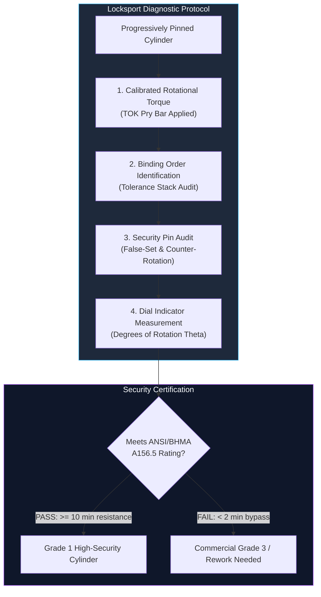

# Operational Verification Labs: Locksport & Mechanical Physical Security

## Objective & Lab Bench Setup

This laboratory guide provides systematic engineering procedures for auditing the mechanical tolerances, internal feedback dynamics, and attack resistance of pin tumbler cylinders according to established locksport and physical security standards (TOOOL and ANSI/BHMA A156.5). Understanding the mechanical weaknesses of locking hardware allows physical security engineers, locksmiths, and hardware architects to specify and test bypass-resistant access control systems.

The verification program validates four core physical security dimensions:
1. **Binding Order Determinism**: Mapping the tolerance variance of pin chambers using progressive pinning methodology.
2. **Security Pin Dynamics**: Measuring the angular rotation of false sets and characterizing counter-rotation torque thresholds on spool and serrated pins.
3. **Keyway Paracentricity & Ward Encroachment**: Quantifying pick shaft deflection and access constraints across restrictive keyway profiles.
4. **ANSI/BHMA Cylinder Rating Audits**: Testing cylinder resistance against manipulation attacks according to standard time-to-bypass thresholds.

### Metrology Suite & Tooling

The physical security analysis bench requires standard locksport and locksmith diagnostic equipment:

- Cutaway and progressive pinning practice cylinders (6-pin brass mortise / rim cylinders)
- Pinning kit with micrometer-gauged standard, spool, serrated, and mushroom pins
- Calibrated dial test indicator ($0.01\text{ mm}$ resolution) with magnetic stand for plug rotation measurement
- Standard precision pick set ($0.025\text{ in}$, $0.020\text{ in}$, and $0.015\text{ in}$ high-yield stainless steel)
- Top-of-Keyway (TOK) pry bars and Bottom-of-Keyway (BOK) tension wrenches
- Digital mechanical bench vise with non-marring rubber or brass jaw inserts



---

## Exercise 1: Progressive Pinning & Tolerance Binding Mapping

Progressive pinning isolates the individual binding behavior of each pin chamber by starting with a single active pin and incrementally adding chambers.

### Step 1.1: Disassembly & Progressive Cylinder Setup

1. Clamp the cylinder housing firmly in the bench vise with the pin stack vertical.
2. Remove the rear C-clip or retaining nut using a circlip tool.
3. Insert the operating key, rotate the plug by $45^\circ$, and slide a solid plug follower into the housing, capturing the upper driver pins and springs in the Bible.
4. Strip chambers 2 through 6, retaining only:
   - Chamber #1: Standard bottom key pin ($0.200\text{ in}$) and standard driver pin ($0.160\text{ in}$).
5. Reinsert the plug and replace the retaining clip.

### Step 1.2: Single-Pin Binding Calibration

1. Insert a TOK pry bar into the top of the keyway. Apply feather-light rotational torque ($0.2\text{--}0.4\text{ N}\cdot\text{m}$).
2. Insert a short hook pick. Lift pin #1 smoothly until the driver pin clears the shear line:
   - **Feedback Indicator**: An audible click is heard, accompanied by a sudden $0.5^\circ$ forward rotational snap of the plug.
3. Repin the cylinder with **Chamber #1 and Chamber #2**:
   - Apply torque. Test each pin with the pick tip:
   - Identify the **binding pin**: The pin that exhibits stiff, immovable resistance. The other pin moves freely against its spring.
   - Set the binding pin first. Observe the instantaneous transfer of binding friction to the second pin.
   - Record the binding sequence (e.g., Chamber 2 binds before Chamber 1).
4. Continue progressive assembly up to 5 active pins, recording the full binding order matrix.

---

## Exercise 2: Spool Pin False-Set & Counter-Rotation Measurement

Spool pins introduce controlled false sets that mechanically arrest the plug when tilted.

### Step 2.1: Setting Up the Security Pin Chamber

1. Re-pin the practice cylinder:
   - Chambers 1, 3, 5: Standard driver pins.
   - Chambers 2, 4: Calibrated spool driver pins.
2. Mount a dial indicator with its contact point resting against a radial arm attached to the plug face to measure angular deflection:


### Step 2.2: Mapping the Spool Feedback Trajectory

1. Apply moderate TOK tension. Pick standard pins 1, 3, and 5 along their binding order until they set.
2. **False Set Observation**: As the final standard pin sets, observe the dial indicator advance by $3.5^\circ\text{--}5.0^\circ$:
   - The plug noticeably tilts forward into a deep false set as the narrow waists of the spools cross the shear line.
3. Probe pin #2 and pin #4:
   - Tap pin #2: It feels springy and loose.
   - Tap pin #4: It binds firmly against the upper lip of its waist.
4. **Counter-Rotation Execution**:
   - Lift pin #4 with the short hook.
   - Observe the tension wrench: It actively forces your tension finger backward against the applied moment.
   - The dial indicator moves backward from $4.5^\circ$ toward $1.0^\circ$.
   - Ease tension finger pressure just enough to allow this reverse rotation without dropping previously set standard pins.
   - At the threshold where the lower spool flange clears the shear line, the plug snaps forward into a true set.

---

## Exercise 3: ANSI/BHMA Manipulation Resistance Certification

ANSI/BHMA A156.5 and UL 437 establish standardized testing protocols to determine whether commercial cylinders resist picking for specified time windows.

### Step 3.1: Testing Threshold Protocol

1. Record baseline resistance time using standard commercial picks under laboratory conditions:
   - **Grade 3 (Standard Residential)**: Must resist picking for minimum $1.5\text{ minutes}$.
   - **Grade 2 (Commercial Intermediate)**: Must resist picking for minimum $2.5\text{ minutes}$.
   - **Grade 1 / High Security (UL 437)**: Must resist picking for minimum $10.0\text{ minutes}$ against skilled attack using specialized tools.

```python
def evaluate_cylinder_rating(resistance_seconds, has_anti_drill_pins, has_sidebar):
    grade = "Unrated / Sub-Grade 3"
    if resistance_seconds >= 600 and has_anti_drill_pins and has_sidebar:
        grade = "ANSI/BHMA Grade 1 / UL 437 High Security"
    elif resistance_seconds >= 150:
        grade = "ANSI/BHMA Grade 2 Commercial"
    elif resistance_seconds >= 90:
        grade = "ANSI/BHMA Grade 3 Residential"
    return grade

print("Evaluation of Sample Tested Cylinders:")
print("Cylinder A (60s):", evaluate_cylinder_rating(60, False, False))
print("Cylinder B (180s):", evaluate_cylinder_rating(180, True, False))
print("Cylinder C (720s + Sidebar):", evaluate_cylinder_rating(720, True, True))
```

---

## Summary & Verification Matrix

| Diagnostic Domain | Metrology Method | Operational Feedback Indicator | Acceptance / Security Threshold |
|:---|:---|:---|:---|
| **Tolerance Stack** | Progressive Pinning | Discrete sequential binding order | Exactly 1 pin binds per rotational state |
| **False-Set Dynamics** | Dial Test Indicator | Sudden plug rotation $\Delta \theta \approx 3^\circ\text{--}5^\circ$ | Clean false set indicates spool waist engagement |
| **Counter-Rotation** | Dynamic Torque Feel | Tension tool pushes reverse to applied torque | Controlled tension relaxation sets spool pin |
| **Security Rating** | ANSI/BHMA A156.5 Timing | Timed manipulation test | Grade 1 requires $\ge 10\text{ minutes}$ resistance |
